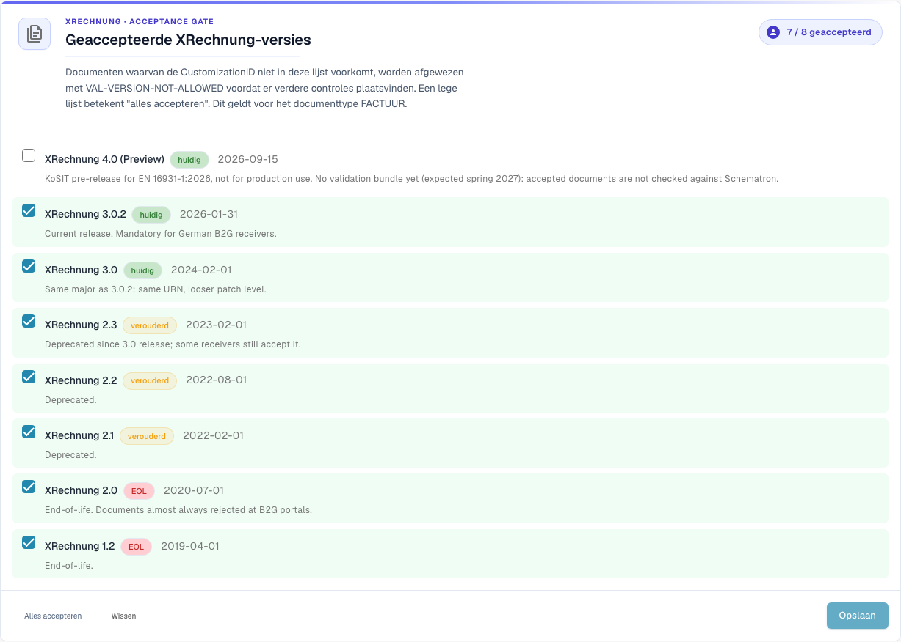
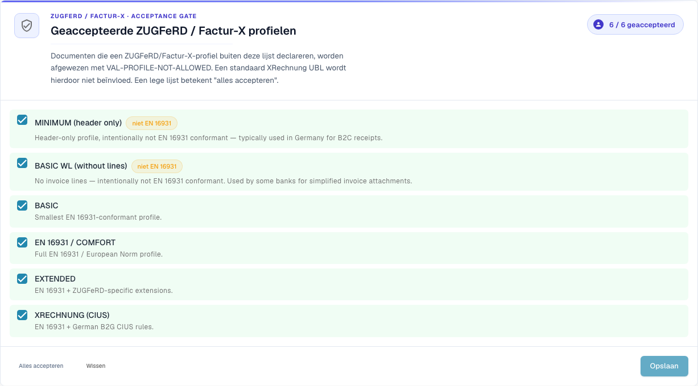

# Validatie-instellingen en geaccepteerde versies

Op deze pagina leest u over de installatiewizard, de geaccepteerde XRechnung-versies en de geaccepteerde profielen van de pagina [Validatie van elektronische facturen](./). Alleen organisatiebeheerders kunnen deze instellingen wijzigen.

## Validatie-instellingen

<figure><figcaption>
Geaccepteerde XRechnung-versies in de voorbeeldorganisatie op Dev. Sommige interfaceteksten zijn in deze versie nog Engels of onjuist vertaald. De handleiding legt de betekenis uit; de schermafbeeldingen tonen de ongewijzigde interface.
</figcaption></figure>

De kaart **Validation Setup** toont uw huidige validatieprofiel (bijvoorbeeld *B2G — Public Sector Receiver*). Klik op **Edit answers** om de installatiewizard opnieuw uit te voeren en de standaard te wijzigen waartegen u valideert.

## Geaccepteerde XRechnung-versies

De acceptatiecontrole **Accepted XRechnung versions** somt elke XRechnung-versie op. Vink de versies aan die u accepteert — documenten waarvan de CustomizationID buiten deze lijst valt, worden vóór elke andere controle afgewezen met `VAL-VERSION-NOT-ALLOWED`. Een lege lijst betekent "alles accepteren". Elke versie is gemarkeerd met **current**, **deprecated** of **EOL** samen met de releasedatum.

## Geaccepteerde profielen en het ernstmodel

<figure><figcaption>
Geaccepteerde ZUGFeRD- en Factur-X-profielen. Sommige interfaceteksten zijn in deze versie nog Engels of onjuist vertaald. De handleiding legt de betekenis uit; de schermafbeeldingen tonen de ongewijzigde interface.
</figcaption></figure>

Kies welke **profielen** u accepteert (BASIC WL, BASIC, EN 16931 / COMFORT, EXTENDED, XRECHNUNG (CIUS)) met **Accept all** / **Clear** en daarna **Save**.

Elke validatieregel heeft een **ernst** die bepaalt wat er gebeurt wanneer de regel een melding oplevert:

| Ernst | Effect |
|-------|--------|
| **FATAL** | Stopt de huidige validatiestap als de fout verdere controles verhindert. Of de verwerking wordt geblokkeerd, hangt ook af van **Blocking** bij het documenttype. |
| **ERROR** | Een validatiefout. Als **Blocking** aan staat, krijgt het document de status **Error**. Dit staat los van de handmatige actie **Reject document**. |
| **WARNING** | Verschijnt in het validatierapport, maar de verwerking van het document gaat normaal verder. |
| **INFO** | Een informatieve melding in het validatierapport. Deze blokkeert het document niet. |

### Wat de wizard wijzigt

De kaart **Validation Setup** verderop op de pagina opent een wizard met **Edit answers**. De wizard vervangt alle aangepaste regelinstellingen van uw organisatie. DocBits waarschuwt u voordat u opslaat. Controleer de stap **Review and apply** zorgvuldig.

Volgende: [Ernst van regels](validation-rule-severities.md) en [Validatie voor elk documenttype](validation-per-document-type.md).
