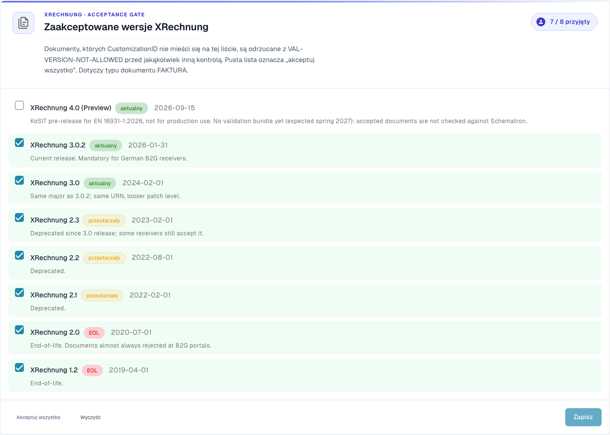
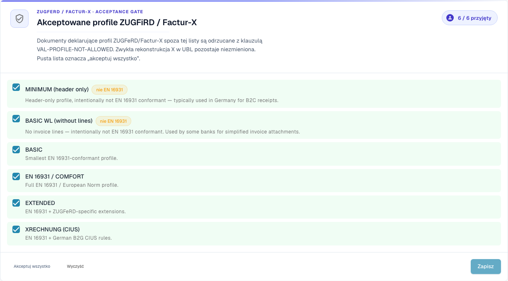

# Konfiguracja walidacji i akceptowane wersje

Ta strona opisuje kreator konfiguracji, akceptowane wersje XRechnung oraz akceptowane profile na stronie [Walidacja e-faktury](./). Te ustawienia mogą zmieniać tylko administratorzy organizacji.

## Konfiguracja walidacji

<figure><figcaption>
Wersje XRechnung akceptowane w przykładowej organizacji Dev. W tej wersji niektóre teksty interfejsu mogą nadal być po angielsku lub mieć błędne tłumaczenie. Instrukcja wyjaśnia ich znaczenie; zrzuty pokazują niezmieniony interfejs.
</figcaption></figure>

Karta **Validation Setup** pokazuje Twój bieżący profil walidacji (na przykład *B2G — Public Sector Receiver*). Kliknij **Edit answers**, aby ponownie uruchomić kreator konfiguracji i zmienić standard, względem którego prowadzona jest walidacja.

## Akceptowane wersje XRechnung

Bramka **Accepted XRechnung versions** wymienia każdą wersję XRechnung. Zaznacz wersje, które akceptujesz — dokumenty, których CustomizationID znajduje się poza tą listą, są odrzucane z kodem `VAL-VERSION-NOT-ALLOWED` przed jakąkolwiek inną kontrolą. Pusta lista oznacza „akceptuj wszystko". Każda wersja jest oznaczona jako **current**, **deprecated** lub **EOL** wraz z datą wydania.

## Akceptowane profile i poziomy ważności 

<figure><figcaption>
Akceptowane profile ZUGFeRD i Factur-X. W tej wersji niektóre teksty interfejsu mogą nadal być po angielsku lub mieć błędne tłumaczenie. Instrukcja wyjaśnia ich znaczenie; zrzuty pokazują niezmieniony interfejs.
</figcaption></figure>

Wybierz, które **profile** akceptujesz (BASIC WL, BASIC, EN 16931 / COMFORT, EXTENDED, XRECHNUNG (CIUS)), używając przycisków **Accept all** / **Clear**, a następnie **Save**.

Każda reguła walidacji ma **poziom ważności**, który decyduje, co się dzieje po jej uruchomieniu:

| Poziom ważności | Skutek |
|------|--------|
| **FATAL** | Zatrzymuje bieżący etap walidacji, jeżeli błąd uniemożliwia dalsze kontrole. Zablokowanie przetwarzania zależy również od ustawienia **Blocking** dla typu dokumentu. |
| **ERROR** | Błąd walidacji. Przy włączonym ustawieniu **Blocking** dokument otrzymuje status **Error**. Jest to odrębne od ręcznej czynności **Reject document**. |
| **WARNING** | Pojawia się w raporcie walidacji, ale przetwarzanie dokumentu przebiega normalnie. |
| **INFO** | Komunikat informacyjny w raporcie walidacyjnym. Nie blokuje dokumentu. |

### Co zmienia kreator

Karta **Validation Setup** niżej na stronie otwiera kreator przyciskiem **Edit answers**. Kreator zastępuje cały zestaw nadpisanych reguł Twojej organizacji. DocBits ostrzega Cię przed zapisem. Sprawdź dokładnie krok **Review and apply**.

Dalej: [Poziomy ważności reguł](validation-rule-severities.md) i [Walidacja dla każdego typu dokumentu](validation-per-document-type.md).
