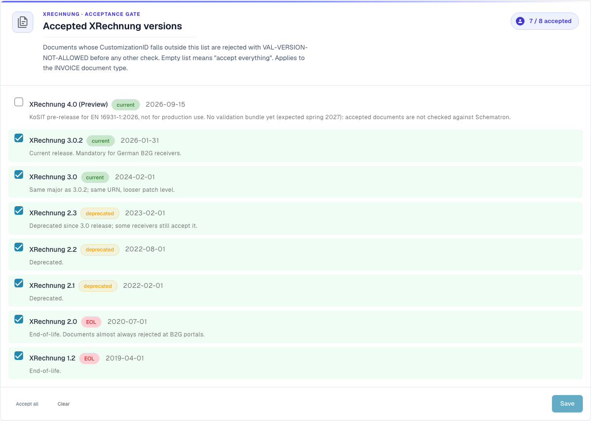
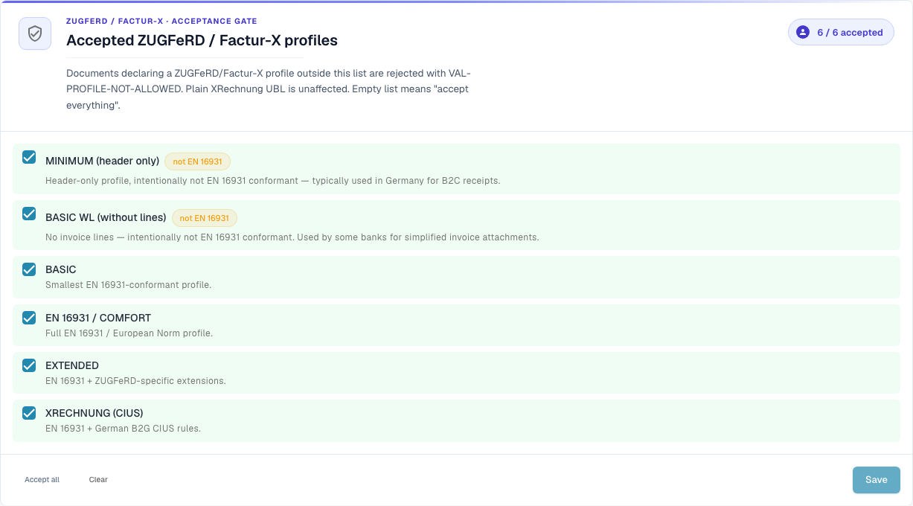

# Validation setup and accepted versions

This page explains the setup wizard, the accepted XRechnung versions and the accepted profiles of the [E-Invoice Validation](./) page. Only organisation administrators can change these settings.

## Validation Setup

<figure><figcaption>
Accepted XRechnung versions in the Dev example organisation.
</figcaption></figure>

The **Validation Setup** card shows your current validation profile (for example _B2G — Public Sector Receiver_). Click **Edit answers** to re-run the setup wizard and change which standard you validate against.

## Accepted XRechnung versions

The **Accepted XRechnung versions** gate lists every XRechnung version. Tick the versions you accept — documents whose CustomizationID falls outside this list are rejected with `VAL-VERSION-NOT-ALLOWED` before any other check. An empty list means "accept everything". Each version is tagged **current**, **deprecated** or **EOL** together with its release date.

## Accepted profiles and severity model

<figure><figcaption>
Accepted ZUGFeRD and Factur-X profiles.
</figcaption></figure>

Choose which **profiles** you accept (BASIC WL, BASIC, EN 16931 / COMFORT, EXTENDED, XRECHNUNG (CIUS)) using **Accept all** / **Clear**, then **Save**.

Each validation rule has a **severity** that decides what happens when it fires:

| Severity    | Effect                                                                                                                          |
| ----------- | ------------------------------------------------------------------------------------------------------------------------------- |
| **FATAL** | Stops the current validation stage when the error prevents further checks. Whether validation blocks document processing also depends on the document type’s **Blocking** setting. |
| **ERROR** | A validation error. With **Blocking** enabled, the document receives status **Error**. This is separate from manually selecting **Reject document**. |
| **WARNING** | Surfaces in the validation report, but the document proceeds through the pipeline normally.                                     |
| **INFO** | An information message in the validation report. It does not block the document. |

### What the wizard changes

The card **Validation Setup** further down the page opens a wizard with **Edit answers**. The wizard replaces the whole set of rule overrides of your organisation. DocBits warns you before you save. Check the **Review and apply** step carefully.

Next: [Rule severities](validation-rule-severities.md) and [Validation for each document type](validation-per-document-type.md).
