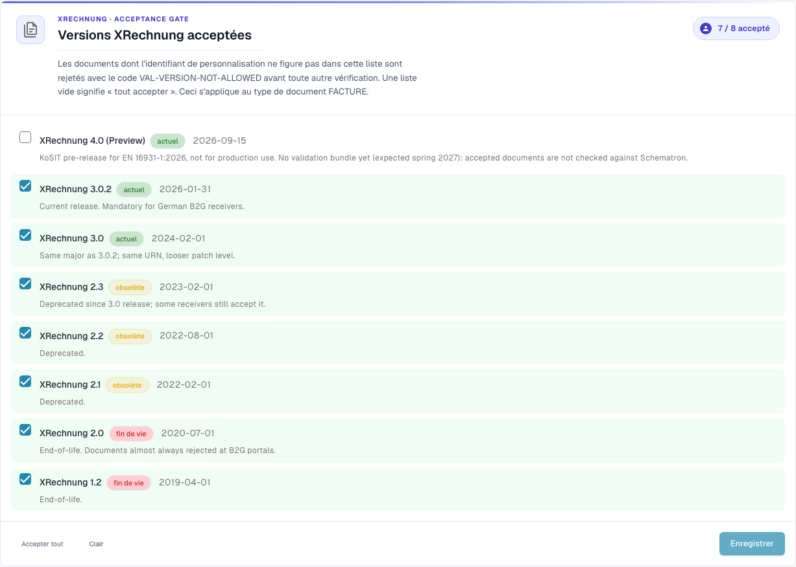
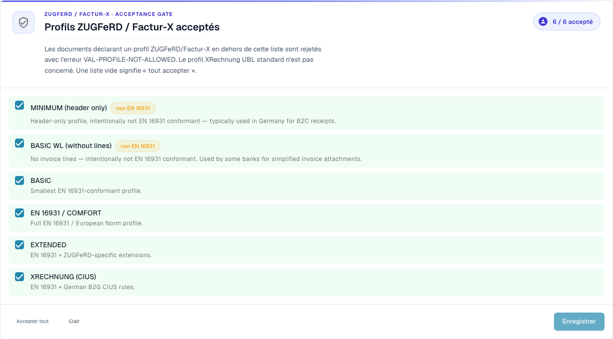

# Configuration de la validation et versions acceptées

Cette page explique l'assistant de configuration, les versions XRechnung acceptées et les profils acceptés de la page [Validation des factures électroniques](./). Seuls les administrateurs de l'organisation peuvent modifier ces paramètres.

## Configuration de la validation

<figure><figcaption>
Versions XRechnung acceptées dans l’organisation de démonstration Dev. Dans cette version, certains textes de l’interface peuvent encore être en anglais ou mal traduits. Le guide explique leur sens ; les captures montrent l’interface sans modification.
</figcaption></figure>

La carte **Validation Setup** affiche votre profil de validation actuel (par exemple *B2G — Public Sector Receiver*). Cliquez sur **Edit answers** pour relancer l'assistant de configuration et changer la norme par rapport à laquelle vous validez.

## Versions XRechnung acceptées

Le contrôle d’acceptation **Accepted XRechnung versions** répertorie chaque version de XRechnung. Cochez les versions que vous acceptez : les documents dont le CustomizationID est en dehors de cette liste sont rejetés avec `VAL-VERSION-NOT-ALLOWED` avant toute autre vérification. Une liste vide signifie « tout accepter ». Chaque version est étiquetée **current**, **deprecated** ou **EOL** avec sa date de publication.

## Profils acceptés et modèle de gravité

<figure><figcaption>
Profils ZUGFeRD et Factur-X acceptés. Dans cette version, certains textes de l’interface peuvent encore être en anglais ou mal traduits. Le guide explique leur sens ; les captures montrent l’interface sans modification.
</figcaption></figure>

Choisissez les **profils** que vous acceptez (BASIC WL, BASIC, EN 16931 / COMFORT, EXTENDED, XRECHNUNG (CIUS)) à l'aide de **Accept all** / **Clear**, puis **Save**.

Chaque règle de validation a une **gravité** qui détermine ce qui se passe lorsqu'elle se déclenche :

| Gravité | Effet |
|---------|-------|
| **FATAL** | Arrête l’étape de validation en cours si l’erreur empêche les contrôles suivants. Le blocage du traitement dépend aussi de **Blocking** pour le type de document. |
| **ERROR** | Une erreur de validation. Si **Blocking** est activé, le document passe au statut **Error**. Cela est distinct de l’action manuelle **Reject document**. |
| **WARNING** | Apparaît dans le rapport de validation, mais le document poursuit normalement le flux. |
| **INFO** | Une information dans le rapport de validation. Elle ne bloque pas le document. |

### Ce que modifie l'assistant

La carte **Validation Setup** plus bas sur la page ouvre un assistant avec **Edit answers**. L'assistant remplace l'ensemble des règles personnalisées de votre organisation. DocBits vous avertit avant l'enregistrement. Vérifiez attentivement l'étape **Review and apply**.

Suite : [Gravité des règles](validation-rule-severities.md) et [Validation pour chaque type de document](validation-per-document-type.md).
