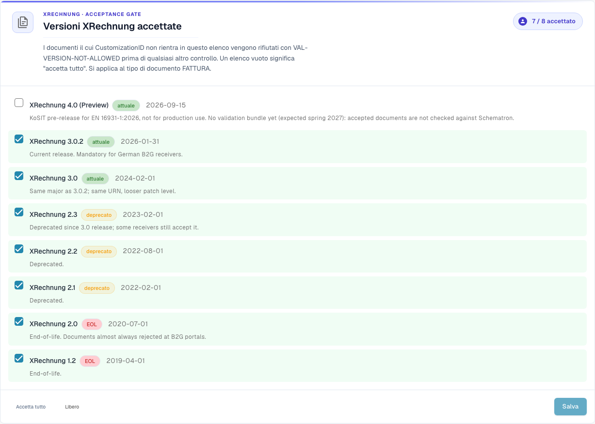
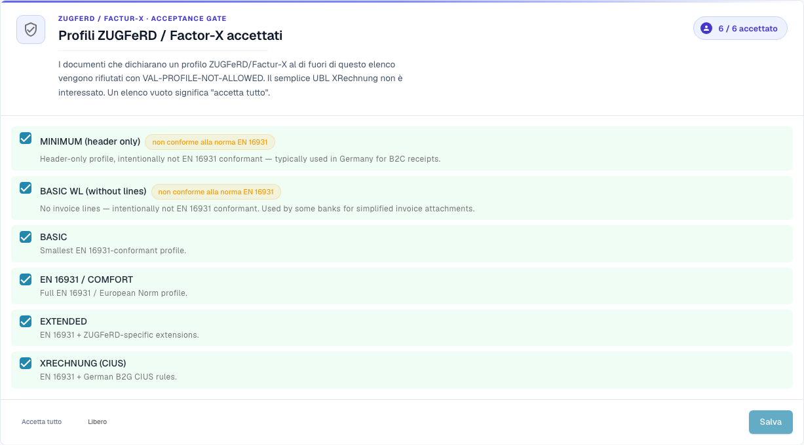

# Configurazione della validazione e versioni accettate

Questa pagina spiega la procedura guidata di configurazione, le versioni XRechnung accettate e i profili accettati della pagina [Validazione della fattura elettronica](./). Solo gli amministratori dell'organizzazione possono modificare queste impostazioni.

## Configurazione della validazione

<figure><figcaption>
Versioni XRechnung accettate nell’organizzazione di esempio Dev. In questa versione alcuni testi dell’interfaccia possono essere ancora in inglese o tradotti in modo errato. La guida ne spiega il significato; le schermate mostrano l’interfaccia originale.
</figcaption></figure>

La scheda **Validation Setup** mostra il tuo profilo di validazione attuale (ad esempio *B2G — Public Sector Receiver*). Fai clic su **Edit answers** per rieseguire la procedura guidata di configurazione e cambiare lo standard rispetto al quale convalidi.

## Versioni XRechnung accettate

Il controllo di accettazione **Accepted XRechnung versions** elenca tutte le versioni di XRechnung. Seleziona le versioni che accetti: i documenti il cui CustomizationID è fuori da questo elenco vengono rifiutati con `VAL-VERSION-NOT-ALLOWED` prima di qualsiasi altro controllo. Un elenco vuoto significa "accetta tutto". Ogni versione è contrassegnata come **current**, **deprecated** o **EOL** insieme alla sua data di rilascio.

## Profili accettati e modello di gravità

<figure><figcaption>
Profili ZUGFeRD e Factur-X accettati. In questa versione alcuni testi dell’interfaccia possono essere ancora in inglese o tradotti in modo errato. La guida ne spiega il significato; le schermate mostrano l’interfaccia originale.
</figcaption></figure>

Scegli quali **profili** accettare (BASIC WL, BASIC, EN 16931 / COMFORT, EXTENDED, XRECHNUNG (CIUS)) tramite **Accept all** / **Clear**, quindi **Save**.

Ogni regola di validazione ha una **gravità** che decide cosa succede quando si attiva:

| Gravità | Effetto |
|---------|---------|
| **FATAL** | Interrompe la fase di validazione corrente se l’errore impedisce ulteriori controlli. Il blocco dell’elaborazione dipende anche da **Blocking** per il tipo di documento. |
| **ERROR** | Un errore di validazione. Con **Blocking** attivo, il documento passa allo stato **Error**. È distinto dall’azione manuale **Reject document**. |
| **WARNING** | Compare nel report di validazione, ma il documento prosegue normalmente nel flusso. |
| **INFO** | Un messaggio informativo nel rapporto di convalida. Non blocca il documento. |

### Cosa cambia la procedura guidata

La scheda **Validation Setup** più in basso nella pagina apre una procedura guidata con **Edit answers**. La procedura guidata sostituisce l'intero insieme delle sovrascritture delle regole della tua organizzazione. DocBits ti avvisa prima del salvataggio. Controlla con attenzione il passaggio **Review and apply**.

Continua con: [Gravità delle regole](validation-rule-severities.md) e [Validazione per ogni tipo di documento](validation-per-document-type.md).
