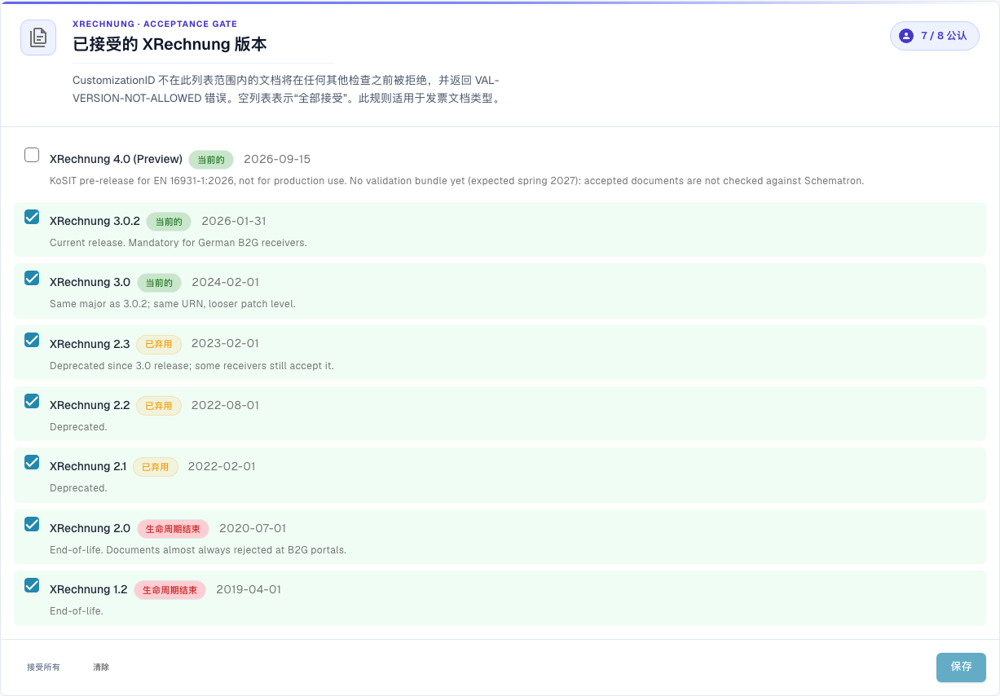
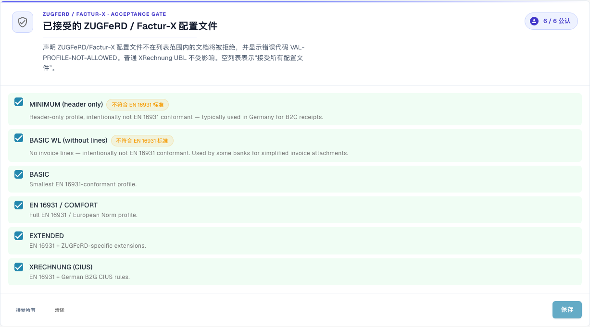

# 验证设置和已接受的版本

本页介绍设置向导、已接受的 XRechnung 版本，以及 [电子发票验证](./) 页面中已接受的规范配置。只有组织管理员可以更改这些设置。

## 验证设置

<figure><figcaption>
Dev 示例组织接受的 XRechnung 版本。 此版本的部分界面文字仍可能使用英语或存在翻译错误。本指南解释正确含义；截图保留实际界面文字。
</figcaption></figure>

**Validation Setup**卡片显示当前的验证规范配置（例如 _B2G — 公共部门接收方_）。点击 **Edit answers** 可重新运行设置向导，并更改要依据哪个标准进行验证。

## 已接受的 XRechnung 版本

**Accepted XRechnung versions**区域列出所有 XRechnung 版本。勾选您接受的版本——CustomizationID 不在此列表中的文档会在执行任何其他检查前被拒绝，并返回 `VAL-VERSION-NOT-ALLOWED`。列表为空表示“全部接受”。每个版本都会标记为 **current**、**deprecated** 或 **EOL**，并显示其发布日期。

## 已接受的规范配置和严重级别模型 

<figure><figcaption>
接受的 ZUGFeRD 和 Factur-X 规范配置。 此版本的部分界面文字仍可能使用英语或存在翻译错误。本指南解释正确含义；截图保留实际界面文字。
</figcaption></figure>

选择要接受的**Profile**（BASIC WL、BASIC、EN 16931 / COMFORT、EXTENDED、XRECHNUNG (CIUS)），使用 **Accept all** / **Clear**，然后点击 **Save**。

每条验证规则都有一个**Severity**，用于决定规则触发后的处理方式：

| 严重级别 | 效果 |
| ----------- | ------------------------------------------------------------------------------------------------------------------------------- |
| **FATAL** | 如果错误导致无法继续检查，则停止当前验证阶段。是否阻止文档处理，还取决于文档类型的 **Blocking** 设置。 |
| **ERROR** | 验证错误。开启 **Blocking** 时，文档状态变为 **Error**。这与手动选择 **Reject document** 是不同的操作。 |
| **WARNING** | 显示在验证报告中，但文档会照常通过工作流处理。                                     |
| **INFO** | 验证报告中的信息提示。不会阻止文档处理。 |

### 向导会更改什么

页面下方的**Validation Setup**卡片会打开一个包含**Edit answers**选项的向导。该向导会替换组织的整套规则覆盖项。保存前，DocBits 会向您发出警告。请仔细检查**Review and apply**步骤。

下一步：[规则严重级别](validation-rule-severities.md)和[按文档类型验证](validation-per-document-type.md)。
