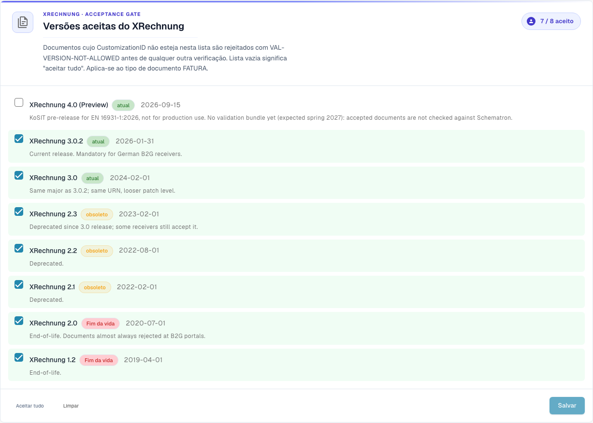

# Configuração da validação e versões aceites

Esta página explica o assistente de configuração, as versões XRechnung aceites e os perfis aceites da página [Validação de faturas eletrónicas](./). Só os administradores da organização podem alterar estas definições.

## Configuração da validação

<figure><figcaption>
Versões XRechnung aceites na organização de exemplo Dev. Nesta versão, alguns textos da interface podem ainda estar em inglês ou ter traduções incorretas. A documentação explica o significado; as capturas mostram a interface sem alterações.
</figcaption></figure>

O cartão **Validation Setup** mostra o seu perfil de validação atual (por exemplo, *B2G — Public Sector Receiver*). Clique em **Edit answers** para voltar a executar o assistente de configuração e alterar o padrão face ao qual valida.

## Versões XRechnung aceites

O controlo de aceitação **Accepted XRechnung versions** lista todas as versões de XRechnung. Marque as versões que aceita — os documentos cujo CustomizationID fica fora desta lista são rejeitados com `VAL-VERSION-NOT-ALLOWED` antes de qualquer outra verificação. Uma lista vazia significa "aceitar tudo". Cada versão é marcada como **current**, **deprecated** ou **EOL** juntamente com a respetiva data de lançamento.

## Perfis aceites e modelo de gravidade

<figure><figcaption>
Perfis ZUGFeRD e Factur-X aceites. Nesta versão, alguns textos da interface podem ainda estar em inglês ou ter traduções incorretas. A documentação explica o significado; as capturas mostram a interface sem alterações.
</figcaption></figure>

Escolha que **perfis** aceita (BASIC WL, BASIC, EN 16931 / COMFORT, EXTENDED, XRECHNUNG (CIUS)) através de **Accept all** / **Clear** e, em seguida, **Save**.

Cada regra de validação tem uma **gravidade** que decide o que acontece quando é acionada:

| Gravidade | Efeito |
|-----------|--------|
| **FATAL** | Interrompe a etapa de validação atual se o erro impedir as verificações seguintes. O bloqueio do processamento depende também de **Blocking** no tipo de documento. |
| **ERROR** | Um erro de validação. Com **Blocking** ativo, o documento passa ao estado **Error**. É diferente da ação manual **Reject document**. |
| **WARNING** | Surge no relatório de validação, mas o documento prossegue normalmente no fluxo. |
| **INFO** | Uma mensagem informativa no relatório de validação. Não bloqueia o documento. |

### O que o assistente altera

O cartão **Validation Setup**, mais abaixo na página, abre um assistente com **Edit answers**. O assistente substitui todo o conjunto de substituições de regras da sua organização. O DocBits avisa-o antes de guardar. Verifique com atenção o passo **Review and apply**.

A seguir: [Gravidade das regras](validation-rule-severities.md) e [Validação para cada tipo de documento](validation-per-document-type.md).
