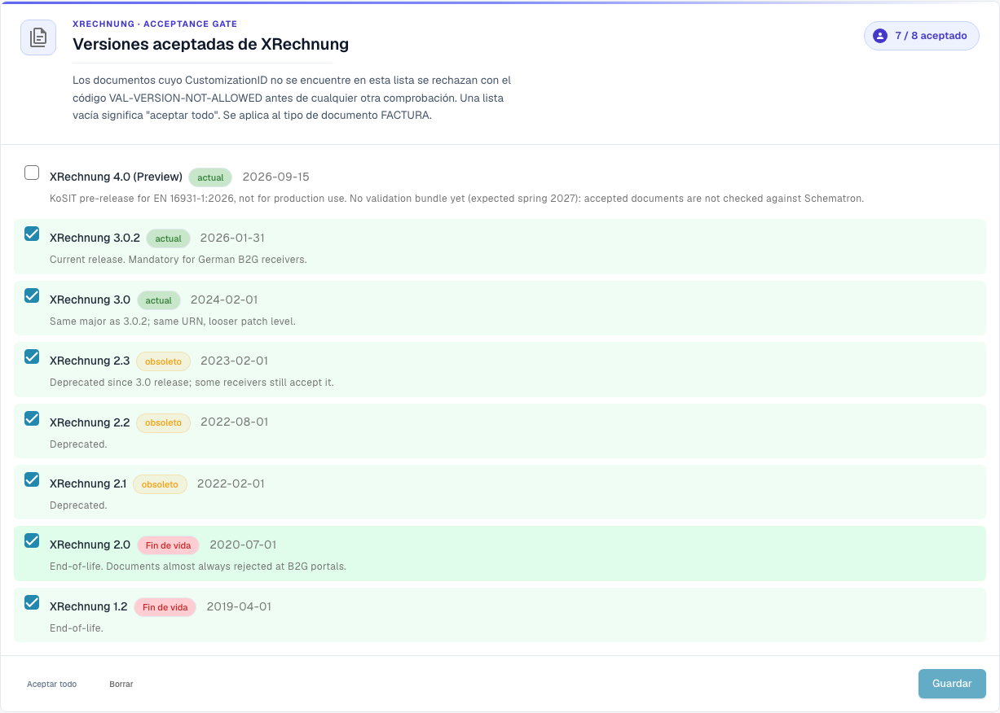
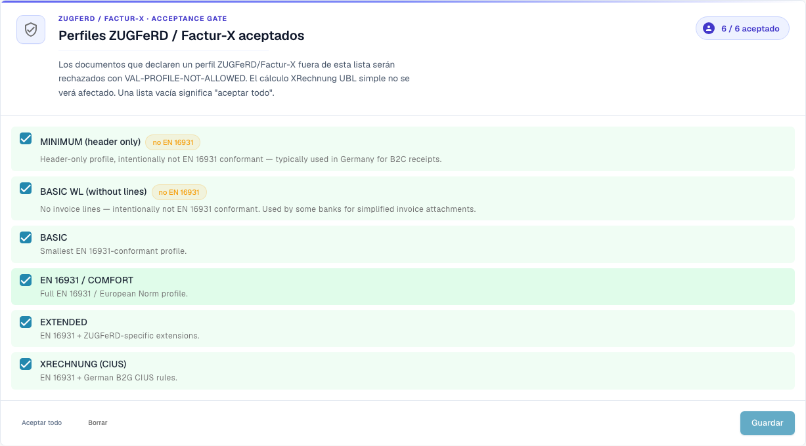

# Configuración de validación y versiones aceptadas

Esta página explica el asistente de configuración, las versiones de XRechnung aceptadas y los perfiles aceptados de la página [Validación de facturas electrónicas](validation-rules.md). Solo los administradores de la organización pueden cambiar estos ajustes.

## Configuración de validación

<figure><figcaption>
Versiones de XRechnung aceptadas en la organización de ejemplo de Dev. En esta versión, algunos textos de la interfaz pueden seguir en inglés o contener traducciones incorrectas. La guía explica su significado; las capturas muestran la interfaz sin modificar.
</figcaption></figure>

La tarjeta **Configuración de validación** muestra su perfil de validación actual (por ejemplo, *B2G — Public Sector Receiver*). Haga clic en **Editar respuestas** para volver a ejecutar el asistente de configuración y cambiar el estándar con el que se valida.

## Versiones de XRechnung aceptadas

El control de aceptación **Versiones de XRechnung aceptadas** enumera todas las versiones de XRechnung. Marque las versiones que acepta: los documentos cuyo CustomizationID quede fuera de esta lista se rechazan con `VAL-VERSION-NOT-ALLOWED` antes de cualquier otra comprobación. Una lista vacía significa "aceptar todo". Cada versión se etiqueta como **current**, **deprecated** o **EOL** junto con su fecha de publicación.

## Perfiles aceptados y modelo de gravedad

<figure><figcaption>
Perfiles de ZUGFeRD y Factur-X aceptados. En esta versión, algunos textos de la interfaz pueden seguir en inglés o contener traducciones incorrectas. La guía explica su significado; las capturas muestran la interfaz sin modificar.
</figcaption></figure>

Elija qué **perfiles** acepta (BASIC WL, BASIC, EN 16931 / COMFORT, EXTENDED, XRECHNUNG (CIUS)) mediante **Aceptar todo** / **Borrar** y luego **Guardar**.

Cada regla de validación tiene una **gravedad** que decide qué ocurre cuando se activa:

| Gravedad | Efecto |
|----------|--------|
| **FATAL** | Detiene la etapa de validación actual si el error impide continuar las comprobaciones. El bloqueo del procesamiento también depende de **Bloqueo** en el tipo de documento. |
| **ERROR** | Un error de validación. Con **Bloqueo** activado, el documento pasa al estado **Error**. Es distinto de la acción manual **Rechazar documento**. |
| **WARNING** | Aparece en el informe de validación, pero el documento continúa por el flujo con normalidad. |
| **INFO** | Un mensaje informativo en el informe de validación. No bloquea el documento. |

### Qué cambia el asistente

La tarjeta **Configuración de validación**, más abajo en la página, abre un asistente con **Editar respuestas**. El asistente sustituye todo el conjunto de anulaciones de reglas de su organización. DocBits le avisa antes de guardar. Revise con atención el paso **Revisar y aplicar**.

Siguiente: [Gravedad de las reglas](validation-rule-severities.md) y [Validación para cada tipo de documento](validation-per-document-type.md).
