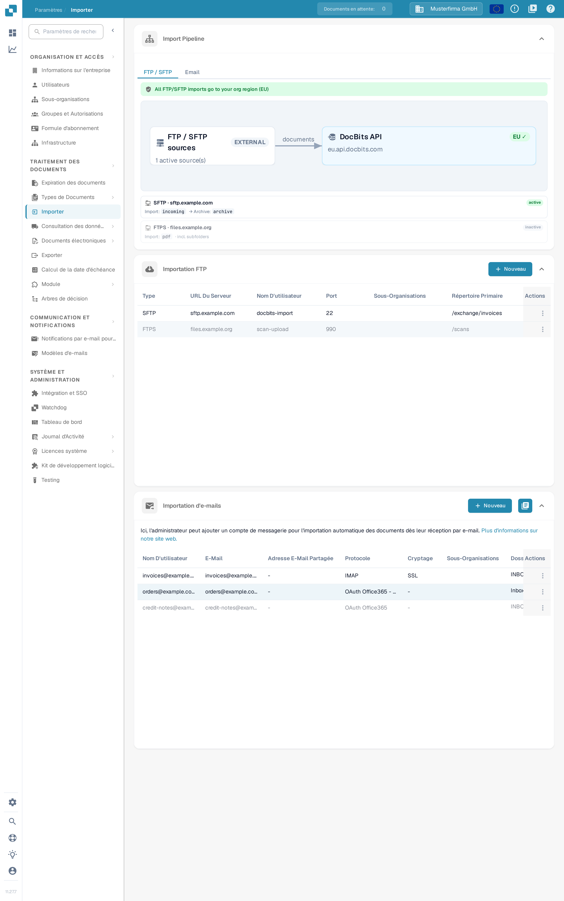
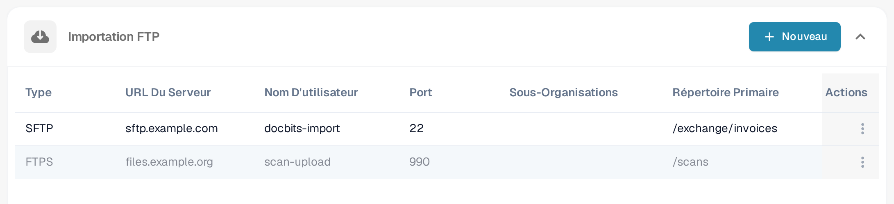
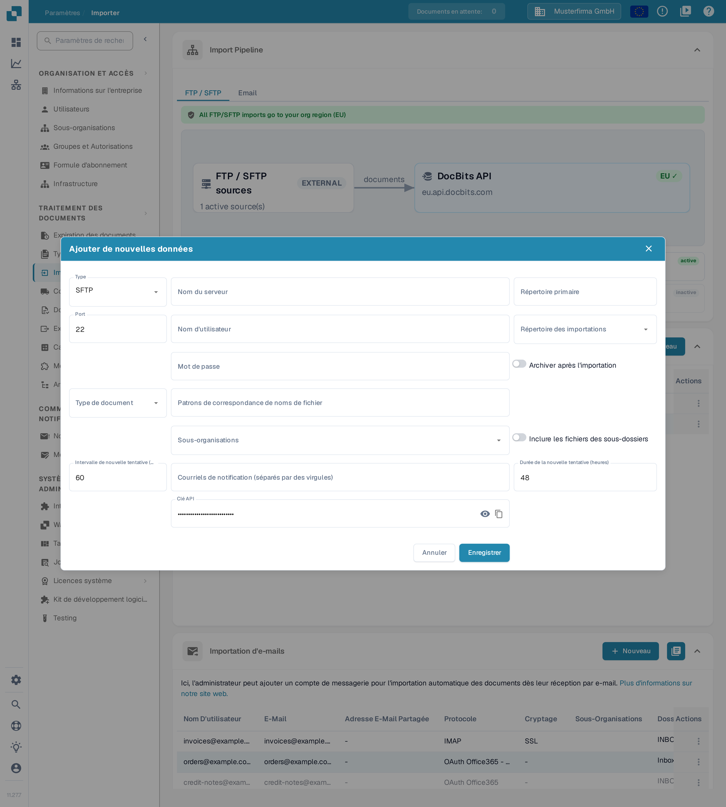
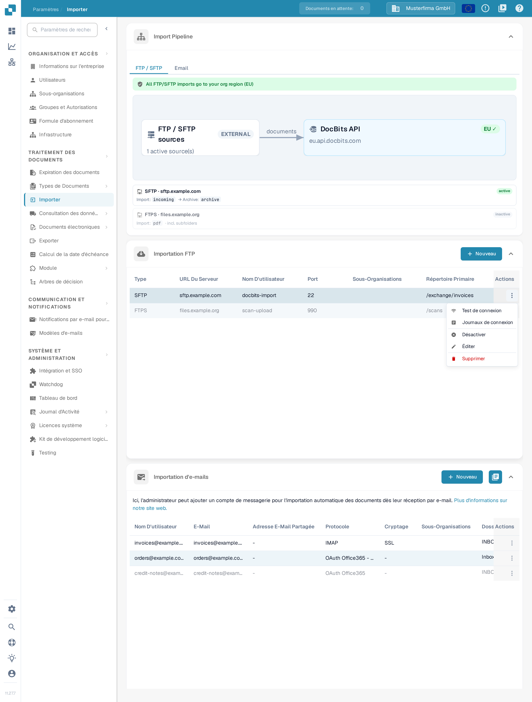
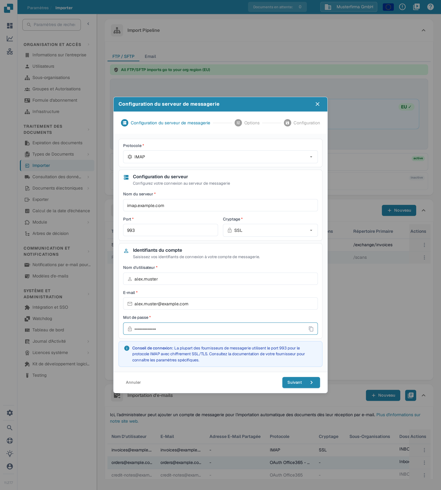
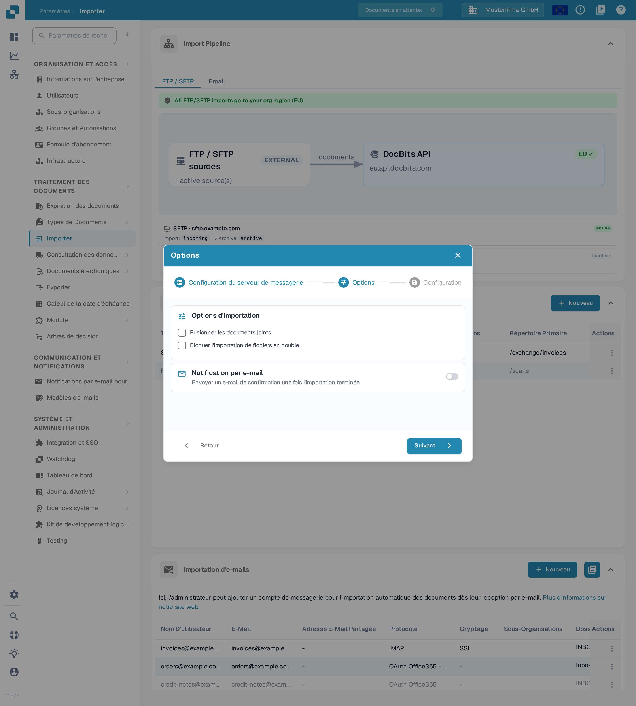
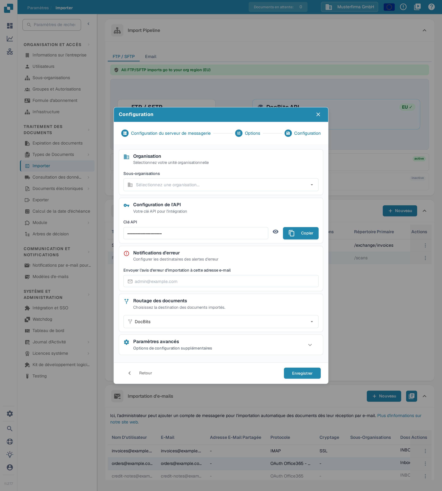
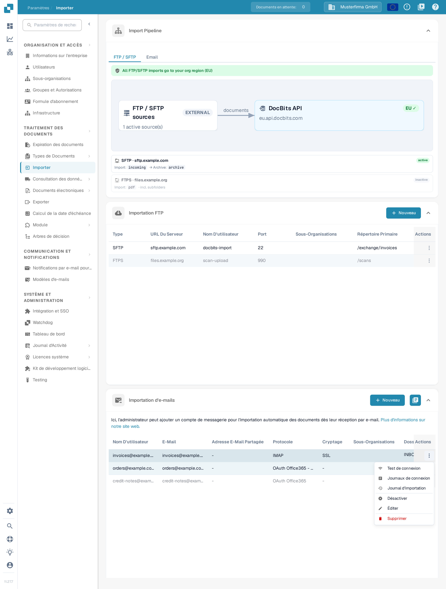
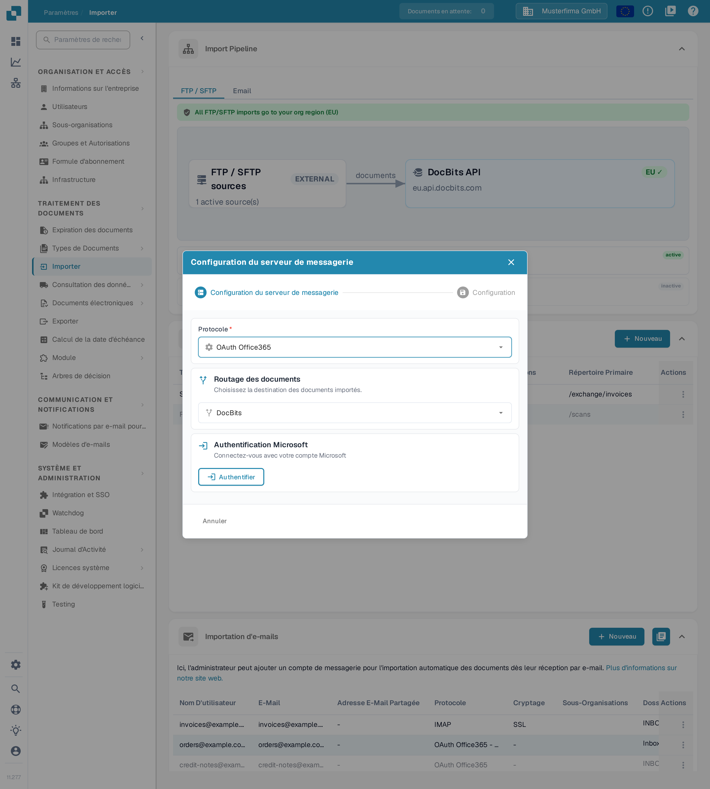
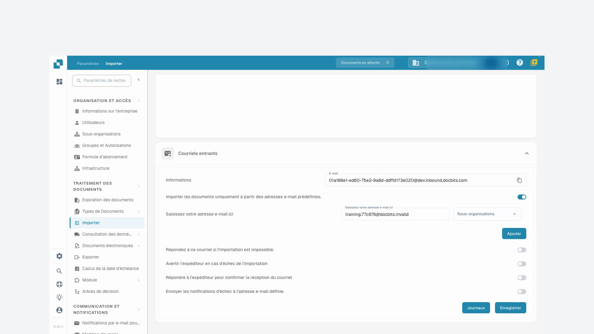

# Importation

## Aperçu

Vous avez besoin d'un compte administrateur pour créer une connexion. Utilisez **Importer** pour configurer l'importation automatique de documents depuis un serveur FTP/SFTP, une boîte aux lettres connectée ou l'adresse e-mail entrante DocBits. Vérifiez l'organisation et l'environnement actuels avant de saisir les détails de connexion.

<figure><figcaption>
La page <strong>Importer</strong> : le schéma Import Pipeline en lecture seule, la carte <strong>Importation FTP</strong> et la carte <strong>Importation d'e-mails</strong>, chacune avec son propre bouton <strong>Nouveau</strong>.
</figcaption></figure>

## Comment y accéder

1. Accédez à **Paramètres** → **Traitement des documents** → **Importer**.
2. Développez la section requise. **Importation FTP** et **Importation d'e-mails** disposent chacune de son propre bouton **Nouveau**.

## **Paramètres des documents**

La page Importer actuelle contient **Import Pipeline**, **Importation FTP**, **Importation d'e-mails** et, lorsqu'il est activé, **Courriels entrants**. Le découpage des pages, les conditions de paiement par défaut et les champs de format de date ne sont pas des contrôles dans cette vue Importer.

**Import Pipeline** affiche la topologie de routage FTP/SFTP, y compris les régions source et cible. Vérifiez tout avertissement affiché avant de modifier une connexion. L'onglet **Email** du pipeline affiche actuellement un message annonçant une disponibilité prochaine ; il n'affiche pas de schéma de traitement des e-mails.

## **Importation FTP**

<figure><figcaption>
La carte <strong>Importation FTP</strong> avec le bouton <strong>Nouveau</strong>, les colonnes Type, URL Du Serveur, Nom D'utilisateur, Port, Sous-Organisations, Répertoire Primaire et Actions ainsi que le menu <strong>Actions</strong> de chaque ligne. Serveurs, noms d'utilisateur et répertoires sont des données d'exemple inventées ; aucune connexion n'a été enregistrée ni modifiée dans cet exemple.
</figcaption></figure>

### Conditions requises

* Un serveur FTP, FTPS ou SFTP accessible par le service d'importation.
* L'adresse du serveur, le protocole, le port, le nom d'utilisateur et le mot de passe fournis par votre administrateur.
* Un répertoire d'importation et, si un archivage est requis, un répertoire d'archive approuvé.

### Ajouter une nouvelle connexion

1. Cliquez sur **Nouveau** dans **Importation FTP**.
2. Saisissez les paramètres de connexion. Un nouveau formulaire démarre avec **SFTP** et le port **22** ; remplacez ces valeurs lorsque votre serveur utilise un autre protocole ou un autre port.

<figure><figcaption>
Le formulaire <strong>Ajouter de nouvelles données</strong> juste après son ouverture : type <strong>SFTP</strong>, port <strong>22</strong> et les valeurs par défaut 60 minutes et 48 heures. La <strong>Clé API</strong> de votre organisation n'apparaît que sous forme de points. Aucune saisie n'a été faite et rien n'a été enregistré.
</figcaption></figure>

* **Type**, **Nom du serveur**, **Port**, **Nom d'utilisateur** et **Mot de passe** identifient et authentifient la connexion au serveur.
* **Répertoire primaire** définit le répertoire de base. **Répertoire des importations** sélectionne le dossier à traiter ; la sélection du dossier devient disponible une fois la connexion enregistrée.
* **Type de document** et **Sous-organisations** contrôlent l'affectation. **Patrons de correspondance de noms de fichier** limite les noms de fichiers pris en compte.
* **Archiver après l'importation** permet de déplacer les fichiers traités vers le répertoire d'archive indiqué. **Inclure les fichiers des sous-dossiers** étend le traitement aux sous-dossiers.
* **Intervalle de nouvelle tentative (min)**, **Durée de la nouvelle tentative (heures)** et **Courriels de notification (séparés par des virgules)** contrôlent le comportement des nouvelles tentatives et des notifications. Les valeurs par défaut illustrées sont 60 minutes et 48 heures.
* **Clé API** utilise la clé d'abonnement d'application existante de l'organisation. L'icône en forme d'œil affiche ou masque cette clé ; l'icône de copie la copie dans le presse-papiers. Ces contrôles ne créent pas de nouvelle clé. Gardez-la confidentielle ; ne l'incluez pas dans les captures d'écran ou les messages au support.

Utilisez **Annuler** ou l'icône de fermeture pour quitter un formulaire de nouvelle connexion sans l'enregistrer.

3. Vérifiez les valeurs et cliquez sur **Enregistrer** lorsque la connexion est prête à être créée.
4. Dans le menu **Actions** de la ligne enregistrée, choisissez **Activer** lorsque les importations sont autorisées à s'exécuter.

### Actions pour FTP

Le menu **Actions** d'une ligne enregistrée propose :

<figure><figcaption>
Le menu <strong>Actions</strong> de la connexion d'exemple <em>sftp.example.com</em> : <strong>Test de connexion</strong>, <strong>Journaux de connexion</strong>, <strong>Désactiver</strong>, <strong>Éditer</strong> et <strong>Supprimer</strong>. Cette connexion est active, c'est pourquoi le menu propose de la désactiver.
</figcaption></figure>

* **Test de connexion** : contacter le serveur configuré pour vérifier la connexion.
* **Journaux de connexion** : consulter les tentatives de connexion et les erreurs.
* **Activer**/**Désactiver** : activer ou arrêter le traitement automatique pour cette connexion.
* **Éditer** : modifier sa configuration.
* **Supprimer** : supprimer la connexion.

Le test, l'activation, la modification et la suppression affectent une connexion réelle. Vérifiez la ligne et l'organisation sélectionnées avant de les utiliser.

## **Importation d'e-mails**

Une boîte aux lettres connectée est distincte de l'adresse e-mail entrante DocBits décrite dans le tutoriel ci-dessous. Choisissez la méthode adaptée à votre processus.

<figure><figcaption>
La carte <strong>Importation d'e-mails</strong> : <strong>Nouveau</strong> crée une connexion de boîte aux lettres, l'icône à côté ouvre le journal d'importation. Les lignes d'exemple montrent des boîtes aux lettres inventées avec les colonnes Nom D'utilisateur, E-Mail, Adresse E-Mail Partagée, Protocole, Cryptage, Sous-Organisations et Actions. Rien n'a été enregistré ni modifié dans cet exemple.
</figcaption></figure>

<mark style="color:red;">**Note**</mark>: Seuls les documents des types de fichiers suivants seront importés :

* `.pdf`
* `.tiff` / `.tif`
* `.eml`
* `.dat`
* `.xml`
* `.edi`
* `.purchaseorder`


**Comment les pièces jointes sont reconnues**

Outre les extensions de fichiers listées ci-dessus, DocBits identifie également un document par son **contenu réel** (signature de fichier), et pas uniquement par le type de contenu déclaré par le système de messagerie expéditeur. Cela compte pour les messages **transférés** : les serveurs de messagerie ou passerelles intermédiaires réétiquettent fréquemment une pièce jointe avec un type générique (`application/octet-stream`) au lieu, par exemple, de `application/pdf` ou `application/xml`. DocBits reconnaît et importe néanmoins correctement ces pièces jointes.

* Les messages **`.eml` transférés** et les pièces jointes Outlook **`winmail.dat`** (TNEF) sont décompressés et les documents qu'ils contiennent sont importés.
* **Encodage XML:** lorsqu'une facture XML est réétiquetée avec un type générique (`application/octet-stream`), DocBits la reconnaît grâce à sa déclaration `<?xml`, en tolérant une marque d'ordre des octets (BOM) **UTF-8** ou **UTF-16** (LE/BE) placée en tête — actuellement, seuls ces encodages BOM sont détectés automatiquement à partir du contenu. Une pièce jointe qui conserve un nom de fichier `.xml` est importée quel que soit son encodage.
* **Ignorées:** les images intégrées qui accompagnent un message (logos de signature / graphiques incorporés — PNG, JPG, GIF, BMP) sont ignorées silencieusement et ne sont **pas** comptées comme des importations échouées.

Si une pièce jointe ne peut pas être importée et que l'option **« Répondez à ce courriel si l'importation est impossible »** est activée pour l'adresse entrante, l'adresse de réponse configurée est notifiée.


### Ajouter une nouvelle connexion IMAP

1. Cliquez sur **Nouveau** dans **Importation d'e-mails** et sélectionnez **IMAP** sous **Protocole**.
2. Dans **Configuration du serveur de messagerie**, saisissez le nom du serveur, le port, le cryptage, le nom d'utilisateur, l'adresse e-mail et le mot de passe. Utilisez les valeurs requises par votre fournisseur de messagerie ; le serveur, le port et le nom d'utilisateur affichés sont des données d'exemple inventées, saisies pour cette prise de vue.

<figure><figcaption>
Le premier pas <strong>Configuration du serveur de messagerie</strong> avec des données d'exemple inventées : protocole <strong>IMAP</strong>, nom du serveur <strong>imap.example.com</strong>, port <strong>993</strong>, cryptage <strong>SSL</strong>, nom d'utilisateur <strong>alex.muster</strong>. Le mot de passe n'apparaît que sous forme de points. Rien n'a été enregistré dans cet exemple.
</figcaption></figure>

L'icône de copie à côté de **Mot de passe** copie le mot de passe saisi dans le presse-papiers. **Annuler** ou l'icône de fermeture quitte cet assistant de nouvelle connexion sans l'enregistrer.

3. Cliquez sur **Suivant** pour ouvrir **Options**. Choisissez si vous souhaitez **Fusionner les documents joints** ou **Bloquer l'importation de fichiers en double**. **Notification par e-mail** active un e-mail de confirmation après l'importation ; activez-le uniquement lorsque ce comportement est souhaité.

<figure><figcaption>
Le pas <strong>Options</strong> de la même connexion d'exemple depuis <em>imap.example.com</em> sépare le comportement d'importation de la notification par e-mail. Les deux cases à cocher et l'interrupteur de notification sont désactivés ; rien n'a été enregistré.
</figcaption></figure>

4. Cliquez sur **Suivant** pour ouvrir **Configuration**. Sélectionnez les **Sous-organisations** requises, vérifiez la **Clé API** existante, définissez le destinataire des erreurs d'importation et vérifiez **Routage des documents**. Développez **Paramètres avancés** uniquement lorsque le processus nécessite des options supplémentaires.

<figure><figcaption>
Le pas <strong>Configuration</strong> de la même connexion d'exemple depuis <em>imap.example.com</em> réunit l'affectation à l'organisation, la clé existante, les notifications d'erreur et le routage. La <strong>Clé API</strong> n'apparaît que sous forme de points, le champ des notifications d'erreur est vide et n'affiche qu'un exemple grisé (<em>admin@example.com</em>), et <strong>Enregistrer</strong> n'a pas été utilisé. Les données affichées sont des données d'exemple inventées.
</figcaption></figure>

Dans **Configuration**, l'icône en forme d'œil affiche ou masque la **Clé API** existante, et **Copier** la copie dans le presse-papiers. Aucun de ces deux contrôles ne génère de nouvelle clé.

5. Cliquez sur **Enregistrer** lorsque la configuration est prête. Utilisez ensuite **Activer** dans le menu **Actions** de la connexion enregistrée pour démarrer le traitement automatique.

Pour une connexion IMAP enregistrée, **Éditer** propose des options de dossier et de traitement après importation. Sélectionnez le dossier source et le dossier de destination des e-mails déplacés uniquement après la création de la connexion et lorsque les dossiers disponibles peuvent être chargés.

### Actions pour IMAP

<figure><figcaption>
Le menu <strong>Actions</strong> de la connexion de boîte aux lettres d'exemple <em>invoices@example.com</em> : <strong>Test de connexion</strong>, <strong>Journaux de connexion</strong>, <strong>Journal d'importation</strong>, <strong>Désactiver</strong>, <strong>Éditer</strong> et <strong>Supprimer</strong>. Cette connexion est active, c'est pourquoi le menu propose de la désactiver.
</figcaption></figure>

Le menu **Actions** de la connexion enregistrée propose **Test de connexion**, **Journaux de connexion**, **Journal d'importation**, **Activer**/**Désactiver**, **Éditer** et **Supprimer**. Le test de connexion contacte la boîte aux lettres configurée ; l'activation active le traitement. Consultez les journaux avant de réessayer une importation échouée.

### Ajouter une nouvelle connexion OAuth Office365

1. Cliquez sur **Nouveau** dans **Importation d'e-mails** et sélectionnez **OAuth Office365** sous **Protocole**. Pour une application de locataire gérée par un administrateur, sélectionnez **OAuth Office365 - Tenant** et suivez [O365 Tenant](o365-tenant.md).
2. Vérifiez **Routage des documents** avant l'authentification.

<figure><figcaption>
Sélectionnez la route avant <strong>Authentifier</strong>. Cette vue précède la connexion ; aucune authentification Microsoft n'a été démarrée.
</figcaption></figure>

3. Cliquez sur **Authentifier** lorsque la connexion à la boîte aux lettres est autorisée. Effectuez la connexion Microsoft par code d'appareil avec le code affiché par DocBits, puis revenez et terminez l'authentification.
4. Après l'authentification, vérifiez les options d'organisation, de dossier, de boîte aux lettres partagée, de dossier de déplacement et de notification d'erreur proposées pour la connexion. Utilisez **Suivant** pour continuer vers **Configuration** lorsqu'elle devient disponible, puis enregistrez les paramètres souhaités.
5. Activez la connexion enregistrée lorsque des importations automatiques doivent s'exécuter. **Importer**, lorsqu'elle est proposée pour une connexion enregistrée, démarre une importation réelle ; utilisez-la délibérément.

### Actions pour OAuth Office365

Le menu **Actions** de la connexion enregistrée propose **Journaux de connexion**, **Journal d'importation**, **Activer**/**Désactiver**, **Éditer** et **Supprimer**. La désactivation arrête le traitement automatique ; la suppression retire la configuration.

### Journal d'importation

Utilisez l'icône de journal en haut à droite de **Importation d'e-mails** pour consulter les importations de l'ensemble des connexions de boîte aux lettres configurées. Utilisez l'action **Journal d'importation** d'une ligne enregistrée pour cette connexion. Vérifiez l'objet, l'expéditeur, le statut et les détails d'erreur disponibles avant de décider de réessayer.

## Courriels entrants

Les deux captures d'écran du tutoriel ci-dessous montrent la carte **Courriels entrants** avec l'adresse DocBits entrante et son journal. Cela est distinct des connexions de boîte aux lettres présentées ci-dessus.

* Utilisez l'icône de copie à côté de **E-mail** pour copier l'adresse de réception affichée pour l'organisation et l'environnement actuels.
* **Ajouter** insère une autre ligne d'expéditeur autorisé dans le formulaire. Choisissez son expéditeur et la sous-organisation souhaitée, puis utilisez **Enregistrer** pour enregistrer la configuration. L'ajout d'une ligne seule ne l'enregistre pas.
* **Journaux** ouvre le journal des courriels entrants. **Erreurs** filtre les erreurs ; **Entrant** et **Sortie** sélectionnent le sens des messages.
* Développez une ligne de journal avec son chevron pour inspecter les détails de la pièce jointe. L'icône de copie à côté de l'ID de suivi copie cet ID pour le dépannage. **Courriel original**, lorsqu'il est disponible pour une ligne entrante, télécharge le message d'origine sélectionné sous forme de fichier `.eml` ; il ne relance pas l'importation.

## Tutoriel vidéo : Boîte de réception et recherche d'erreurs


Boîte de réception et recherche d'erreurs


[Regarder avec sous-titres et navigation par chapitres](https://docbits-videos.fra1.cdn.digitaloceanspaces.com/settings-assistant/email-import-admin/v2/fr.html)

Certains libellés natifs du produit peuvent rester dans une autre langue. Les identifiants techniques des champs sont conservés.

Sous les paramètres et l'importation, j'utilise l'adresse DocBits entrante dans cet exemple. Une boîte aux lettres directement connectée est une méthode d'importation distincte. Pour cette formation, je travaille dans une organisation de démonstration dédiée avec des factures synthétiques. Les notifications restent désactivées.

Je vérifie d'abord l'adresse de réception affichée et le périmètre. L'adresse appartient exactement à cette organisation et à son environnement. Pour une autre entreprise ou un environnement de production, j'utilise toujours l'adresse qui y est réellement affichée.

Ici, je limite la boîte de réception à notre expéditeur de test approuvé. Je ne sélectionne l'affectation à une sous-organisation que si elle relève du processus prévu. J'enregistre le paramètre et je le rouvre. L'expéditeur autorisé a été conservé ; les e-mails de réponse automatique restent désactivés dans cette formation.

<figure><figcaption>
Carte <strong>Courriels entrants</strong> : expéditeur autorisé enregistré, notifications désactivées.
</figcaption></figure>

Pour cette formation, un message de test a été soumis directement au traitement des courriels entrants de DocBits. Ce test ne confirme pas une livraison d'e-mail externe. Dans le journal, je vérifie l'objet, l'expéditeur et la pièce jointe importée correspondants. Je contrôle ensuite le document réellement créé.

J'ouvre le document correspondant et je compare la pièce jointe PDF avec la facture dans DocBits. Le nom du fichier, le numéro de facture, le fournisseur et le montant doivent correspondre. Une importation réussie ne dit rien sur une approbation ou une écriture ERP.

Un deuxième test contrôlé provient d'un expéditeur non approuvé. Dans le journal, je recherche spécifiquement ce courriel entrant et j'active le filtre **Erreurs**. Les détails nomment l'expéditeur rejeté. Je vérifie la cause à l'aide de l'objet et de l'ID de suivi, au lieu de déclencher l'importation plusieurs fois.

Dans un cas réel, je clarifie d'abord si cet expéditeur est même autorisé. Une modification approuvée de la liste des expéditeurs est enregistrée puis vérifiée à nouveau. Ensuite, je contrôle un nouveau courriel entrant de test unique jusqu'au document créé. Pour les erreurs techniques, je transmets l'ID de suivi et le message d'erreur concret.

<figure><figcaption>
Importation échouée avec pièce jointe, motif et ID de suivi.
</figcaption></figure>
