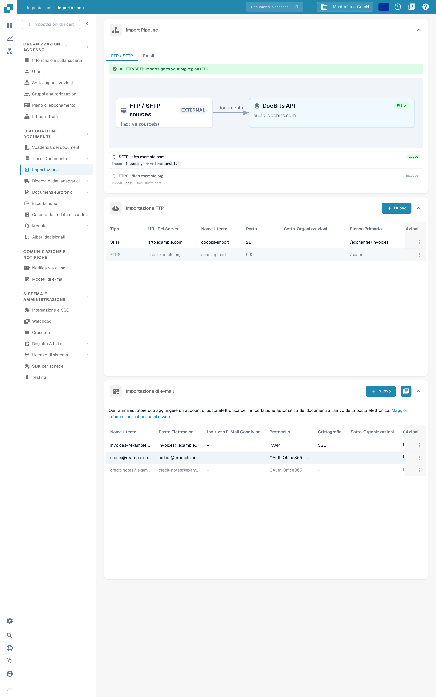
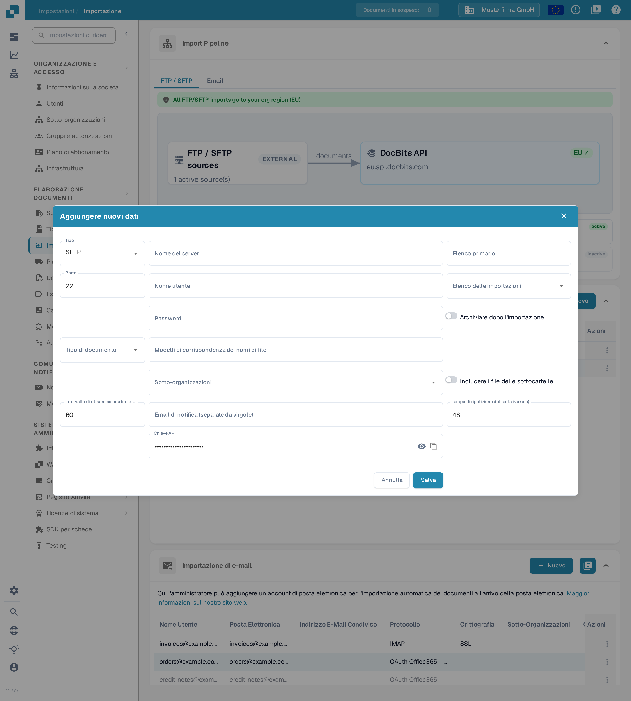
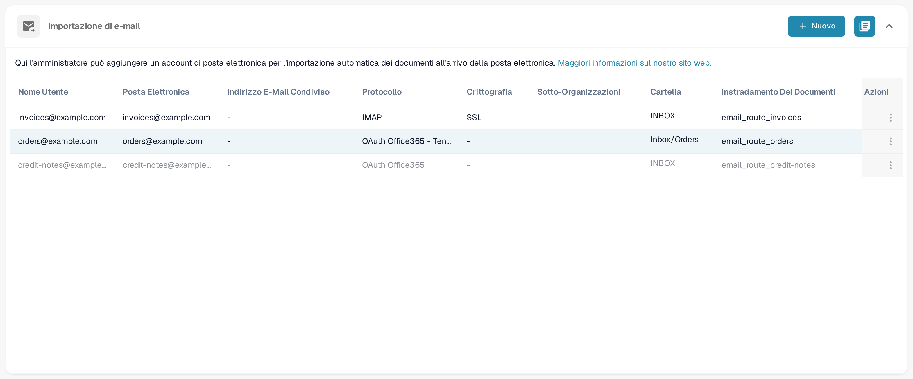
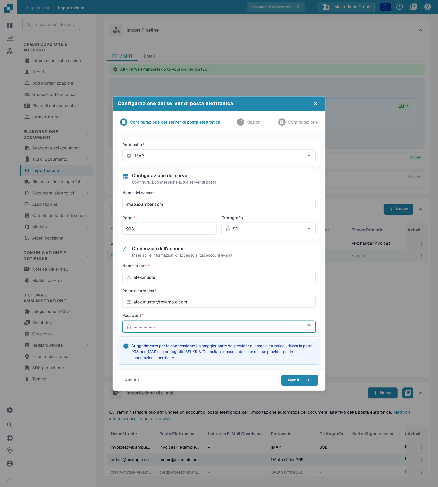
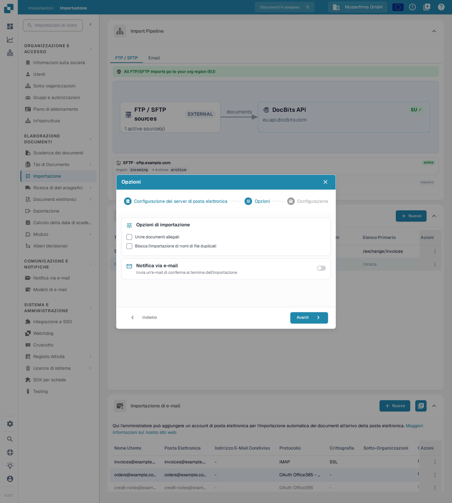
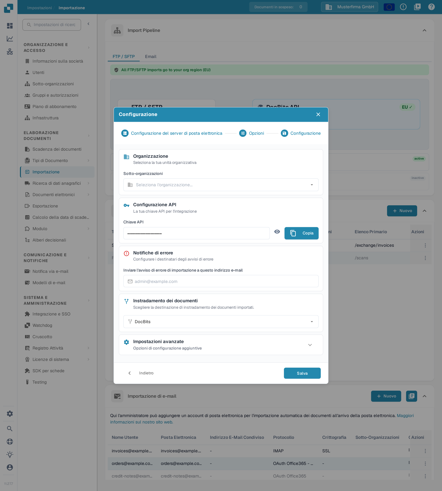
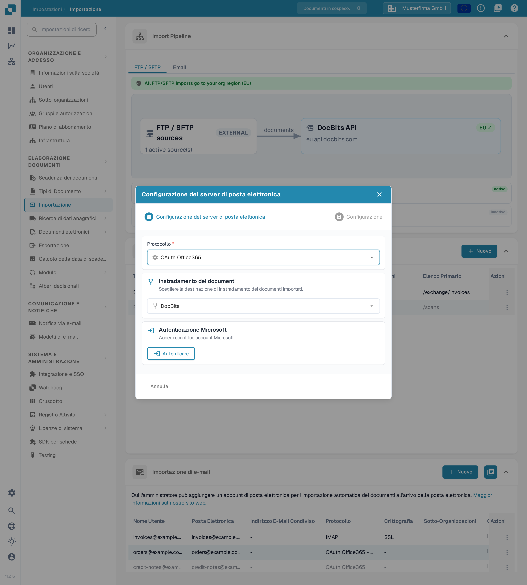
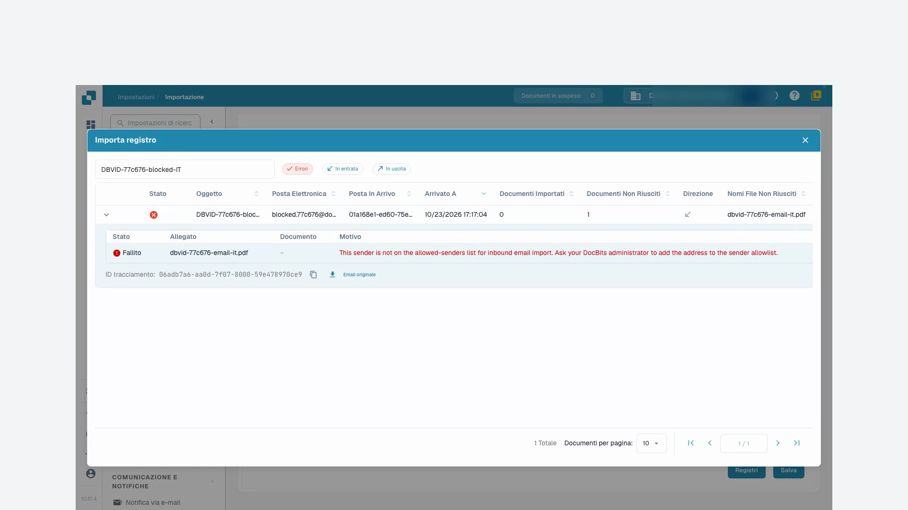

# Importazione

## Panoramica

Per creare una connessione è necessario un account amministratore. Vai a **Impostazioni** → **Elaborazione documenti** → **Importazione** per configurare l'importazione automatica dei documenti da un server FTP/SFTP, da una casella di posta collegata o dall'indirizzo e-mail in entrata di DocBits. Verifica l'organizzazione e l'ambiente correnti prima di inserire i dettagli della connessione.

<figure><figcaption>
La pagina <strong>Importazione</strong>: in alto il diagramma <strong>Import Pipeline</strong> in sola lettura, poi la lista <strong>Importazione FTP</strong> e la lista <strong>Importazione di e-mail</strong>, ciascuna con il proprio pulsante <strong>Nuovo</strong>. Le connessioni mostrate sono dati di esempio inventati.
</figcaption></figure>

## Come accedere

1. Vai a **Impostazioni** → **Elaborazione documenti** → **Importazione**.
2. Espandi la sezione richiesta. **Importazione FTP** e **Importazione di e-mail** hanno ciascuna il proprio pulsante **Nuovo**.

## **Contenuto della pagina Importazione**

La pagina Importazione corrente contiene **Import Pipeline**, **Importazione FTP**, **Importazione di e-mail** e, se attivata, **Email in entrata**. I campi per il ritaglio delle pagine, per i termini di pagamento predefiniti e per i modelli di data non sono controlli in questa vista.

**Import Pipeline** mostra la topologia di instradamento FTP/SFTP, comprese le regioni di origine e di destinazione. Controlla qualsiasi avviso visualizzato prima di modificare una connessione. La scheda `Email` della pipeline mostra attualmente il messaggio „The Email import pipeline view is coming soon.”; non visualizza alcun diagramma di elaborazione delle e-mail.

## **Importazione FTP**

<figure><figcaption>
Usa <strong>Nuovo</strong> in <strong>Importazione FTP</strong> per aggiungere una connessione a un server. Le righe mostrate sono dati di esempio inventati.
</figcaption></figure>

### Requisiti

* Un server FTP, FTPS o SFTP raggiungibile dal servizio di importazione.
* L'indirizzo del server, il protocollo, la porta, il nome utente e la password forniti dall'amministratore.
* Una directory di importazione e, se è richiesta l'archiviazione, una directory di archivio approvata.

### Aggiungere una nuova connessione

1. Fai clic su **Nuovo** in **Importazione FTP**.
2. Inserisci le impostazioni della connessione. Un nuovo modulo parte con **SFTP** e porta **22**; sostituisci questi valori quando il tuo server usa un altro protocollo o un'altra porta.

<figure><figcaption>
Il modulo <strong>Aggiungere nuovi dati</strong> con i valori predefiniti <strong>SFTP</strong>, porta <strong>22</strong>, intervallo di ritrasmissione <strong>60</strong> minuti e tempo di ripetizione <strong>48</strong> ore. I campi del server e delle credenziali sono vuoti, la <strong>Chiave API</strong> è mascherata e questo modulo non è stato salvato.
</figcaption></figure>

* **Tipo**, **Nome del server**, **Porta**, **Nome utente** e **Password** identificano e autenticano la connessione al server.
* **Elenco primario** imposta la directory di base. **Elenco delle importazioni** seleziona la cartella da elaborare; la selezione della cartella diventa disponibile dopo il salvataggio della connessione.
* **Tipo di documento** e **Sotto-organizzazioni** controllano l'assegnazione. **Modelli di corrispondenza dei nomi di file** limita i nomi di file considerati.
* **Archiviare dopo l'importazione** abilita lo spostamento dei file elaborati nella directory di archivio specificata. **Includere i file delle sottocartelle** estende l'elaborazione alle sottocartelle.
* **Intervallo di ritrasmissione (minuti)**, **Tempo di ripetizione del tentativo (ore)** e **Email di notifica (separate da virgole)** controllano il comportamento dei tentativi e delle notifiche. I valori predefiniti illustrati sono 60 minuti e 48 ore.
* **Chiave API** usa la chiave di abbonamento all'app esistente dell'organizzazione. L'icona a forma di occhio mostra o nasconde quella chiave; l'icona di copia la copia negli appunti. Questi controlli non creano una nuova chiave. Mantienila riservata; non inserirla in screenshot o messaggi di assistenza.

Usa **Annulla** o l'icona di chiusura per uscire da un nuovo modulo di connessione senza salvarlo.

3. Controlla i valori e fai clic su **Salva** quando la connessione è pronta per essere creata.
4. Nel menu **Azioni** della riga salvata, scegli **Attivare** quando le importazioni sono autorizzate a essere eseguite.

### Azioni per FTP

Il menu **Azioni** della connessione salvata offre:

* **Collegamento di prova**: contatta il server configurato per verificare la connessione.
* **Registri di connessione**: esamina i tentativi di connessione e gli errori.
* **Attivare**/**Disattivare**: attiva o interrompe l'elaborazione automatica per questa connessione.
* **Modifica**: modifica la sua configurazione.
* **Cancellare**: rimuove la connessione.

Il test, l'attivazione, la modifica e l'eliminazione agiscono su una connessione reale. Verifica la riga e l'organizzazione selezionate prima di usarli.

## **Importazione di e-mail**

Una casella di posta collegata è distinta dall'indirizzo e-mail in entrata di DocBits descritto nel tutorial seguente. Scegli il metodo adatto al tuo processo.

<figure><figcaption>
La lista <strong>Importazione di e-mail</strong> mostra protocollo (<strong>IMAP</strong>, <strong>OAuth Office365</strong>), crittografia, cartella e instradamento dei documenti di ogni casella. <strong>Nuovo</strong> aggiunge una casella; le caselle mostrate sono dati di esempio inventati.
</figcaption></figure>

<mark style="color:red;">**Nota**</mark>: vengono importati solo i documenti con i seguenti tipi di file:

* `.pdf`
* `.tiff` / `.tif`
* `.eml`
* `.dat`
* `.xml`
* `.edi`
* `.purchaseorder`


**Come vengono riconosciuti gli allegati**

Oltre alle estensioni di file elencate sopra, DocBits identifica un documento anche dal suo **contenuto effettivo del file** (firma del file), non solo dal tipo di contenuto dichiarato dal sistema di posta mittente. Questo è rilevante per le e-mail **inoltrate**: i server di posta e i gateway intermedi rietichettano spesso un allegato con un tipo generico (`application/octet-stream`) invece che, ad esempio, `application/pdf` o `application/xml`. DocBits riconosce e importa comunque correttamente questi allegati.

* I messaggi `.eml` **inoltrati** e gli allegati Outlook **`winmail.dat`** (TNEF) vengono scompattati e i documenti in essi contenuti vengono importati.
* **Codifica XML:** quando una fattura XML viene rietichettata con un tipo generico (`application/octet-stream`), DocBits la riconosce dalla sua dichiarazione `<?xml`, tollerando un byte-order mark (BOM) iniziale **UTF-8** o **UTF-16** (LE/BE) — attualmente solo queste codifiche BOM vengono rilevate automaticamente dal contenuto. Un allegato che mantiene un nome di file `.xml` viene importato indipendentemente dalla sua codifica.
* **Ignorati:** le immagini inline che accompagnano un'e-mail (loghi di firma / immagini incorporate — PNG, JPG, GIF, BMP) vengono saltate silenziosamente e **non** vengono conteggiate come importazioni non riuscite.

Se un allegato non può essere importato e l'opzione **“Rispondere a questa e-mail se l'importazione non può essere effettuata”** è attivata per l'indirizzo in entrata, viene notificato l'indirizzo di risposta configurato.


### Aggiungere una nuova connessione IMAP

1. Fai clic su **Nuovo** in **Importazione di e-mail** e seleziona **IMAP** sotto **Protocollo**.
2. In **Configurazione del server di posta elettronica** inserisci il nome del server, la porta, la crittografia, il nome utente, l'indirizzo e-mail e la password in **Credenziali dell'account**. Usa i valori richiesti dal tuo provider di posta; i valori mostrati nell'illustrazione (server, porta, utente e indirizzo) sono un esempio inventato, non un'impostazione completata.

<figure><figcaption>
Il primo passo <strong>Configurazione del server di posta elettronica</strong> con il protocollo <strong>IMAP</strong>. L'immagine usa solo dati di esempio inventati: server <strong>imap.example.com</strong>, porta <strong>993</strong>, crittografia <strong>SSL</strong>, utente <strong>alex.muster</strong> e indirizzo <strong>alex.muster@example.com</strong>; nessuna credenziale è stata inviata e la password digitata non è riportata.
</figcaption></figure>

L'icona di copia accanto a **Password** copia la password inserita negli appunti. **Annulla** o l'icona di chiusura abbandona questa procedura guidata di nuova connessione senza salvarla.

3. Fai clic su **Avanti** per aprire **Opzioni**; **Indietro** riporta al passo precedente. Scegli se **Unire documenti allegati** o **Blocca l'importazione di nomi di file duplicati**. **Notifica via e-mail** abilita un'e-mail di conferma dopo l'importazione; attivala solo quando questo comportamento è desiderato.

<figure><figcaption>
<strong>Opzioni</strong> separa il comportamento di importazione dalla notifica e-mail. In questo esempio non salvato le due caselle e la notifica via e-mail sono disattivate.
</figcaption></figure>

4. Fai clic su **Avanti** per aprire **Configurazione**. Seleziona le **Sotto-organizzazioni** richieste, controlla la **Chiave API** esistente, imposta il destinatario per gli errori di importazione e verifica **Instradamento dei documenti**. Espandi **Impostazioni avanzate** solo quando il processo richiede opzioni aggiuntive.

<figure><figcaption>
<strong>Configurazione</strong> riunisce l'assegnazione dell'organizzazione, la chiave API esistente con i simboli dell'occhio e <strong>Copia</strong>, i destinatari degli errori e l'instradamento dei documenti. La chiave mostrata è un valore di esempio inventato e mascherato, e <strong>Salva</strong> non è stato usato.
</figcaption></figure>

In **Configurazione**, l'icona a forma di occhio mostra o nasconde la **Chiave API** esistente e **Copia** la copia negli appunti. Nessuno dei due controlli genera una nuova chiave.

5. Fai clic su **Salva** quando la configurazione è pronta. Poi usa **Attivare** nel menu **Azioni** della connessione salvata per avviare l'elaborazione automatica.

Per una connessione IMAP salvata, **Modifica** offre opzioni per la cartella e per la gestione successiva all'importazione. Seleziona la cartella di origine e la cartella di destinazione per le e-mail spostate solo dopo che la connessione è stata creata e le cartelle disponibili possono essere caricate.

### Azioni per IMAP

Il menu **Azioni** della connessione salvata offre **Collegamento di prova**, **Registri di connessione**, **Importa registro**, **Attivare**/**Disattivare**, **Modifica** e **Cancellare**. Il test della connessione contatta la casella di posta configurata; l'attivazione abilita l'elaborazione. Esamina i registri prima di ripetere un'importazione non riuscita.

### Aggiungere una nuova connessione OAuth Office365

1. Fai clic su **Nuovo** in **Importazione di e-mail** e seleziona **OAuth Office365** sotto **Protocollo**. Per un'applicazione tenant gestita dall'amministratore, seleziona **OAuth Office365 - Tenant** e segui [O365 Tenant](o365-tenant.md).
2. Controlla **Instradamento dei documenti** prima dell'autenticazione.

<figure><figcaption>
Seleziona l'instradamento dei documenti prima di <strong>Autenticare</strong>. Questa vista precede l'accesso Microsoft; nell'illustrazione non è stata avviata alcuna autenticazione.
</figcaption></figure>

3. Fai clic su **Autenticare** quando la connessione alla casella di posta è autorizzata. Completa l'accesso con codice dispositivo Microsoft usando il codice mostrato da DocBits, poi torna in DocBits e completa l'autenticazione.
4. Dopo l'autenticazione, controlla l'organizzazione, la cartella, la casella condivisa, la cartella di spostamento e le opzioni di notifica degli errori offerte per la connessione. Usa **Avanti** per continuare verso **Configurazione** quando diventa disponibile, poi salva le impostazioni desiderate.
5. Attiva la connessione salvata quando le importazioni automatiche devono essere eseguite. L'azione di importazione del menu **Azioni**, dove offerta per una connessione salvata, avvia un'importazione reale; usala con consapevolezza.

### Azioni per OAuth Office365

Il menu **Azioni** della connessione salvata offre **Collegamento di prova**, **Registri di connessione**, **Importa registro**, **Attivare**/**Disattivare**, **Modifica** e **Cancellare**. La disattivazione interrompe l'elaborazione automatica; l'eliminazione rimuove la configurazione.

### Importa registro

Usa l'icona del registro accanto a **Nuovo** in **Importazione di e-mail** (tooltip **Importa registro**) per esaminare le importazioni di tutte le connessioni configurate alla casella di posta. Usa l'azione **Importa registro** del menu **Azioni** di una riga salvata per quella connessione. Controlla oggetto, mittente, stato e dettagli degli errori disponibili prima di decidere se ripetere l'importazione.

## Email in entrata

I due screenshot del tutorial riportati sotto mostrano l'indirizzo in entrata di DocBits e i suoi registri. Questo è distinto dalle connessioni alla casella di posta descritte sopra.

* Usa l'icona di copia accanto a **Posta elettronica** per copiare l'indirizzo di ricezione visualizzato per l'organizzazione e l'ambiente correnti.
* **Aggiungi** inserisce un'altra riga di mittente consentito nel modulo. Scegli il suo mittente e l'eventuale sotto-organizzazione desiderata, poi usa **Salva** per rendere permanente la configurazione. Aggiungere una riga da sola non la salva.
* **Registri** apre il registro delle e-mail in entrata. **Errori** filtra gli errori; **In entrata** e **In uscita** selezionano la direzione del messaggio.
* Espandi una riga del registro con il suo chevron per controllare i dettagli degli allegati. L'icona di copia accanto all'ID di tracciamento copia quell'ID per la risoluzione dei problemi. **Email originale**, quando disponibile per una riga in entrata, scarica il messaggio originale selezionato come file `.eml`; non ripete l'importazione.

## Video tutorial: Casella di posta e ricerca errori


Casella di posta e ricerca errori


[Guarda con sottotitoli e capitoli](https://docbits-videos.fra1.cdn.digitaloceanspaces.com/settings-assistant/email-import-admin/v2/it.html)

Alcune etichette native del prodotto possono rimanere in un'altra lingua. Gli ID tecnici dei campi sono conservati.

In impostazioni e importazione, in questo esempio utilizzo l'indirizzo in entrata di DocBits. Una casella di posta collegata direttamente è un metodo di importazione separato. Per questa formazione lavoro in un'organizzazione demo dedicata con fatture sintetiche. Le notifiche restano disattivate.

Per prima cosa controllo l'indirizzo di ricezione visualizzato e l'ambito. L'indirizzo appartiene esattamente a questa organizzazione e al suo ambiente. Per un'altra azienda o un ambiente di produzione, uso sempre l'indirizzo effettivamente visualizzato lì.

Qui limito la casella al nostro mittente di test approvato. Seleziono l'assegnazione a una sotto-organizzazione solo se appartiene al processo previsto. Salvo l'impostazione e la riapro. Il mittente consentito è stato mantenuto; le e-mail di risposta automatica restano disattivate in questa formazione.

<figure><figcaption>
Mittente consentito salvato con le notifiche disattivate.
</figcaption></figure>

Per questa formazione, un messaggio di test è stato inviato direttamente all'elaborazione in entrata di DocBits. Questo test non conferma la consegna di e-mail esterne. Nel registro controllo oggetto, mittente e allegato importato corrispondenti. Poi controllo il documento effettivamente creato.

Apro il documento corrispondente e confronto l'allegato PDF con la fattura in DocBits. Nome del file, numero di fattura, fornitore e importo devono corrispondere. Un'importazione riuscita non dice nulla su un'approvazione o su una registrazione ERP.

Un secondo test controllato proviene da un mittente non approvato. Nel registro cerco specificamente questo ingresso in entrata e attivo il filtro degli errori. I dettagli indicano il mittente rifiutato. Controllo la causa usando l'oggetto e l'ID di tracciamento, invece di avviare più volte l'importazione.

In un caso reale, chiarisco prima se questo mittente è persino autorizzato. Una modifica approvata all'elenco dei mittenti viene salvata e controllata di nuovo. Successivamente verifico un nuovo ingresso di test univoco fino al documento creato. Per gli errori tecnici, consegno l'ID di tracciamento e il messaggio di errore concreto.

<figure><figcaption>
Riga di registro di un'importazione non riuscita: nome del file allegato, motivo dell'errore, ID di tracciamento e pulsante <strong>Email originale</strong>.
</figcaption></figure>
