# Importeren

## Overzicht

U hebt een beheerdersaccount nodig om een verbinding te maken. Gebruik **Importeren** om geautomatiseerde documentimport te configureren vanaf een FTP/SFTP-server, een gekoppeld postvak of het inkomende DocBits-e-mailadres. Controleer de huidige organisatie en omgeving voordat u verbindingsgegevens invoert.

<figure>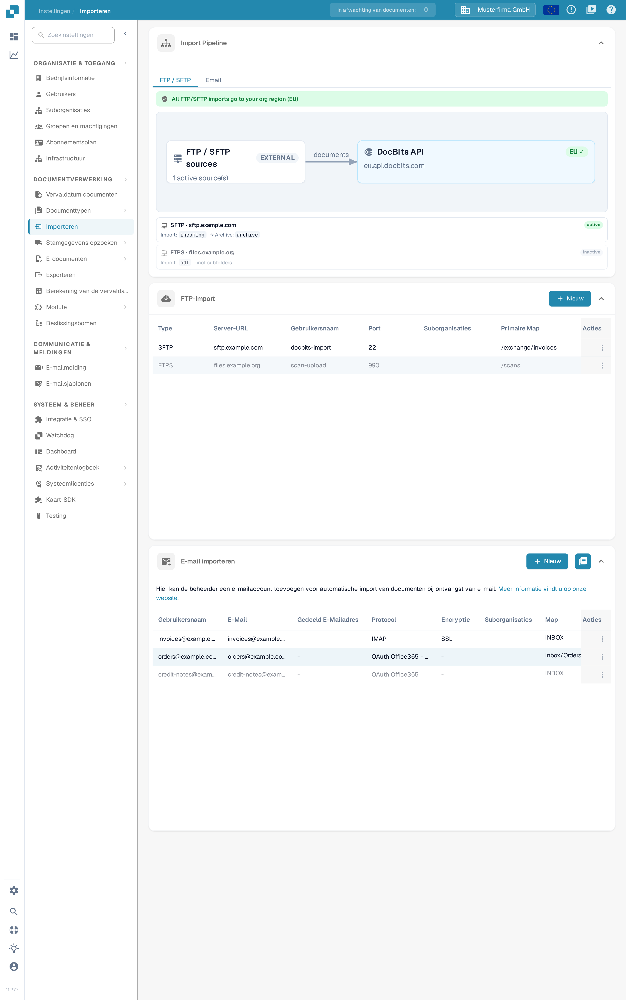<figcaption>
De pagina <strong>Importeren</strong>: het alleen-lezen diagram <strong>Import Pipeline</strong>, de kaart <strong>FTP-import</strong> en de kaart <strong>E-mail importeren</strong>, elk met een eigen knop <strong>Nieuw</strong>.
</figcaption></figure>

## Toegang

1. Navigeer naar **Instellingen** → **Documentverwerking** → **Importeren**.
2. Vouw de gewenste sectie uit. **FTP-import** en **E-mail importeren** hebben elk een eigen knop **Nieuw**.

## **Documentinstellingen**

De huidige pagina Importeren bevat **Import Pipeline**, **FTP-import**, **E-mail importeren** en, indien ingeschakeld, **Inkomende e-mails**. Instellingen voor pagina-einden, standaard betalingsvoorwaarden en datumpatronen zijn geen bedieningselementen in deze weergave Importeren.

**Import Pipeline** toont de FTP/SFTP-routeringstopologie, inclusief de bron- en doelregio's. Controleer elk weergegeven advies voordat u een verbinding wijzigt. Het tabblad **Email** van de pipeline toont momenteel een bericht dat de functie binnenkort beschikbaar komt; er wordt geen diagram voor e-mailverwerking weergegeven.

## **FTP-import**

<figure>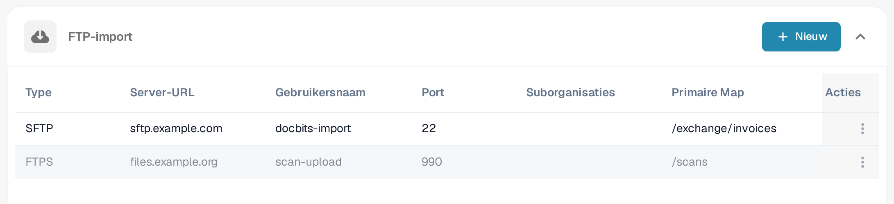<figcaption>
De kaart <strong>FTP-import</strong> met de knop <strong>Nieuw</strong>, de kolommen Type, Server-URL, Gebruikersnaam, Port, Suborganisaties, Primaire Map en Acties, en per rij het menu <strong>Acties</strong>. Servers, gebruikersnamen en mappen zijn verzonnen voorbeeldgegevens; in deze opname is niets gewijzigd.
</figcaption></figure>

### Vereisten

* Een FTP-, FTPS- of SFTP-server die bereikbaar is voor de importdienst.
* Het serveradres, protocol, de poort, gebruikersnaam en het wachtwoord zoals verstrekt door uw beheerder.
* Een importmap en, als archivering nodig is, een goedgekeurde archiveringsmap.

### Nieuwe verbinding toevoegen

1. Klik op **Nieuw** in **FTP-import**.
2. Voer de verbindingsinstellingen in. Een nieuw formulier begint met **SFTP** en poort **22**; vervang deze waarden wanneer uw server een ander protocol of een andere poort gebruikt.

<figure>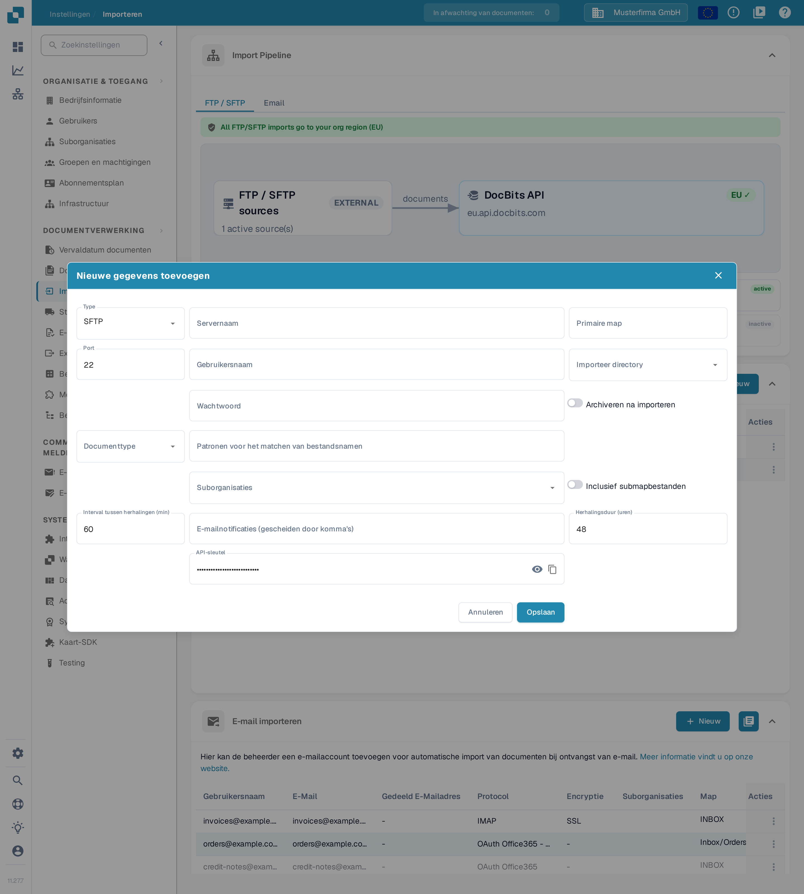<figcaption>
Het formulier <strong>Nieuwe gegevens toevoegen</strong> direct na het openen: type <strong>SFTP</strong>, poort <strong>22</strong> en de standaardwaarden 60 minuten en 48 uur. De <strong>API-sleutel</strong> van uw organisatie is alleen als punten zichtbaar, het wachtwoordveld is nog leeg. Er is niets ingevuld buiten deze standaardwaarden en niets opgeslagen.
</figcaption></figure>

* **Type**, **Servernaam**, **Port**, **Gebruikersnaam** en **Wachtwoord** identificeren en authenticeren de serververbinding.
* **Primaire map** stelt de basismap in. Met **Importeer directory** kiest u de map die moet worden verwerkt.
* **Documenttype** en **Suborganisaties** regelen de toewijzing. **Patronen voor het matchen van bestandsnamen** beperkt welke bestandsnamen in aanmerking komen.
* **Archiveren na importeren** maakt het mogelijk verwerkte bestanden naar de opgegeven archiveringsmap te verplaatsen. **Inclusief submapbestanden** breidt de verwerking uit naar submappen.
* **Interval tussen herhalingen (min)**, **Herhalingsduur (uren)** en **E-mailnotificaties (gescheiden door komma's)** regelen het opnieuw proberen en de meldingen. De weergegeven standaardwaarden zijn 60 minuten en 48 uur.
* **API-sleutel** gebruikt de bestaande abonnementssleutel van de organisatie. Het oogpictogram toont of verbergt die sleutel; het kopieerpictogram kopieert deze naar het klembord. Deze bedieningselementen maken geen nieuwe sleutel aan. Houd de sleutel vertrouwelijk; neem deze niet op in schermafbeeldingen of supportberichten.

Gebruik **Annuleren** of het sluitpictogram om een formulier voor een nieuwe verbinding te verlaten zonder het op te slaan.

3. Controleer de waarden en klik op **Opslaan** wanneer de verbinding klaar is om te worden aangemaakt.
4. Kies in het menu **Acties** van de opgeslagen rij **Activeren** wanneer imports mogen worden uitgevoerd.

### Acties voor FTP-import

Het menu **Acties** van de opgeslagen verbinding biedt:

<figure>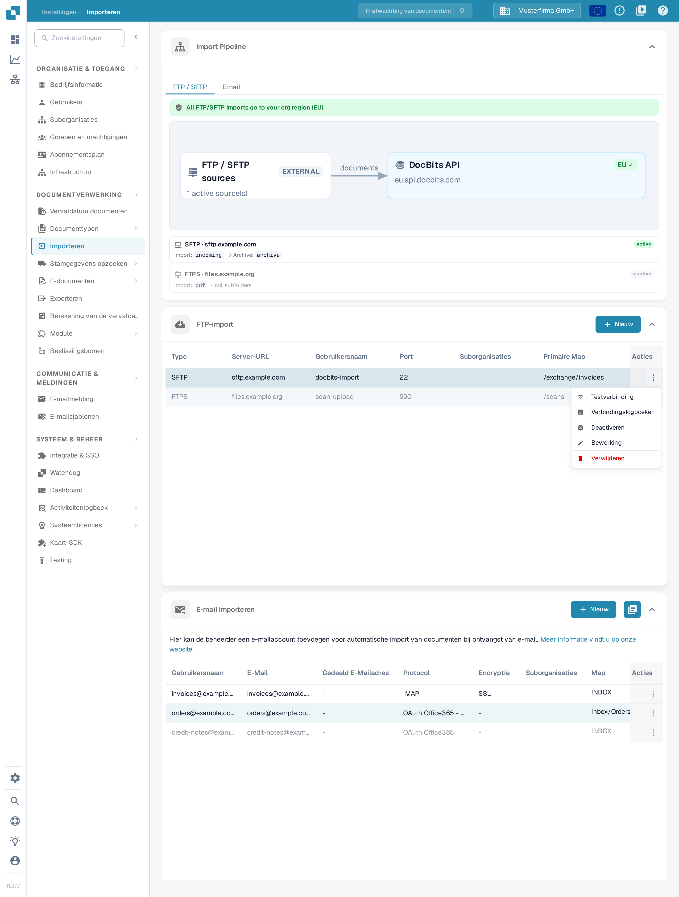<figcaption>
Het menu <strong>Acties</strong> van de voorbeeldverbinding <em>sftp.example.com</em>: <strong>Testverbinding</strong>, <strong>Verbindingslogboeken</strong>, <strong>Deactiveren</strong>, <strong>Bewerking</strong> en <strong>Verwijderen</strong>. Deze verbinding is actief, daarom biedt het menu deactiveren aan.
</figcaption></figure>

* **Testverbinding**: de geconfigureerde server benaderen om de verbinding te controleren.
* **Verbindingslogboeken**: verbindingspogingen en fouten bekijken.
* **Activeren**/**Deactiveren**: automatische verwerking voor deze verbinding inschakelen of stoppen.
* **Bewerking**: de configuratie wijzigen.
* **Verwijderen**: de verbinding verwijderen.

Testen, activeren, bewerken en verwijderen hebben invloed op een echte verbinding. Controleer de geselecteerde rij en organisatie voordat u deze gebruikt.

## **E-mail importeren**

Een gekoppeld postvak staat los van het inkomende DocBits-e-mailadres dat in de onderstaande handleiding wordt beschreven. Kies de methode die bij uw proces past.

<figure>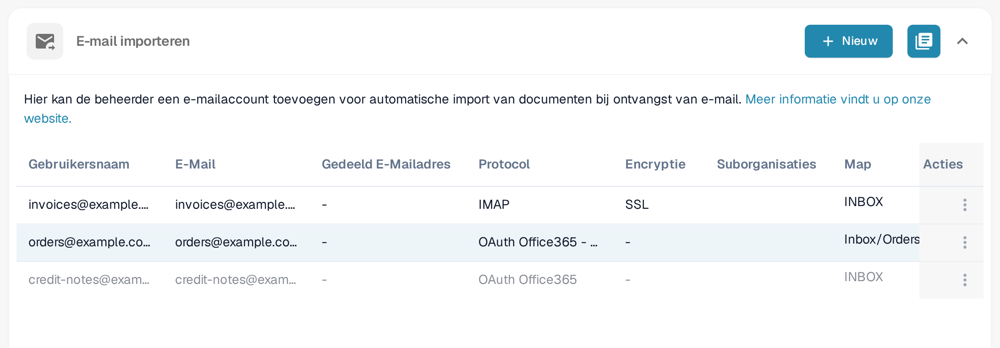<figcaption>
De kaart <strong>E-mail importeren</strong>: <strong>Nieuw</strong> maakt een postvakverbinding, het pictogram ernaast opent het importlogboek. De voorbeeldrijen tonen verzonnen postvakken met de kolommen Gebruikersnaam, E-Mail, Gedeeld E-Mailadres, Protocol, Encryptie, Suborganisaties, Map, Documentroutering en Acties. Er is niets opgeslagen of gewijzigd.
</figcaption></figure>

<mark style="color:red;">**Let op**</mark>: Alleen documenten met de volgende bestandstypen worden geïmporteerd:

* `.pdf`
* `.tiff` / `.tif`
* `.eml`
* `.dat`
* `.xml`
* `.edi`
* `.purchaseorder`


**Hoe bijlagen worden herkend**

Naast de hierboven genoemde bestandsextensies identificeert DocBits een document ook op basis van de **werkelijke bestandsinhoud** (bestandssignatuur), niet alleen op basis van het inhoudstype dat het verzendende mailsysteem opgeeft. Dit is van belang bij **doorgestuurde** e-mails: tussenliggende mailservers en gateways voorzien een bijlage vaak van een generiek type (`application/octet-stream`) in plaats van bijvoorbeeld `application/pdf` of `application/xml`. DocBits herkent en importeert dergelijke bijlagen toch correct.

* **Doorgestuurde `.eml`**-berichten en Outlook-bijlagen **`winmail.dat`** (TNEF) worden uitgepakt en de documenten daarin worden geïmporteerd.
* **XML-codering:** wanneer een XML-factuur opnieuw wordt gelabeld met een generiek type (`application/octet-stream`), herkent DocBits deze aan de declaratie `<?xml` en tolereert daarbij een voorafgaande bytevolgordemarkering (BOM) in **UTF-8** of **UTF-16** (LE/BE) — momenteel worden alleen deze BOM-coderingen automatisch op basis van de inhoud gedetecteerd. Een bijlage die een `.xml`-bestandsnaam behoudt, wordt ongeacht de codering geïmporteerd.
* **Genegeerd:** inline-afbeeldingen die met een e-mail meekomen (handtekeninglogo's en ingesloten afbeeldingen — PNG, JPG, GIF, BMP) worden stilzwijgend overgeslagen en **niet** als mislukte import geteld.

Als een bijlage niet kan worden geïmporteerd en de optie **Beantwoord deze e-mail als de import niet kan worden uitgevoerd** is ingeschakeld voor het inkomende adres, wordt het geconfigureerde antwoordadres op de hoogte gesteld.


### Nieuwe IMAP-verbinding toevoegen

1. Klik op **Nieuw** in **E-mail importeren** en selecteer **IMAP** onder **Protocol**.
2. Voer in **E-mailserver instellen** de servernaam, poort, encryptie, gebruikersnaam, het e-mailadres en het wachtwoord in. Gebruik de waarden die uw mailprovider vereist; de getoonde servernaam, poort en gebruikersnaam zijn voor deze opname als voorbeeld ingevuld.

<figure>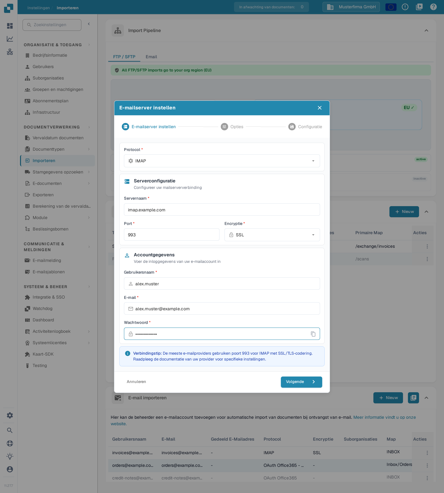<figcaption>
De eerste stap <strong>E-mailserver instellen</strong> met verzonnen voorbeeldgegevens: protocol <strong>IMAP</strong>, servernaam <strong>imap.example.com</strong>, poort <strong>993</strong>, encryptie <strong>SSL</strong> en gebruikersnaam <strong>alex.muster</strong>. Het wachtwoord is alleen als punten zichtbaar. Er is niets opgeslagen.
</figcaption></figure>

Het kopieerpictogram naast **Wachtwoord** kopieert het ingevoerde wachtwoord naar het klembord. Met **Annuleren** of het sluitpictogram verlaat u deze wizard voor een nieuwe verbinding zonder op te slaan.

3. Klik op **Volgende** om **Opties** te openen. Kies of u **Bijgevoegde documenten samenvoegen** of **Importeren van dubbele bestandsnamen blokkeren** wilt gebruiken. Met **E-mailmelding** schakelt u een bevestigingsmail na de import in; schakel dit alleen in wanneer dat gedrag bedoeld is.

<figure>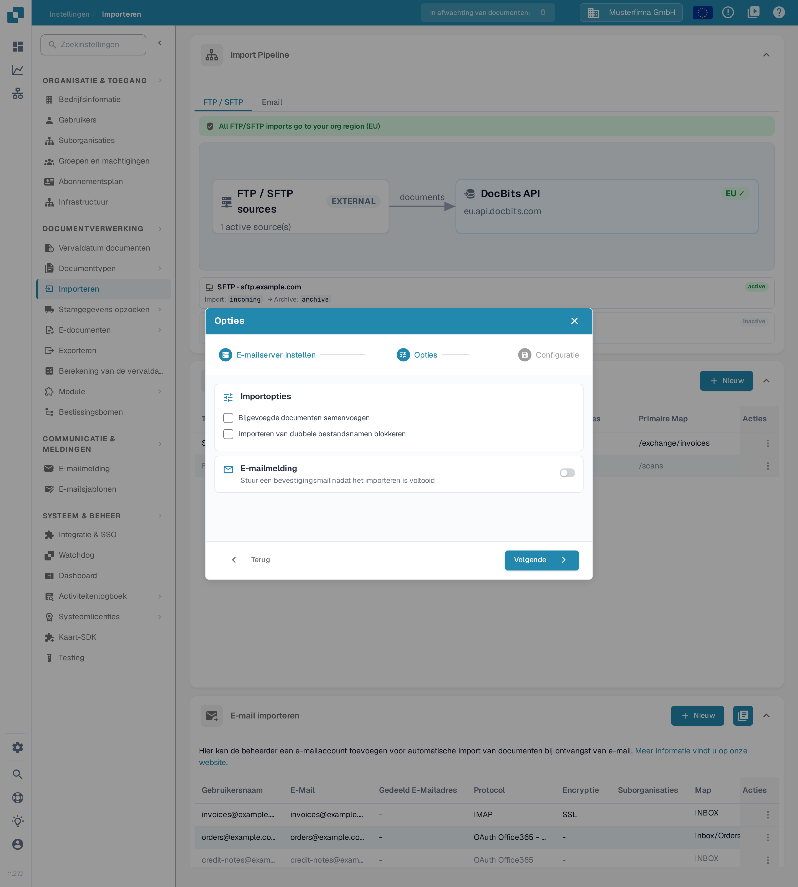<figcaption>
De stap <strong>Opties</strong> van dezelfde voorbeeldverbinding vanaf <em>imap.example.com</em> scheidt het importgedrag van de e-mailmelding. Beide selectievakjes en de schakelaar voor de melding staan uit; er is niets opgeslagen.
</figcaption></figure>

4. Klik op **Volgende** om **Configuratie** te openen. Selecteer de vereiste **Suborganisaties**, controleer de bestaande **API-sleutel**, stel de ontvanger voor importfouten in en controleer **Documentroutering**. Vouw **Geavanceerde instellingen** alleen uit wanneer het proces extra opties nodig heeft.

<figure><figcaption>
De stap <strong>Configuratie</strong> van dezelfde voorbeeldverbinding vanaf <em>imap.example.com</em> brengt de toewijzing aan de organisatie, de bestaande sleutel, de foutmeldingen en de routering samen. De <strong>API-sleutel</strong> is alleen als punten zichtbaar, het veld voor foutmeldingen is leeg en toont alleen een grijs voorbeeld (<em>admin@example.com</em>), en <strong>Opslaan</strong> is niet gebruikt. De getoonde gegevens zijn verzonnen voorbeelden.
</figcaption></figure>

In **Configuratie** toont het oogpictogram de bestaande **API-sleutel** of verbergt deze, en **Kopiëren** kopieert de sleutel naar het klembord. Geen van beide bedieningselementen genereert een nieuwe sleutel.

5. Klik op **Opslaan** wanneer de configuratie klaar is. Gebruik daarna **Activeren** in het menu **Acties** van de opgeslagen verbinding om automatische verwerking te starten.

Voor een opgeslagen IMAP-verbinding biedt de actie **Bewerking** opties voor mappen en voor de verwerking na de import. Selecteer de bronmap en de doelmap voor verplaatste e-mails pas nadat de verbinding is aangemaakt en de beschikbare mappen kunnen worden geladen.

### Acties voor IMAP

Het menu **Acties** van de opgeslagen verbinding biedt **Testverbinding**, **Verbindingslogboeken**, **Importlogboek**, **Activeren**/**Deactiveren**, **Bewerking** en **Verwijderen**. Bij het testen van de verbinding wordt het geconfigureerde postvak benaderd; activering schakelt de verwerking in. Controleer de logboeken voordat u een mislukte import opnieuw probeert.

<figure>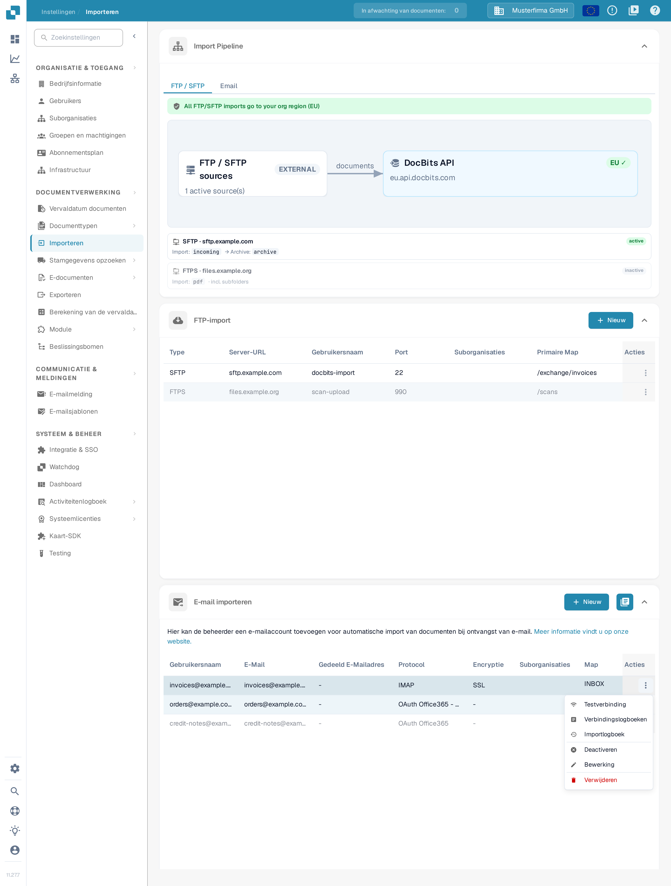<figcaption>
Het menu <strong>Acties</strong> van de voorbeeldpostbus <em>invoices@example.com</em>: <strong>Testverbinding</strong>, <strong>Verbindingslogboeken</strong>, <strong>Importlogboek</strong>, <strong>Deactiveren</strong>, <strong>Bewerking</strong> en <strong>Verwijderen</strong>. Deze verbinding is actief, daarom biedt het menu deactiveren aan.
</figcaption></figure>

### Nieuwe OAuth Office365-verbinding toevoegen

1. Klik op **Nieuw** in **E-mail importeren** en selecteer **OAuth Office365** onder **Protocol**. Selecteer **OAuth Office365 - Tenant** voor een door een beheerder beheerde tenant-applicatie en volg [O365 Tenant](o365-tenant.md).
2. Controleer **Documentroutering** vóór de authenticatie.

<figure>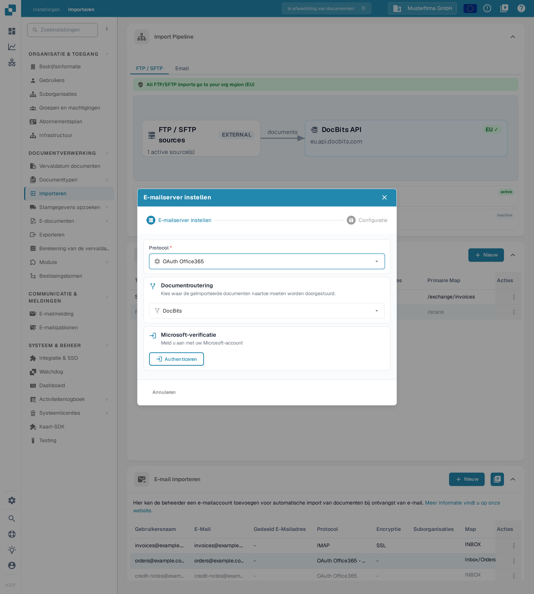<figcaption>
Kies de route vóór <strong>Authenticeren</strong>. Deze weergave is van vóór de aanmelding; er is geen Microsoft-authenticatie gestart.
</figcaption></figure>

3. Klik op **Authenticeren** om de Microsoft-aanmelding met apparaatcode te starten, voer de code in die DocBits toont en rond de koppeling daarna af met de bevestigingsknop van de wizard.
4. Controleer na de authenticatie de opties voor organisatie, map, gedeeld postvak, verplaatsmap en foutmeldingen die voor de verbinding worden aangeboden. Gebruik **Volgende** om verder te gaan naar **Configuratie** zodra dit beschikbaar is en sla daarna de gewenste instellingen op.
5. Activeer de opgeslagen verbinding wanneer automatische imports moeten worden uitgevoerd. Waar de app voor een opgeslagen verbinding een importactie aanbiedt, start die een daadwerkelijke import; gebruik deze bewust.

### Acties voor OAuth Office365

Het menu **Acties** van de opgeslagen verbinding biedt **Verbindingslogboeken**, **Importlogboek**, **Activeren**/**Deactiveren**, **Bewerking** en **Verwijderen**. Deactivering stopt de automatische verwerking; verwijdering verwijdert de configuratie.

### Importlogboek

Gebruik het logboekpictogram rechtsboven in **E-mail importeren** om imports over de geconfigureerde postvakverbindingen te bekijken. Gebruik de actie **Importlogboek** van een opgeslagen rij voor die verbinding. Controleer het onderwerp, de afzender, de status en de beschikbare foutdetails voordat u besluit of u het opnieuw probeert.

## Inkomende e-mails

De twee onderstaande schermafbeeldingen uit de handleiding tonen het inkomende DocBits-adres en de bijbehorende logboeken. Dit staat los van de postvakverbindingen hierboven.

* Gebruik het kopieerpictogram naast **E-Mail** om het ontvangstadres te kopiëren dat voor de huidige organisatie en omgeving wordt weergegeven.
* **Toevoegen** voegt een extra rij met een toegestane afzender toe in het formulier. Kies de afzender en de eventueel bedoelde suborganisatie en gebruik **Opslaan** om de configuratie op te slaan. Alleen een rij toevoegen slaat deze niet op.
* **Logboeken** opent het logboek voor inkomende e-mail. **Fouten** filtert op fouten; **Inkomend** en **Uitgaand** selecteren de berichtrichting.
* Vouw een logregel uit met de chevron om de bijlagedetails te bekijken. Het kopieerpictogram naast de trace-ID kopieert die ID voor probleemoplossing. **Originele e-mail** downloadt, waar beschikbaar voor een inkomende rij, het geselecteerde oorspronkelijke bericht als een `.eml`-bestand; de import wordt niet opnieuw geprobeerd.

## Videohandleiding: Inbox en foutopsporing


E-mailinbox en foutopsporing


[Bekijken met ondertiteling en hoofdstukken](https://docbits-videos.fra1.cdn.digitaloceanspaces.com/settings-assistant/email-import-admin/v2/nl.html)

Sommige oorspronkelijke productlabels kunnen in een andere taal staan. Technische veld-ID's blijven behouden.

Bij instellingen en import gebruik ik in dit voorbeeld het inkomende DocBits-adres. Een direct gekoppelde mailbox is een aparte importmethode. Voor deze training werk ik in een eigen demo-organisatie met synthetische facturen. Meldingen blijven uitgeschakeld.

Eerst controleer ik het weergegeven ontvangstadres en de reikwijdte. Het adres hoort precies bij deze organisatie en bij de bijbehorende omgeving. Voor een ander bedrijf of een productieomgeving gebruik ik altijd het adres dat daar daadwerkelijk wordt weergegeven.

Hier beperk ik de inbox tot onze goedgekeurde testafzender. Ik selecteer de toewijzing aan een suborganisatie alleen als deze bij het bedoelde proces hoort. Ik sla de instelling op en open deze opnieuw. De toegestane afzender is behouden; automatische antwoordmails blijven in deze training uitgeschakeld.

<figure>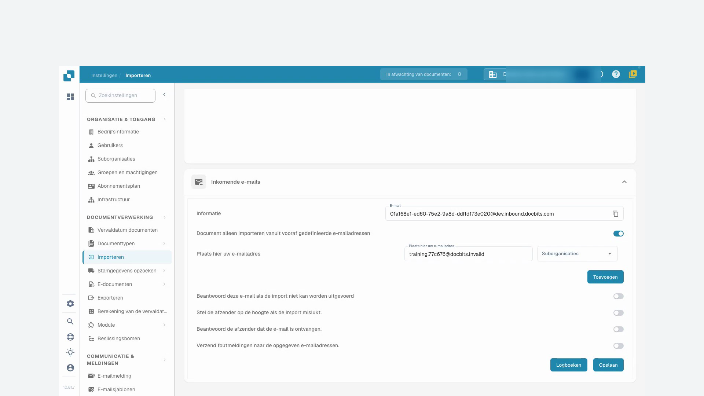<figcaption>
De kaart <strong>Inkomende e-mails</strong> uit de handleiding: de schakelaar voor vooraf gedefinieerde afzenders staat aan, in het adresveld staat het voorbeeldadres <em>training.77c676@docbits.invalid</em> en de vier meldingsschakelaars staan uit. Rechts staat het inkomende adres van de demo-organisatie met het kopieerpictogram.
</figcaption></figure>

Voor deze training is een testbericht rechtstreeks aan de verwerking van inkomende e-mail in DocBits aangeboden. Deze test bevestigt geen externe e-mailbezorging. In het logboek controleer ik het bijbehorende onderwerp, de afzender en de geïmporteerde bijlage. Daarna controleer ik het document dat daadwerkelijk is aangemaakt.

Ik open het bijbehorende document en vergelijk de PDF-bijlage met de factuur in DocBits. Bestandsnaam, factuurnummer, leverancier en bedrag moeten overeenkomen. Een geslaagde import zegt niets over een goedkeuring of een ERP-boeking.

Een tweede gecontroleerde test komt van een niet-goedgekeurde afzender. In het logboek zoek ik gericht naar deze inkomende e-mail en activeer ik het foutenfilter. De details noemen de afgewezen afzender. Ik controleer de oorzaak aan de hand van het onderwerp en de trace-ID, in plaats van de import meerdere keren te starten.

In een echt geval zoek ik eerst uit of deze afzender überhaupt bevoegd is. Een goedgekeurde wijziging van de afzenderlijst wordt opgeslagen en opnieuw gecontroleerd. Daarna verifieer ik een nieuwe, unieke testinvoer tot aan het aangemaakte document. Voor technische fouten geef ik de trace-ID en de concrete foutmelding door.

<figure>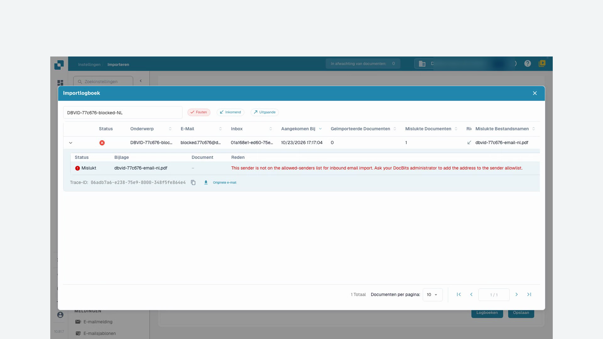<figcaption>
Het venster <strong>Importlogboek</strong> uit de handleiding met het filter <strong>Fouten</strong>: de mislukte import van de bijlage <em>dbdc-77c676-email-nl.pdf</em> met status <strong>Mislukt</strong>. De reden staat in het Engels omdat de app deze melding niet vertaalt: de afzender staat niet op de lijst met toegestane afzenders. Daaronder staan de trace-ID met het kopieerpictogram en de link <strong>Originele e-mail</strong>.
</figcaption></figure>
