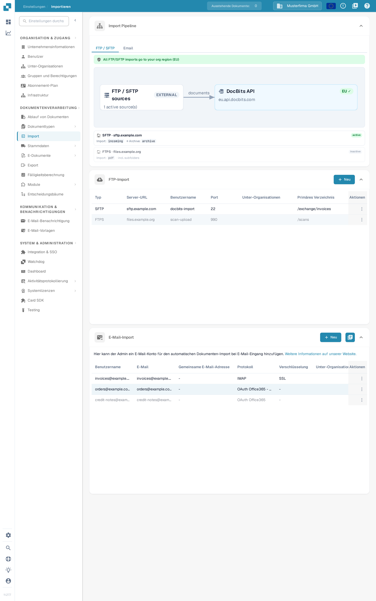
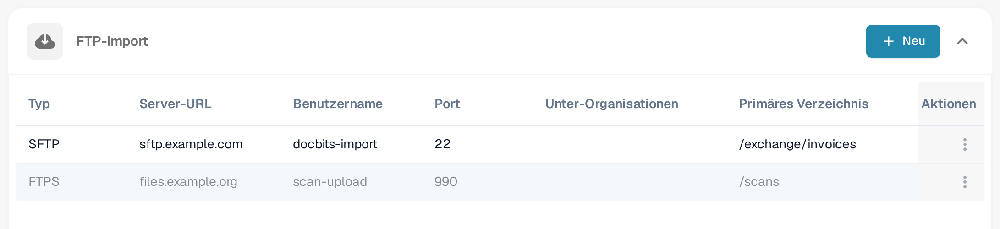
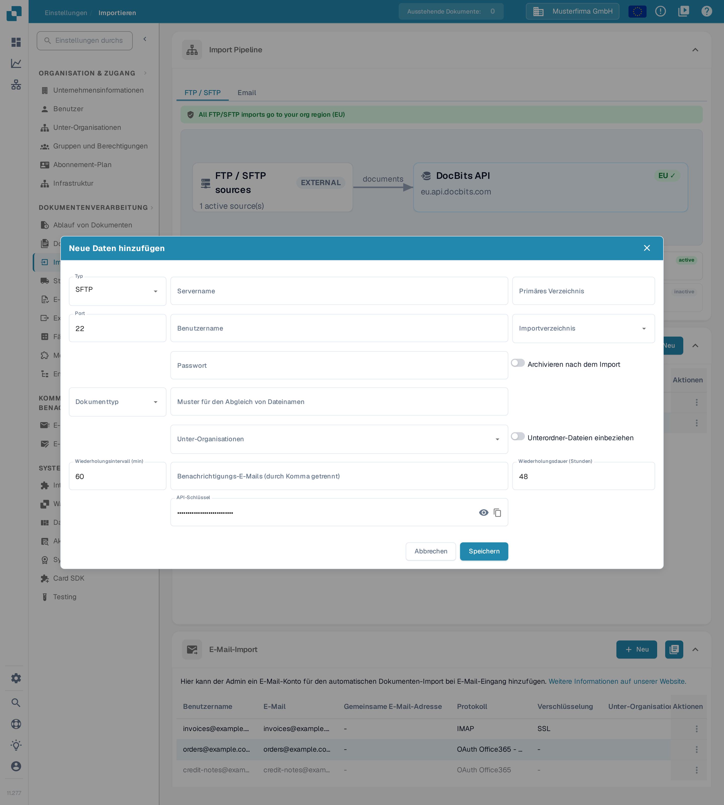
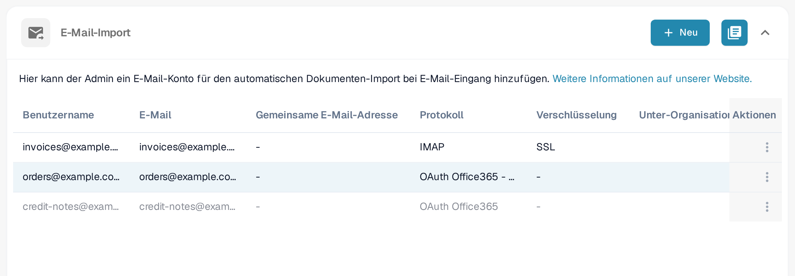
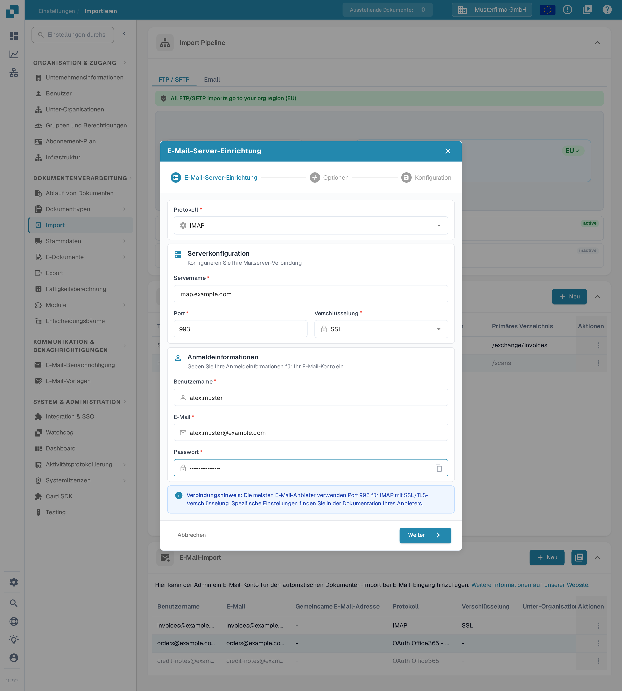
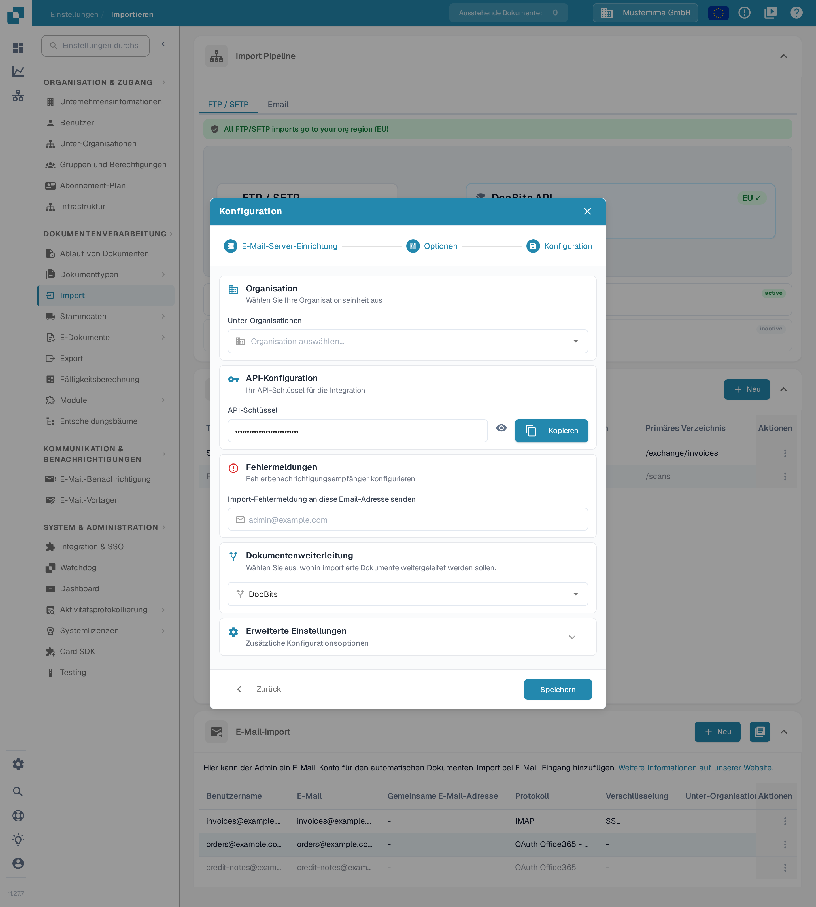
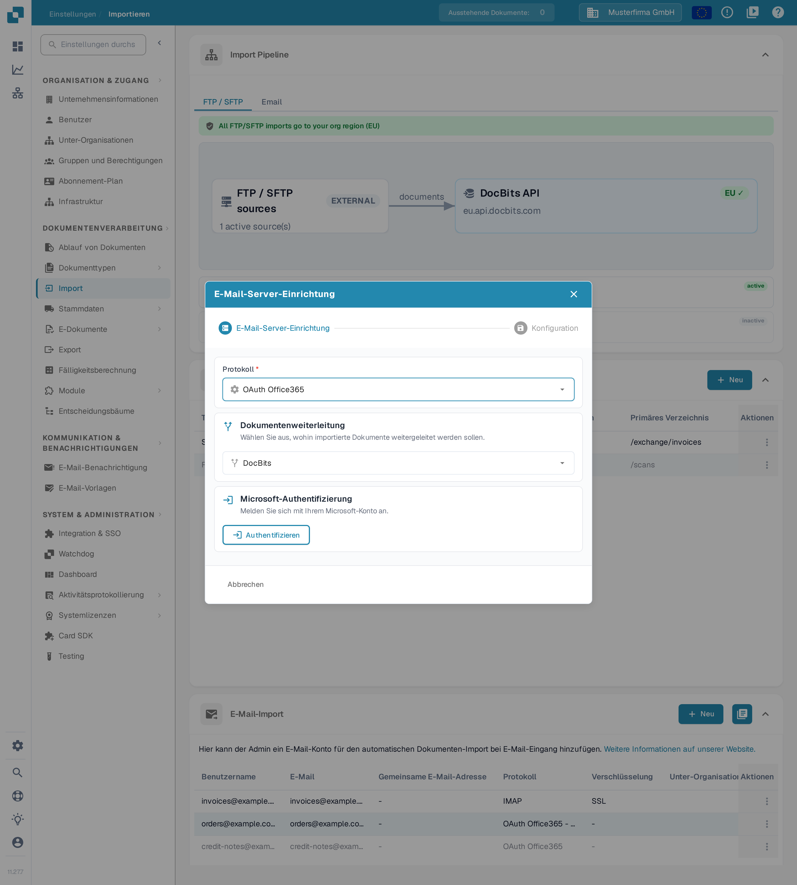
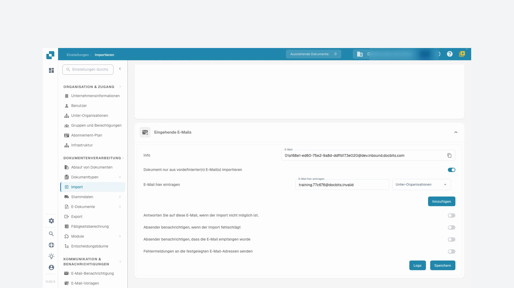
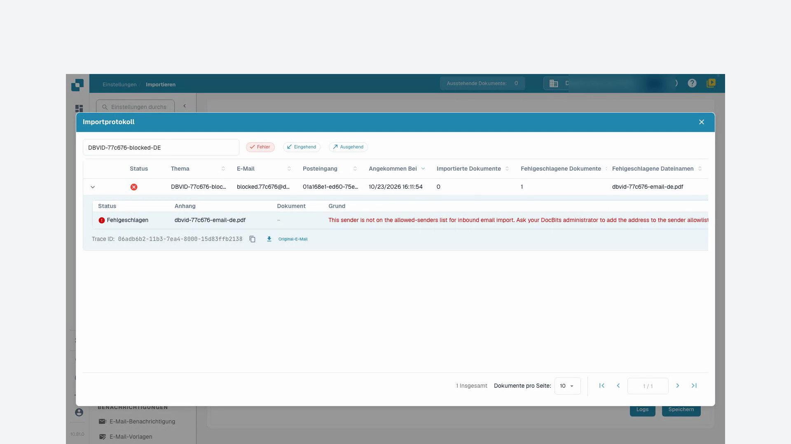

# Importieren

## Überblick

Zum Erstellen einer Verbindung ist ein Administratorkonto erforderlich. Mit **Import** konfigurieren Sie den automatischen Dokumentimport von einem FTP/SFTP-Server, aus einem angebundenen Postfach oder über die eingehende DocBits-E-Mail-Adresse. Prüfen Sie die aktuelle Organisation und Umgebung, bevor Sie Verbindungsdaten eingeben.

<figure><figcaption>
Die Seite Importieren: das schreibgeschützte Diagramm Import Pipeline, die Karte FTP-Import und die Karte E-Mail-Import, jeweils mit eigener Schaltfläche <strong>Neu</strong>.
</figcaption></figure>

## Zugriff

1. Navigieren Sie zu **Einstellungen** → **Dokumentenverarbeitung** → **Import**.
2. Klappen Sie den gewünschten Bereich auf. **FTP-Import** und **E-Mail-Import** haben jeweils eine eigene Schaltfläche **Neu**.

## **Dokumenteinstellungen**

Die aktuelle Seite Importieren enthält **Import Pipeline**, **FTP-Import**, **E-Mail-Import** und, sofern aktiviert, **Eingehende E-Mails**. Das Kürzen von Seiten, standardmäßige Zahlungsbedingungen und Datumsmusterfelder sind in dieser Import-Ansicht keine Bedienelemente.

**Import Pipeline** zeigt die FTP/SFTP-Routing-Topologie einschließlich Quell- und Zielregionen. Prüfen Sie jeden angezeigten Hinweis, bevor Sie eine Verbindung ändern. Die Beschriftungen im Diagramm selbst bleiben derzeit englisch; das ist die Anzeige der Anwendung und keine Einstellung. Der Pipeline-Reiter **Email** zeigt derzeit nur den Hinweis, dass die E-Mail-Ansicht folgt; ein Diagramm zur E-Mail-Verarbeitung wird nicht angezeigt.

## **FTP-Import**

<figure><figcaption>
Die Karte FTP-Import mit der Schaltfläche <strong>Neu</strong>, den Spalten Typ, Server-URL, Benutzername, Port, Unter-Organisationen, Primäres Verzeichnis und Aktionen sowie je Zeile dem Menü <strong>Aktionen</strong>. Server, Benutzername und Verzeichnis sind erfundene Beispieldaten; in diesem Beispiel ist keine Verbindung gespeichert oder geändert.
</figcaption></figure>

### Voraussetzungen

* Ein FTP-, FTPS- oder SFTP-Server, der vom Importdienst erreichbar ist.
* Die von Ihrem Administrator bereitgestellte Serveradresse, das Protokoll, der Port, der Benutzername und das Passwort.
* Ein Importverzeichnis und, falls eine Archivierung erforderlich ist, ein freigegebenes Archivverzeichnis.

### Neue Verbindung hinzufügen

1. Klicken Sie in **FTP-Import** auf **Neu**.
2. Geben Sie die Verbindungseinstellungen ein. Ein neues Formular **Neue Daten hinzufügen** startet mit **SFTP** und Port **22**; ersetzen Sie diese Werte, wenn Ihr Server ein anderes Protokoll oder einen anderen Port verwendet.

<figure><figcaption>
Das Formular <strong>Neue Daten hinzufügen</strong> direkt nach dem Öffnen: Typ <strong>SFTP</strong>, Port <strong>22</strong> und die Standardwerte 60 Minuten und 48 Stunden. Der API-Schlüssel Ihrer Organisation erscheint nur als Punkte. Es wurden keine Eingaben gemacht und nichts gespeichert.
</figcaption></figure>

* **Typ**, **Servername**, **Port**, **Benutzername** und **Passwort** identifizieren und authentifizieren die Serververbindung.
* **Primäres Verzeichnis** legt das Basisverzeichnis fest. **Importverzeichnis** wählt den zu verarbeitenden Ordner; die Ordnerauswahl wird verfügbar, nachdem die Verbindung gespeichert wurde.
* **Dokumenttyp** und **Unter-Organisationen** steuern die Zuordnung. **Muster für den Abgleich von Dateinamen** begrenzt, welche Dateinamen berücksichtigt werden.
* **Archivieren nach dem Import** ermöglicht das Verschieben verarbeiteter Dateien in das angegebene Archivverzeichnis. **Unterordner-Dateien einbeziehen** erweitert die Verarbeitung auf Unterordner.
* **Wiederholungsintervall (min)**, **Wiederholungsdauer (Stunden)** und **Benachrichtigungs-E-Mails (durch Komma getrennt)** steuern Wiederholungs- und Benachrichtigungsverhalten. Die dargestellten Standardwerte sind 60 Minuten und 48 Stunden.
* **API-Schlüssel** verwendet den vorhandenen App-Subscription-Schlüssel der Organisation. Das Augensymbol zeigt diesen Schlüssel an oder blendet ihn aus; **Kopieren** kopiert ihn in die Zwischenablage. Diese Bedienelemente erzeugen keinen neuen Schlüssel. Behandeln Sie den Schlüssel vertraulich; nehmen Sie ihn nicht in Screenshots oder Supportnachrichten auf.

Mit **Abbrechen** oder dem Schließen-Symbol verlassen Sie ein neues Verbindungsformular, ohne es zu speichern.

3. Prüfen Sie die Werte und klicken Sie auf **Speichern**, wenn die Verbindung erstellt werden kann.
4. Wählen Sie im Menü **Aktionen** der gespeicherten Zeile **Aktivieren**, wenn Importe ausgeführt werden dürfen.

### Aktionen für FTP

Das Menü **Aktionen** der gespeicherten Verbindung bietet:

* **Verbindung testen**: kontaktiert den konfigurierten Server, um die Verbindung zu prüfen.
* **Verbindungsprotokolle**: zeigt Verbindungsversuche und Fehler.
* **Aktivieren/Deaktivieren**: aktiviert oder stoppt die automatische Verarbeitung für diese Verbindung.
* **Bearbeiten**: ändert die Konfiguration.
* **Löschen**: entfernt die Verbindung.

Testen, Aktivieren, Bearbeiten und Löschen wirken auf eine echte Verbindung. Prüfen Sie die ausgewählte Zeile und Organisation, bevor Sie diese Aktionen verwenden.

## **E-Mail-Import**

Ein angebundenes Postfach ist von der eingehenden DocBits-E-Mail-Adresse aus der untenstehenden Videoanleitung zu unterscheiden. Wählen Sie die Methode, die zu Ihrem Prozess passt.

<figure><figcaption>
Die Karte <strong>E-Mail-Import</strong>: <strong>Neu</strong> legt eine Postfachverbindung an, das Symbol daneben öffnet das Importprotokoll. Die Beispielzeilen zeigen erfundene Postfächer; sichtbar sind die Spalten Benutzername, E-Mail, Gemeinsame E-Mail-Adresse, Protokoll, Verschlüsselung und Aktionen. In diesem Beispiel wurde nichts gespeichert oder geändert.
</figcaption></figure>

<mark style="color:red;">**Hinweis**</mark>: Es werden nur Dokumente mit den folgenden Dateitypen importiert:

* `.pdf`
* `.tiff` / `.tif`
* `.eml`
* `.dat`
* `.xml`
* `.edi`
* `.purchaseorder`


**Wie Anhänge erkannt werden**

Zusätzlich zu den oben aufgeführten Dateiendungen erkennt DocBits ein Dokument auch an seinem **tatsächlichen Dateiinhalt** (Dateisignatur) und nicht nur am Inhaltstyp, den das sendende Mailsystem angibt. Das ist bei **weitergeleiteten** Mails wichtig: Zwischengeschaltete Mailserver/Gateways kennzeichnen einen Anhang häufig mit einem allgemeinen Typ (`application/octet-stream`) statt beispielsweise mit `application/pdf` oder `application/xml`. DocBits erkennt und importiert solche Anhänge dennoch korrekt.

* **Weitergeleitete `.eml`**-Nachrichten und Outlook-Anhänge **`winmail.dat`** (TNEF) werden entpackt, und die darin enthaltenen Dokumente werden importiert.
* **XML-Kodierung:** Wird eine XML-Rechnung mit einem allgemeinen Typ (`application/octet-stream`) gekennzeichnet, erkennt DocBits sie an ihrer Deklaration `<?xml` und toleriert dabei eine vorangestellte **UTF-8**- oder **UTF-16**-Byte-Order-Mark (BOM, LE/BE) — derzeit werden nur diese BOM-Kodierungen automatisch anhand des Inhalts erkannt. Ein Anhang, der einen Dateinamen mit `.xml` behält, wird unabhängig von seiner Kodierung importiert.
* **Ignoriert:** Inline-Bilder, die in einer Mail mitgeführt werden (Signaturlogos / eingebettete Grafiken — PNG, JPG, GIF, BMP), werden stillschweigend übersprungen und **nicht** als fehlgeschlagene Importe gezählt.

Kann ein Anhang nicht importiert werden und ist für die Eingangsadresse die Option **„Antworten Sie auf diese E-Mail, wenn der Import nicht möglich ist.“** aktiviert, wird die konfigurierte Antwortadresse benachrichtigt.


### Neue IMAP-Verbindung hinzufügen

1. Klicken Sie in **E-Mail-Import** auf **Neu** und wählen Sie unter **Protokoll** den Eintrag **IMAP**.
2. Geben Sie in **E-Mail-Server-Einrichtung** den Servernamen, den Port, die Verschlüsselung, den Benutzernamen, die E-Mail-Adresse und das Passwort ein. Verwenden Sie die von Ihrem Mailprovider geforderten Werte; die angezeigte 993 ist ein Portbeispiel und keine abgeschlossene Einstellung.

<figure><figcaption>
Der erste Schritt <strong>E-Mail-Server-Einrichtung</strong> mit erfundenen Beispieldaten: Protokoll <strong>IMAP</strong>, Servername <strong>imap.example.com</strong>, Port <strong>993</strong>, Verschlüsselung <strong>SSL</strong>, Benutzername <strong>alex.muster</strong>. Das Passwort erscheint nur als Punkte. In diesem Beispiel wurde nichts gespeichert.
</figcaption></figure>

Das Kopiersymbol neben **Passwort** kopiert das eingegebene Passwort in die Zwischenablage. Mit **Abbrechen** oder dem Schließen-Symbol verlassen Sie diesen Assistenten für eine neue Verbindung, ohne sie zu speichern.

3. Klicken Sie auf **Weiter**, um **Optionen** zu öffnen. Wählen Sie, ob **Angehängte Dokumente zusammenführen** oder **Importieren doppelter Dateinamen blockieren** gelten soll. **E-Mail-Benachrichtigung** sendet nach dem Import eine Bestätigungs-E-Mail; aktivieren Sie die Option nur, wenn dieses Verhalten gewünscht ist.

<figure><figcaption>
Der Schritt <strong>Optionen</strong> derselben Beispielverbindung aus <em>imap.example.com</em> trennt das Importverhalten von der E-Mail-Benachrichtigung. Beide Kontrollkästchen und der Benachrichtigungsschalter sind ausgeschaltet; gespeichert wurde nichts.
</figcaption></figure>

4. Klicken Sie auf **Weiter**, um **Konfiguration** zu öffnen. Wählen Sie die erforderlichen **Unter-Organisationen**, prüfen Sie den vorhandenen **API-Schlüssel**, legen Sie unter **Fehlermeldungen** den Empfänger für Importfehler fest und kontrollieren Sie **Dokumentenweiterleitung**. Klappen Sie **Erweiterte Einstellungen** nur auf, wenn der Prozess zusätzliche Optionen benötigt.

<figure><figcaption>
Der Schritt <strong>Konfiguration</strong> bündelt Organisationszuordnung, den vorhandenen Schlüssel, Fehlermeldungen und die Weiterleitung. Der API-Schlüssel ist nur als Punkte sichtbar, das Feld für Importfehler ist mit der Beispieladresse <em>alex.muster@example.com</em> vorbelegt, und <strong>Speichern</strong> wurde nicht verwendet.
</figcaption></figure>

In **Konfiguration** zeigt oder verbirgt das Augensymbol den vorhandenen **API-Schlüssel**, und **Kopieren** kopiert ihn in die Zwischenablage. Keines der beiden Bedienelemente erzeugt einen neuen Schlüssel.

5. Klicken Sie auf **Speichern**, wenn die Konfiguration fertig ist. Verwenden Sie anschließend **Aktivieren** im Menü **Aktionen** der gespeicherten Verbindung, um die automatische Verarbeitung zu starten.

Bei einer gespeicherten IMAP-Verbindung bietet **Bearbeiten** Optionen für Ordner und die Behandlung nach dem Import. Wählen Sie den Quellordner und den Zielordner für verschobene E-Mails erst, nachdem die Verbindung erstellt wurde und die verfügbaren Ordner geladen werden können.

### Aktionen für IMAP

Das Menü **Aktionen** der gespeicherten Verbindung bietet **Verbindung testen**, **Verbindungsprotokolle**, **Importprotokoll**, **Aktivieren/Deaktivieren**, **Bearbeiten** und **Löschen**. Der Verbindungstest kontaktiert das konfigurierte Postfach; die Aktivierung schaltet die Verarbeitung ein. Prüfen Sie die Protokolle, bevor Sie einen fehlgeschlagenen Import wiederholen.

### Neue OAuth Office365-Verbindung hinzufügen

1. Klicken Sie in **E-Mail-Import** auf **Neu** und wählen Sie unter **Protokoll** den Eintrag **OAuth Office365**. Für eine vom Administrator verwaltete Tenant-Anwendung wählen Sie **OAuth Office365 - Tenant** und beachten [O365 Tenant](o365-tenant.md).
2. Prüfen Sie **Dokumentenweiterleitung** vor der Authentifizierung.

<figure><figcaption>
Wählen Sie die Weiterleitung vor <strong>Authentifizieren</strong>. Diese Ansicht zeigt den Zustand vor der Anmeldung; es wurde keine Microsoft-Authentifizierung gestartet.
</figcaption></figure>

3. Klicken Sie auf **Authentifizieren**, wenn die Postfachverbindung freigegeben ist. Schließen Sie die Microsoft-Anmeldung per Gerätecode mit dem von DocBits angezeigten Code ab, kehren Sie zurück und schließen Sie die Authentifizierung ab.
4. Prüfen Sie nach der Authentifizierung die für die Verbindung angebotenen Optionen zu Organisation, Ordner, freigegebenem Postfach, Zielordner und Fehlerbenachrichtigung. Verwenden Sie **Weiter**, um zu **Konfiguration** zu wechseln, sobald es verfügbar ist, und speichern Sie dann die gewünschten Einstellungen.
5. Aktivieren Sie die gespeicherte Verbindung, wenn automatische Importe laufen sollen. **Import** startet, sofern für eine gespeicherte Verbindung angeboten, einen tatsächlichen Import; verwenden Sie diese Aktion bewusst.

### Aktionen für OAuth Office365

Das Menü **Aktionen** der gespeicherten Verbindung bietet **Verbindungsprotokolle**, **Importprotokoll**, **Aktivieren/Deaktivieren**, **Bearbeiten** und **Löschen**. Das Deaktivieren stoppt die automatische Verarbeitung; das Löschen entfernt die Konfiguration.

### Importprotokoll

Mit dem Protokollsymbol oben rechts in **E-Mail-Import** prüfen Sie Importe über alle konfigurierten Postfachverbindungen. Für eine einzelne Verbindung verwenden Sie die Aktion **Importprotokoll** in der gespeicherten Zeile. Prüfen Sie Betreff, Absender, Status und die verfügbaren Fehlerdetails, bevor Sie über eine Wiederholung entscheiden.

## Eingehende E-Mails

Die beiden Screenshots der Anleitung unten zeigen die eingehende DocBits-Adresse und ihre Protokolle. Das ist von den oben beschriebenen Postfachverbindungen zu unterscheiden.

* Mit dem Kopiersymbol neben **E-Mail** kopieren Sie die Empfangsadresse, die für die aktuelle Organisation und Umgebung angezeigt wird.
* **hinzufügen** fügt im Formular eine weitere Zeile für einen zulässigen Absender ein. Wählen Sie den Absender und gegebenenfalls die vorgesehene Unterorganisation und speichern Sie die Konfiguration mit **Speichern**. Das bloße Hinzufügen einer Zeile speichert sie nicht.
* **Logs** öffnet das Protokoll der eingehenden E-Mails. Die Filter **Fehler**, **Eingehend** und **Ausgehend** schränken die Liste ein.
* Klappen Sie eine Protokollzeile über das Pfeilsymbol auf, um Anhangsdetails zu prüfen. Das Kopiersymbol neben der Kennung der Ablaufverfolgung kopiert diese Kennung für die Fehlersuche. Die Schaltfläche für die Originalnachricht lädt, sofern für eine eingehende Zeile verfügbar, die ausgewählte Nachricht als `.eml`-Datei herunter; ein erneuter Import wird dabei nicht ausgelöst.

## Videoanleitung: E-Mail-Postfach und Fehlersuche


E-Mail-Postfach und Fehlersuche


[Mit Untertiteln und Kapiteln ansehen](https://docbits-videos.fra1.cdn.digitaloceanspaces.com/settings-assistant/email-import-admin/v2/de.html)

Einzelne native Produktbeschriftungen können in einer anderen Sprache verbleiben. Technische Feld-IDs bleiben erhalten.

Unter Einstellungen und Import verwende ich in diesem Beispiel die eingehende DocBits-Adresse. Ein direkt angebundenes Postfach ist eine eigene Importmethode. Für diese Schulung arbeite ich in einer eigenen Demoorganisation mit synthetischen Rechnungen. Benachrichtigungen bleiben ausgeschaltet.

Zuerst prüfe ich die angezeigte Empfangsadresse und den Geltungsbereich. Die Adresse gehört genau zu dieser Organisation und ihrer Umgebung. Für ein anderes Unternehmen oder eine Produktionsumgebung verwende ich immer die dort tatsächlich angezeigte Adresse.

Hier beschränke ich den Posteingang auf unseren freigegebenen Testabsender. Die Zuordnung zu einer Unterorganisation wähle ich nur, wenn sie zum vorgesehenen Prozess gehört. Ich speichere die Einstellung und öffne sie erneut. Der zulässige Absender ist erhalten geblieben; automatische Antwort-E-Mails bleiben in dieser Schulung ausgeschaltet.

<figure><figcaption>
Zulässiger Absender gespeichert, Benachrichtigungen ausgeschaltet
</figcaption></figure>

Für diese Schulung wurde eine Testnachricht direkt an die DocBits-Eingangsverarbeitung übergeben. Dieser Test bestätigt keine externe E-Mail-Zustellung. Im Protokoll prüfe ich den passenden Betreff, den Absender und den importierten Anhang. Anschließend prüfe ich das tatsächlich erstellte Dokument.

Ich öffne das zugehörige Dokument und vergleiche den PDF-Anhang mit der Rechnung in DocBits. Dateiname, Rechnungsnummer, Lieferant und Betrag müssen übereinstimmen. Ein erfolgreicher Import sagt nichts über eine Freigabe oder eine ERP-Buchung aus.

Ein zweiter kontrollierter Test stammt von einem nicht freigegebenen Absender. Im Protokoll suche ich gezielt nach diesem Eingang und aktiviere den Fehlerfilter **Fehler**. Die Details nennen den abgelehnten Absender. Ich prüfe die Ursache anhand des Betreffs und der Kennung der Ablaufverfolgung, statt den Import mehrfach auszulösen.

In einem echten Fall kläre ich zuerst, ob dieser Absender überhaupt berechtigt ist. Eine genehmigte Änderung an der Absenderliste wird gespeichert und erneut geprüft. Danach überprüfe ich einen neuen eindeutigen Testeingang bis zum erstellten Dokument. Bei technischen Fehlern übergebe ich die Kennung der Ablaufverfolgung und die konkrete Fehlermeldung.

<figure><figcaption>
Fehlgeschlagener Import mit Anhang, Ursache und Trace
</figcaption></figure>
