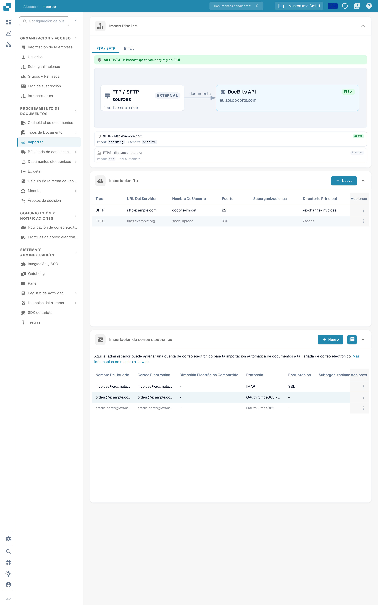
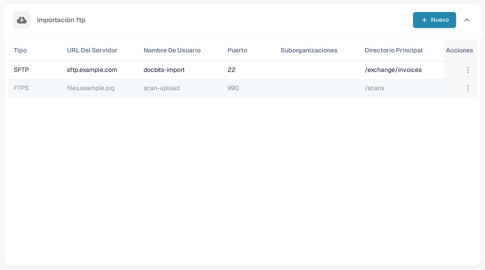
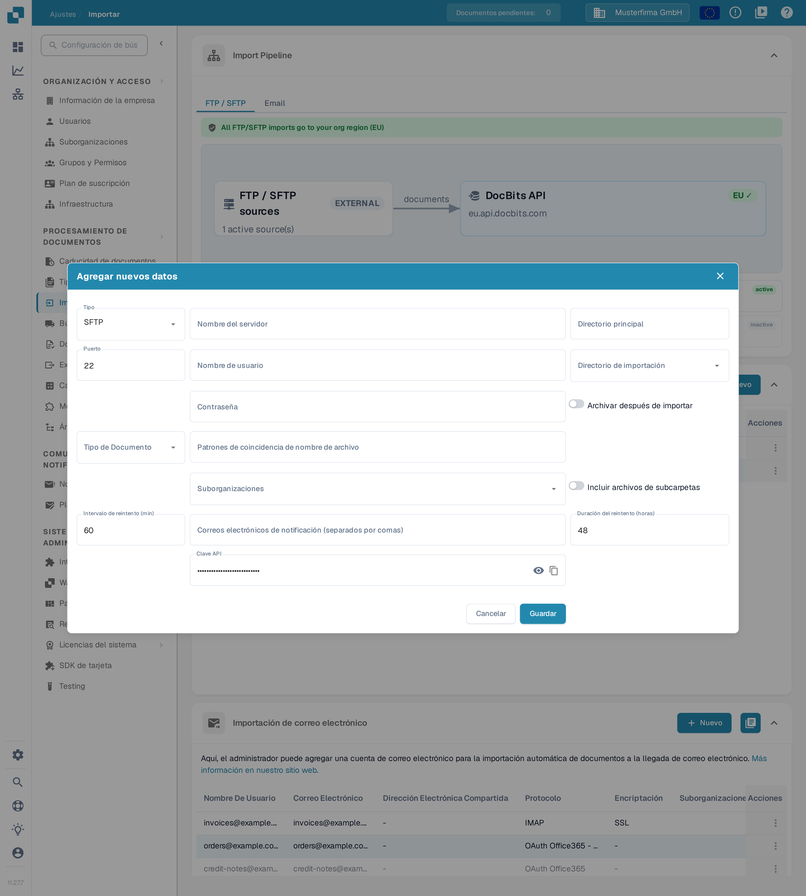
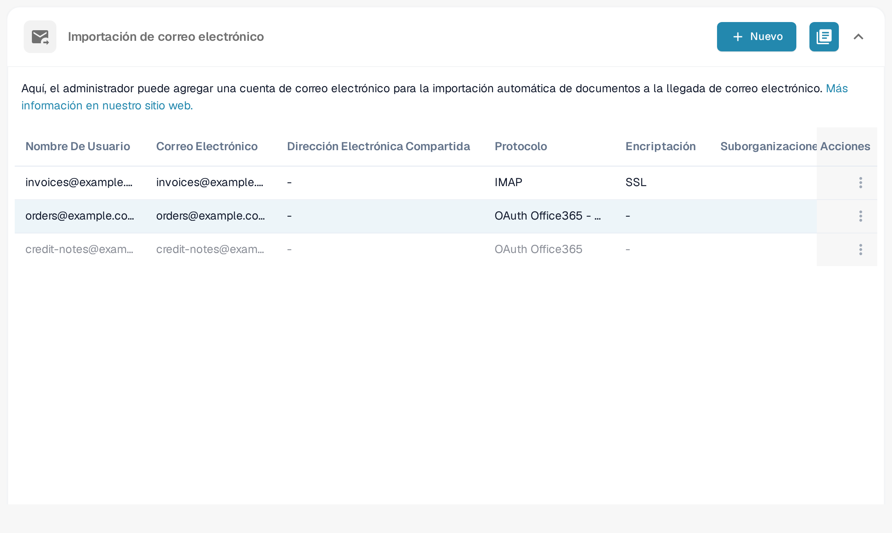
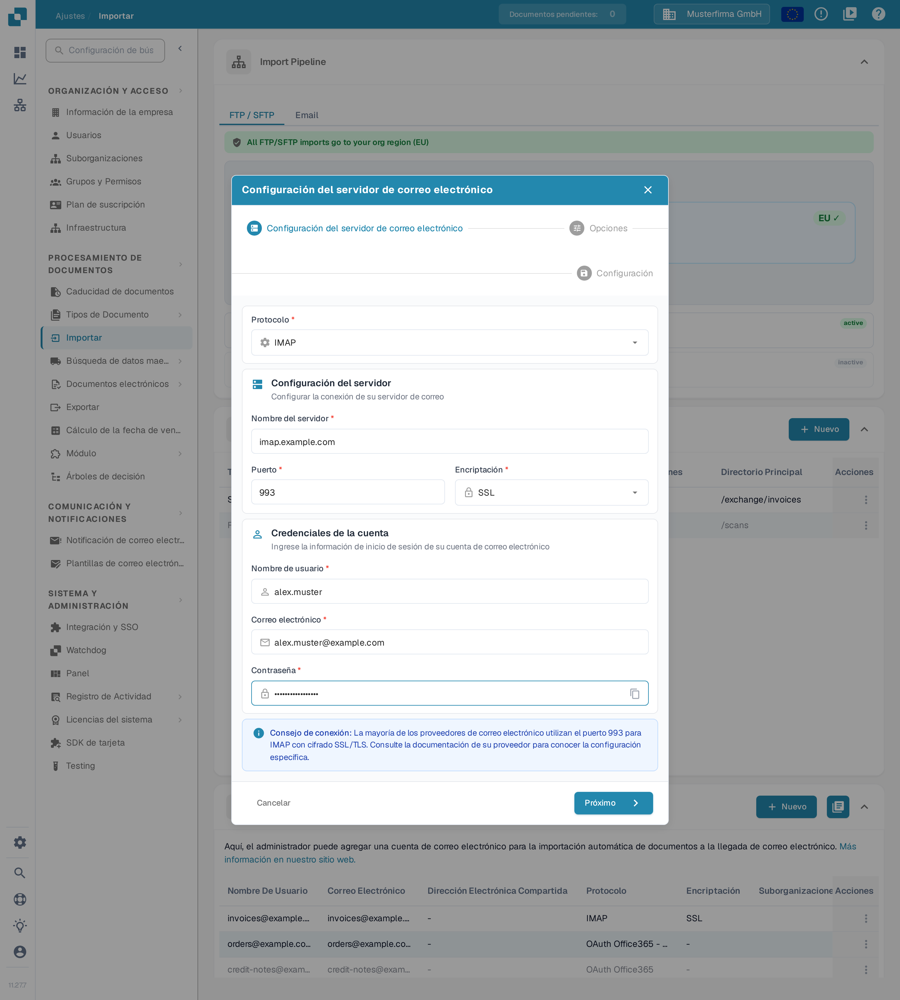
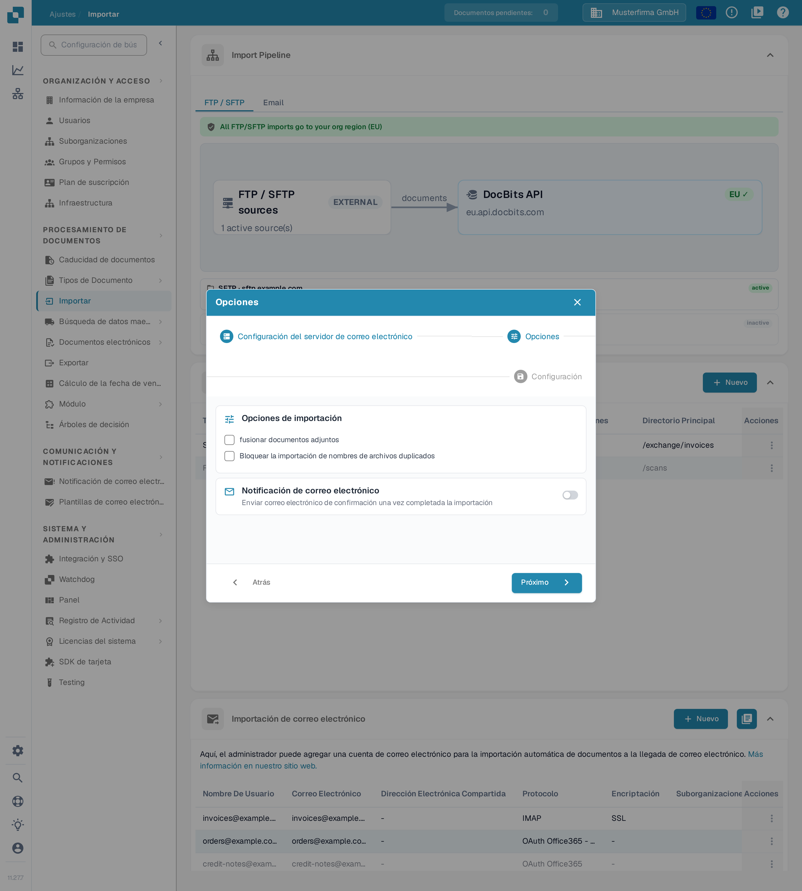
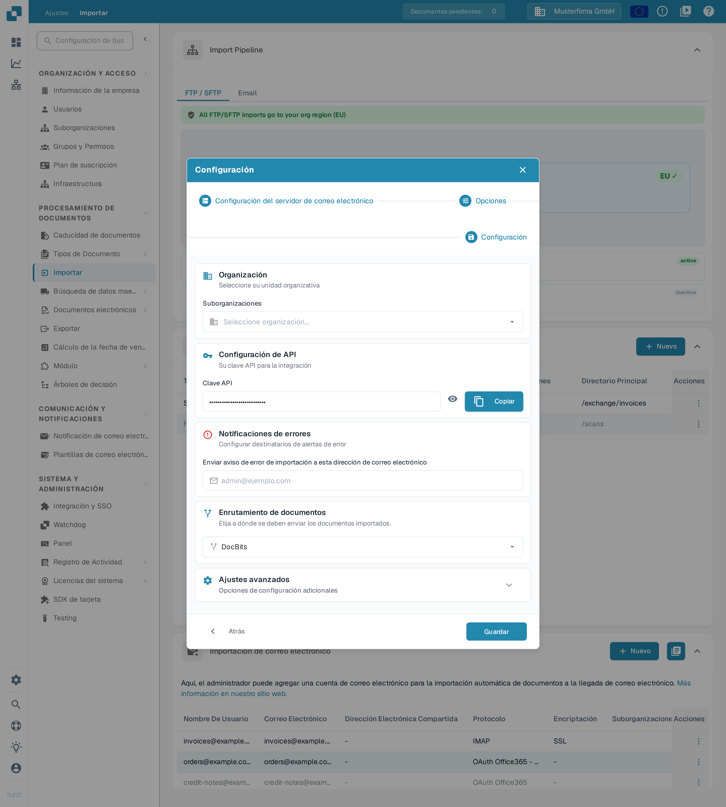
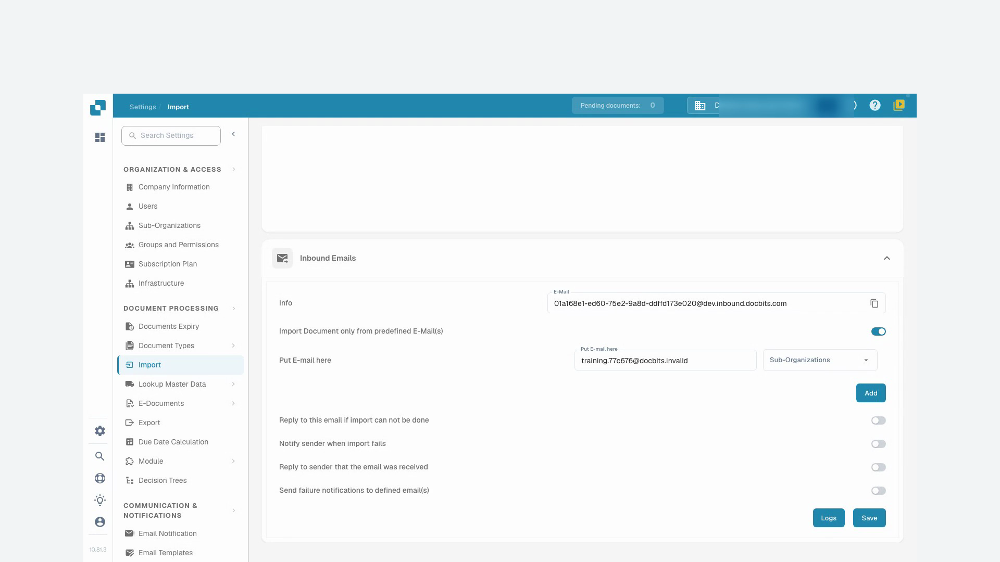
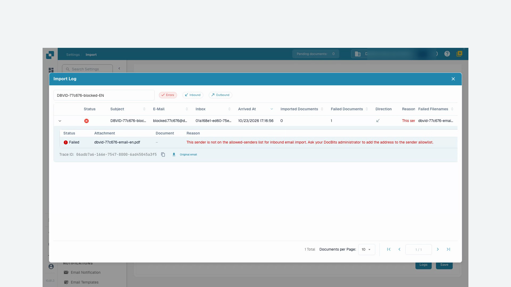

# Importar

## Descripción general

Para crear una conexión se necesita una cuenta de administrador. Use **Importar** para configurar la importación automática de documentos desde un servidor FTP/SFTP, un buzón conectado o la dirección de correo entrante de DocBits. Compruebe la organización y el entorno actuales antes de introducir los datos de conexión.

<figure><figcaption>
La página <strong>Importar</strong>: arriba el diagrama <strong>Import Pipeline</strong> de solo lectura, debajo la lista <strong>Importación ftp</strong> y la lista <strong>Importación de correo electrónico</strong>, cada una con su propio botón <strong>Nuevo</strong>.
</figcaption></figure>

## Cómo acceder

1. Vaya a **Ajustes** → **Procesamiento de documentos** → **Importar**.
2. Despliegue la sección necesaria. **Importación ftp** e **Importación de correo electrónico** tienen cada una su propio botón **Nuevo**.

## **Contenido de la página Importar**

La página Importar contiene hoy **Import Pipeline**, **Importación ftp**, **Importación de correo electrónico** y, cuando está habilitada, **Correos electrónicos entrantes**. El recorte de páginas, los plazos de pago predeterminados y los campos de patrón de fecha no son controles de esta vista.

**Import Pipeline** muestra la topología de enrutamiento FTP/SFTP, incluidas las regiones de origen y destino. Revise cualquier aviso mostrado antes de cambiar una conexión. La pestaña de pipeline **Email** muestra actualmente un mensaje de próxima disponibilidad; no muestra ningún diagrama de procesamiento de correo.

## **Importación ftp**

<figure><figcaption>
La lista <strong>Importación ftp</strong>: cada fila es una conexión con su tipo, servidor, usuario, puerto y directorio principal. Use <strong>Nuevo</strong> para añadir una conexión. Las conexiones de ejemplo de esta captura son datos inventados de demostración.
</figcaption></figure>

### Requisitos

* Un servidor FTP, FTPS o SFTP accesible por el servicio de importación.
* La dirección del servidor, el protocolo, el puerto, el nombre de usuario y la contraseña facilitados por su administrador.
* Un directorio de importación y, si se requiere archivado, un directorio de archivo aprobado.

### Añadir nueva conexión

1. Haga clic en **Nuevo** en **Importación ftp**.
2. Introduzca los ajustes de conexión. Un formulario nuevo comienza con **SFTP** y el puerto **22**; sustituya estos valores cuando su servidor use otro protocolo o puerto.

<figure><figcaption>
El formulario <strong>Agregar nuevos datos</strong> con los valores predeterminados <strong>SFTP</strong>, puerto <strong>22</strong>, reintento <strong>60</strong> minutos y duración de reintento <strong>48</strong> horas. Los campos de servidor, usuario y contraseña están vacíos y la clave API solo se muestra enmascarada; este ejemplo no se ha guardado.
</figcaption></figure>

* **Nombre del servidor**, **Puerto**, **Nombre de usuario** y **Contraseña** identifican y autentican la conexión con el servidor.
* **Directorio principal** define el directorio base. **Directorio de importación** selecciona la carpeta que se va a procesar; la selección de carpetas está disponible una vez guardada la conexión.
* **Tipo de Documento** y **Suborganizaciones** controlan la asignación. **Patrones de coincidencia de nombre de archivo** limita los nombres de archivo que se tienen en cuenta.
* **Archivar después de importar** permite mover los archivos procesados al directorio de archivo indicado. **Incluir archivos de subcarpetas** amplía el procesamiento a las subcarpetas.
* **Intervalo de reintento (min)**, **Duración del reintento (horas)** y **Correos electrónicos de notificación (separados por comas)** controlan el comportamiento de reintento y de notificación. Los valores predeterminados de la ilustración son 60 minutos y 48 horas.
* **Clave API** usa la clave de suscripción de aplicación existente de la organización. El icono del ojo muestra u oculta esa clave; el icono de copia la copia al portapapeles. Estos controles no crean una clave nueva. Manténgala confidencial; no la incluya en capturas de pantalla ni en mensajes de soporte.

Use **Cancelar** o el icono de cierre para salir de un formulario de conexión nueva sin guardarlo.

3. Revise los valores y haga clic en **Guardar** cuando la conexión esté lista para crearse.
4. En el menú **Acciones** de la fila guardada, elija **Activar** cuando las importaciones estén autorizadas a ejecutarse.

### Acciones para FTP

El menú **Acciones** de la conexión guardada ofrece:

* **Conexión de prueba**: contacta con el servidor configurado para comprobar la conexión.
* **Registros de conexión**: inspeccione los intentos de conexión y los errores.
* **Activar/Desactivar**: habilita o detiene el procesamiento automático de esta conexión.
* **Editar**: cambia su configuración.
* **Borrar**: elimina la conexión.

Las pruebas, la activación, la edición y la eliminación afectan a una conexión real. Verifique la fila y la organización seleccionadas antes de usarlas.

## **Importación de correo electrónico**

Un buzón conectado es distinto de la dirección de correo entrante de DocBits que se describe en el tutorial siguiente. Elija el método que se ajuste a su proceso.

<figure><figcaption>
La lista <strong>Importación de correo electrónico</strong> muestra el protocolo de cada buzón (<strong>IMAP</strong>, <strong>OAuth Office365</strong> u <strong>OAuth Office365 - Tenant</strong>) y su enrutamiento de documentos. Use <strong>Nuevo</strong> para añadir un buzón; los buzones de ejemplo son datos inventados de demostración.
</figcaption></figure>

<mark style="color:red;">**Nota**</mark>: Solo se importarán documentos con los siguientes tipos de archivo:

* `.pdf`
* `.tiff` / `.tif`
* `.eml`
* `.dat`
* `.xml`
* `.edi`
* `.purchaseorder`


**Cómo se reconocen los archivos adjuntos**

Además de las extensiones de archivo indicadas arriba, DocBits también identifica un documento por su **contenido real** (firma de archivo), no solo por el tipo de contenido declarado por el sistema de correo emisor. Esto es relevante en los correos **reenviados**: los servidores y pasarelas de correo intermedios suelen reetiquetar un archivo adjunto con un tipo genérico (`application/octet-stream`) en lugar de, por ejemplo, `application/pdf` o `application/xml`. DocBits sigue reconociendo e importando estos archivos adjuntos correctamente.

* Los mensajes **`.eml` reenviados** y los archivos adjuntos **`winmail.dat`** (TNEF) de Outlook se descomprimen y los documentos que contienen se importan.
* **Codificación XML:** cuando una factura XML se reetiqueta con un tipo genérico (`application/octet-stream`), DocBits la reconoce por su declaración `<?xml`, tolerando una marca de orden de bytes (BOM) inicial **UTF-8** o **UTF-16** (LE/BE); actualmente solo estas codificaciones BOM se detectan automáticamente a partir del contenido. Un archivo adjunto que conserva un nombre de archivo `.xml` se importa independientemente de su codificación.
* **Ignorados:** las imágenes en línea que viajan en un correo (logotipos de firma o gráficos incrustados: PNG, JPG, GIF, BMP) se omiten de forma silenciosa y **no** se cuentan como importaciones fallidas.

Si un archivo adjunto no se puede importar y la opción **«Responda a este correo electrónico si no se puede realizar la importación»** está habilitada para la dirección de entrada, se notifica a la dirección de respuesta configurada.


### Añadir nueva conexión IMAP

1. Haga clic en **Nuevo** en **Importación de correo electrónico** y seleccione **IMAP** en **Protocolo**.
2. En **Configuración del servidor de correo electrónico**, introduzca el nombre del servidor, el puerto, la encriptación, el nombre de usuario, la dirección de correo y la contraseña. Use los valores que exija su proveedor de correo; los datos de esta ilustración son un ejemplo inventado y no una conexión real.

<figure><figcaption>
Primer paso <strong>Configuración del servidor de correo electrónico</strong> con el protocolo <strong>IMAP</strong> fijado. La ilustración usa datos inventados de ejemplo: servidor <strong>imap.example.com</strong>, puerto <strong>993</strong>, cifrado <strong>SSL</strong> y una cuenta de ejemplo; no se ha enviado ninguna credencial de buzón.
</figcaption></figure>

El icono de copia junto a **Contraseña** copia al portapapeles la contraseña introducida. **Cancelar** o el icono de cierre abandonan este asistente de conexión nueva sin guardarla.

3. Haga clic en **Próximo** para abrir **Opciones**. Elija si desea **fusionar documentos adjuntos** o **Bloquear la importación de nombres de archivos duplicados**. Con la opción de **Notificación de correo electrónico** «Enviar correo electrónico de confirmación una vez completada la importación» se envía un correo de confirmación tras la importación; actívela solo cuando ese comportamiento sea el deseado.

<figure><figcaption>
<strong>Opciones</strong> separa el comportamiento de importación de la notificación por correo. En este ejemplo sin guardar, ambas casillas y el interruptor de notificación están desactivados.
</figcaption></figure>

4. Haga clic en **Próximo** para abrir **Configuración**. Seleccione las **Suborganizaciones** necesarias, revise la **Clave API** existente, defina el destinatario en **Notificaciones de errores** y elija el destino en **Enrutamiento de documentos**. Despliegue **Ajustes avanzados** solo cuando el proceso necesite opciones adicionales.

<figure><figcaption>
<strong>Configuración</strong> reúne la asignación de organización, la clave API existente con los iconos del ojo y <strong>Copiar</strong>, los destinatarios de errores y el enrutamiento de documentos. La clave está enmascarada y no se ha usado <strong>Guardar</strong>.
</figcaption></figure>

En **Configuración**, el icono del ojo muestra u oculta la **Clave API** existente, y **Copiar** la copia al portapapeles. Ninguno de los dos controles genera una clave nueva.

5. Haga clic en **Guardar** cuando la configuración esté lista. A continuación, use **Activar** en el menú **Acciones** de la conexión guardada para iniciar el procesamiento automático.

En una conexión IMAP guardada, **Editar** ofrece opciones de carpeta y de tratamiento posterior a la importación. Seleccione la carpeta de origen y la carpeta de destino de los correos movidos solo después de crear la conexión y de que se puedan cargar las carpetas disponibles.

### Acciones para IMAP

El menú **Acciones** de la conexión guardada ofrece **Conexión de prueba**, **Registros de conexión**, **Registro de importación**, **Activar/Desactivar**, **Editar** y **Borrar**. La prueba de conexión contacta con el buzón configurado; la activación habilita el procesamiento. Revise los registros antes de reintentar una importación fallida.

### Añadir nueva conexión OAuth Office365

1. Haga clic en **Nuevo** en **Importación de correo electrónico** y seleccione **OAuth Office365** en **Protocolo**. Para una aplicación de inquilino gestionada por el administrador, seleccione **OAuth Office365 - Tenant** y siga [O365 Tenant](o365-tenant.md).
2. Revise **Enrutamiento de documentos** antes de la autenticación.

<figure><figcaption>
Seleccione el enrutamiento antes de <strong>Autenticar</strong>. Esta vista es anterior al inicio de sesión; no se ha iniciado ninguna autenticación de Microsoft.
</figcaption></figure>

3. Haga clic en **Autenticar** cuando la conexión del buzón esté autorizada. Complete el inicio de sesión de Microsoft con código de dispositivo usando el código que muestra DocBits y, después, vuelva a DocBits y confirme que la autenticación ha finalizado.
4. Tras la autenticación, revise las opciones de organización, carpeta, buzón compartido, carpeta de destino y notificación de errores que se ofrecen para la conexión. Continúe con **Próximo** hasta **Configuración** cuando esté disponible y, a continuación, guarde los ajustes deseados.
5. Active la conexión guardada cuando deban ejecutarse importaciones automáticas. La acción de importación del menú de una conexión guardada inicia una importación real; úsela de forma deliberada.

### Acciones para OAuth Office365

El menú **Acciones** de la conexión guardada ofrece **Registros de conexión**, **Registro de importación**, **Activar/Desactivar**, **Editar** y **Borrar**. La desactivación detiene el procesamiento automático; la eliminación suprime la configuración.

### Registro de importación

Use la acción **Registro de importación** del menú de una conexión de correo guardada para revisar las importaciones de ese buzón. Inspeccione el asunto, el remitente, el estado y los detalles de error disponibles antes de decidir si desea reintentar.

## Correos electrónicos entrantes

Las dos capturas del tutorial siguientes muestran la dirección entrante de DocBits y sus registros. Esto es independiente de las conexiones de buzón anteriores.

* Use el icono de copia junto a **Correo electrónico** para copiar la dirección de recepción que se muestra para la organización y el entorno actuales.
* **Agregar** inserta otra fila de remitente permitido en el formulario. Elija su remitente y la suborganización deseada y, a continuación, use **Guardar** para guardar la configuración. Añadir una fila por sí solo no la guarda.
* **Registros** abre el registro de correos entrantes. Allí puede filtrar por errores y por dirección del mensaje (entrante o saliente).
* Despliegue una fila del registro para ver los detalles. Las columnas **Razón** y **Nombre Del Archivo** muestran la causa y el archivo afectado; el identificador de seguimiento de la fila sirve para la resolución de problemas y puede copiarse. La descarga del mensaje original, cuando está disponible para una fila de entrada, guarda el correo como archivo `.eml`; no reintenta la importación.

## Videotutorial: Inbox de correo y resolución de errores


Inbox de correo y resolución de errores


[Ver con subtítulos y navegación por capítulos](https://docbits-videos.fra1.cdn.digitaloceanspaces.com/settings-assistant/email-import-admin/v2/es.html)

Algunas etiquetas nativas del producto pueden permanecer en otro idioma. Se conservan los identificadores técnicos de los campos.

En ajustes e importación, en este ejemplo utilizo la dirección entrante de DocBits. Un buzón conectado directamente es un método de importación distinto. Para esta formación, trabajo en una organización de demostración dedicada con facturas sintéticas. Las notificaciones permanecen desactivadas.

Primero compruebo la dirección de recepción mostrada y el alcance. La dirección pertenece exactamente a esta organización y a su entorno. Para otra empresa o un entorno de producción, siempre utilizo la dirección que se muestra realmente allí.

Aquí restringo la Inbox a nuestro remitente de prueba aprobado. Solo selecciono la asignación a una suborganización si pertenece al proceso previsto. Guardo el ajuste y lo abro de nuevo. El remitente permitido se ha conservado; los correos de respuesta automática siguen desactivados en esta formación.

<figure><figcaption>
Remitente permitido guardado con las notificaciones desactivadas
</figcaption></figure>

Para esta formación, se ha enviado un mensaje de prueba directamente al procesamiento de correos entrantes de DocBits. Esta prueba no confirma la entrega de correo externo. En el registro compruebo el asunto, el remitente y el archivo adjunto importado que coinciden. Después compruebo el documento que se ha creado realmente.

Abro el documento correspondiente y comparo el archivo adjunto PDF con la factura en DocBits. El nombre del archivo, el número de factura, el proveedor y el importe deben coincidir. Una importación correcta no dice nada sobre una aprobación ni sobre un registro en el ERP.

Una segunda prueba controlada procede de un remitente no aprobado. En el registro busco específicamente esta entrada y activo el filtro de errores. Los detalles indican el remitente rechazado. Compruebo la causa utilizando el asunto y el identificador de seguimiento, en lugar de desencadenar la importación varias veces.

En un caso real, primero aclaro si este remitente está siquiera autorizado. Un cambio aprobado en la lista de remitentes se guarda y se comprueba de nuevo. Después verifico una nueva entrada de prueba única hasta el documento creado. Para errores técnicos, entrego el identificador de seguimiento y el mensaje de error concreto.

<figure><figcaption>
Importación fallida con adjunto, motivo e identificador de seguimiento
</figcaption></figure>
