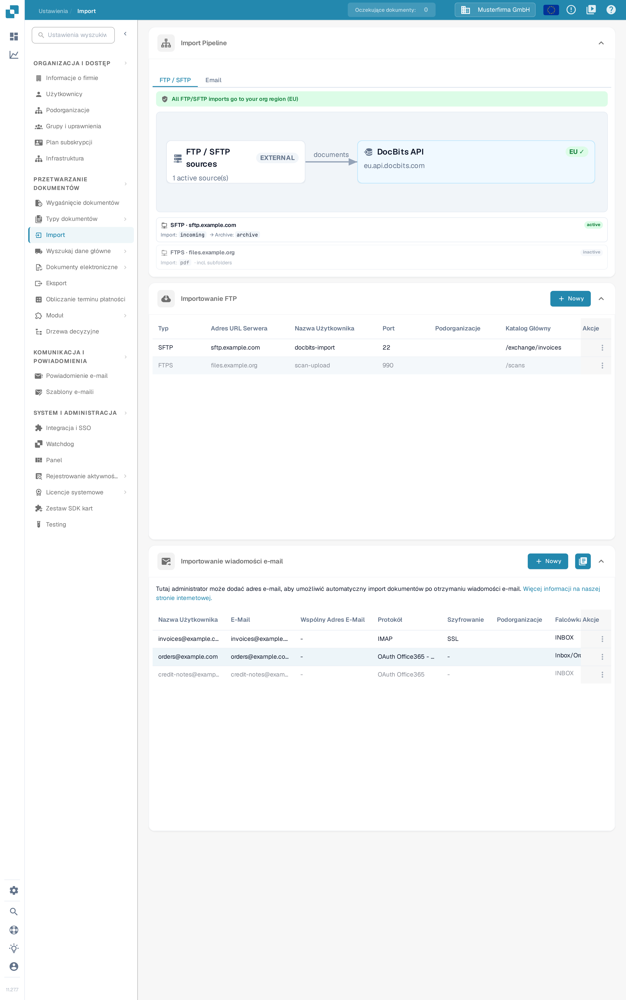
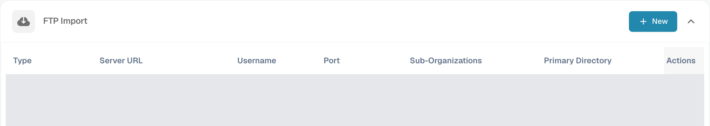
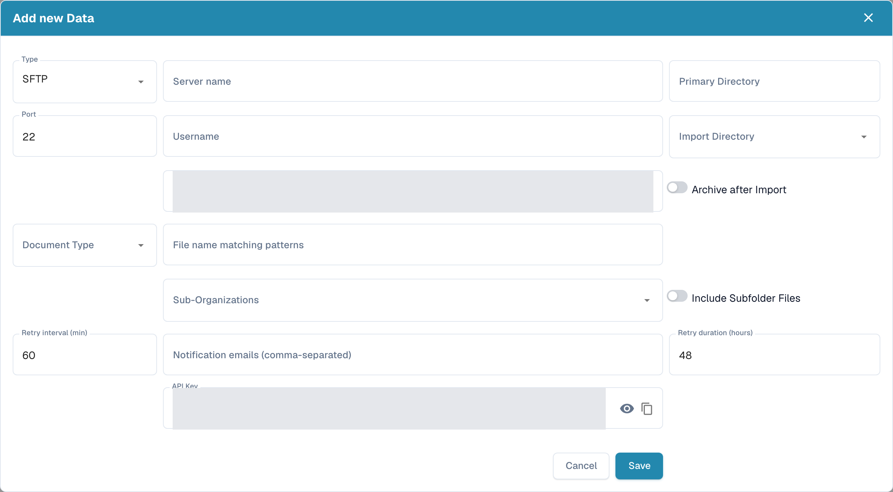
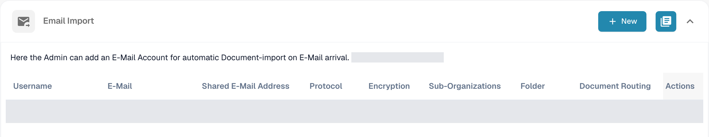
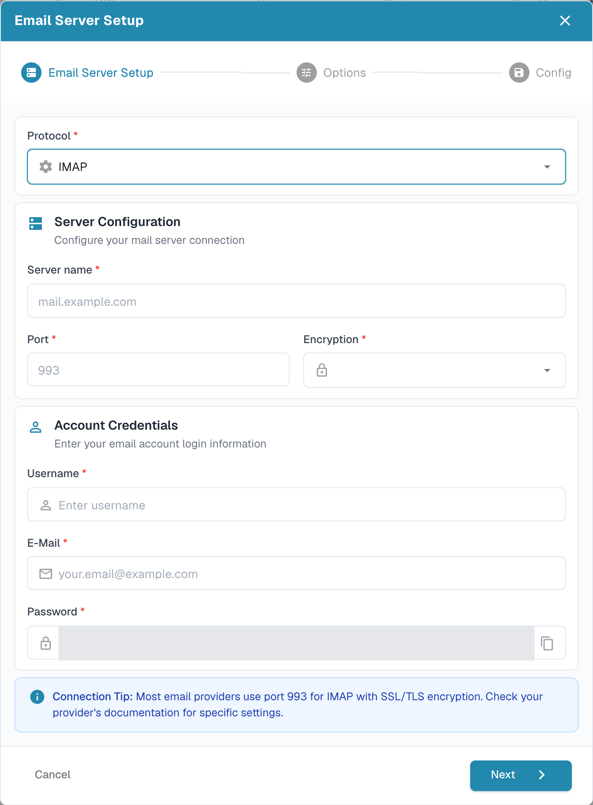
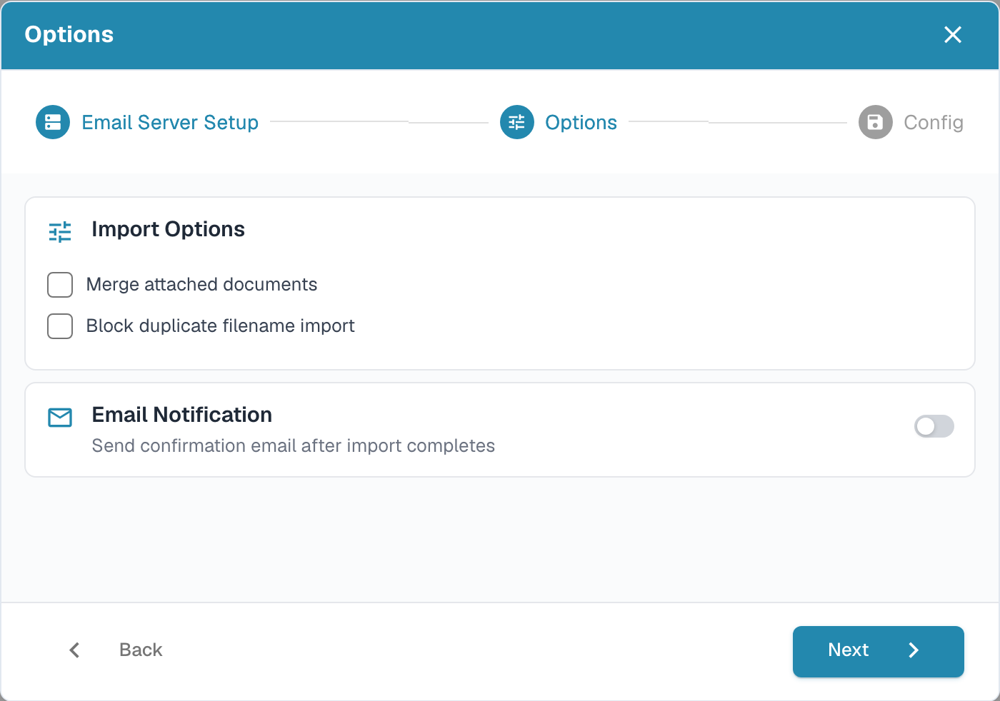
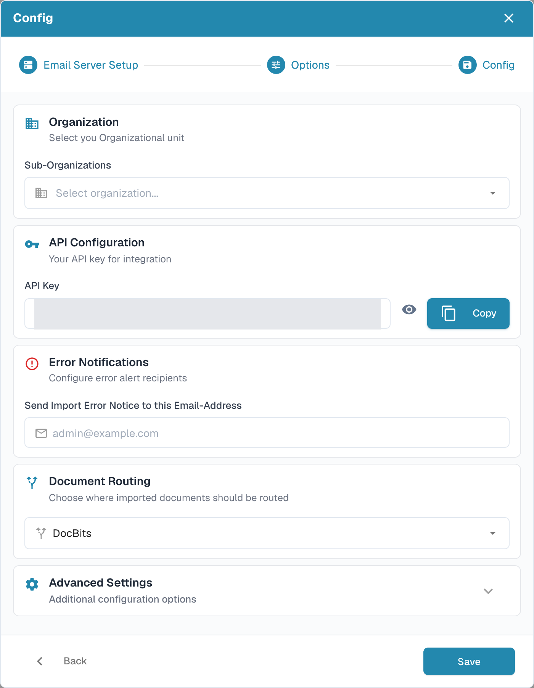
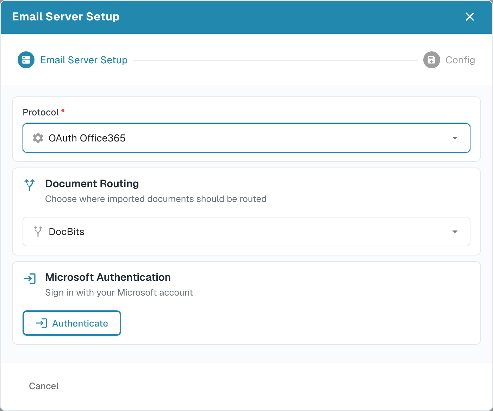

# Import

## Przegląd

Do utworzenia połączenia potrzebne jest konto administratora. Sekcja **Import** służy do konfigurowania automatycznego importu dokumentów z serwera FTP/SFTP, podłączonej skrzynki pocztowej lub przychodzącego adresu e-mail DocBits. Przed wprowadzeniem danych połączenia sprawdź bieżącą organizację i środowisko.

<figure><figcaption>
Strona Import: diagram Import Pipeline tylko do odczytu, lista FTP Import i lista Email Import, każda z własnym przyciskiem <strong>New</strong>.
</figcaption></figure>

## Jak uzyskać dostęp

1. Przejdź do **Settings** → **Document Processing** → **Import**.
2. Rozwiń wymaganą sekcję. **FTP Import** i **Email Import** mają własne przyciski **New**.

## **Document Settings**

Bieżąca strona Import zawiera **Import Pipeline**, **FTP Import**, **Email Import** oraz, gdy jest włączona, **Inbound Emails**. Przycinanie stron, domyślne terminy płatności i pola wzorca daty nie są kontrolkami w tym widoku Import.

**Import Pipeline** pokazuje topologię routingu FTP/SFTP, w tym region źródłowy i docelowy. Przed zmianą połączenia sprawdź wszelkie wyświetlane wskazówki. Karta potoku **Email** wyświetla obecnie komunikat o planowanym udostępnieniu; nie pokazuje diagramu przetwarzania wiadomości e-mail.

## **FTP Import**

<figure><figcaption>
Użyj przycisku New w FTP Import, aby dodać połączenie z serwerem. W tym przykładzie istniejące wiersze połączeń są zasłonięte.
</figcaption></figure>

### Wymagania

* Serwer FTP, FTPS lub SFTP osiągalny z poziomu usługi importu.
* Adres serwera, protokół, port, nazwa użytkownika i hasło przekazane przez administratora.
* Katalog importu oraz, jeśli wymagana jest archiwizacja, zatwierdzony katalog archiwum.

### Dodawanie nowego połączenia

1. Kliknij **New** w **FTP Import**.
2. Wprowadź ustawienia połączenia. Nowy formularz startuje z **SFTP** i portem **22**; zastąp te wartości, jeśli serwer używa innego protokołu lub portu.

<figure><figcaption>
Wprowadź dane serwera i logowania, a następnie sprawdź katalogi, routing i ustawienia ponowień. Pola hasła i klucza API są zasłonięte; ten przykład nie został zapisany.
</figcaption></figure>

* **Type**, **Server name**, **Port**, **Username** i **Password** identyfikują połączenie z serwerem i je uwierzytelniają.
* **Primary Directory** ustawia katalog bazowy. **Import Directory** wybiera folder do przetwarzania; wybór folderu staje się dostępny po zapisaniu połączenia.
* **Document Type** i **Sub-Organizations** sterują przypisaniem. **File name matching patterns** ogranicza, które nazwy plików są brane pod uwagę.
* **Archive after Import** włącza przenoszenie przetworzonych plików do wskazanego katalogu archiwum. **Include Subfolder Files** rozszerza przetwarzanie na podfoldery.
* **Retry interval (min)**, **Retry duration (hours)** i **Notification emails (comma-separated)** sterują zachowaniem ponowień i powiadomień. Domyślne wartości na ilustracji to 60 minut i 48 godzin.
* **API Key** korzysta z istniejącego klucza subskrypcji aplikacji organizacji. Ikona oka pokazuje lub ukrywa ten klucz; ikona kopiowania kopiuje go do schowka. Te kontrolki nie tworzą nowego klucza. Zachowaj klucz w poufności; nie umieszczaj go na zrzutach ekranu ani w wiadomościach do pomocy technicznej.

Użyj **Cancel** lub ikony zamknięcia, aby opuścić formularz nowego połączenia bez zapisywania.

3. Sprawdź wartości i kliknij **Save**, gdy połączenie jest gotowe do utworzenia.
4. W menu **Actions** zapisanego wiersza wybierz **Activate**, gdy importy mają być uruchamiane.

### Działania dla FTP

Menu **Actions** zapisanego połączenia udostępnia:

* **Test Connection**: kontaktuje się ze skonfigurowanym serwerem, aby sprawdzić połączenie.
* **Connection Logs**: przeglądanie prób połączenia i błędów.
* **Activate/Deactivate**: włącza lub zatrzymuje automatyczne przetwarzanie dla tego połączenia.
* **Edit**: zmiana jego konfiguracji.
* **Delete**: usunięcie połączenia.

Testowanie, aktywacja, edycja i usuwanie wpływają na rzeczywiste połączenie. Przed ich użyciem sprawdź wybrany wiersz i organizację.

## **Email Import**

Podłączona skrzynka pocztowa jest oddzielna od przychodzącego adresu e-mail DocBits opisanego w poniższym samouczku. Wybierz metodę odpowiednią dla swojego procesu.

<figure><figcaption>
Użyj przycisku New dla połączenia skrzynki pocztowej lub ikony dziennika, aby przejrzeć importy. Istniejące wiersze połączeń i link informacyjny są zasłonięte.
</figcaption></figure>

<mark style="color:red;">**Note**</mark>: Importowane będą tylko dokumenty o następujących typach plików:

* `.pdf`
* `.tiff` / `.tif`
* `.eml`
* `.dat`
* `.xml`
* `.edi`
* `.purchaseorder`


**Jak rozpoznawane są załączniki**

Oprócz wymienionych powyżej rozszerzeń plików DocBits identyfikuje dokument również po jego **rzeczywistej zawartości** (sygnaturze pliku), a nie tylko po typie zawartości zadeklarowanym przez system pocztowy nadawcy. Ma to znaczenie w przypadku wiadomości **przekazywanych**: pośredniczące serwery pocztowe i bramy często oznaczają załącznik typem ogólnym (`application/octet-stream`) zamiast na przykład `application/pdf` lub `application/xml`. DocBits nadal rozpoznaje i importuje takie załączniki prawidłowo.

* **Przekazane wiadomości `.eml`** oraz załączniki Outlook **`winmail.dat`** (TNEF) są rozpakowywane, a dokumenty w nich zawarte są importowane.
* **Kodowanie XML:** gdy faktura XML zostanie oznaczona typem ogólnym (`application/octet-stream`), DocBits rozpoznaje ją po deklaracji `<?xml`, tolerując wiodący znacznik kolejności bajtów (BOM) **UTF-8** lub **UTF-16** (LE/BE) — obecnie tylko te kodowania BOM są automatycznie wykrywane na podstawie zawartości. Załącznik, który zachowuje nazwę pliku `.xml`, jest importowany niezależnie od kodowania.
* **Pomijane:** obrazy osadzone w wiadomości (loga podpisów / grafiki wbudowane — PNG, JPG, GIF, BMP) są pomijane po cichu i **nie** są liczone jako nieudane importy.

Jeśli załącznika nie można zaimportować, a opcja **„Reply to this email if import can not be done”** jest włączona dla adresu przychodzącego, skonfigurowany adres odpowiedzi otrzymuje powiadomienie.


### Dodawanie nowego połączenia IMAP

1. Kliknij **New** w **Email Import** i wybierz **IMAP** w sekcji **Protocol**.
2. W **Email Server Setup** wprowadź nazwę serwera, port, szyfrowanie, nazwę użytkownika, adres e-mail i hasło. Użyj wartości wymaganych przez Twojego dostawcę poczty; wyświetlane 993 to przykład portu, a nie ukończone ustawienie.

<figure><figcaption>
Przed kliknięciem Next uzupełnij wymagane pola serwera i konta. Obszar hasła jest zasłonięty; w tym przykładzie nie przesłano danych logowania do skrzynki.
</figcaption></figure>

Ikona kopiowania obok **Password** kopiuje wprowadzone hasło do schowka. **Cancel** lub ikona zamknięcia opuszcza tego kreatora nowego połączenia bez zapisywania.

3. Kliknij **Next**, aby otworzyć **Options**. Zdecyduj, czy **Merge attached documents**, czy **Block duplicate filename import**. **Email Notification** włącza wiadomość potwierdzającą po imporcie; włączaj ją tylko wtedy, gdy takie zachowanie jest zamierzone.

<figure><figcaption>
Options oddziela zachowanie importu od powiadomień e-mail. W tym niezapisanym przykładzie oba pola wyboru i przełącznik powiadomień są wyłączone.
</figcaption></figure>

4. Kliknij **Next**, aby otworzyć **Config**. Wybierz wymagane **Sub-Organizations**, sprawdź istniejący **API Key**, ustaw odbiorcę błędów importu i sprawdź **Document Routing**. Rozwiń **Advanced Settings** tylko wtedy, gdy proces wymaga dodatkowych opcji.

<figure><figcaption>
Config łączy przypisanie organizacji, istniejący klucz, powiadomienia o błędach i routing. Klucz jest zasłonięty, a Save nie zostało użyte.
</figcaption></figure>

W **Config** ikona oka pokazuje lub ukrywa istniejący **API Key**, a **Copy** kopiuje go do schowka. Żadna z tych kontrolek nie generuje nowego klucza.

5. Kliknij **Save**, gdy konfiguracja jest gotowa. Następnie użyj **Activate** w menu **Actions** zapisanego połączenia, aby uruchomić automatyczne przetwarzanie.

Dla zapisanego połączenia IMAP **Edit** udostępnia opcje folderu i obsługi po imporcie. Wybierz folder źródłowy i folder docelowy przenoszonych wiadomości dopiero po utworzeniu połączenia i możliwości wczytania dostępnych folderów.

### Działania dla IMAP

Menu **Actions** zapisanego połączenia udostępnia **Test Connection**, **Connection Logs**, **Import Log**, **Activate/Deactivate**, **Edit** i **Delete**. Test połączenia kontaktuje się ze skonfigurowaną skrzynką; aktywacja włącza przetwarzanie. Przed ponowieniem nieudanego importu przejrzyj dzienniki.

### Dodawanie nowego połączenia OAuth Office365

1. Kliknij **New** w **Email Import** i wybierz **OAuth Office365** w sekcji **Protocol**. W przypadku aplikacji dzierżawcy zarządzanej przez administratora wybierz **OAuth Office365 - Tenant** i postępuj zgodnie z opisem w [O365 Tenant](o365-tenant.md).
2. Przed uwierzytelnieniem sprawdź **Document Routing**.

<figure><figcaption>
Wybierz trasę przed Authenticate. Ten widok jest sprzed logowania; nie rozpoczęto żadnego uwierzytelniania Microsoft.
</figcaption></figure>

3. Kliknij **Authenticate**, gdy połączenie ze skrzynką jest autoryzowane. Ukończ logowanie Microsoft kodem urządzenia przy użyciu kodu wyświetlonego przez DocBits, następnie wróć i wybierz **Finish Authentication**.
4. Po uwierzytelnieniu sprawdź opcje organizacji, folderu, skrzynki współdzielonej, folderu przenoszenia i powiadomień o błędach oferowane dla połączenia. Użyj **Next**, aby przejść do **Config**, gdy stanie się dostępne, a następnie zapisz zamierzone ustawienia.
5. Aktywuj zapisane połączenie, gdy automatyczne importy mają być uruchamiane. **Import**, jeśli jest oferowany dla zapisanego połączenia, uruchamia rzeczywisty import; używaj go świadomie.

### Działania dla OAuth Office365

Menu **Actions** zapisanego połączenia udostępnia **Connection Logs**, **Import Log**, **Activate/Deactivate**, **Edit** i **Delete**. Dezaktywacja zatrzymuje automatyczne przetwarzanie; usunięcie usuwa konfigurację.

### Import Log

Ikona dziennika w prawym górnym rogu **Email Import** służy do przeglądania importów we wszystkich skonfigurowanych połączeniach skrzynek pocztowych. Dla danego połączenia użyj akcji **Import Log** w zapisanym wierszu. Przed decyzją o ponowieniu sprawdź temat, nadawcę, status i dostępne szczegóły błędu.

## Inbound Emails

Dwa zrzuty ekranu samouczka poniżej pokazują przychodzący adres DocBits i jego dzienniki. Jest to oddzielne od połączeń skrzynek pocztowych opisanych powyżej.

* Użyj ikony kopiowania obok **E-Mail**, aby skopiować adres odbiorczy wyświetlany dla bieżącej organizacji i środowiska.
* **Add** wstawia kolejny wiersz dozwolonego nadawcy w formularzu. Wybierz nadawcę i zamierzoną podorganizację, a następnie użyj **Save**, aby zapisać konfigurację. Samo dodanie wiersza go nie zapisuje.
* **Logs** otwiera dziennik wiadomości przychodzących. **Errors** filtruje błędy; **Inbound** i **Outbound** wybierają kierunek wiadomości.
* Rozwiń wiersz dziennika strzałką, aby sprawdzić szczegóły załącznika. Ikona kopiowania obok identyfikatora śledzenia kopiuje ten identyfikator do rozwiązywania problemów. **Original email**, gdy jest dostępny dla wiersza przychodzącego, pobiera wybraną oryginalną wiadomość jako plik `.eml`; nie ponawia importu.

## Instrukcja wideo: Skrzynka odbiorcza i wyszukiwanie błędów


Skrzynka odbiorcza i wyszukiwanie błędów


[Oglądaj z napisami i rozdziałami](https://docbits-videos.fra1.cdn.digitaloceanspaces.com/settings-assistant/email-import-admin/v2/pl.html)

Niektóre natywne etykiety produktu mogą pozostać w innym języku. Techniczne identyfikatory pól są zachowane.

W ustawieniach i imporcie używam w tym przykładzie adresu przychodzącego DocBits. Bezpośrednio podłączona skrzynka pocztowa to osobna metoda importu. Na potrzeby tego szkolenia pracuję w dedykowanej organizacji demonstracyjnej z syntetycznymi fakturami. Powiadomienia pozostają wyłączone.

Najpierw sprawdzam wyświetlany adres odbiorczy i zakres. Adres należy dokładnie do tej organizacji i jej środowiska. W przypadku innej firmy lub środowiska produkcyjnego zawsze używam adresu, który jest tam faktycznie wyświetlany.

Tutaj ograniczam skrzynkę odbiorczą do naszego zatwierdzonego nadawcy testowego. Przypisanie do podorganizacji wybieram tylko wtedy, gdy należy do zamierzonego procesu. Zapisuję ustawienie i otwieram je ponownie. Dozwolony nadawca został zachowany; automatyczne e-maile z odpowiedziami pozostają wyłączone na tym szkoleniu.

<figure><figcaption>
Dozwolony nadawca zapisany przy wyłączonych powiadomieniach
</figcaption></figure>

Na potrzeby tego szkolenia wiadomość testowa została przesłana bezpośrednio do obsługi poczty przychodzącej w DocBits. Ten test nie potwierdza dostarczenia zewnętrznego e-maila. W logu sprawdzam temat, nadawcę i zaimportowany załącznik. Następnie sprawdzam faktycznie utworzony dokument.

Otwieram odpowiedni dokument i porównuję załącznik PDF z fakturą w DocBits. Nazwa pliku, numer faktury, dostawca i kwota muszą się zgadzać. Pomyślny import nie mówi nic o zatwierdzeniu ani księgowaniu w ERP.

Drugi kontrolowany test pochodzi od niezatwierdzonego nadawcy. W logu szukam konkretnie tego zgłoszenia przychodzącego i aktywuję filtr błędów. Szczegóły wymieniają odrzuconego nadawcę. Sprawdzam przyczynę za pomocą tematu i identyfikatora śledzenia, zamiast wielokrotnie uruchamiać import.

W prawdziwym przypadku najpierw wyjaśniam, czy ten nadawca jest w ogóle upoważniony. Zatwierdzona zmiana na liście nadawców jest zapisywana i ponownie sprawdzana. Następnie weryfikuję nowe, unikalne zgłoszenie testowe aż do utworzonego dokumentu. W przypadku błędów technicznych przekazuję identyfikator śledzenia i konkretny komunikat o błędzie.

<figure><figcaption>
Nieudany import z załącznikiem, przyczyną i identyfikatorem śledzenia
</figcaption></figure>
