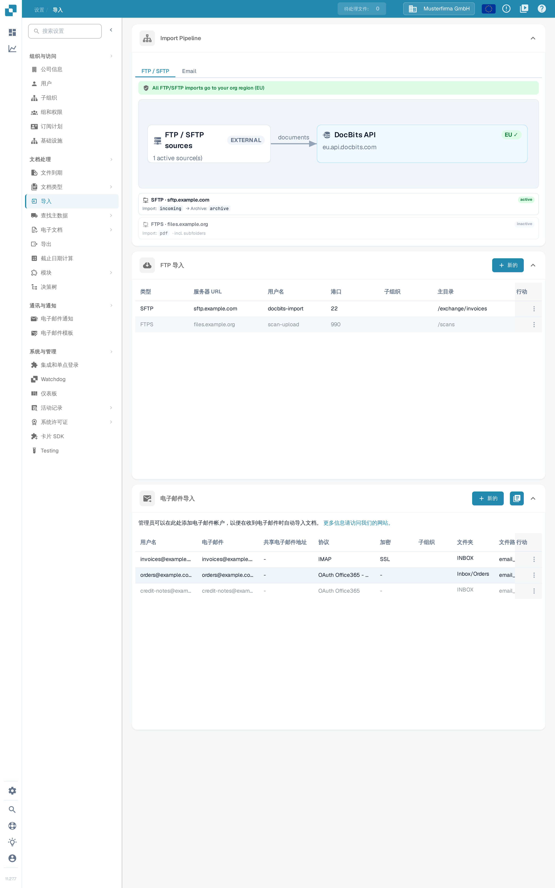

# 导入

## 概述

创建连接需要管理员账户。使用 **Import** 配置从 FTP/SFTP 服务器、已连接的邮箱或 DocBits 入站电子邮件地址自动导入文档。在输入连接详细信息之前，请先检查当前组织和环境。

<figure><figcaption>
导入页面: 只读的 Import Pipeline 示意图、FTP Import 列表和 Email Import 列表，各自带有自己的 <strong>New</strong> 按钮。
</figcaption></figure>

## 如何访问

1. 依次转到 **Settings** → **Document Processing** → **Import**。
2. 展开所需的部分。**FTP Import** 和 **Email Import** 各自带有自己的 **New** 按钮。

## **Document Settings**

当前的导入页面包含 **Import Pipeline**、**FTP Import**、**Email Import**，以及在启用时的 **Inbound Emails**。页面裁剪、默认付款条件和日期格式字段不是此导入视图中的控件。

**Import Pipeline** 显示 FTP/SFTP 路由拓扑，包括源区域和目标区域。更改任何连接之前，请先检查显示的所有提示信息。**Email** 管道选项卡目前显示即将推出的消息；它不显示电子邮件处理示意图。

## **FTP Import**

<figure><figcaption>
在 FTP Import 中使用 New 添加服务器连接。此示例中现有连接行已被遮盖。
</figcaption></figure>

### 要求

* 导入服务可访问的 FTP、FTPS 或 SFTP 服务器。
* 由管理员提供的服务器地址、协议、端口、用户名和密码。
* 一个导入目录，以及需要归档时的已批准归档目录。

### 添加新连接

1. 在 **FTP Import** 中点击 **New**。
2. 输入连接设置。新表单起初为 **SFTP** 和端口 **22**；当您的服务器使用其他协议或端口时，请替换这些值。

<figure><figcaption>
输入服务器和登录详细信息，然后检查目录、路由和重试设置。密码和 API 密钥字段已被遮盖；此示例尚未保存。
</figcaption></figure>

* **Type**、**Server name**、**Port**、**Username** 和 **Password** 用于识别并验证服务器连接。
* **Primary Directory** 设置基础目录。**Import Directory** 选择要处理的文件夹；保存连接后才能选择文件夹。
* **Document Type** 和 **Sub-Organizations** 控制分配。**File name matching patterns** 限定考虑哪些文件名。
* **Archive after Import** 可将已处理的文件移动到指定的归档目录。**Include Subfolder Files** 将处理扩展到子文件夹。
* **Retry interval (min)**、**Retry duration (hours)** 和 **Notification emails (comma-separated)** 控制重试和通知行为。图示的默认值为 60 分钟和 48 小时。
* **API Key** 使用组织现有的应用订阅密钥。眼睛图标显示或隐藏该密钥；复制图标将其复制到剪贴板。这些控件不会创建新密钥。请对其保密；不要将其包含在截图或支持消息中。

使用 **Cancel** 或关闭图标可以在不保存的情况下离开新连接表单。

3. 检查各项值，当连接可以创建时点击 **Save**。
4. 在已保存行的 **Actions** 菜单中，当允许导入运行时选择 **Activate**。

### FTP 的操作

已保存连接的 **Actions** 菜单提供:

* **Test Connection**: 联系配置的服务器以检查连接。
* **Connection Logs**: 查看连接尝试和错误。
* **Activate/Deactivate**: 为此连接启用或停止自动处理。
* **Edit**: 更改其配置。
* **Delete**: 删除该连接。

测试、激活、编辑和删除会影响真实连接。使用这些操作之前，请确认所选行和组织。

## **Email Import**

已连接的邮箱与下文教程中描述的 DocBits 入站电子邮件地址是分开的。请选择适合您流程的方法。

<figure><figcaption>
使用 New 创建邮箱连接，或使用日志图标查看导入。此示例中现有连接行和信息链接已被遮盖。
</figcaption></figure>

<mark style="color:red;">**Note**</mark>: 仅导入以下文件类型的文档:

* `.pdf`
* `.tiff` / `.tif`
* `.eml`
* `.dat`
* `.xml`
* `.edi`
* `.purchaseorder`


**附件的识别方式**

除上述文件扩展名外，DocBits 还会根据**实际文件内容**（文件签名）识别文档，而不仅仅依据发件邮件系统声明的 Content-Type。这对**转发**邮件很重要: 中间邮件服务器/网关经常将附件重新标记为通用类型（`application/octet-stream`），而不是例如 `application/pdf` 或 `application/xml`。DocBits 仍能正确识别并导入此类附件。

* **转发的 `.eml`** 邮件和 Outlook **`winmail.dat`**（TNEF）附件会被解包，并导入其中的文档。
* **XML 编码:** 当 XML 发票被重新标记为通用类型（`application/octet-stream`）时，DocBits 通过其 `<?xml` 声明识别它，并容忍开头的 **UTF-8** 或 **UTF-16**（LE/BE）字节顺序标记（BOM）——目前仅从内容中自动检测这些 BOM 编码。保留 `.xml` 文件名的附件无论编码如何都会被导入。
* **忽略:** 随邮件附带的内嵌图片（签名标志/嵌入图形——PNG、JPG、GIF、BMP）会被静默跳过，且**不**计为导入失败。

如果附件无法导入，且入站地址启用了选项 **“Reply to this email if import can not be done”**，则会通知配置的回复地址。


### 添加新的 IMAP 连接

1. 在 **Email Import** 中点击 **New**，并在 **Protocol** 下选择 **IMAP**。
2. 在 **Email Server Setup** 中，输入服务器名称、端口、加密方式、用户名、电子邮件地址和密码。使用您的邮件提供商要求的值；显示的 993 是端口示例，不是已完成的设置。

<figure><figcaption>
在点击 Next 之前填写所需的服务器和账户字段。密码区域已被遮盖；此示例未提交任何邮箱凭据。
</figcaption></figure>

**Password** 旁的复制图标会将输入的密码复制到剪贴板。**Cancel** 或关闭图标会在不保存的情况下离开此新连接向导。

3. 点击 **Next** 打开 **Options**。选择 **Merge attached documents** 或 **Block duplicate filename import**。**Email Notification** 会在导入后启用确认电子邮件；仅当需要该行为时才启用它。

<figure><figcaption>
Options 将导入行为与电子邮件通知分开。在此未保存的示例中，两个复选框和通知开关均处于关闭状态。
</figcaption></figure>

4. 点击 **Next** 打开 **Config**。选择所需的 **Sub-Organizations**，检查现有的 **API Key**，设置导入错误的接收方，并检查 **Document Routing**。仅在流程需要其他选项时才展开 **Advanced Settings**。

<figure><figcaption>
Config 汇集了组织分配、现有密钥、错误通知和路由。密钥已被遮盖，且尚未使用 Save。
</figcaption></figure>

在 **Config** 中，眼睛图标显示或隐藏现有的 **API Key**，**Copy** 将其复制到剪贴板。这两个控件都不会生成新密钥。

5. 配置准备好后点击 **Save**。然后在已保存连接的 **Actions** 菜单中使用 **Activate** 启动自动处理。

对于已保存的 IMAP 连接，**Edit** 提供文件夹和导入后处理选项。仅当连接已创建且可用文件夹能够加载后，才选择源文件夹和已移动电子邮件的目标文件夹。

### IMAP 的操作

已保存连接的 **Actions** 菜单提供 **Test Connection**、**Connection Logs**、**Import Log**、**Activate/Deactivate**、**Edit** 和 **Delete**。连接测试会联系配置的邮箱；激活会启用处理。在重试失败的导入之前，请先查看日志。

### 添加新的 OAuth Office365 连接

1. 在 **Email Import** 中点击 **New**，并在 **Protocol** 下选择 **OAuth Office365**。对于由管理员管理的租户应用程序，选择 **OAuth Office365 - Tenant** 并按照 [O365 Tenant](o365-tenant.md) 操作。
2. 在身份验证之前检查 **Document Routing**。

<figure><figcaption>
在 Authenticate 之前选择路由。此视图处于登录之前；尚未启动 Microsoft 身份验证。
</figcaption></figure>

3. 邮箱连接获得授权后点击 **Authenticate**。使用 DocBits 显示的代码完成 Microsoft 设备代码登录，然后返回并选择 **Finish Authentication**。
4. 身份验证后，检查为该连接提供的组织、文件夹、共享邮箱、移动文件夹和错误通知选项。当 **Next** 可用时使用它继续前往 **Config**，然后保存预期设置。
5. 当应运行自动导入时，激活已保存的连接。对于已保存的连接，在提供 **Import** 时，它会启动实际导入；请谨慎使用。

### OAuth Office365 的操作

已保存连接的 **Actions** 菜单提供 **Connection Logs**、**Import Log**、**Activate/Deactivate**、**Edit** 和 **Delete**。停用会停止自动处理；删除会移除配置。

### Import Log

使用 **Email Import** 右上角的日志图标查看已配置邮箱连接中的导入情况。使用已保存行的 **Import Log** 操作查看该连接。在决定是否重试之前，请检查主题、发件人、状态和可用的错误详细信息。

## Inbound Emails

下文的两个教程截图显示入站 DocBits 地址及其日志。这与上文的邮箱连接是分开的。

* 使用 **E-Mail** 旁的复制图标复制为当前组织和环境显示的接收地址。
* **Add** 在表单中插入另一个允许的发件人行。选择其发件人和任何预期的子组织，然后使用 **Save** 保存配置。仅添加一行并不会保存它。
* **Logs** 打开入站电子邮件日志。**Errors** 筛选错误；**Inbound** 和 **Outbound** 选择消息方向。
* 使用折叠箭头展开日志行以检查附件详细信息。追踪 ID 旁的复制图标会复制该 ID 以便排查。当入站行提供 **Original email** 时，它会将选定的原始邮件下载为 `.eml` 文件；它不会重试导入。

## 视频教程: 收件箱与错误排查


收件箱与错误排查


[观看带字幕和章节导航的视频](https://docbits-videos.fra1.cdn.digitaloceanspaces.com/settings-assistant/email-import-admin/v2/zh.html)

部分产品原生标签可能仍为其他语言。技术字段 ID 保持不变。

在设置和导入下，本示例中我使用 DocBits 的入站地址。直接连接的邮箱是一种独立的导入方法。本次培训中，我在一个使用合成发票的专用演示组织中操作。通知保持关闭。

首先，我检查显示的接收地址及其范围。该地址完全属于此组织及其环境。对于其他公司或生产环境，我始终使用那里实际显示的地址。

在这里，我将收件箱限制为我们批准的测试发件人。只有当分配给子组织属于预期流程时，我才选择该分配。我保存设置并再次打开它。允许的发件人已被保留；本次培训中自动回复邮件仍保持关闭。

<figure><figcaption>
允许的发件人已保存，通知已关闭
</figcaption></figure>

本次培训将一封测试邮件直接提交给 DocBits 入站处理。此测试并不能确认外部电子邮件送达。在日志中，我检查匹配的主题、发件人和已导入的附件。然后我检查实际创建的文档。

我打开相应的文档，并将 PDF 附件与 DocBits 中的发票进行比较。文件名、发票编号、供应商和金额必须一致。成功导入并不能说明已审批或已在 ERP 中记账。

第二个受控测试来自未获批准的发件人。在日志中，我专门查找此入站并激活错误筛选。详细信息会指明被拒绝的发件人。我使用主题和追踪 ID 检查原因，而不是多次触发导入。

在实际案例中，我首先确认该发件人是否已获授权。对发件人列表的已批准更改会被保存并再次检查。之后，我验证一个新的唯一测试入站，一直到创建的文档。对于技术错误，我移交追踪 ID 和具体的错误消息。

<figure><figcaption>
导入失败，包含附件、原因和追踪
</figcaption></figure>
