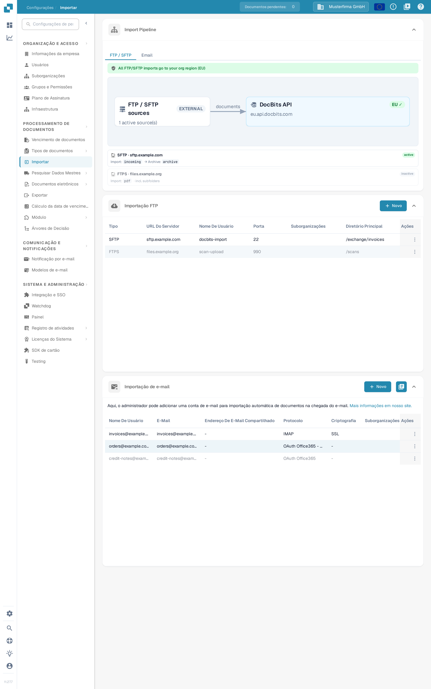
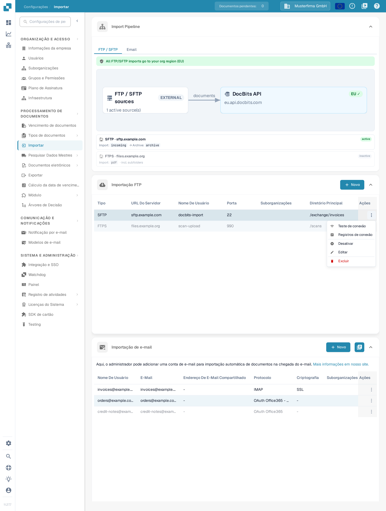
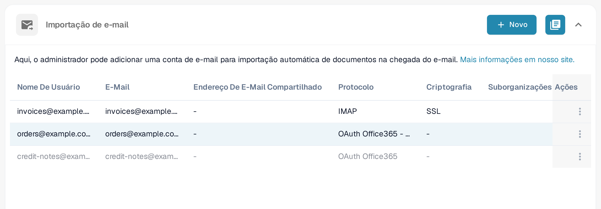
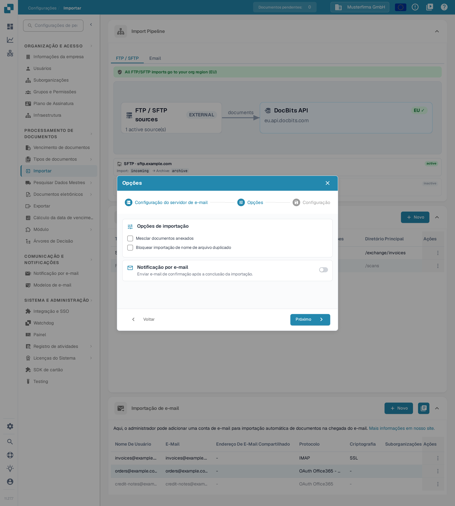
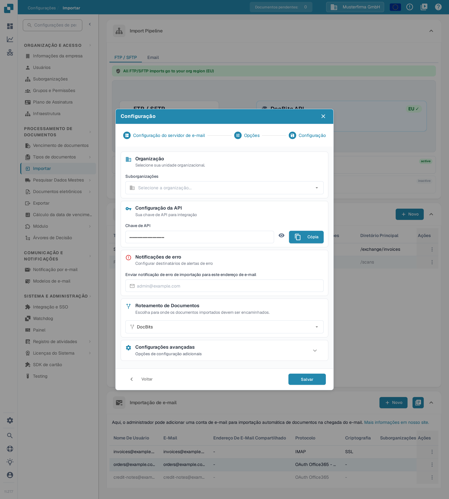
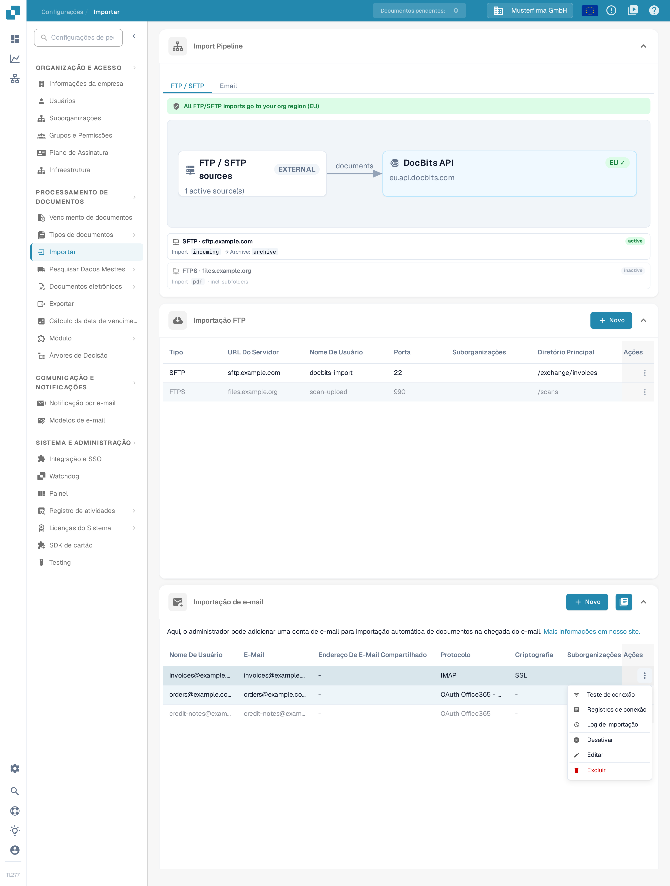
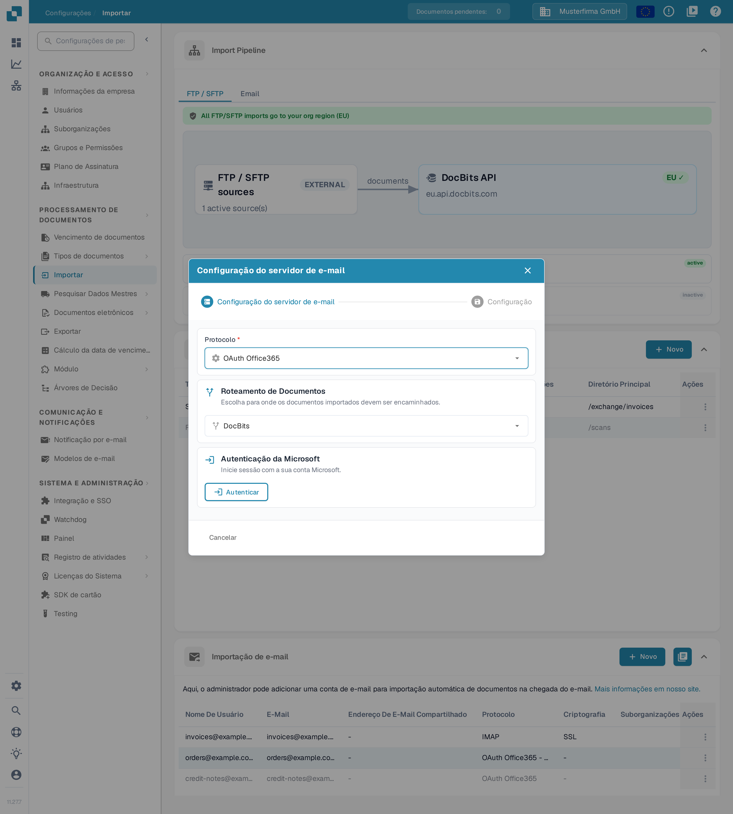
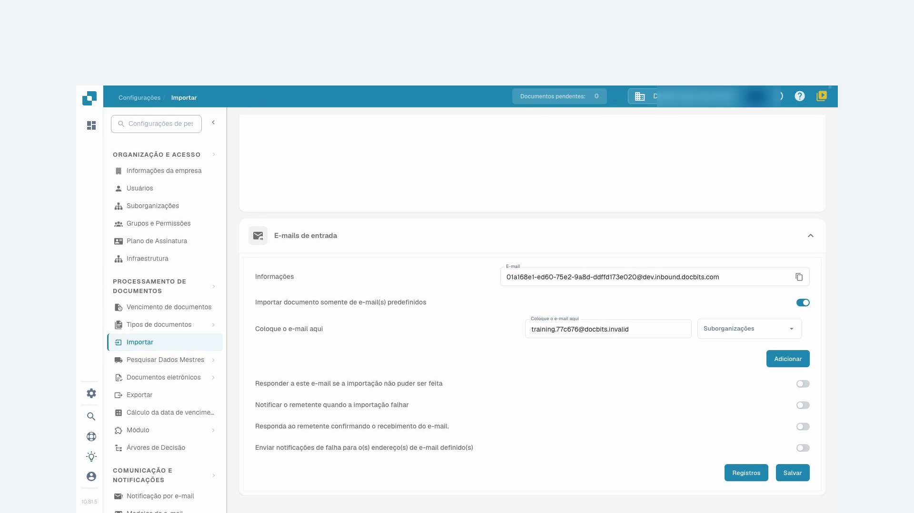
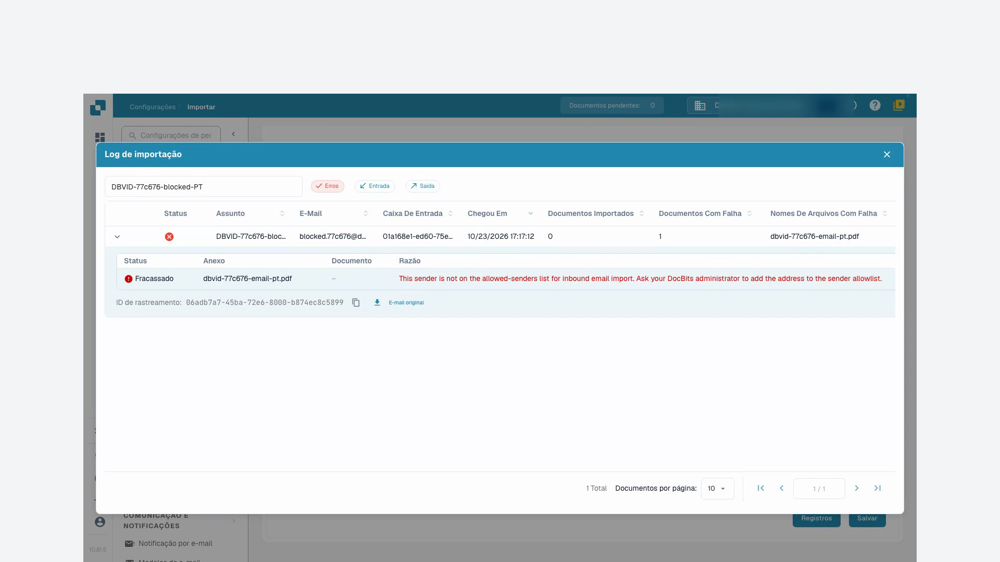

# Importar

## Visão geral

É necessária uma conta de administrador para criar uma ligação. Utilize **Importar** para configurar a importação automática de documentos a partir de um servidor FTP/SFTP, de uma caixa de correio ligada ou do endereço de e-mail de entrada do DocBits. Verifique a organização e o ambiente atuais antes de introduzir os dados da ligação.

<figure><figcaption>
A página <strong>Importar</strong>: o diagrama Import Pipeline só de leitura, a lista <strong>Importação FTP</strong> e a lista <strong>Importação de e-mail</strong>, cada uma com o seu próprio botão <strong>Novo</strong>.
</figcaption></figure>

## Como aceder

1. Navegue até **Configurações** → **Processamento de documentos** → **Importar**.
2. Expanda a secção necessária. **Importação FTP** e **Importação de e-mail** têm cada uma o seu próprio botão **Novo**.

## **Configurações do documento**

A atual página **Importar** contém **Import Pipeline**, **Importação FTP**, **Importação de e-mail** e, quando ativado, **E-mails de entrada**. O limite de páginas, as condições de pagamento predefinidas e os campos de padrão de data não são controlos nesta vista.

**Import Pipeline** mostra a topologia de encaminhamento FTP/SFTP, incluindo as regiões de origem e de destino. Verifique qualquer aviso apresentado antes de alterar uma ligação. O separador **Email** do pipeline apresenta atualmente uma mensagem de funcionalidade futura; não mostra um diagrama de processamento de e-mail. A aplicação mantém aqui, deliberadamente, a designação inglesa **Import Pipeline** e o aviso em inglês.

## **Importação FTP**

<figure><figcaption>
A lista <strong>Importação FTP</strong> com o botão <strong>Novo</strong> e as colunas <strong>Tipo</strong>, <strong>URL Do Servidor</strong>, <strong>Nome De Usuário</strong>, <strong>Porta</strong>, <strong>Suborganizações</strong>, <strong>Diretório Principal</strong> e <strong>Ações</strong>. Os dois servidores mostrados são dados de exemplo inventados; a versão 11.27.7 aparece no canto inferior esquerdo.
</figcaption></figure>

### Requisitos

* Um servidor FTP, FTPS ou SFTP acessível ao serviço de importação.
* O endereço do servidor, o protocolo, a porta, o nome de utilizador e a senha fornecidos pelo seu administrador.
* Um diretório de importação e, se for necessário arquivar, um diretório de arquivo aprovado.

### Adicionar nova ligação

1. Clique em **Novo** em **Importação FTP**.
2. Introduza as definições da ligação. Um novo formulário começa com **SFTP** e porta **22**; substitua estes valores quando o seu servidor utilizar outro protocolo ou outra porta.

<figure><figcaption>
O formulário <strong>Adicionar novos dados</strong> logo após a abertura: nada foi introduzido nem guardado. A aplicação preenche <strong>Tipo</strong> com <strong>SFTP</strong>, <strong>Porta</strong> com <strong>22</strong>, <strong>Intervalo entre tentativas (min)</strong> com <strong>60</strong> e <strong>Duração da nova tentativa (horas)</strong> com <strong>48</strong>. A <strong>Chave de API</strong> aparece ocultada e corresponde à chave existente da organização.
</figcaption></figure>

* **Tipo**, **Nome do servidor**, **Porta**, **Nome de usuário** e **Senha** identificam e autenticam a ligação ao servidor.
* **Diretório principal** define o diretório base e **Diretório de importação** seleciona a pasta a processar.
* **Tipo de documento** e **Suborganizações** controlam a atribuição. **Padrões de correspondência de nomes de arquivo** limita os nomes de ficheiro considerados.
* **Arquivar após a importação** permite mover os ficheiros processados para o diretório de arquivo indicado. **Incluir arquivos de subpasta** alarga o processamento às subpastas.
* **Intervalo entre tentativas (min)**, **Duração da nova tentativa (horas)** e **E-mails de notificação (separados por vírgulas)** controlam o comportamento de repetição e de notificação. Os valores predefinidos ilustrados são 60 minutos e 48 horas.
* **Chave de API** utiliza a chave de subscrição de aplicação existente da organização. O ícone de olho mostra ou oculta essa chave e o botão de cópia copia-a para a área de transferência. Estes controlos não criam uma nova chave. Mantenha-a confidencial; não a inclua em capturas de ecrã ou mensagens de suporte.

Utilize **Cancelar** ou o ícone de fechar para sair de um novo formulário de ligação sem o guardar.

3. Reveja os valores e clique em **Salvar** quando a ligação estiver pronta a ser criada.
4. No menu **Ações** da linha guardada, escolha **Ativar** quando as importações estiverem autorizadas a ser executadas. Numa ligação já ativa, o mesmo menu oferece **Desativar**.

### Ações para FTP

<figure><figcaption>
O menu <strong>Ações</strong> de uma ligação FTP guardada e ativa: <strong>Teste de conexão</strong>, <strong>Registros de conexão</strong>, <strong>Desativar</strong>, <strong>Editar</strong> e <strong>Excluir</strong>. Numa ligação inativa, o mesmo menu mostra <strong>Ativar</strong> em vez de <strong>Desativar</strong>. As linhas visíveis são dados de exemplo inventados.
</figcaption></figure>

O menu **Ações** da ligação guardada disponibiliza:

* **Teste de conexão**: contacta o servidor configurado para verificar a ligação.
* **Registros de conexão**: inspeciona as tentativas de ligação e os erros.
* **Ativar**/**Desativar**: ativa ou interrompe o processamento automático desta ligação.
* **Editar**: altera a sua configuração.
* **Excluir**: remove a ligação.

Testar, ativar, editar e eliminar afetam uma ligação real. Verifique a linha e a organização selecionadas antes de as utilizar.

## **Importação de e-mail**

Uma caixa de correio ligada é independente do endereço de e-mail de entrada do DocBits descrito no tutorial abaixo. Escolha o método que se adequa ao seu processo.

<figure><figcaption>
A lista <strong>Importação de e-mail</strong> com o botão <strong>Novo</strong>, o botão do registo de importação e as colunas <strong>Nome De Usuário</strong>, <strong>E-Mail</strong>, <strong>Endereço De E-Mail Compartilhado</strong>, <strong>Protocolo</strong>, <strong>Criptografia</strong>, <strong>Suborganizações</strong> e <strong>Ações</strong>. A tabela continua para a direita com as colunas <strong>Pasta</strong> e <strong>Roteamento De Documentos</strong>, que se alcançam deslocando a tabela horizontalmente. As caixas de correio mostradas são dados de exemplo inventados.
</figcaption></figure>

<mark style="color:red;">**Nota**</mark>: Apenas serão importados documentos com os seguintes tipos de ficheiro:

* `.pdf`
* `.tiff` / `.tif`
* `.eml`
* `.dat`
* `.xml`
* `.edi`
* `.purchaseorder`


**Como os anexos são reconhecidos**

Para além das extensões de ficheiro indicadas acima, o DocBits também identifica um documento pelo seu **conteúdo real** (assinatura do ficheiro) e não apenas pelo tipo de conteúdo declarado pelo sistema de correio que o envia. Isto é relevante para mensagens **reencaminhadas**: os servidores ou gateways de correio intermédios reetiquetam frequentemente um anexo com um tipo genérico (`application/octet-stream`) em vez de, por exemplo, `application/pdf` ou `application/xml`. O DocBits continua a reconhecer e a importar corretamente esses anexos.

* Mensagens **`.eml` reencaminhadas** e anexos Outlook **`winmail.dat`** (TNEF) são descompactados e os documentos que contêm são importados.
* **Codificação XML:** quando uma fatura XML é reetiquetada com um tipo genérico (`application/octet-stream`), o DocBits reconhece-a pela sua declaração `<?xml`, tolerando um byte-order mark (BOM) inicial **UTF-8** ou **UTF-16** (LE/BE) — atualmente apenas estas codificações BOM são detetadas automaticamente a partir do conteúdo. Um anexo que mantenha um nome de ficheiro `.xml` é importado independentemente da sua codificação.
* **Ignorado:** as imagens incorporadas que acompanham uma mensagem (logótipos de assinatura ou gráficos incorporados — PNG, JPG, GIF, BMP) são ignoradas silenciosamente e **não** são contabilizadas como importações falhadas.

Se um anexo não puder ser importado e a opção **“Responder a este e-mail se a importação não puder ser feita”** estiver ativada para o endereço de entrada, o endereço de resposta configurado é notificado.


### Adicionar nova ligação IMAP

1. Clique em **Novo** em **Importação de e-mail** e selecione **IMAP** em **Protocolo**.
2. Em **Configuração do servidor de e-mail**, introduza o nome do servidor, a porta, a criptografia, o nome de utilizador, o endereço de e-mail e a senha. Utilize os valores exigidos pelo seu fornecedor de correio.

<figure><figcaption>
O primeiro passo, <strong>Configuração do servidor de e-mail</strong>: o nome de servidor <strong>imap.example.com</strong>, a porta <strong>993</strong>, o nome de utilizador, o endereço de e-mail e a senha são dados de exemplo inventados para esta captura e não foram submetidos. <strong>Cancelar</strong> ou o ícone de fechar encerra o assistente sem guardar.
</figcaption></figure>

O ícone de cópia junto a **Senha** copia a senha introduzida para a área de transferência. **Cancelar** ou o ícone de fechar encerra este assistente de nova ligação sem o guardar.

3. Clique em **Próximo** para abrir **Opções**. Escolha se pretende **Mesclar documentos anexados** ou **Bloquear importação de nome de arquivo duplicado**. **Notificação por e-mail** ativa um e-mail de confirmação após a importação; ative-a apenas quando esse comportamento for pretendido.

<figure><figcaption>
O passo <strong>Opções</strong> separa o comportamento de importação da notificação por e-mail. As duas caixas de verificação e o interruptor de <strong>Notificação por e-mail</strong> estão desligados nesta configuração de exemplo inventada, que usa <strong>imap.example.com</strong> e ainda não foi guardada.
</figcaption></figure>

4. Clique em **Próximo** para abrir **Configuração**. Selecione as **Suborganizações** necessárias, reveja a **Chave de API** existente, defina o destinatário para erros de importação e verifique o **Roteamento de Documentos**. Expanda **Configurações avançadas** apenas quando o processo necessitar de opções adicionais.

<figure><figcaption>
O passo <strong>Configuração</strong> reúne a <strong>Organização</strong>, as <strong>Suborganizações</strong>, a <strong>Chave de API</strong> existente com o botão de cópia, as <strong>Notificações de erro</strong>, o <strong>Roteamento de Documentos</strong> e as <strong>Configurações avançadas</strong>. A chave aparece ocultada, os campos de organização estão vazios e <strong>Salvar</strong> não foi utilizado nesta captura de exemplo inventada da ligação <strong>imap.example.com</strong>.
</figcaption></figure>

Em **Configuração**, o ícone de olho mostra ou oculta a **Chave de API** existente e o botão de cópia copia-a para a área de transferência. Nenhum dos controlos gera uma nova chave.

5. Clique em **Salvar** quando a configuração estiver pronta. Em seguida, utilize **Ativar** no menu **Ações** da ligação guardada para iniciar o processamento automático.

Para uma ligação IMAP guardada, **Editar** disponibiliza opções de pasta e de tratamento após a importação. Selecione a pasta de origem e a pasta de destino das mensagens movidas apenas depois de a ligação ter sido criada e de as pastas disponíveis poderem ser carregadas.

### Ações para IMAP

<figure><figcaption>
O menu <strong>Ações</strong> de uma caixa de correio IMAP guardada e ativa: <strong>Teste de conexão</strong>, <strong>Registros de conexão</strong>, <strong>Log de importação</strong>, <strong>Desativar</strong>, <strong>Editar</strong> e <strong>Excluir</strong>. Comparada com a lista FTP, existe aqui a entrada adicional <strong>Log de importação</strong>. As caixas de correio mostradas são dados de exemplo inventados.
</figcaption></figure>

O menu **Ações** da ligação guardada disponibiliza **Teste de conexão**, **Registros de conexão**, **Log de importação**, **Ativar**/**Desativar**, **Editar** e **Excluir**. O teste de ligação contacta a caixa de correio configurada; a ativação permite o processamento. Reveja os registos antes de repetir uma importação falhada.

### Adicionar nova ligação OAuth Office365

1. Clique em **Novo** em **Importação de e-mail** e selecione **OAuth Office365** em **Protocolo**. Para uma aplicação de tenant gerida pelo administrador, selecione **OAuth Office365 - Tenant** e siga [O365 Tenant](o365-tenant.md).
2. Reveja o **Roteamento de Documentos** antes da autenticação.

<figure><figcaption>
Com o protocolo <strong>OAuth Office365</strong>, escolha primeiro o <strong>Roteamento de Documentos</strong> e depois inicie a <strong>Autenticação da Microsoft</strong> com <strong>Autenticar</strong>. O terceiro passo do assistente (<strong>Configuração</strong>) continua bloqueado enquanto o início de sessão da Microsoft não estiver concluído; esta captura é anterior a qualquer início de sessão.
</figcaption></figure>

3. Clique em **Autenticar** quando a ligação à caixa de correio estiver autorizada. Conclua o início de sessão por código de dispositivo da Microsoft com o código apresentado pelo DocBits e regresse ao DocBits para confirmar a autenticação.
4. Após a autenticação, reveja a organização, a pasta, a caixa de correio partilhada, a pasta de destino e as opções de notificação de erros disponibilizadas para a ligação. Utilize **Próximo** para continuar para **Configuração** quando estiver disponível e, depois, guarde as definições pretendidas.
5. Ative a ligação guardada quando as importações automáticas deverem ser executadas. Uma importação imediata, quando oferecida para uma ligação guardada, executa uma importação real; utilize-a de forma deliberada.

### Ações para OAuth Office365

O menu **Ações** da ligação guardada disponibiliza **Registros de conexão**, **Log de importação**, **Ativar**/**Desativar**, **Editar** e **Excluir**. A desativação interrompe o processamento automático; a eliminação remove a configuração.

### Log de importação

Utilize o botão do registo no canto superior direito de **Importação de e-mail** para rever as importações de todas as ligações de caixa de correio configuradas. Utilize a ação **Log de importação** de uma linha guardada para essa ligação. Inspecione o assunto, o remetente, o estado e os detalhes de erro disponíveis antes de decidir se deve repetir.

## E-mails de entrada

As duas capturas de ecrã do tutorial abaixo mostram o endereço de entrada do DocBits e os respetivos registos. Isto é independente das ligações de caixa de correio acima.

* Utilize o ícone de cópia junto a **E-Mail** para copiar o endereço de receção apresentado para a organização e o ambiente atuais.
* **Adicionar** insere outra linha de remetente permitido no formulário. Escolha o remetente e a suborganização pretendida e, em seguida, utilize **Salvar** para persistir a configuração. Adicionar uma linha, por si só, não a guarda.
* **Registos** abre o registo de e-mails recebidos. Em cima, **Todos**, **Enviados** e **Saída** filtram a vista, e a etiqueta **Erro** marca uma mensagem falhada.
* Expanda uma linha de registo com o respetivo chevron para inspecionar os detalhes do anexo. O ícone de cópia junto ao ID de rastreio copia esse ID para resolução de problemas. **E-mail original**, quando disponível para uma linha de entrada, transfere a mensagem original selecionada como um ficheiro `.eml`; não repete a importação.

## Tutorial em vídeo: caixa de entrada de e-mail e resolução de erros


Caixa de entrada de e-mail e resolução de erros


[Ver com legendas e navegação por capítulos](https://docbits-videos.fra1.cdn.digitaloceanspaces.com/settings-assistant/email-import-admin/v2/pt.html)

Alguns rótulos nativos do produto podem permanecer noutro idioma. Os IDs técnicos dos campos são preservados.

Em definições e importação, utilizo o endereço de entrada do DocBits neste exemplo. Uma caixa de correio ligada diretamente é um método de importação distinto. Para esta formação, trabalho numa organização de demonstração dedicada com faturas sintéticas. As notificações permanecem desativadas.

Primeiro, verifico o endereço de receção apresentado e o âmbito. O endereço pertence exatamente a esta organização e ao seu ambiente. Para outra empresa ou um ambiente de produção, utilizo sempre o endereço efetivamente apresentado nesse local.

Aqui restringo a caixa de entrada ao nosso remetente de teste aprovado. Só seleciono a atribuição a uma suborganização se esta fizer parte do processo pretendido. Guardo a definição e volto a abri-la. O remetente permitido foi mantido; os e-mails de resposta automática continuam desativados nesta formação.

<figure><figcaption>
O cartão <strong>E-mails de entrada</strong> com o endereço de receção copiável, a opção de importar apenas de remetentes preferidos e a linha de remetente novo que <strong>Adicionar</strong> insere. Os interruptores de resposta e de notificação estão desligados e <strong>Salvar</strong> guarda o conjunto.
</figcaption></figure>

Para esta formação, foi submetida uma mensagem de teste diretamente ao processamento de e-mails recebidos do DocBits. Este teste não confirma a entrega de e-mail externo. No registo, verifico o assunto, o remetente e o anexo importado correspondentes. Depois, verifico o documento que foi efetivamente criado.

Abro o documento correspondente e comparo o anexo PDF com a fatura no DocBits. O nome do ficheiro, o número da fatura, o fornecedor e o valor têm de corresponder. Uma importação bem-sucedida não diz nada sobre uma aprovação ou um registo no ERP.

Um segundo teste controlado provém de um remetente não aprovado. No registo, procuro especificamente esta entrada e ativo o filtro de erros. Os detalhes indicam o remetente rejeitado. Verifico a causa através do assunto e do ID de rastreio, em vez de acionar a importação várias vezes.

Num caso real, esclareço primeiro se este remetente está sequer autorizado. Uma alteração aprovada à lista de remetentes é guardada e verificada novamente. Depois, verifico uma nova entrada de teste única até ao documento criado. Para erros técnicos, entrego o ID de rastreio e a mensagem de erro concreta.

<figure><figcaption>
O <strong>Log de importação</strong> com uma importação falhada: estado <strong>Fracassado</strong>, o anexo, o motivo e o ID de rastreio copiável. O motivo desta mensagem de erro da aplicação aparece em inglês; o resto da janela está em português.
</figcaption></figure>
