# Import

## Przegląd

Do utworzenia połączenia potrzebne jest konto administratora. Sekcja **Import** służy do konfigurowania automatycznego importu dokumentów z serwera FTP/SFTP, podłączonej skrzynki pocztowej lub przychodzącego adresu e-mail DocBits. Przed wprowadzeniem danych połączenia sprawdź bieżącą organizację i środowisko.

<figure><figcaption>
Strona Import: diagram <strong>Import Pipeline</strong> tylko do odczytu, lista <strong>Importowanie FTP</strong> i lista <strong>Importowanie wiadomości e-mail</strong>, każda z własnym przyciskiem <strong>Nowy</strong>.
</figcaption></figure>

## Jak uzyskać dostęp

1. Przejdź do **Ustawienia** → **Przetwarzanie dokumentów** → **Import**.
2. Rozwiń wymaganą sekcję. **Importowanie FTP** i **Importowanie wiadomości e-mail** mają własne przyciski **Nowy**.

## Ustawienia dokumentów

Bieżąca strona Import zawiera **Import Pipeline**, **Importowanie FTP**, **Importowanie wiadomości e-mail** oraz — gdy funkcja jest włączona — sekcję Wiadomości e-mail przychodzące. Przycinanie stron, domyślne terminy płatności i pola wzorca daty nie są kontrolkami w tym widoku Import.

**Import Pipeline** pokazuje topologię routingu FTP/SFTP, w tym region źródłowy i docelowy. Przed zmianą połączenia sprawdź wszelkie wyświetlane wskazówki. Karta **Email** nie pokazuje diagramu przetwarzania wiadomości e-mail, lecz komunikat o planowanym udostępnieniu widoku (w polskim interfejsie nadal po angielsku: „The Email import pipeline view is coming soon.”).

## **Importowanie FTP**

<figure>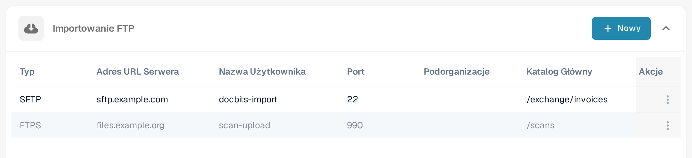<figcaption>
Przycisk <strong>Nowy</strong> w sekcji <strong>Importowanie FTP</strong> dodaje połączenie z serwerem. Wiersze na ilustracji zawierają wymyślone dane przykładowe z domen example.com.
</figcaption></figure>

### Wymagania

* Serwer FTP, FTPS lub SFTP osiągalny z poziomu usługi importu.
* Adres serwera, protokół, port, nazwa użytkownika i hasło przekazane przez administratora.
* Katalog importu oraz, jeśli wymagana jest archiwizacja, zatwierdzony katalog archiwum.

### Dodawanie nowego połączenia

1. Kliknij **Nowy** w sekcji **Importowanie FTP**.
2. Wprowadź ustawienia połączenia. Nowy formularz startuje z **SFTP** i portem **22**; zastąp te wartości, jeśli serwer używa innego protokołu lub portu.

<figure>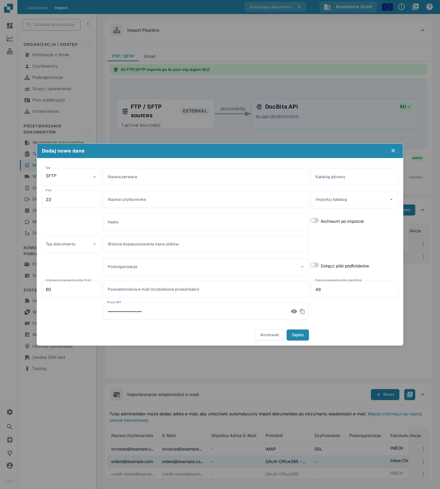<figcaption>
Okno <strong>Dodaj nowe dane</strong>: wprowadź dane serwera i logowania, a następnie sprawdź katalogi, trasowanie i ustawienia ponowień. Hasło i pozostałe pola tekstowe są puste, pole klucza API jest wstępnie wypełnione i zasłonięte, a wartości 22, 60 i 48 to domyślne ustawienia formularza. W tym przykładzie nic nie zostało zapisane.
</figcaption></figure>

* **Typ**, **Nazwa serwera**, **Port**, **Nazwa użytkownika** i **Hasło** identyfikują połączenie z serwerem i je uwierzytelniają.
* **Katalog główny** ustawia katalog bazowy. **Importuj katalog** wybiera folder do przetwarzania; wybór folderu staje się dostępny po zapisaniu połączenia.
* **Typ dokumentu** i **Podorganizacje** sterują przypisaniem. **Wzorce dopasowywania nazw plików** ogranicza, które nazwy plików są brane pod uwagę.
* **Archiwum po imporcie** włącza przenoszenie przetworzonych plików do wskazanego katalogu archiwum. **Dołącz pliki podfolderów** rozszerza przetwarzanie na podfoldery.
* **Interwał ponawiania próby (min)**, **Czas ponawiania próby (godziny)** i **Powiadomienia e-mail (rozdzielone przecinkami)** sterują ponawianiem i powiadomieniami. Wartości widoczne na ilustracji to 60 minut i 48 godzin.
* **Klucz API** korzysta z istniejącego klucza subskrypcji aplikacji organizacji. Ikona oka pokazuje lub ukrywa ten klucz; ikona kopiowania kopiuje go do schowka. Te kontrolki nie tworzą nowego klucza. Zachowaj klucz w poufności; nie umieszczaj go na zrzutach ekranu ani w wiadomościach do pomocy technicznej.

Użyj **Anulować** lub ikony zamknięcia, aby opuścić formularz nowego połączenia bez zapisywania.

3. Sprawdź wartości i kliknij **Zapisz**, gdy połączenie jest gotowe do utworzenia.
4. Po zapisaniu wiersza wybierz w jego menu **Akcje** pozycję włączającą import, gdy importy mają być uruchamiane.

### Działania dla FTP

<figure>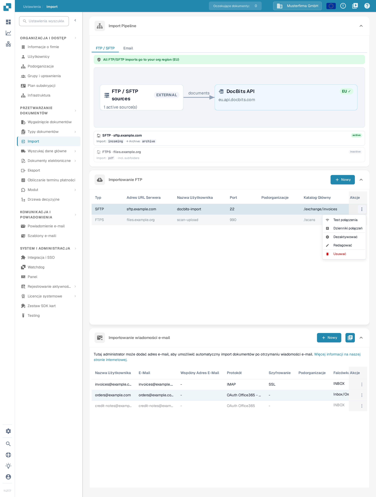<figcaption>
Menu <strong>Akcje</strong> aktywnego wiersza połączenia: <strong>Test połączenia</strong>, <strong>Dzienniki połączeń</strong>, <strong>Dezaktywować</strong>, <strong>Redagować</strong> i <strong>Usuwać</strong>.
</figcaption></figure>

<figure>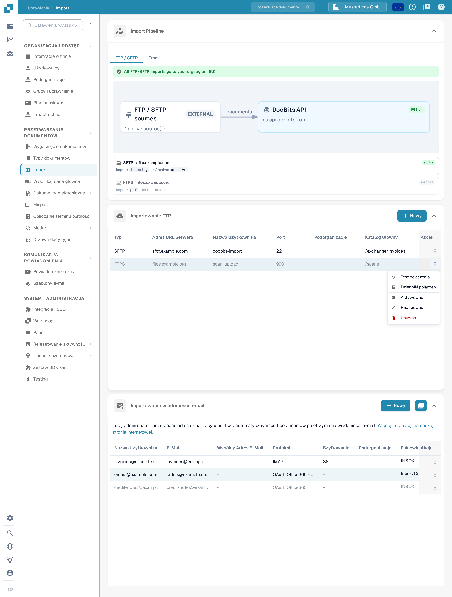<figcaption>
Menu <strong>Akcje</strong> nieaktywnego wiersza: zamiast <strong>Dezaktywować</strong> oferuje ono <strong>Aktywować</strong>.
</figcaption></figure>

Menu **Akcje** zapisanego połączenia udostępnia:

* **Test połączenia**: kontaktuje się ze skonfigurowanym serwerem, aby sprawdzić połączenie.
* **Dzienniki połączeń**: przeglądanie prób połączenia i błędów.
* **Aktywować** / **Dezaktywować**: włącza lub zatrzymuje automatyczne przetwarzanie dla tego połączenia. Aktywny wiersz oferuje **Dezaktywować**, nieaktywny **Aktywować**.
* **Redagować**: zmiana konfiguracji połączenia.
* **Usuwać**: usunięcie połączenia.

Testowanie, aktywacja, edycja i usuwanie wpływają na rzeczywiste połączenie. Przed ich użyciem sprawdź wybrany wiersz i organizację.

## **Importowanie wiadomości e-mail**

Podłączona skrzynka pocztowa jest oddzielona od przychodzącego adresu e-mail DocBits opisanego w poniższym samouczku. Wybierz metodę odpowiednią dla swojego procesu.

<figure>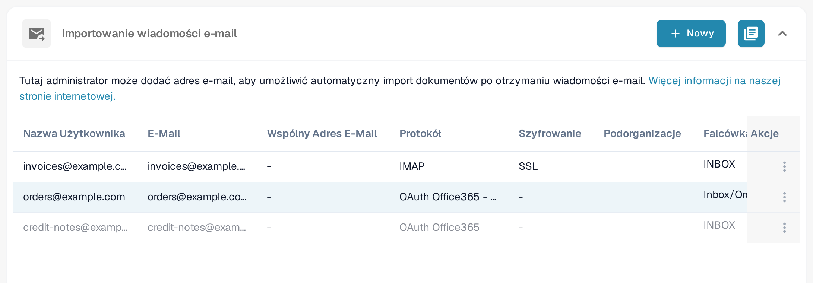<figcaption>
<strong>Nowy</strong> dodaje połączenie ze skrzynką pocztową, ikona dziennika w nagłówku sekcji otwiera importy. Wiersze zawierają wymyślone dane przykładowe; kolumna <strong>Falcówka</strong> pokazuje folder skrzynki.
</figcaption></figure>

<mark style="color:red;">Uwaga</mark>: importowane będą tylko dokumenty o następujących typach plików:

* `.pdf`
* `.tiff` / `.tif`
* `.eml`
* `.dat`
* `.xml`
* `.edi`
* `.purchaseorder`


Jak rozpoznawane są załączniki

Oprócz wymienionych powyżej rozszerzeń plików DocBits identyfikuje dokument również po jego rzeczywistej zawartości (sygnaturze pliku), a nie tylko po typie zawartości zadeklarowanym przez system pocztowy nadawcy. Ma to znaczenie w przypadku wiadomości przekazywanych: pośredniczące serwery pocztowe i bramy często oznaczają załącznik typem ogólnym (`application/octet-stream`) zamiast na przykład `application/pdf` lub `application/xml`. DocBits nadal rozpoznaje i importuje takie załączniki prawidłowo.

* Przekazane wiadomości `.eml` oraz załączniki Outlook `winmail.dat` (TNEF) są rozpakowywane, a dokumenty w nich zawarte są importowane.
* Kodowanie XML: gdy faktura XML zostanie oznaczona typem ogólnym (`application/octet-stream`), DocBits rozpoznaje ją po deklaracji `<?xml`, tolerując wiodący znacznik kolejności bajtów (BOM) UTF-8 lub UTF-16 (LE/BE) — obecnie tylko te kodowania BOM są automatycznie wykrywane na podstawie zawartości. Załącznik, który zachowuje nazwę pliku `.xml`, jest importowany niezależnie od kodowania.
* Pomijane: obrazy osadzone w wiadomości (loga podpisów i grafiki wbudowane — PNG, JPG, GIF, BMP) są pomijane po cichu i nie są liczone jako nieudane importy.

Jeśli załącznika nie można zaimportować, a opcja „Reply to this email if import can not be done” jest włączona dla adresu przychodzącego, skonfigurowany adres odpowiedzi otrzymuje powiadomienie.


### Dodawanie nowego połączenia IMAP

1. Kliknij **Nowy** w sekcji **Importowanie wiadomości e-mail** i wybierz **IMAP** w polu **Protokół**.
2. W kroku **Konfiguracja serwera poczty e-mail** wprowadź nazwę serwera, port, szyfrowanie, nazwę użytkownika, adres e-mail i hasło. Użyj wartości wymaganych przez Twojego dostawcę poczty.

<figure>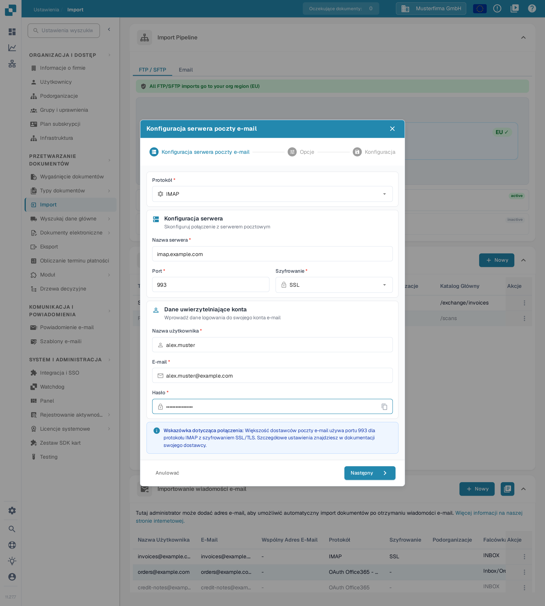<figcaption>
Uzupełnij pola serwera i konta przed kliknięciem <strong>Następny</strong>. W przykładzie wpisano imap.example.com, port 993, użytkownika alex.muster i adres alex.muster@example.com — są to wymyślone dane przykładowe. Hasło jest zasłonięte, a żadne dane nie zostały wysłane ani zapisane.
</figcaption></figure>

Ikona kopiowania obok **Hasło** kopiuje wprowadzone hasło do schowka. **Anulować** lub ikona zamknięcia opuszcza kreatora nowego połączenia bez zapisywania.

3. Kliknij **Następny**, aby otworzyć krok **Opcje**. Zdecyduj, czy **Połącz dołączone dokumenty**, czy **Blokuj importowanie duplikatów nazw plików**. **Powiadomienie e-mail** z opcją **Wyślij e-mail z potwierdzeniem po zakończeniu importu** włącza wiadomość potwierdzającą po imporcie; włączaj ją tylko wtedy, gdy takie zachowanie jest zamierzone.

<figure>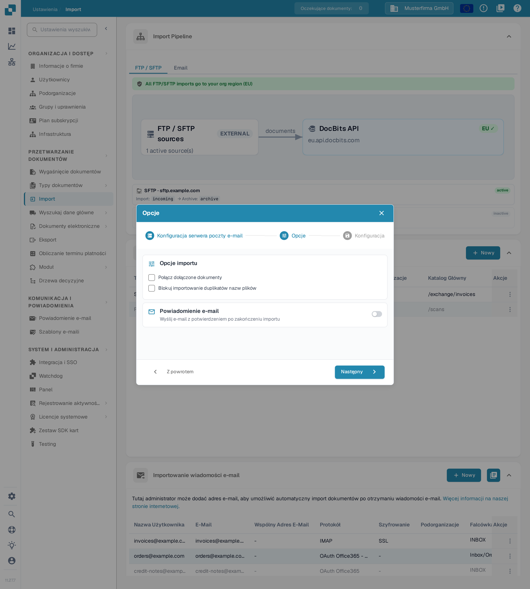<figcaption>
Krok <strong>Opcje</strong> oddziela zachowanie importu od powiadomień e-mail. W tym niezapisanym przykładzie oba pola wyboru i przełącznik powiadomień pozostają wyłączone; dane logowania z poprzedniego kroku, np. alex.muster@example.com, są wymyślone.
</figcaption></figure>

4. Kliknij **Następny**, aby otworzyć krok **Konfiguracja**. Wybierz wymagane **Podorganizacje**, sprawdź istniejący **Klucz API**, ustaw odbiorcę powiadomień o błędach importu i sprawdź **Trasowanie dokumentów**. Rozwiń **Ustawienia zaawansowane** tylko wtedy, gdy proces wymaga dodatkowych opcji.

<figure>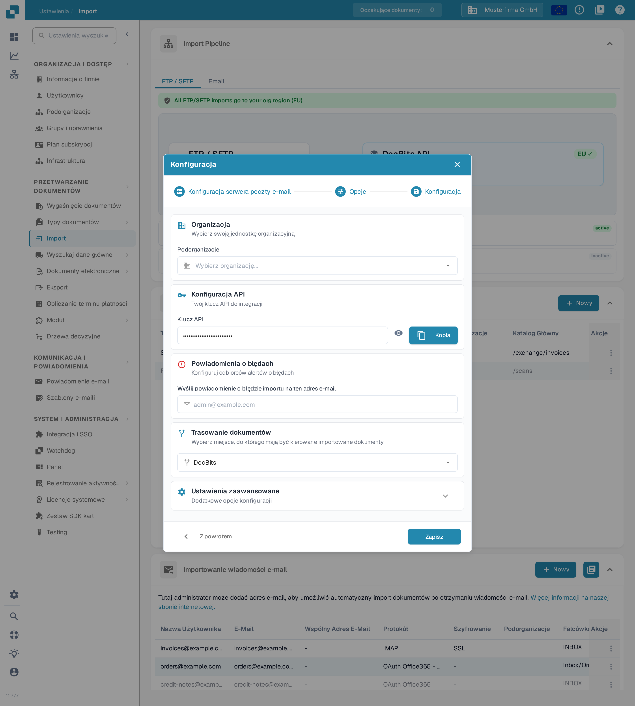<figcaption>
Krok <strong>Konfiguracja</strong> łączy przypisanie organizacji, istniejący klucz, powiadomienia o błędach i trasowanie. Klucz jest zasłonięty, a <strong>Zapisz</strong> nie zostało użyte; konto alex.muster@example.com nadal należy do wymyślonego przykładu.
</figcaption></figure>

W kroku **Konfiguracja** ikona oka pokazuje lub ukrywa istniejący **Klucz API**, a **Kopia** kopiuje go do schowka. Żadna z tych kontrolek nie generuje nowego klucza.

5. Kliknij **Zapisz**, gdy konfiguracja jest gotowa. Następnie użyj w menu **Akcje** zapisanego połączenia pozycji włączającej import, aby uruchomić automatyczne przetwarzanie.

Dla zapisanego połączenia IMAP **Redagować** udostępnia opcje folderu i obsługi po imporcie. Wybierz folder źródłowy i folder docelowy przenoszonych wiadomości dopiero po utworzeniu połączenia i możliwości wczytania dostępnych folderów.

### Działania dla IMAP

<figure>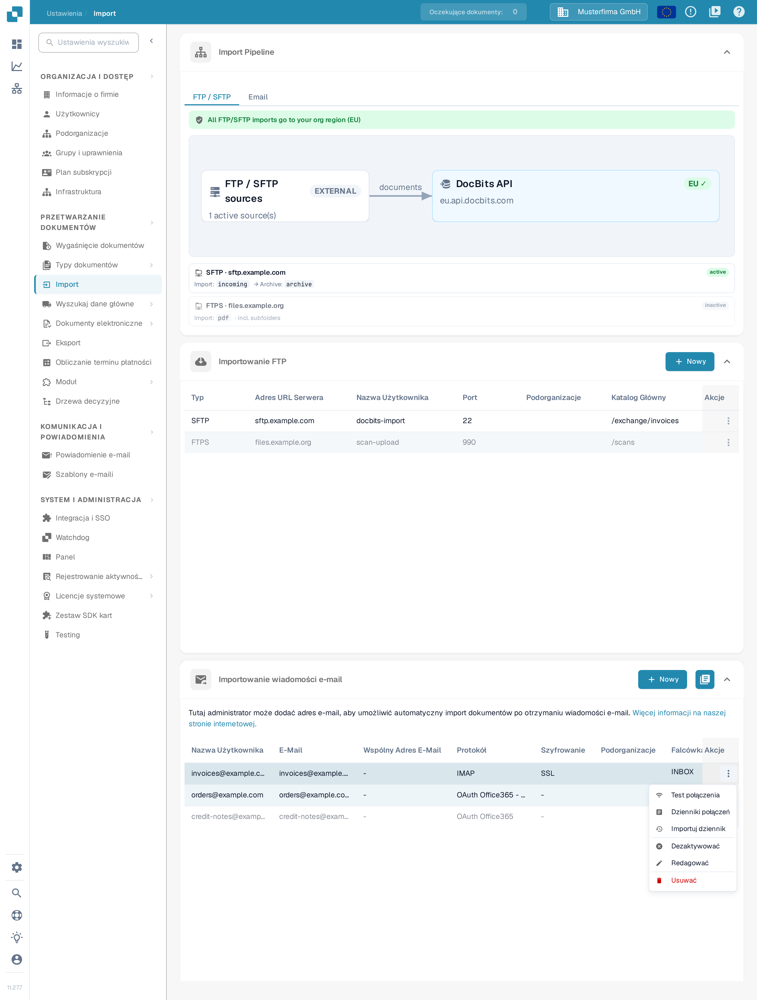<figcaption>
Menu <strong>Akcje</strong> zapisanego połączenia ze skrzynką: <strong>Test połączenia</strong>, <strong>Dzienniki połączeń</strong>, <strong>Importuj dziennik</strong>, <strong>Dezaktywować</strong>, <strong>Redagować</strong> i <strong>Usuwać</strong>.
</figcaption></figure>

Menu **Akcje** zapisanego połączenia udostępnia **Test połączenia**, **Dzienniki połączeń**, **Importuj dziennik**, **Aktywować** / **Dezaktywować**, **Redagować** i **Usuwać**. Test połączenia kontaktuje się ze skonfigurowaną skrzynką; aktywacja włącza przetwarzanie. Przed ponowieniem nieudanego importu przejrzyj dzienniki.

### Dodawanie nowego połączenia OAuth Office365

1. Kliknij **Nowy** w sekcji **Importowanie wiadomości e-mail** i wybierz **OAuth Office365** w polu **Protokół**. W przypadku aplikacji dzierżawcy zarządzanej przez administratora wybierz **OAuth Office365 - Tenant** i postępuj zgodnie z opisem w [O365 Tenant](o365-tenant.md).
2. Przed uwierzytelnieniem sprawdź **Trasowanie dokumentów**.

<figure>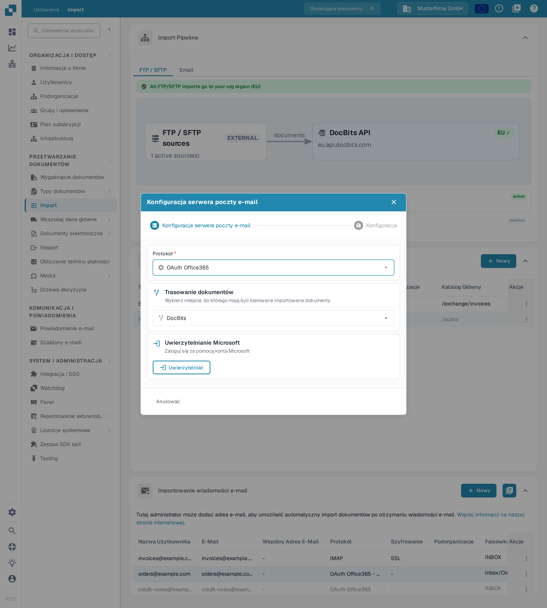<figcaption>
Wybierz trasę przed <strong>Uwierzytelniać</strong>. Ten widok jest sprzed logowania; nie rozpoczęto żadnego uwierzytelniania Microsoft.
</figcaption></figure>

3. Kliknij **Uwierzytelniać**, aby rozpocząć logowanie do konta Microsoft. W sekcji **Uwierzytelnianie Microsoft** użyj kodu wyświetlonego przez DocBits, a następnie wróć do DocBits i dokończ uwierzytelnianie.
4. Po uwierzytelnieniu sprawdź opcje organizacji, folderu, skrzynki współdzielonej, folderu przenoszenia i powiadomień o błędach oferowane dla połączenia. Gdy krok **Konfiguracja** będzie dostępny, przejdź do niego i zapisz zamierzone ustawienia.
5. Aktywuj zapisane połączenie, gdy automatyczne importy mają być uruchamiane. Akcja uruchamiająca import, jeśli jest oferowana dla zapisanego połączenia, wykonuje rzeczywisty import; używaj jej świadomie.

### Działania dla OAuth Office365

Menu **Akcje** zapisanego połączenia udostępnia **Dzienniki połączeń**, **Importuj dziennik**, **Aktywować** / **Dezaktywować**, **Redagować** i **Usuwać**. Dezaktywacja zatrzymuje automatyczne przetwarzanie; usunięcie usuwa konfigurację.

### Dziennik importu

Ikona dziennika w prawym górnym rogu sekcji **Importowanie wiadomości e-mail** służy do przeglądania importów we wszystkich skonfigurowanych połączeniach skrzynek pocztowych. Dla danego połączenia użyj akcji **Importuj dziennik** w zapisanym wierszu. Przed decyzją o ponowieniu sprawdź temat, nadawcę, status i dostępne szczegóły błędu.

## Wiadomości e-mail przychodzące

Dwa zrzuty ekranu samouczka poniżej pokazują przychodzący adres DocBits i jego dzienniki. Jest to oddzielne od połączeń skrzynek pocztowych opisanych powyżej.

* Użyj ikony kopiowania obok **E-Mail**, aby skopiować adres odbiorczy wyświetlany dla bieżącej organizacji i środowiska.
* **Dodaj** wstawia kolejny wiersz dozwolonego nadawcy w formularzu. Wybierz nadawcę i zamierzoną podorganizację, a następnie użyj **Zapisz**, aby zapisać konfigurację. Samo dodanie wiersza go nie zapisuje.
* **Importuj dziennik** otwiera dziennik wiadomości przychodzących. **Błędy** filtruje błędy; karty **Przetworzone** i **Wychodzące** przełączają widok dziennika.
* Rozwiń wiersz dziennika strzałką, aby sprawdzić szczegóły załącznika. Ikona kopiowania obok **Identyfikator Śledzenia** kopiuje ten identyfikator do rozwiązywania problemów. **Oryginalny e-mail**, gdy jest dostępny dla wiersza przychodzącego, pobiera wybraną oryginalną wiadomość jako plik `.eml`; nie ponawia importu.

## Instrukcja wideo: Skrzynka odbiorcza i wyszukiwanie błędów


Skrzynka odbiorcza i wyszukiwanie błędów


[Oglądaj z napisami i rozdziałami](https://docbits-videos.fra1.cdn.digitaloceanspaces.com/settings-assistant/email-import-admin/v2/pl.html)

Niektóre natywne etykiety produktu mogą pozostać w innym języku. Techniczne identyfikatory pól są zachowane.

W ustawieniach i imporcie używam w tym przykładzie adresu przychodzącego DocBits. Bezpośrednio podłączona skrzynka pocztowa to osobna metoda importu. Na potrzeby tego szkolenia pracuję w dedykowanej organizacji demonstracyjnej z syntetycznymi fakturami. Powiadomienia pozostają wyłączone.

Najpierw sprawdzam wyświetlany adres odbiorczy i zakres. Adres należy dokładnie do tej organizacji i jej środowiska. W przypadku innej firmy lub środowiska produkcyjnego zawsze używam adresu, który jest tam faktycznie wyświetlany.

Tutaj ograniczam skrzynkę odbiorczą do naszego zatwierdzonego nadawcy testowego. Przypisanie do podorganizacji wybieram tylko wtedy, gdy należy do zamierzonego procesu. Zapisuję ustawienie i otwieram je ponownie. Dozwolony nadawca został zachowany; automatyczne e-maile z odpowiedziami pozostają wyłączone na tym szkoleniu.

<figure><figcaption>
Dozwolony nadawca zapisany przy wyłączonych powiadomieniach.
</figcaption></figure>

Na potrzeby tego szkolenia wiadomość testowa została przesłana bezpośrednio do obsługi poczty przychodzącej w DocBits. Ten test nie potwierdza dostarczenia zewnętrznego e-maila. W dzienniku sprawdzam temat, nadawcę i zaimportowany załącznik. Następnie sprawdzam faktycznie utworzony dokument.

Otwieram odpowiedni dokument i porównuję załącznik PDF z fakturą w DocBits. Nazwa pliku, numer faktury, dostawca i kwota muszą się zgadzać. Pomyślny import nie mówi nic o zatwierdzeniu ani księgowaniu w ERP.

Drugi kontrolowany test pochodzi od niezatwierdzonego nadawcy. W dzienniku szukam konkretnie tego zgłoszenia przychodzącego i aktywuję filtr błędów. Szczegóły wymieniają odrzuconego nadawcę. Sprawdzam przyczynę za pomocą tematu i identyfikatora śledzenia, zamiast wielokrotnie uruchamiać import.

W prawdziwym przypadku najpierw wyjaśniam, czy ten nadawca jest w ogóle upoważniony. Zatwierdzona zmiana na liście nadawców jest zapisywana i ponownie sprawdzana. Następnie weryfikuję nowe, unikalne zgłoszenie testowe aż do utworzonego dokumentu. W przypadku błędów technicznych przekazuję identyfikator śledzenia i konkretny komunikat o błędzie.

<figure>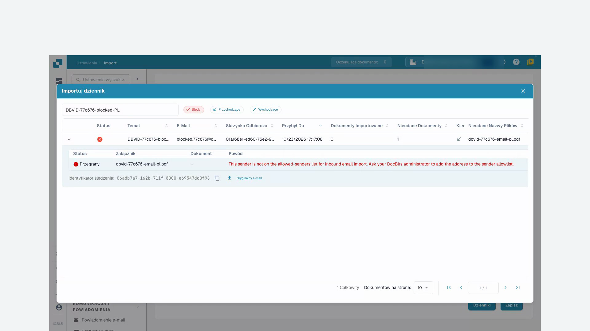<figcaption>
Nieudany import z załącznikiem, przyczyną i identyfikatorem śledzenia.
</figcaption></figure>
