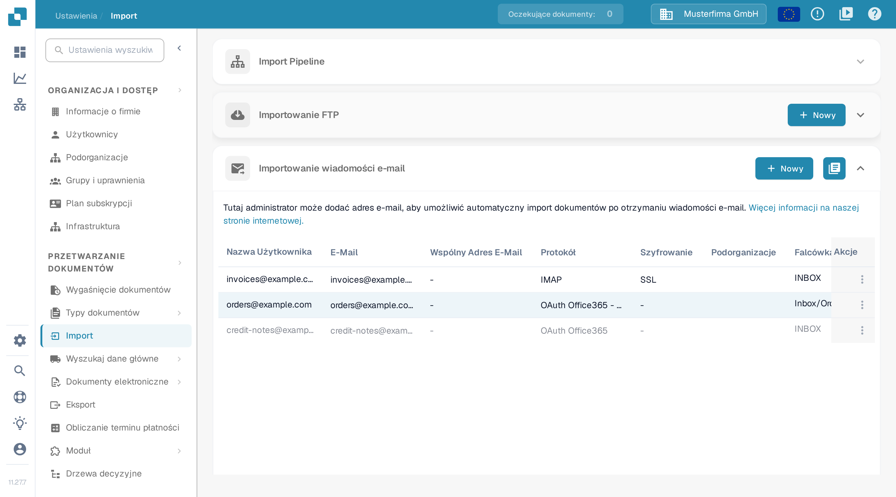

# O365 Tenant

Ten przewodnik opisuje, jak podłączyć skrzynkę pocztową Microsoft 365 należącą do organizacji za pośrednictwem aplikacji Microsoft Entra. Administrator musi mieć dostęp do właściwej dzierżawy Entra i do odpowiedniej organizacji DocBits. Przed włączeniem importu ustal skrzynkę pocztową, miejsce docelowe dokumentów oraz osobę odpowiedzialną za poświadczenia.

## 1. Przygotuj aplikację Entra 

W [centrum administracyjnym Microsoft Entra](https://entra.microsoft.com/) otwórz we właściwej dzierżawie sekcję rejestracji aplikacji i utwórz nową rejestrację. Wybierz rozpoznawalną nazwę oraz typ konta zatwierdzony przez administratora tożsamości. Aplikacja używana tylko w obrębie organizacji korzysta zwykle z opcji dla jednej dzierżawy. Zanotuj jej **identyfikator katalogu (dzierżawy)** i **identyfikator aplikacji (klienta)**. Nazwy w portalu Microsoft mogą się różnić w zależności od ustawionego języka; [aktualne instrukcje rejestracji](https://learn.microsoft.com/en-us/graph/auth-register-app-v2) firmy Microsoft pokazują kolejne kroki w portalu.

Formularz dzierżawy w DocBits wymaga klucza tajnego klienta. W sekcji **Certyfikaty i wpisy tajne** rejestracji utwórz klucz tajny zgodnie z zatwierdzoną polityką wygasania i zanotuj jego **wartość**, dopóki jest widoczna. Przechowuj ją bezpiecznie i ustal przed terminem wygaśnięcia, kto będzie ją odnawiał. Wpisz tę wartość w polu **Wartość aplikacji klienckiej** w DocBits. Nie umieszczaj kluczy tajnych na zrzutach ekranu, w zgłoszeniach ani w dokumentacji.

W konfiguracji opartej na kluczu tajnym pozostaw przepływy dla klientów publicznych wyłączone, chyba że administrator tożsamości ustalił odrębne wymaganie. [Wskazówki firmy Microsoft dotyczące typów klientów](https://learn.microsoft.com/en-us/entra/identity-platform/msal-client-applications) wyjaśniają, dlaczego aplikacje klienckie publiczne nie mogą bezpiecznie przechowywać kluczy tajnych aplikacji.

## 2. Zatwierdź uprawnienie i zakres skrzynki pocztowej

Poproś administratora usługi Microsoft 365 o zatwierdzenie operacji na poczcie oraz zakresu skrzynek dla tej aplikacji. Uprawnienie aplikacji **Mail.ReadWrite** programu Microsoft Graph umożliwia dostęp do poczty i jej zmienianie bez zalogowanego użytkownika i wymaga zgody administratora. Uprawnienie bez ograniczeń obejmuje skrzynki pocztowe w całej organizacji. Mail.ReadWrite nie pozwala wysyłać poczty; funkcje wysyłania wymagają odrębnego przeglądu uprawnień. Zobacz [dokumentację uprawnień programu Microsoft Graph](https://learn.microsoft.com/en-us/graph/permissions-reference#mailreadwrite).

Uzgodnij z administratorem Exchange ograniczony dostęp do skrzynek, korzystając z [funkcji RBAC dla aplikacji](https://learn.microsoft.com/en-us/exchange/permissions-exo/application-rbac). Uprawnienia przyznane w Entra i uprawnienia RBAC usługi Exchange sumują się: samo dodanie uprawnienia RBAC z ograniczonym zakresem nie zawęża istniejącego uprawnienia Entra obejmującego całą organizację. Poproś administratora o potwierdzenie faktycznego dostępu do właściwej skrzynki przed włączeniem źródła.

## 3. Skonfiguruj połączenie dzierżawy w DocBits

W odpowiedniej organizacji DocBits otwórz **Ustawienia → Import**, a w sekcji **Importowanie wiadomości e-mail** wybierz **Nowy**.

<figure><figcaption>
Nowy otwiera kreator konfiguracji poczty e-mail. Ten obraz dokumentacji pokazuje wymyślone dane przykładowe; kolumny Falcówka i Trasowanie dokumentów po prawej stronie są ucięte przy szerokości zrzutu.
</figcaption></figure>

W polu **Protokół** wybierz **OAuth Office365 - Tenant**, a w polu **Trasowanie dokumentów** wybierz miejsce docelowe. Wypełnij pola dzierżawy przekazane przez administratora:

| Pole w DocBits                      | Wpis                                                           |
| ----------------------------------- | -------------------------------------------------------------- |
| ID najemcy                          | Identyfikator katalogu (dzierżawy) właściwej dzierżawy Entra.   |
| Identyfikator aplikacji klienckiej  | Identyfikator aplikacji (klienta) zarejestrowanej aplikacji.    |
| Wartość aplikacji klienckiej        | Wartość klucza tajnego klienta z tej rejestracji.               |
| Typ najemcy                         | Środowisko chmury dzierżawy, na przykład Handlowy lub GCC High. |

<figure><figcaption>
Wariant dzierżawy ma własny formularz poświadczeń. Ten przykład używa miejsca docelowego DocBits i typu najemcy Handlowy; wszystkie trzy pola poświadczeń są puste. Test połączenia i Zapisz nie zostały użyte w tym zrzucie.
</figcaption></figure>

Przed użyciem **Zapisz** sprawdź połączenie przyciskiem **Test połączenia** z autoryzowanymi poświadczeniami dzierżawy. Test łączy się ze skonfigurowaną usługą; Zapisz wysyła konfigurację dzierżawy. Udany test połączenia nie dowodzi, że wiadomość lub dokument został zaimportowany. Jeśli chcesz tylko obejrzeć formularz, wybierz **Anulować** lub symbol zamknięcia.

## 4. Sprawdź zapisane źródło

Przy autoryzowanym wdrożeniu użyj wyznaczonej skrzynki testowej i nieszkodliwego przykładowego załącznika. Po zapisaniu źródła wyślij wiadomość testową na tę skrzynkę, sprawdź listę w sekcji **Importowanie wiadomości e-mail** oraz dzienniki importu i potwierdź, że dokument dotarł do wybranego miejsca. W razie potrzeby omów z administratorem opcje wspólnej skrzynki i przenoszenia wiadomości. Zapisz trasę, skrzynkę i osobę odpowiedzialną za wygaśnięcie klucza tajnego w wewnętrznym runbooku, bez klucza.

Sprawdzenie dokumentacji objęło polską ścieżkę menu, listę oraz niewypełniony kreator dzierżawy. Nie utworzono ani nie zmieniono żadnej aplikacji Entra, żadnych poświadczeń, uprawnień, skrzynki pocztowej ani źródła importu. Nie wykonano testu połączenia, uwierzytelniania dzierżawy ani importu wiadomości. Aktualny interfejs administracyjny firmy Microsoft opisują podlinkowane instrukcje.
