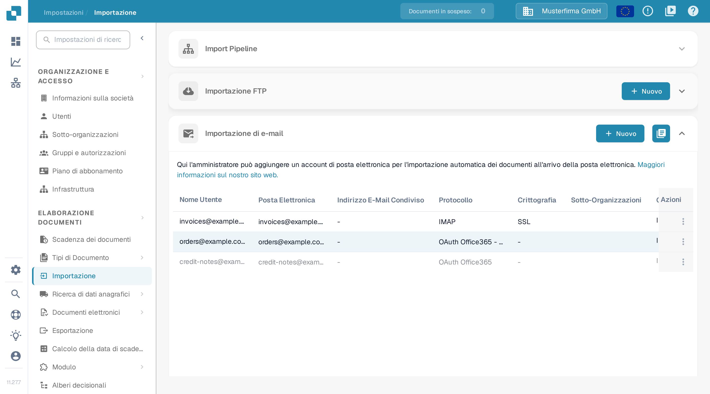
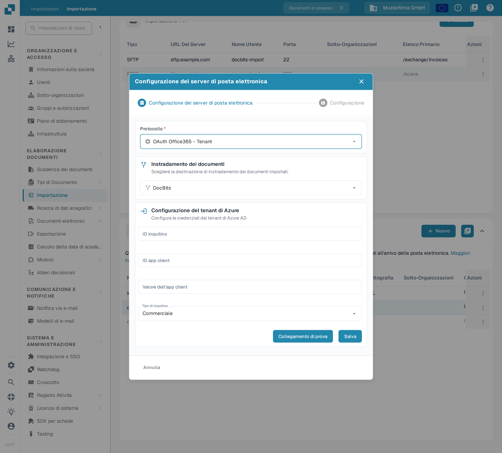

# O365 Tenant

Questa guida descrive come collegare una casella di posta Microsoft 365 dell'organizzazione tramite un'applicazione Microsoft Entra. Un amministratore deve avere accesso al tenant Entra previsto e all'organizzazione DocBits corrispondente. Prima di attivare l'importazione, concordare la casella di posta, la destinazione dei documenti e la persona responsabile delle credenziali.

## 1. Preparare l'applicazione Entra 

Nel [centro di amministrazione di Microsoft Entra](https://entra.microsoft.com/) aprire, nel tenant previsto, le registrazioni delle applicazioni e crearne una nuova. Scegliere un nome riconoscibile e il tipo di account approvato dalla propria amministrazione delle identità. Un'applicazione utilizzata solo all'interno della propria organizzazione usa di norma l'opzione per singolo tenant. Annotare l'**ID directory (tenant)** e l'**ID applicazione (client)**. Le denominazioni nel portale Microsoft possono variare in base alla lingua impostata; le [istruzioni di registrazione aggiornate](https://learn.microsoft.com/en-us/graph/auth-register-app-v2) di Microsoft mostrano i passaggi nel portale.

Il modulo del tenant in DocBits richiede un segreto client. In **Certificati e segreti** della registrazione creare il segreto secondo la politica di scadenza approvata e annotarne il **valore** finché è visibile. Conservarlo in modo sicuro e stabilire prima della scadenza chi lo rinnoverà. Inserire questo valore in **Valore dell'app client** in DocBits. Tenere i segreti fuori da screenshot, ticket e documentazione.

Per questa configurazione basata su un segreto, lasciare disattivati i flussi per client pubblici, a meno che l'amministrazione delle identità abbia stabilito un requisito separato. Le [indicazioni sui tipi di client](https://learn.microsoft.com/en-us/entra/identity-platform/msal-client-applications) di Microsoft spiegano perché le applicazioni client pubblici non possono conservare in modo sicuro i segreti delle applicazioni.

## 2. Approvare autorizzazione e ambito della casella

Chiedere all'amministratore di Microsoft 365 di approvare le operazioni di posta e l'ambito della casella per questa applicazione. L'autorizzazione applicazione **Mail.ReadWrite** di Microsoft Graph consente l'accesso alle e-mail e le relative modifiche senza un utente connesso e richiede il consenso di un amministratore. Un'autorizzazione senza limiti copre le caselle di posta dell'intera organizzazione. Mail.ReadWrite non consente di inviare e-mail; le funzioni di invio richiedono una verifica separata delle autorizzazioni. Vedere il [riferimento sulle autorizzazioni di Microsoft Graph](https://learn.microsoft.com/en-us/graph/permissions-reference#mailreadwrite).

Verificare con l'amministratore di Exchange l'accesso limitato alle caselle tramite [RBAC per le applicazioni](https://learn.microsoft.com/en-us/exchange/permissions-exo/application-rbac). Le autorizzazioni concesse in Entra e quelle RBAC di Exchange si sommano: un'ulteriore concessione RBAC con ambito non riduce un'autorizzazione Entra esistente valida per l'intera organizzazione. Chiedere all'amministratore di confermare l'accesso effettivo alla casella prevista prima di attivare l'origine.

## 3. Configurare la connessione del tenant in DocBits

Nell'organizzazione DocBits prevista aprire **Impostazioni → Importazione** e, nella sezione **Importazione di e-mail**, selezionare **Nuovo**.

<figure><figcaption>
Nuovo apre la procedura guidata per la configurazione della posta elettronica. Questa immagine di documentazione mostra dati di esempio inventati; le colonne Cartella e Instradamento dei documenti, più a destra, sono tagliate alla larghezza della cattura.
</figcaption></figure>

In **Protocollo** selezionare **OAuth Office365 - Tenant** e in **Instradamento dei documenti** scegliere la destinazione prevista. Compilare i campi del tenant forniti dall'amministratore:

| Campo in DocBits       | Immissione                                                      |
| ---------------------- | --------------------------------------------------------------- |
| ID inquilino           | ID directory (tenant) del tenant Entra previsto.                |
| ID app client          | ID applicazione (client) dell'applicazione registrata.          |
| Valore dell'app client | Il valore del segreto client di questa registrazione.           |
| Tipo di inquilino      | L'ambiente cloud del tenant, ad esempio Commerciale o GCC High. |

<figure><figcaption>
La variante del tenant ha un proprio modulo delle credenziali. Questo esempio usa la destinazione DocBits e il tipo di inquilino Commerciale; tutti e tre i campi delle credenziali sono vuoti. Collegamento di prova e Salva non sono stati usati per questa cattura.
</figcaption></figure>

Prima di **Salva**, usare **Collegamento di prova** con le credenziali autorizzate del tenant. Il test contatta il servizio configurato; Salva invia la configurazione del tenant. Un collegamento di prova riuscito non dimostra che un messaggio o un documento sia stato importato. Se si desidera solo esaminare il modulo, usare **Annulla** o il simbolo di chiusura.

## 4. Verificare l'origine salvata

Per un'implementazione autorizzata, usare una casella di posta di test designata e un allegato di esempio innocuo. Dopo aver salvato l'origine, inviare un messaggio di test a quella casella, controllare l'elenco in **Importazione di e-mail** e i registri di importazione e verificare che il documento arrivi alla destinazione scelta. Se necessario, rivedere con l'amministratore le opzioni per le caselle condivise e lo spostamento dei messaggi. Annotare percorso, casella di posta e responsabile della scadenza del segreto nel runbook interno, senza il segreto.

La verifica della documentazione ha riguardato il percorso di menu italiano, l'elenco e il modulo del tenant non compilato. Non sono state create o modificate applicazioni Entra, credenziali, autorizzazioni, caselle di posta o origini di importazione. Non sono stati eseguiti test di collegamento, di autenticazione del tenant o di importazione delle e-mail. Per l'interfaccia attuale dell'amministrazione Microsoft, usare le istruzioni collegate di Microsoft.
