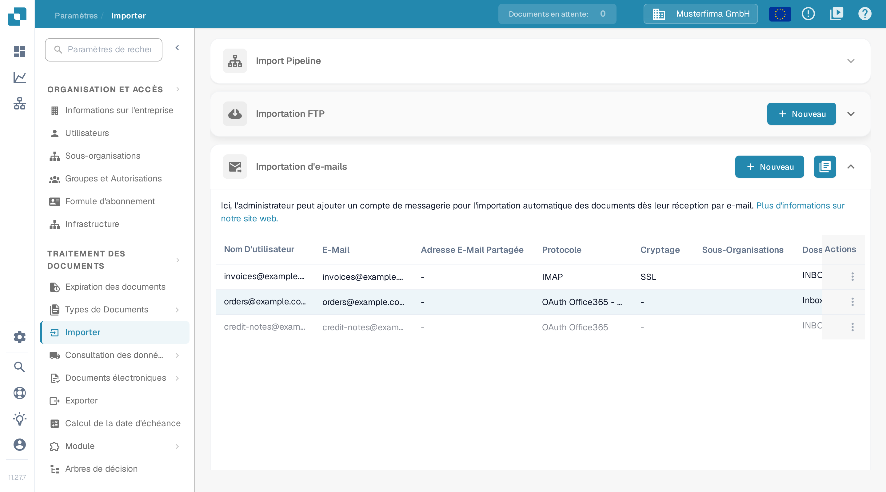

# O365 Tenant

Utilisez ce guide pour connecter une boîte aux lettres Microsoft 365 détenue par l'organisation au moyen d'une application Microsoft Entra. Un administrateur doit avoir accès au locataire Entra prévu et à l'organisation DocBits correspondante. Convenez de la boîte aux lettres, de la destination des documents et du responsable des identifiants avant d'activer l'importation.

## 1. Préparer l'application Entra 

Dans le [centre d'administration Microsoft Entra](https://entra.microsoft.com/), ouvrez Identité → Applications → Inscriptions d'applications → Nouvelle inscription dans le locataire prévu. Choisissez un nom reconnaissable et le type de compte approuvé par votre administrateur d'identité. Une application utilisée uniquement au sein de votre organisation emploie normalement l'option de compte à locataire unique. Notez son ID d'annuaire (locataire) et son ID d'application (client). Suivez les [instructions d'inscription actuelles](https://learn.microsoft.com/en-us/graph/auth-register-app-v2) de Microsoft pour les étapes dans le portail.

Le formulaire de locataire de DocBits demande un secret client. Sous Certificats et secrets, créez le secret selon la politique d'expiration approuvée et notez sa valeur tant qu'elle est affichée. Conservez-la en lieu sûr et désignez un responsable de sa rotation avant l'expiration. Saisissez cette valeur dans **Valeur de l'application client** dans DocBits. Ne placez jamais de secret dans une capture d'écran, un ticket ou la documentation.

Laissez les flux de client public désactivés pour cette configuration fondée sur un secret, sauf si votre administrateur d'identité a établi une exigence distincte. Les [recommandations de Microsoft sur les types de client](https://learn.microsoft.com/en-us/entra/identity-platform/msal-client-applications) expliquent pourquoi une application de client public ne peut pas conserver un secret d'application en toute sécurité.

## 2. Approuver l'autorisation et l'étendue de la boîte aux lettres

Demandez à l'administrateur Microsoft 365 d'approuver les opérations de messagerie et l'étendue de la boîte aux lettres pour cette application. L'autorisation d'application Mail.ReadWrite de Microsoft Graph permet d'accéder au courrier et de le modifier sans utilisateur connecté, et exige le consentement d'un administrateur. Une attribution sans étendue couvre les boîtes aux lettres de toute l'organisation. Mail.ReadWrite n'autorise pas l'envoi de courrier ; les fonctions d'envoi nécessitent une analyse d'autorisation distincte. Consultez la [référence des autorisations Microsoft Graph](https://learn.microsoft.com/en-us/graph/permissions-reference#mailreadwrite).

Examinez l'accès restreint à la boîte aux lettres avec l'administrateur Exchange au moyen de la [RBAC pour les applications](https://learn.microsoft.com/en-us/exchange/permissions-exo/application-rbac). Les attributions d'autorisations Entra et les attributions RBAC Exchange se cumulent : ajouter une seule attribution RBAC avec étendue ne réduit pas une attribution Entra existante pour tout le locataire. Demandez à l'administrateur de confirmer l'accès effectif à la boîte aux lettres prévue avant d'activer la source.

## 3. Configurer la connexion du locataire DocBits

Ouvrez **Paramètres** → **Importer**, allez à la section **Importation d'e-mails** dans l'organisation DocBits prévue et sélectionnez **Nouveau**.

<figure><figcaption>
Nouveau ouvre l'assistant de configuration de la messagerie. Cette capture de documentation montre des données d'exemple inventées dans le tableau, et les colonnes situées plus à droite sont coupées.
</figcaption></figure>

Sélectionnez **OAuth Office365 - Tenant** sous **Protocole** et choisissez la destination prévue sous **Routage des documents**. Renseignez les champs du locataire fournis par votre administrateur :

| Champ dans DocBits                | Saisie                                                                          |
| --------------------------------- | ------------------------------------------------------------------------------- |
| ID du locataire                   | ID d'annuaire (locataire) du locataire Entra prévu.                            |
| ID de l'application client        | ID d'application (client) de l'application enregistrée.                         |
| Valeur de l'application client    | La valeur du secret client de cette inscription.                                |
| Type de locataire                 | L'environnement cloud du locataire, par exemple Commercial ou Haut GCC.         |

<figure><figcaption>
La variante de locataire dispose de son propre formulaire d'identification. Cet exemple utilise la route DocBits et le type de locataire Commercial ; les trois champs d'identification sont vides. Test de connexion et Enregistrer n'ont pas été utilisés pour cette capture de documentation.
</figcaption></figure>

Utilisez **Test de connexion** avec les identifiants autorisés du locataire avant **Enregistrer**. Le test contacte le service configuré ; Enregistrer transmet la configuration du locataire. Un test de connexion réussi ne prouve pas qu'un message ou un document a été importé. Si vous ne faites qu'examiner le formulaire, utilisez **Annuler** ou la commande de fermeture.

## 4. Vérifier la source enregistrée

Pour un déploiement autorisé, utilisez une boîte aux lettres de test désignée et une pièce jointe d'exemple inoffensive. Après avoir enregistré la source, envoyez un message de test à cette boîte aux lettres, consultez la liste **Importation d'e-mails** et les journaux d'importation, puis confirmez que le document arrive à la destination sélectionnée. Examinez les options de boîte aux lettres partagée et de déplacement des messages avec l'administrateur selon les besoins. Notez la route, la boîte aux lettres et le responsable de l'expiration du secret dans le manuel interne, sans le secret.

La vérification de cette documentation a couvert le chemin de menu en français, la liste et l'assistant de locataire vide. Aucune application Entra, aucun identifiant, aucune autorisation, aucune boîte aux lettres et aucune source d'importation n'a été créé ni modifié. Aucun test de connexion, d'authentification du locataire ou d'importation de courrier n'a été effectué. Utilisez les instructions Microsoft liées pour leur interface d'administration actuelle.
