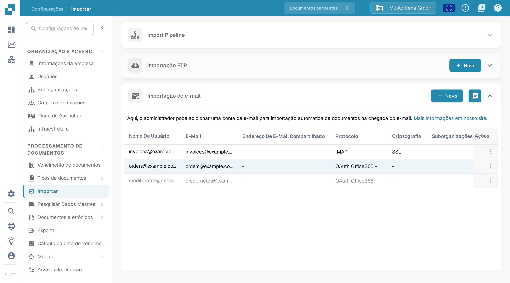
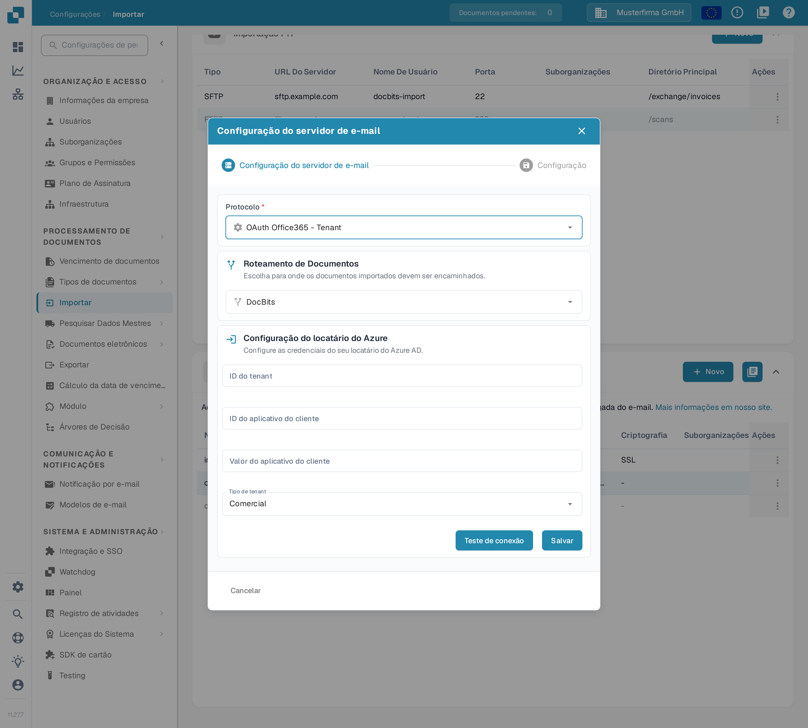

# Tenant do Office 365

Use este guia para ligar uma caixa de correio Microsoft 365 da organização através de uma aplicação Microsoft Entra. Um administrador precisa de acesso ao tenant Entra pretendido e à organização DocBits correspondente. Combine previamente a caixa de correio, o destino dos documentos e quem gere as credenciais antes de ativar a importação.

## 1. Preparar a aplicação Entra 

No [centro de administração Microsoft Entra](https://entra.microsoft.com/), abra Identidade → Aplicações → Registos de aplicações → Novo registo no tenant pretendido. Escolha um nome reconhecível e o tipo de conta aprovado pelo seu administrador de identidade. Uma aplicação usada apenas dentro da organização utiliza normalmente a opção de conta de inquilino único. Anote o ID do diretório (inquilino) e o ID da aplicação (cliente). Siga as [instruções de registo atuais](https://learn.microsoft.com/en-us/graph/auth-register-app-v2) da Microsoft para os passos no portal; os nomes no portal da Microsoft dependem do idioma configurado.

O formulário de tenant do DocBits pede um segredo do cliente. Em Certificados e segredos, crie o segredo segundo a política de expiração aprovada e anote o valor enquanto estiver visível. Guarde-o em segurança e defina quem o renova antes da expiração. Introduza esse valor em **Valor do aplicativo do cliente** no DocBits. Mantenha os segredos fora de capturas de ecrã, tickets e documentação.

Deixe os fluxos de cliente público desativados nesta configuração baseada num segredo, a menos que o seu administrador de identidade tenha definido um requisito separado. As [orientações da Microsoft sobre tipos de cliente](https://learn.microsoft.com/en-us/entra/identity-platform/msal-client-applications) explicam porque é que as aplicações de cliente público não conseguem guardar segredos de aplicação em segurança.

## 2. Aprovar a permissão e o âmbito da caixa de correio

Peça ao administrador do Microsoft 365 que aprove as operações de correio e o âmbito da caixa de correio para esta aplicação. A permissão de aplicação **Mail.ReadWrite** do Microsoft Graph permite aceder ao correio e alterá-lo sem um utilizador com sessão iniciada e exige o consentimento de um administrador. Uma atribuição sem âmbito abrange as caixas de correio de toda a organização. Mail.ReadWrite não permite enviar correio; as funções de envio exigem uma revisão separada da permissão. Consulte a [referência de permissões do Microsoft Graph](https://learn.microsoft.com/en-us/graph/permissions-reference#mailreadwrite).

Reveja o acesso restrito às caixas de correio com o administrador do Exchange através de [RBAC para aplicações](https://learn.microsoft.com/en-us/exchange/permissions-exo/application-rbac). As atribuições de permissões do Entra e as atribuições RBAC do Exchange combinam-se: acrescentar apenas uma atribuição RBAC com âmbito não reduz uma atribuição Entra existente para toda a organização. Peça ao administrador que confirme o acesso efetivo à caixa de correio pretendida antes de ativar a origem.

## 3. Configurar a ligação do tenant no DocBits

Abra **Configurações → Importar** na organização DocBits pretendida, abra a secção **Importação de e-mail** e selecione **Novo**.

<figure><figcaption>
Novo abre o assistente do servidor de e-mail. Os dados das linhas nesta captura de documentação são exemplos inventados; as colunas Pasta e Roteamento De Documentos ficam fora da largura da captura e podem ser alcançadas na horizontal.
</figcaption></figure>

As ligações existentes gerem-se com o menu da coluna **Ações**, com **Teste de conexão**, **Registros de conexão**, **Log de importação**, **Desativar**, **Editar** e **Excluir**. O ícone junto a **Novo** abre o registo de importação de todas as ligações de e-mail. [As ações da importação de e-mail](README.md#acoes-para-oauth-office365) descrevem este menu em detalhe.

Em **Protocolo**, escolha **OAuth Office365 - Tenant** e, em **Roteamento de Documentos**, escolha o destino pretendido. Preencha os campos do tenant fornecidos pelo seu administrador:

| Campo no DocBits | Introduza |
| --- | --- |
| ID do tenant | ID do diretório (inquilino) do tenant Entra pretendido. |
| ID do aplicativo do cliente | ID da aplicação (cliente) da aplicação registada. |
| Valor do aplicativo do cliente | O valor do segredo do cliente desse registo. |
| Tipo de tenant | O ambiente cloud do tenant, por exemplo Comercial ou Alto GCC. |

<figure><figcaption>
A variante Tenant tem o seu próprio formulário de credenciais. Este exemplo usa o encaminhamento DocBits e o tipo de tenant Comercial; os três campos de credenciais estão vazios. Teste de conexão e Salvar não foram usados nesta captura de documentação.
</figcaption></figure>

Use **Teste de conexão** com as credenciais autorizadas do tenant antes de **Salvar**. O teste contacta o serviço configurado; **Salvar** submete a configuração do tenant. Um teste de ligação com sucesso não prova que uma mensagem ou um documento foi importado. Se estiver apenas a inspecionar o formulário, use **Cancelar** ou o controlo de fechar.

## 4. Verificar a origem guardada

Para uma implementação autorizada, use uma caixa de correio de teste designada e um anexo de exemplo inofensivo. Depois de guardar a origem, envie uma mensagem de teste para essa caixa de correio, abra a lista **Importação de e-mail** e o **Log de importação** e confirme que o documento chega ao destino escolhido. Reveja as opções de caixa de correio partilhada e de movimentação de mensagens conforme necessário com o administrador. Registe a rota, a caixa de correio e o responsável pela expiração do segredo no manual interno, sem o segredo.

A verificação da documentação abrangeu o menu atual em português, a lista e o assistente de tenant vazio. Não foi criada nem alterada qualquer aplicação Entra, credencial, permissão, caixa de correio ou origem de importação. Não foi testada qualquer ligação, autenticação de tenant ou importação de correio. Use as instruções da Microsoft indicadas acima para a interface de administração atual.
