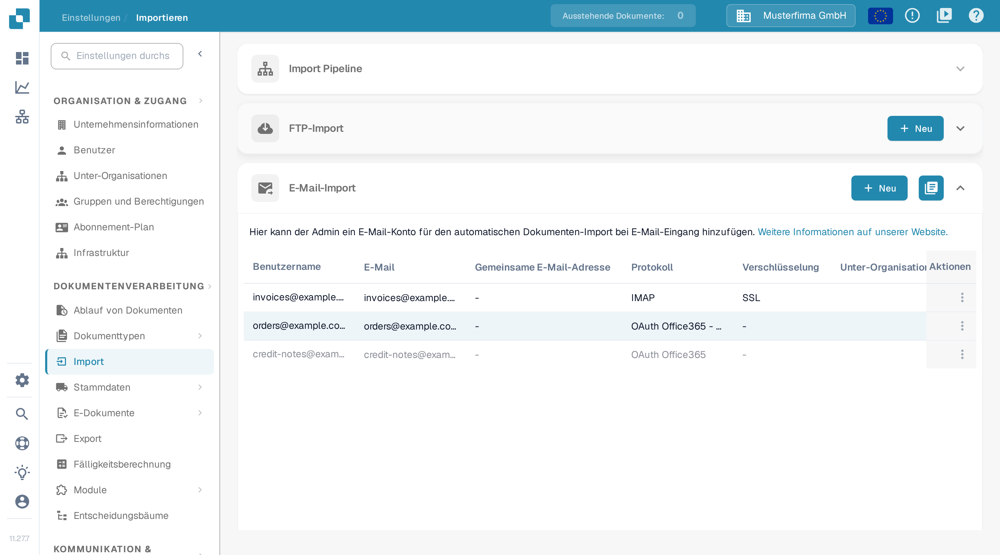

# O365 Tenant

Diese Anleitung verbindet ein unternehmenseigenes Microsoft-365-Postfach über eine Microsoft-Entra-Anwendung. Ein Administrator benötigt Zugriff auf den vorgesehenen Entra-Mandanten und die passende DocBits-Organisation. Legen Sie vor dem Aktivieren des Imports Postfach, Dokumentziel und Verantwortlichen für die Zugangsdaten fest.

## 1. Entra-Anwendung vorbereiten 

Öffnen Sie im [Microsoft Entra Admin Center](https://entra.microsoft.com/) im vorgesehenen Mandanten die App-Registrierungen und legen Sie eine neue Anwendung an. Wählen Sie einen erkennbaren Namen und den Kontotyp, den Ihre Identitätsverwaltung freigibt. Eine Anwendung, die nur innerhalb Ihrer Organisation genutzt wird, verwendet normalerweise die Option für einzelne Mandanten. Notieren Sie die Verzeichnis-ID (Mandant) und die Anwendungs-ID (Client). Die Bezeichnungen im Microsoft-Portal können je nach Spracheinstellung abweichen; die [aktuellen Registrierungsanweisungen](https://learn.microsoft.com/en-us/graph/auth-register-app-v2) von Microsoft zeigen die Schritte im Portal.

Das Mandantenformular von DocBits fragt nach einem Clientgeheimnis. Erstellen Sie das Geheimnis in den Zertifikaten und Geheimnissen der Registrierung nach der freigegebenen Ablaufrichtlinie und notieren Sie den Wert, solange er sichtbar ist. Bewahren Sie ihn sicher auf und legen Sie vor dem Ablauf fest, wer ihn erneuert. Tragen Sie diesen Wert in **Wert der Client-App** in DocBits ein. Halten Sie Geheimnisse aus Screenshots, Tickets und Dokumentation heraus.

Lassen Sie Public-Client-Flows für diese Einrichtung mit Geheimnis deaktiviert, solange Ihre Identitätsverwaltung keine eigene Anforderung festgelegt hat. Die [Anleitung zu Clienttypen](https://learn.microsoft.com/en-us/entra/identity-platform/msal-client-applications) von Microsoft erklärt, warum Public-Client-Anwendungen keine Anwendungsgeheimnisse sicher speichern können.

## 2. Berechtigung und Postfachumfang freigeben

Lassen Sie den Microsoft-365-Administrator die Mailvorgänge und den Postfachumfang für diese Anwendung freigeben. Die Anwendungsberechtigung Mail.ReadWrite von Microsoft Graph erlaubt den Zugriff auf E-Mails und Änderungen daran ohne angemeldeten Benutzer und erfordert die Zustimmung eines Administrators. Eine Freigabe ohne Einschränkung umfasst die Postfächer der gesamten Organisation. Mail.ReadWrite erlaubt das Senden von E-Mails nicht; Funktionen zum Senden erfordern eine eigene Berechtigungsprüfung. Siehe die [Berechtigungsreferenz zu Microsoft Graph](https://learn.microsoft.com/en-us/graph/permissions-reference#mailreadwrite).

Prüfen Sie den eingeschränkten Postfachzugriff mit dem Exchange-Administrator über [RBAC für Anwendungen](https://learn.microsoft.com/en-us/exchange/permissions-exo/application-rbac). Berechtigungen aus Entra und RBAC-Freigaben aus Exchange wirken zusammen: Eine zusätzliche RBAC-Freigabe mit Umfang verkleinert eine bestehende, organisationsweite Entra-Freigabe nicht. Lassen Sie sich vom Administrator den tatsächlichen Zugriff auf das vorgesehene Postfach bestätigen, bevor Sie die Quelle aktivieren.

## 3. Mandantenverbindung in DocBits einrichten

Öffnen Sie in der vorgesehenen DocBits-Organisation **Einstellungen → Importieren** und wählen Sie im Bereich **E-Mail-Import** die Schaltfläche **Neu**.

<figure><figcaption>
Neu öffnet den Assistenten für die E-Mail-Einrichtung. Diese Dokumentationsaufnahme zeigt erfundene Beispieldaten; die weiter rechts liegenden Spalten Ordner und Dokumentenweiterleitung sind an der Aufnahmebreite abgeschnitten.
</figcaption></figure>

Wählen Sie unter **Protokoll** die Option **OAuth Office365 - Tenant** und unter **Dokumentenweiterleitung** das vorgesehene Ziel. Füllen Sie die Mandantenfelder aus, die Ihr Administrator bereitstellt:

| Feld in DocBits     | Eingabe                                                                   |
| ------------------- | ------------------------------------------------------------------------- |
| Mandanten-ID        | Verzeichnis-ID (Mandant) des vorgesehenen Entra-Mandanten.                 |
| Client-App-ID       | Anwendungs-ID (Client) der registrierten Anwendung.                        |
| Wert der Client-App | Der Wert des Clientgeheimnisses aus dieser Registrierung.                  |
| Mietertyp           | Die Cloud-Umgebung des Mandanten, zum Beispiel Kommerziell oder GCC Hoch.  |

<figure><figcaption>
Die Mandantenvariante hat ein eigenes Zugangsformular. Dieses Beispiel nutzt das Ziel DocBits und den Mietertyp Kommerziell; alle drei Zugangsfelder sind leer. Verbindung testen und Speichern wurden für diese Aufnahme nicht verwendet.
</figcaption></figure>

Verwenden Sie **Verbindung testen** mit den freigegebenen Zugangsdaten des Mandanten, bevor Sie **Speichern** wählen. Der Test kontaktiert den eingerichteten Dienst; Speichern übermittelt die Mandantenkonfiguration. Ein erfolgreicher Verbindungstest belegt nicht, dass eine Nachricht oder ein Dokument importiert wurde. Wenn Sie das Formular nur ansehen, verwenden Sie **Abbrechen** oder das Schließen-Symbol.

## 4. Gespeicherte Quelle prüfen

Für einen freigegebenen Einsatz verwenden Sie ein festgelegtes Testpostfach und einen harmlosen Beispielanhang. Senden Sie nach dem Speichern der Quelle eine Testnachricht an dieses Postfach, prüfen Sie die Liste im Bereich E-Mail-Import und die Importprotokolle und bestätigen Sie, dass das Dokument am gewählten Ziel ankommt. Prüfen Sie bei Bedarf gemeinsam mit dem Administrator die Optionen für gemeinsame Postfächer und das Verschieben von Nachrichten. Halten Sie Weiterleitung, Postfach und den Verantwortlichen für den Ablauf des Geheimnisses im internen Runbook fest, ohne das Geheimnis.

Die Dokumentationsprüfung umfasste den aktuellen deutschen Menüweg, die Liste und den leeren Mandantenassistenten. Es wurden keine Entra-Anwendung, keine Zugangsdaten, keine Berechtigung, kein Postfach und keine Importquelle angelegt oder geändert. Es wurde kein Verbindungs-, Mandantenauthentifizierungs- oder Mailimport-Test durchgeführt. Verwenden Sie für die aktuelle Oberfläche der Microsoft-Verwaltung die verlinkten Anweisungen von Microsoft.
