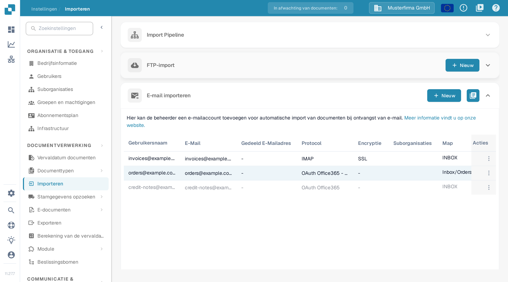
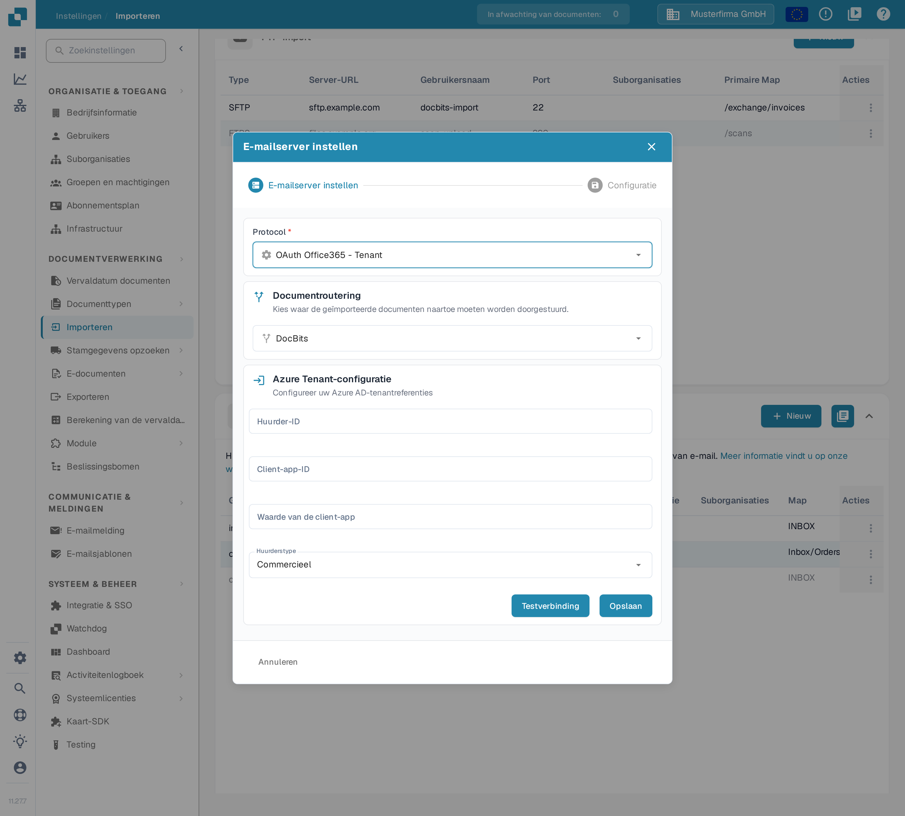

# O365 Tenant

Gebruik deze handleiding om een Microsoft 365-postvak van uw organisatie te verbinden via een Microsoft Entra-toepassing. Een beheerder heeft toegang nodig tot de bedoelde Entra-tenant en de bijbehorende DocBits-organisatie. Spreek vóór het inschakelen van de import af welk postvak, welke documentbestemming en wie de referenties beheert.

## 1. De Entra-toepassing voorbereiden 

Open in het [Microsoft Entra-beheercentrum](https://entra.microsoft.com/) in de bedoelde tenant **Identiteit → Toepassingen → App-registraties → Nieuwe registratie**. Kies een herkenbare naam en het accounttype dat uw identiteitsbeheerder goedkeurt. Een toepassing die alleen binnen uw organisatie wordt gebruikt, gebruikt normaal de optie voor één tenant. Noteer de **map-id (tenant)** en de **toepassings-id (client)**. De labels in het Microsoft-portaal kunnen per taalinstelling afwijken; de [actuele registratie-instructies](https://learn.microsoft.com/en-us/graph/auth-register-app-v2) van Microsoft tonen de stappen in het portaal.

Het tenantformulier van DocBits vraagt om een clientgeheim. Maak het geheim aan onder **Certificaten en geheimen** volgens het goedgekeurde verloopbeleid en noteer de **waarde** zolang die beschikbaar is. Bewaar het veilig en leg vóór het verlopen vast wie het vernieuwt. Voer deze waarde in bij **Waarde van de client-app** in DocBits. Houd geheimen buiten schermafbeeldingen, tickets en documentatie.

Laat public-clientstromen uitgeschakeld voor deze opzet met een geheim, tenzij uw identiteitsbeheerder een aparte eis heeft vastgelegd. De [richtlijnen over clienttypen](https://learn.microsoft.com/en-us/entra/identity-platform/msal-client-applications) van Microsoft leggen uit waarom public-clienttoepassingen geen toepassingsgeheimen veilig kunnen bewaren.

## 2. Machtiging en postvakbereik goedkeuren

Laat de Microsoft 365-beheerder de mailbewerkingen en het postvakbereik voor deze toepassing goedkeuren. De Microsoft Graph-machtiging **Mail.ReadWrite** geeft toegang tot en wijzigingen in e-mail zonder aangemelde gebruiker en vereist toestemming van een beheerder. Een goedkeuring zonder bereik omvat de postvakken van de hele organisatie. Mail.ReadWrite geeft geen recht om e-mail te verzenden; functies voor verzenden vragen een aparte beoordeling van de machtiging. Zie de [machtigingsreferentie van Microsoft Graph](https://learn.microsoft.com/en-us/graph/permissions-reference#mailreadwrite).

Bespreek beperkte postvaktoegang met de Exchange-beheerder via [RBAC voor toepassingen](https://learn.microsoft.com/en-us/exchange/permissions-exo/application-rbac). Goedkeuringen uit Entra en RBAC-goedkeuringen uit Exchange werken samen: een extra RBAC-goedkeuring met bereik verkleint een bestaande goedkeuring voor de hele organisatie niet. Laat de beheerder de feitelijke toegang tot het bedoelde postvak bevestigen voordat u de bron inschakelt.

## 3. De tenantverbinding in DocBits instellen

Open **Instellingen → Importeren → E-mail importeren** in de bedoelde DocBits-organisatie en kies **Nieuw**.

<figure><figcaption>
Nieuw opent de assistent voor de e-mailserver. De rijgegevens in deze documentatieopname zijn verzonnen voorbeelden; de kolom Documentroutering ligt buiten de opnamebreedte en is horizontaal te bereiken.
</figcaption></figure>

Bestaande verbindingen beheert u met het menu in de kolom **Acties**, met **Testverbinding**, **Verbindingslogboeken**, **Importlogboek**, **Deactiveren**, **Bewerking** en **Verwijderen**. Het pictogram naast **Nieuw** opent het importlogboek van alle e-mailverbindingen. Beide staan uitgelegd bij [de acties van de e-mailimport](../import.md#acties-voor-oauth-office365).

Kies onder **Protocol** de optie **OAuth Office365 - Tenant** en kies bij **Documentroutering** de bedoelde bestemming. Vul de tenantvelden in die uw beheerder aanlevert:

| Veld in DocBits          | Invoer                                                                |
| ------------------------ | --------------------------------------------------------------------- |
| Huurder-ID               | Map-id (tenant) van de bedoelde Entra-tenant.                         |
| Client-app-ID            | Toepassings-id (client) van de geregistreerde toepassing.             |
| Waarde van de client-app | De waarde van het clientgeheim uit die registratie.                   |
| Huurderstype             | De cloudomgeving van de tenant, bijvoorbeeld Commercieel of GCC-hoog. |

<figure><figcaption>
De tenantvariant heeft een eigen referentieformulier. Dit voorbeeld gebruikt de DocBits-routering en het huurderstype Commercieel; alle drie de referentievelden zijn leeg. Testverbinding en Opslaan zijn voor deze documentatieopname niet gebruikt.
</figcaption></figure>

Gebruik **Testverbinding** met de goedgekeurde referenties van de tenant voordat u **Opslaan** kiest. De test neemt contact op met de geconfigureerde dienst; met Opslaan verstuurt u de tenantconfiguratie. Een geslaagde verbindingstest bewijst niet dat een bericht of document is geïmporteerd. Als u het formulier alleen bekijkt, gebruikt u **Annuleren** of het sluitpictogram.

## 4. De opgeslagen bron controleren

Gebruik voor een goedgekeurde uitrol een aangewezen testpostvak en een onschuldige voorbeeldbijlage. Stuur na het opslaan van de bron een testbericht naar dat postvak, bekijk de lijst **E-mail importeren** en de importlogboeken en bevestig dat het document op de gekozen bestemming aankomt. Bespreek de opties voor gedeelde postvakken en het verplaatsen van berichten indien nodig met de beheerder. Leg de routering, het postvak en de verantwoordelijke voor het verlopen van het geheim vast in het interne draaiboek, zonder het geheim.

De documentatiecontrole omvatte het actuele Nederlandse menu, de lijst en de lege tenantassistent. Er is geen Entra-toepassing, referentie, machtiging, postvak of importbron aangemaakt of gewijzigd. Er is geen verbinding, tenantauthenticatie of mailimport getest. Gebruik de gekoppelde Microsoft-instructies voor hun actuele beheerinterface.
