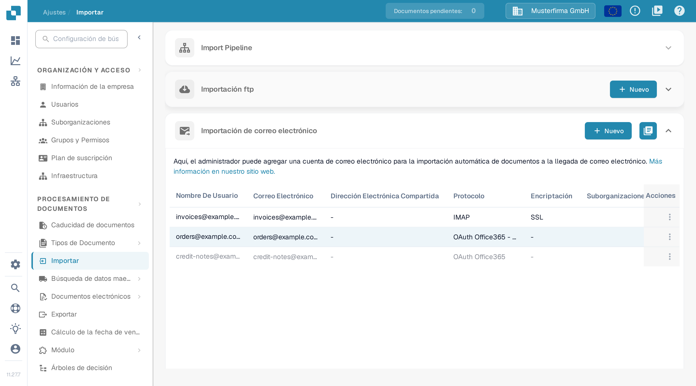
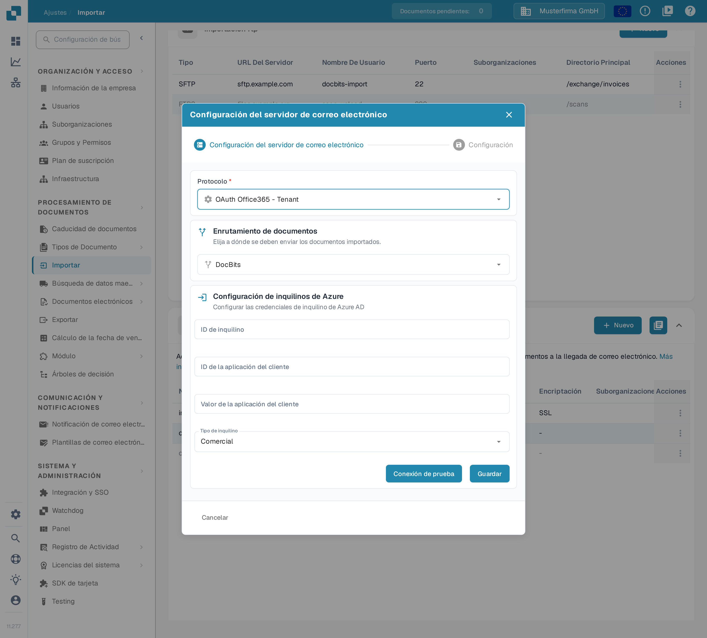

# O365 Tenant

Use esta guía para conectar un buzón de Microsoft 365 propiedad de la organización a través de una aplicación de Microsoft Entra. Un administrador necesita acceso al inquilino de Entra previsto y a la organización de DocBits correspondiente. Acuerde el buzón, el destino de los documentos y el responsable de las credenciales antes de habilitar la importación.

## 1. Prepare la aplicación de Entra 

En el [centro de administración de Microsoft Entra](https://entra.microsoft.com/), abra el registro de aplicaciones en Identidad → Aplicaciones → Registros de aplicaciones → Nuevo registro, dentro del inquilino previsto. Elija un nombre reconocible y el tipo de cuenta que apruebe su administrador de identidad. Una aplicación que se usa solo dentro de su organización suele utilizar la opción de cuenta de inquilino único. Anote el ID de directorio (inquilino) y el ID de aplicación (cliente). Siga las [instrucciones de registro actuales](https://learn.microsoft.com/en-us/graph/auth-register-app-v2) de Microsoft para los pasos en el portal.

El formulario de inquilino de DocBits solicita un secreto de cliente. En la sección de certificados y secretos, cree el secreto con la política de caducidad aprobada y anote el valor mientras esté disponible. Guárdelo de forma segura y asigne la responsabilidad de su rotación antes de la caducidad. Introduzca ese valor en **Valor de la aplicación del cliente** en DocBits. Mantenga los secretos fuera de las capturas de pantalla, los tickets y la documentación.

Deje deshabilitados los flujos de cliente público para esta configuración basada en secretos, salvo que su administrador de identidad haya establecido un requisito distinto. La [guía de tipos de cliente](https://learn.microsoft.com/en-us/entra/identity-platform/msal-client-applications) de Microsoft explica por qué las aplicaciones de cliente público no pueden almacenar secretos de aplicación de forma segura.

## 2. Apruebe el permiso y el alcance del buzón

Haga que el administrador de Microsoft 365 apruebe las operaciones de correo y el alcance del buzón para esta aplicación. El permiso de aplicación Mail.ReadWrite de Microsoft Graph permite acceder al correo y modificarlo sin un usuario que haya iniciado sesión, y requiere el consentimiento del administrador. Una concesión sin alcance abarca los buzones de toda la organización. Mail.ReadWrite no concede permiso para enviar correo; las funciones de envío requieren una revisión de permisos aparte. Consulte la [referencia de permisos de Microsoft Graph](https://learn.microsoft.com/en-us/graph/permissions-reference#mailreadwrite).

Revise el acceso restringido al buzón con el administrador de Exchange mediante [RBAC para aplicaciones](https://learn.microsoft.com/en-us/exchange/permissions-exo/application-rbac). Las concesiones de permisos de Entra y las concesiones de RBAC de Exchange se combinan: añadir solo una concesión de RBAC con alcance no reduce una concesión de Entra existente para todo el inquilino. Pida al administrador que confirme el acceso efectivo al buzón previsto antes de habilitar el origen.

## 3. Configure la conexión del inquilino de DocBits

Abra **Ajustes → Importar**, vaya a la sección **Importación de correo electrónico** en la organización de DocBits prevista y seleccione **Nuevo**.

<figure><figcaption>
Nuevo abre el asistente de configuración del correo electrónico. Esta captura de documentación muestra datos de ejemplo inventados en la tabla, y las columnas situadas más a la derecha quedan recortadas.
</figcaption></figure>

Seleccione **OAuth Office365 - Tenant** en **Protocolo** y elija el destino previsto en **Enrutamiento de documentos**. Complete los campos de inquilino que le haya proporcionado su administrador:

| Campo en DocBits                     | Introduzca                                                                     |
| ------------------------------------ | ------------------------------------------------------------------------------ |
| ID de inquilino                      | ID de directorio (inquilino) del inquilino de Entra previsto.                   |
| ID de la aplicación del cliente      | ID de aplicación (cliente) de la aplicación registrada.                         |
| Valor de la aplicación del cliente   | El valor del secreto de cliente de ese registro.                                |
| Tipo de inquilino                    | El entorno de nube del inquilino, por ejemplo Comercial o Alto nivel del CCG.    |

<figure><figcaption>
La variante de inquilino tiene su propio formulario de credenciales. Este ejemplo usa la ruta DocBits y el tipo de inquilino Comercial; los tres campos de credenciales están vacíos. Conexión de prueba y Guardar no se usaron para esta captura de documentación.
</figcaption></figure>

Use **Conexión de prueba** con las credenciales autorizadas del inquilino antes de **Guardar**. La prueba contacta el servicio configurado; Guardar envía la configuración del inquilino. Una prueba de conexión correcta no demuestra que se haya importado un mensaje o un documento. Si solo está revisando el formulario, use **Cancelar** o el control de cierre.

## 4. Verifique el origen guardado

Para un despliegue autorizado, use un buzón de prueba designado y un archivo adjunto de muestra inofensivo. Después de guardar el origen, envíe un mensaje de prueba a ese buzón, revise la lista de Importación de correo electrónico y los registros de importación, y confirme que el documento llega al destino seleccionado. Revise con el administrador las opciones de buzón compartido y de movimiento de mensajes según sea necesario. Anote la ruta, el buzón y el responsable de la caducidad del secreto en el manual interno, sin el secreto.

La comprobación de esta documentación cubrió la ruta de menú en español, la lista y el asistente de inquilino vacío. No se creó ni se modificó ninguna aplicación de Entra, credencial, permiso, buzón u origen de importación. No se realizó ninguna prueba de conexión, de autenticación de inquilino ni de importación de correo. Use las instrucciones enlazadas de Microsoft para su interfaz de administración actual.
