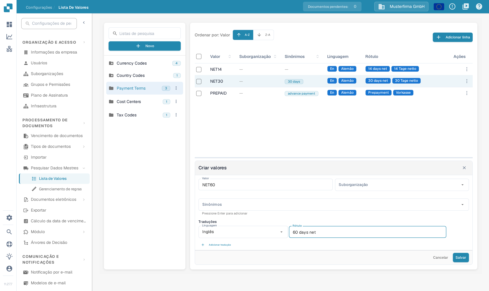

# Listas de valores

## Vídeo tutorial: Dados mestres e listas de valores


Fontes de dados mestres, listas de valores e configurações de dados mestre no DocBits


O vídeo mostra as fontes de dados mestres, as listas de valores e as configurações de dados mestre de um tipo de documento.

## Visão geral

Uma lista de valores fornece opções predefinidas para um campo, como tipos de fatura ou moedas. Cada entrada tem um **Valor** armazenado e pode ter **Sinônimos** e **Rótulos** traduzidos. Utilize listas ao configurar listas pendentes em [Campos](../global-settings/document-types/fields/) e na validação de campos.

As listas e as entradas podem ser limitadas a uma suborganização. As traduções controlam o rótulo apresentado num idioma; o valor subjacente mantém-se igual. Se não existir um rótulo para o idioma do utilizador, é apresentado o valor subjacente.

## Como aceder?

Abra **Configurações**. Em **PROCESSAMENTO DE DOCUMENTOS**, expanda **Pesquisar Dados Mestres** e selecione **Lista de Valores**.

Utilize **Listas de pesquisa** no painel esquerdo para encontrar uma lista e selecione o respetivo nome. As entradas aparecem à direita. O número junto ao nome da lista indica a quantidade de entradas carregadas. O ícone de pasta com estrela identifica uma lista definida pelo sistema.

<figure><figcaption>
Selecione uma lista no painel esquerdo para abrir as entradas à direita. Os nomes das listas e as quantidades nesta vista são dados de exemplo inventados.
</figcaption></figure>

<figure><figcaption>
Selecionar uma lista abre a tabela de entradas. A-Z e Z-A ordenam os valores; Adicionar linha abre o formulário de uma nova entrada. Os valores e os rótulos são dados de exemplo inventados.
</figcaption></figure>

## Adicionar ou eliminar uma lista

### Criar uma nova lista de valores

1. Selecione **Novo** acima dos nomes das listas no painel esquerdo.
2. Introduza um **Nome**.
3. Selecione opcionalmente **Suborganizações** para limitar o âmbito da lista.
4. Selecione **Salvar** para criar a lista. Feche a janela com **X** para sair sem criar uma lista.

<figure><figcaption>
Novo abre esta janela. O Nome identifica a lista; Suborganizações limita o âmbito. Salvar cria a lista. O nome approval_levels é um dado de exemplo inventado.
</figcaption></figure>

### Eliminar uma lista

Para uma lista criada pela sua organização, abra o menu de três pontos junto ao nome e selecione **Excluir**. Uma janela de confirmação pergunta se a lista deve ser eliminada. Confirme apenas a lista pretendida. As listas definidas pelo sistema não apresentam este menu.

## Adicionar, editar ou remover valores de uma lista existente

### Adicionar valores manualmente

1. Selecione a lista no painel esquerdo.
2. Selecione **Adicionar linha** acima da tabela. O formulário **Criar valores** abre abaixo da tabela.
3. Introduza o **Valor** armazenado e, se necessário, a respetiva **Suborganização**.
4. Adicione opcionalmente **Sinônimos**. Confirme cada um com **Enter** para o adicionar como etiqueta.
5. Em **Traduções**, selecione uma **Linguagem** e introduza um **Rótulo** não vazio. Uma nova entrada necessita de pelo menos uma tradução preenchida.
6. Selecione **Salvar** para guardar a entrada ou **Cancelar** para fechar o formulário sem guardar.

<figure><figcaption>
Adicionar linha abre o formulário da entrada abaixo da tabela. Introduza o valor e pelo menos um rótulo de idioma antes de guardar; Cancelar fecha o formulário sem guardar a entrada. O Valor NET60 e o Rótulo 60 days net são dados de exemplo inventados.
</figcaption></figure>

### Importar valores de um ficheiro CSV

Esta vista não inclui o antigo comando de carregamento de CSV no menu **Ações**. Os passos anteriores para carregar um ficheiro CSV não se aplicam a este ecrã. Utilize **Adicionar linha** para introduzir valores aqui.

### Editar valores existentes

Selecione uma linha para abrir o formulário de edição abaixo da tabela ou utilize **Editar** no menu **Ações** da linha. Altere os campos editáveis e guarde o formulário. **Cancelar** descarta a alteração não guardada. Os campos protegidos permanecem apenas de leitura; o Valor armazenado também pode ficar bloqueado depois de existirem traduções.

O menu da linha oferece também **Duplicado**. Esta vista não apresenta um controlo de cópia em massa acima da tabela; duplique uma entrada de cada vez através do menu da linha.

### Eliminar valores

Para uma entrada criada pela sua organização, o menu **Ações** da linha inclui **Excluir**. Esta ação remove a entrada, pelo que a deve escolher apenas para uma entrada que pretende realmente remover. As entradas definidas pelo sistema não apresentam esta ação.

## Adicionar traduções aos seus valores

No formulário da entrada, selecione a **Linguagem** e introduza o respetivo **Rótulo**. Selecione **Adicionar tradução** para acrescentar outro idioma e o respetivo rótulo. Preencha ou remova as linhas de tradução adicionais vazias antes de guardar. Quando existe uma linha de tradução removível, o respetivo ícone de eliminar retira essa tradução do formulário; guarde o formulário para aplicar a alteração.

O rótulo apresentado depende do idioma; sem um rótulo para o idioma ativo, aparece o Valor armazenado.

## Listas e linhas definidas pelo sistema

As listas definidas pelo sistema são marcadas com um ícone de pasta com estrela e não podem ser eliminadas. Podem conter entradas adicionais criadas pela sua organização.

As entradas definidas pelo sistema e as traduções herdadas têm campos protegidos. Utilize os controlos editáveis para as entradas e traduções da sua própria organização. A ausência da ação Excluir identifica uma entrada protegida; uma lista do sistema pode conter entradas protegidas e entradas criadas pela organização.
