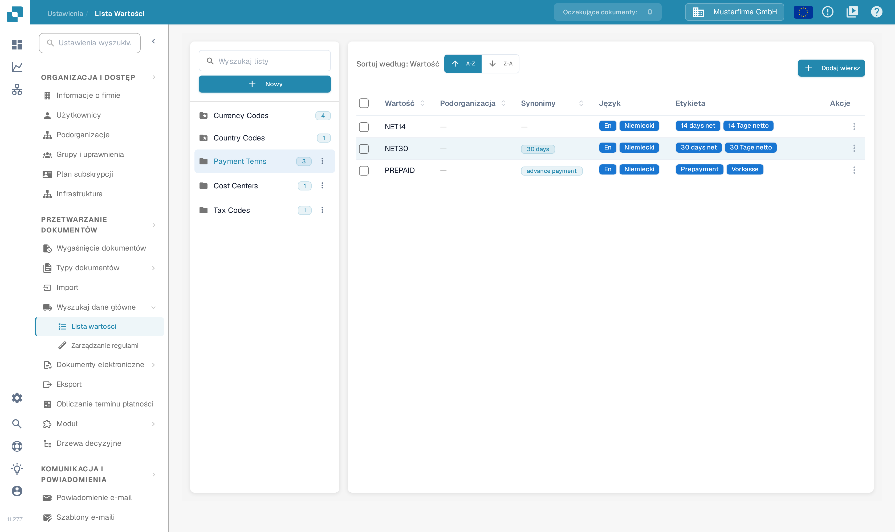
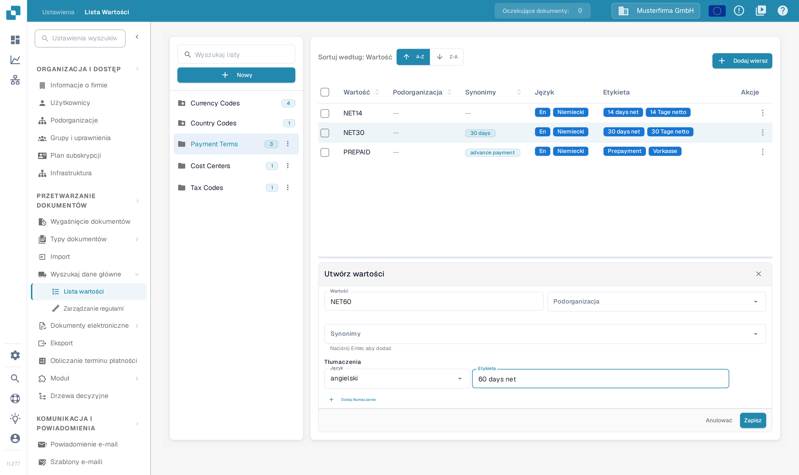

# Listy wartości

## Samouczek wideo: Dane główne i listy wartości


Źródła danych głównych, listy wartości i ustawienia danych głównych w DocBits


Film pokazuje źródła danych głównych, listy wartości oraz ustawienia danych głównych typu dokumentu.

## Przegląd

Lista wartości dostarcza wstępnie zdefiniowanych opcji dla pola, na przykład typów faktur lub walut. Każda pozycja ma zapisaną **Wartość** i może mieć **Synonimy** oraz etykiety w różnych językach. List używaj podczas konfigurowania list rozwijanych w [Pola](../global-settings/document-types/fields/) i przy walidacji pól.

Listy i pozycje można ograniczyć do podorganizacji. Tłumaczenia decydują o etykiecie wyświetlanej dla danego języka; zapisana wartość pozostaje taka sama. Jeśli dla języka użytkownika nie ma etykiety, wyświetlana jest zapisana wartość.

## Jak otworzyć?

Otwórz **Ustawienia**. W sekcji **PRZETWARZANIE DOKUMENTÓW** rozwiń **Wyszukaj dane główne** i wybierz **Lista wartości**.

Użyj pola **Wyszukaj listy** w lewym panelu, aby znaleźć listę, a następnie wybierz jej nazwę. Po prawej stronie pojawią się jej pozycje. Liczba obok nazwy listy pokazuje liczbę wczytanych pozycji. Ikona folderu z gwiazdką oznacza listę zdefiniowaną przez system.

<figure><figcaption>
Znajdź i wybierz listę w lewym panelu, aby otworzyć jej pozycje. Nazwy list i liczby pozycji w tym widoku są zmyślonymi danymi przykładowymi.
</figcaption></figure>

<figure><figcaption>
Wybranie listy otwiera tabelę pozycji. Przyciski A-Z i Z-A sortują wartości, a Dodaj wiersz otwiera formularz nowej pozycji. Wartości, etykiety i liczby w tym widoku są zmyślonymi danymi przykładowymi.
</figcaption></figure>

Przyciski **A-Z** i **Z-A** obok pola **Sortuj według: Wartość** sortują wartości rosnąco lub malejąco. Kolumna **Akcje** zawiera czynności dostępne dla danego wiersza.

## Jak dodać lub usunąć listę

### Tworzenie nowej listy wartości

1. Wybierz **Nowy** nad nazwami list w lewym panelu.
2. Wpisz **Nazwa**.
3. W razie potrzeby wybierz **Podorganizacje**, aby ograniczyć zakres listy.
4. Wybierz **Zapisz**, aby utworzyć listę. Okno zamkniesz przyciskiem **X** bez tworzenia listy.

<figure><figcaption>
Przycisk Nowy otwiera to okno. Nazwa identyfikuje listę, a Podorganizacje ogranicza jej zakres. Zapisz tworzy listę. Nazwa approval_levels jest zmyśloną daną przykładową.
</figcaption></figure>

### Jak usunąć listę

Dla listy utworzonej przez Twoją organizację otwórz menu z trzema kropkami obok jej nazwy i wybierz **Usuwać**. Okno potwierdzenia pyta, czy usunąć listę. Potwierdź tylko właściwą listę. Listy zdefiniowane przez system nie mają menu usuwania.

## Jak dodawać, edytować lub usuwać wartości z istniejącej listy

### Ręczne dodawanie wartości

1. Wybierz listę w lewym panelu.
2. Wybierz **Dodaj wiersz** nad jej tabelą. Pod tabelą otworzy się formularz **Utwórz wartości**.
3. Wpisz zapisywaną **Wartość** i w razie potrzeby wybierz **Podorganizacja**.
4. Opcjonalnie dodaj **Synonimy**. Po każdym naciśnij **Enter**, aby stał się etykietą w polu.
5. W sekcji **Tłumaczenia** wybierz **Język** i uzupełnij niepuste pole **Etykieta**. Nowa pozycja wymaga co najmniej jednego uzupełnionego tłumaczenia.
6. Wybierz **Zapisz**, aby zapisać pozycję, albo **Anulować**, aby zamknąć formularz bez zapisywania.

<figure><figcaption>
Dodaj wiersz otwiera formularz pozycji pod tabelą. Przed zapisaniem wpisz wartość i co najmniej jedną etykietę języka; Anulować zamyka formularz bez zapisywania pozycji. Wartość NET60 i etykieta 60 days net są zmyślonymi danymi przykładowymi.
</figcaption></figure>

### Importowanie wartości z pliku CSV

Ten widok nie zawiera dawnego polecenia wczytywania pliku CSV z menu **Akcje**. Starsze kroki przesyłania pliku CSV nie dotyczą tego ekranu. Wartości wprowadzaj przyciskiem **Dodaj wiersz**.

### Edytowanie istniejących wartości

Wybierz wiersz, aby otworzyć pod tabelą jego formularz edycji, albo użyj **Redagować** w menu **Akcje** tego wiersza. Zmień edytowalne pola i zapisz formularz. **Anulować** odrzuca niezapisaną zmianę. Chronione pola pozostają tylko do odczytu; zapisana Wartość może też zostać zablokowana, gdy istnieją już tłumaczenia.

Menu wiersza oferuje także **Duplikat**. Aby zduplikować kilka pozycji, zaznacz ich pola wyboru i użyj przycisku kopiowania nad tabelą. Duplikowanie tworzy dodatkowe pozycje.

### Usuwanie wartości

Dla pozycji utworzonej przez Twoją organizację menu **Akcje** wiersza zawiera **Usuwać**. Ta czynność usuwa pozycję, więc wybieraj ją tylko dla pozycji, którą naprawdę chcesz usunąć. Pozycje zdefiniowane przez system nie udostępniają tej czynności.

## Dodawanie tłumaczeń do wartości

W formularzu pozycji wybierz **Język** i uzupełnij jego pole **Etykieta**. Wybierz **Dodaj tłumaczenie** dla kolejnego języka i jego etykiety. Przed zapisaniem uzupełnij lub usuń dodatkowe puste wiersze tłumaczeń. Jeśli wiersz tłumaczenia można usunąć, jego przycisk kosza usuwa to tłumaczenie z formularza; zapisz formularz, aby zachować zmianę.

## Listy i pozycje zdefiniowane przez system

Listy systemowe są oznaczone ikoną folderu z gwiazdką i nie można ich usunąć. Mogą zawierać dodatkowe pozycje utworzone przez Twoją organizację.

Pozycje zdefiniowane przez system oraz odziedziczone tłumaczenia mają chronione pola. Korzystaj z edytowalnych pól dla pozycji i tłumaczeń własnej organizacji. Brak czynności **Usuwać** oznacza pozycję chronioną; lista systemowa może zawierać zarówno pozycje chronione, jak i pozycje utworzone przez organizację.
