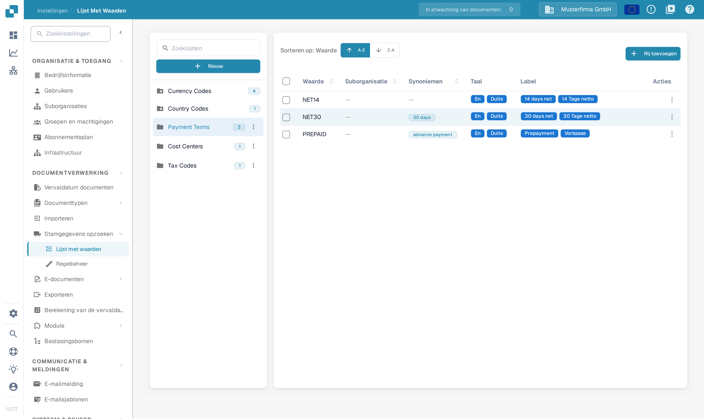
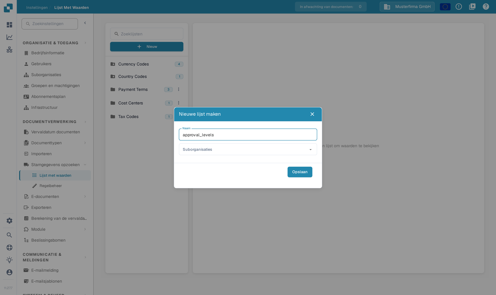
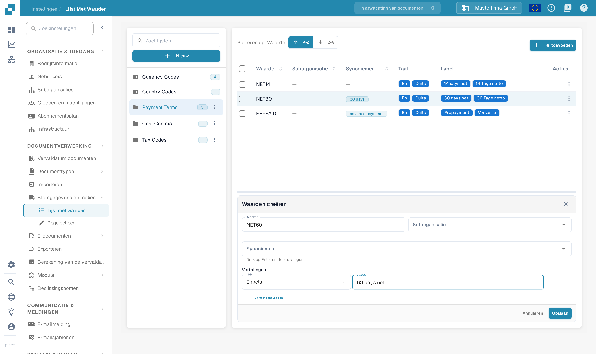

# Waardenlijsten

## Videotutorial: Stamgegevens en waardelijsten


Bronnen voor stamgegevens, waardelijsten en mastergegevensinstellingen in DocBits


De video toont de bronnen voor stamgegevens, de waardelijsten en de mastergegevensinstellingen van een documenttype.

## Overzicht

Een waardenlijst levert vooraf gedefinieerde keuzes voor een veld, bijvoorbeeld factuurtypen of valuta. Elke waarde heeft een opgeslagen **Waarde** en kan **Synoniemen** en vertaalde labels hebben. Gebruik lijsten bij het instellen van keuzelijsten in [Velden](../global-settings/document-types/fields/) en bij veldvalidatie.

Lijsten en waarden kunnen aan een suborganisatie worden gekoppeld. Vertalingen bepalen het label dat voor een taal wordt getoond; de onderliggende waarde blijft gelijk. Is er geen label voor de taal van de gebruiker, dan wordt de onderliggende waarde getoond.

## Hoe opent u het?

Open **Instellingen**. Vouw onder **DOCUMENTVERWERKING** **Stamgegevens opzoeken** uit en selecteer **Lijst met waarden**.

Gebruik **Zoeklijsten** in het linkerpaneel om een lijst te vinden en selecteer vervolgens de naam. De waarden verschijnen rechts. Een getal naast de lijstnaam toont het aantal geladen waarden. Het pictogram met de map en de ster markeert een door het systeem gedefinieerde lijst.

<figure><figcaption>
Selecteer links een lijst om de waarden rechts te openen. Lijstnamen en aantallen in deze weergave zijn verzonnen voorbeeldgegevens.
</figcaption></figure>

<figure><figcaption>
Een lijst selecteren opent de tabel met waarden. A-Z en Z-A sorteren de waarden; Rij toevoegen opent het formulier voor een nieuwe waarde. Waarden, labels en aantallen zijn verzonnen voorbeeldgegevens.
</figcaption></figure>

## Een lijst toevoegen of verwijderen

### Een nieuwe waardenlijst maken

1. Selecteer **Nieuw** boven de lijstnamen in het linkerpaneel.
2. Voer een **Naam** in.
3. Selecteer indien nodig **Suborganisaties** om het bereik van de lijst te beperken.
4. Selecteer **Opslaan** om de lijst te maken. Met **X** sluit u het venster zonder een lijst te maken.

<figure><figcaption>
Nieuw opent dit venster. Naam identificeert de lijst; Suborganisaties beperkt het bereik. Opslaan maakt de lijst. De naam approval_levels is een verzonnen voorbeeldgegeven.
</figcaption></figure>

### Een lijst verwijderen

Voor een lijst die door uw organisatie is gemaakt, opent u het menu met drie punten naast de naam en selecteert u **Verwijderen**. Een bevestigingsvenster vraagt of de lijst moet worden verwijderd. Bevestig alleen de bedoelde lijst. Door het systeem gedefinieerde lijsten hebben geen verwijdermenu.

## Waarden van een bestaande lijst toevoegen, wijzigen of verwijderen

### Waarden handmatig toevoegen

1. Selecteer de lijst in het linkerpaneel.
2. Selecteer **Rij toevoegen** boven de tabel. Het formulier **Waarden creëren** opent onder de tabel.
3. Voer de opgeslagen **Waarde** in en, indien nodig, de bijbehorende **Suborganisatie**.
4. Voeg indien gewenst **Synoniemen** toe. Druk na elk synoniem op **Enter**, zodat het als label aan het veld wordt toegevoegd.
5. Selecteer onder **Vertalingen** een **Taal** en voer een niet-leeg **Label** in. Een nieuwe waarde heeft ten minste één volledige vertaling nodig.
6. Selecteer **Opslaan** om de waarde op te slaan, of **Annuleren** om het formulier te sluiten zonder op te slaan.

<figure><figcaption>
Rij toevoegen opent het formulier voor de waarde onder de tabel. Voer de waarde en ten minste één taallabel in voordat u opslaat; Annuleren sluit het formulier zonder de waarde op te slaan. De waarde NET60 en het label 60 days net zijn verzonnen voorbeeldgegevens.
</figcaption></figure>

### Waarden uit een CSV-bestand importeren

Deze weergave bevat de vroegere opdracht voor het uploaden van een CSV-bestand in het menu **Acties** niet. De oudere stappen voor het uploaden van een CSV-bestand gelden niet voor dit scherm. Gebruik **Rij toevoegen** om hier waarden in te voeren.

### Bestaande waarden wijzigen

Selecteer een rij om het bewerkingsformulier onder de tabel te openen, of gebruik **Bewerking** in het menu **Acties** van de rij. Wijzig de bewerkbare velden en sla het formulier op. **Annuleren** verwerpt de niet-opgeslagen wijziging. Beveiligde velden blijven alleen-lezen; de opgeslagen Waarde kan ook vergrendeld zijn zodra er vertalingen bestaan.

Het rijmenu biedt ook **Duplicaat**. Om meerdere waarden te dupliceren, selecteert u de selectievakjes en gebruikt u de kopieerknop boven de tabel. Dupliceren maakt extra waarden aan.

### Waarden verwijderen

Voor een waarde die door uw organisatie is gemaakt, bevat het menu **Acties** van de rij **Verwijderen**. Deze actie verwijdert de waarde, dus kies deze alleen voor een waarde die u echt wilt verwijderen. Door het systeem gedefinieerde waarden bieden deze actie niet.

## Vertalingen aan uw waarden toevoegen

Kies in het formulier van de waarde de **Taal** en voer het bijbehorende **Label** in. Selecteer **Vertaling toevoegen** voor een andere taal en het bijbehorende label. Vul of verwijder extra lege vertaalregels voordat u opslaat. Als er een verwijderbare vertaalregel aanwezig is, verwijdert de prullenbak die vertaling uit het formulier; sla het formulier op om de wijziging te bewaren.

## Door het systeem gedefinieerde lijsten en rijen

Systeemlijsten zijn gemarkeerd met een pictogram met een map en een ster en kunnen niet worden verwijderd. Ze kunnen extra waarden bevatten die door uw organisatie zijn gemaakt.

Door het systeem gedefinieerde waarden en overgenomen vertalingen hebben beveiligde velden. Gebruik de bewerkbare bedieningselementen voor de waarden en vertalingen van uw eigen organisatie. Het ontbreken van de actie Verwijderen duidt op een beveiligde waarde; een systeemlijst kan zowel beveiligde als door de organisatie gemaakte waarden bevatten.
