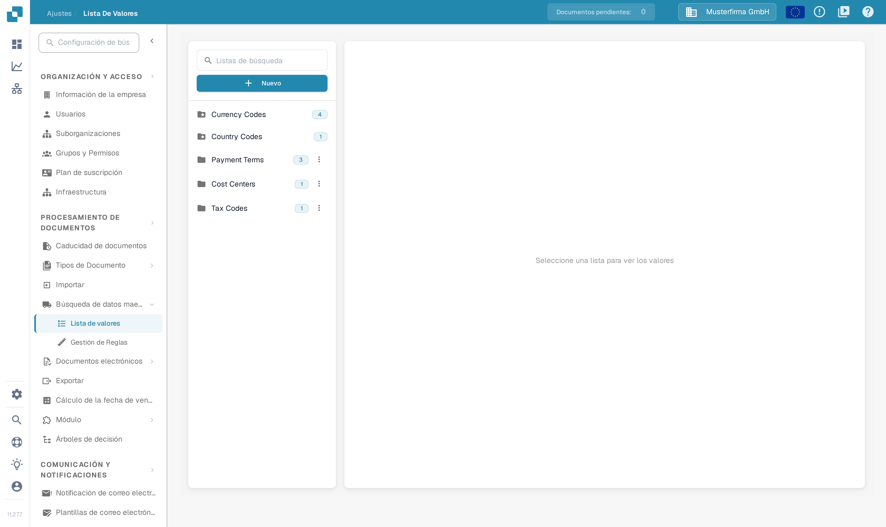
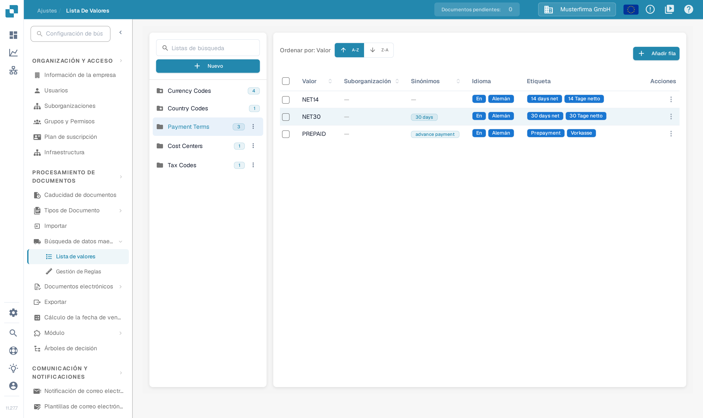
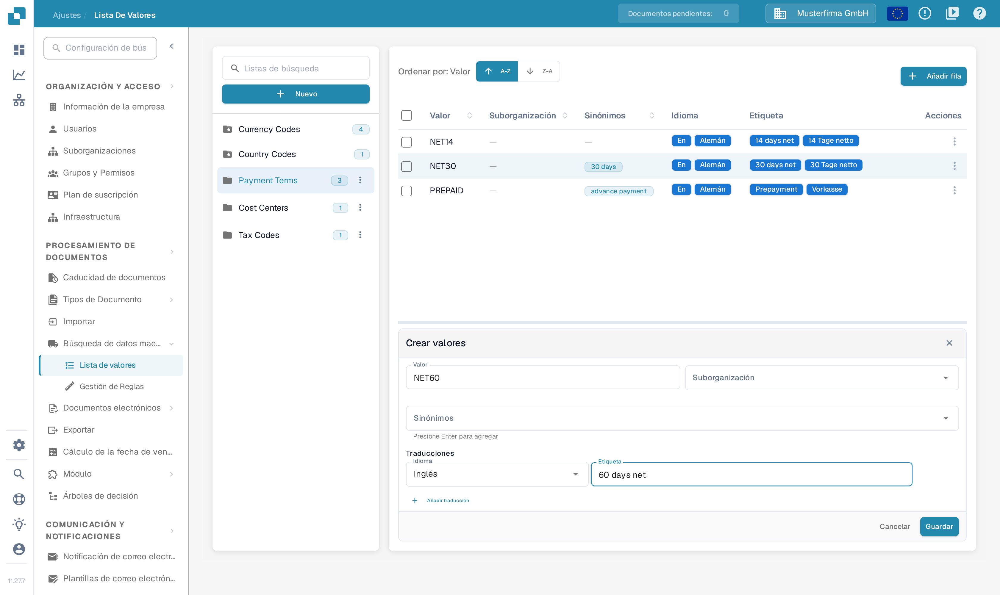

# Listas de valores

## Tutorial en vídeo: Datos maestros y listas de valores


Fuentes de datos maestros, listas de valores y ajustes de datos maestros en DocBits


El vídeo muestra las fuentes de datos maestros, las listas de valores y los ajustes de datos maestros de un tipo de documento.

## Descripción general

Una lista de valores proporciona opciones predefinidas para un campo, por ejemplo tipos de factura o monedas. Cada entrada tiene un **Valor** almacenado y puede tener **Sinónimos** y etiquetas traducidas. Utilice las listas al configurar desplegables en [Campos](../global-settings/document-types/fields/) y en la validación de campos.

Las listas y las entradas se pueden limitar a una suborganización. Las traducciones determinan la etiqueta que se muestra en un idioma; el valor subyacente no cambia. Si no existe una etiqueta para el idioma del usuario, se muestra el valor subyacente.

## ¿Cómo acceder?

Abra **Ajustes**. En **PROCESAMIENTO DE DOCUMENTOS**, despliegue **Búsqueda de datos maestros** y seleccione **Lista de valores**.

Utilice **Listas de búsqueda** en el panel izquierdo para encontrar una lista y seleccione su nombre. Sus entradas aparecen a la derecha. El número junto al nombre de la lista muestra la cantidad de entradas cargadas. El icono de carpeta con estrella identifica una lista definida por el sistema.

<figure><figcaption>
Encuentre y seleccione una lista en el panel izquierdo para abrir sus entradas. Los nombres de las listas de la imagen son datos de ejemplo.
</figcaption></figure>

<figure><figcaption>
Al seleccionar una lista existente se abre la tabla de entradas. A-Z y Z-A ordenan sus valores; Añadir fila abre el formulario de una entrada nueva. Los valores y nombres de la imagen son datos de ejemplo.
</figcaption></figure>

## Cómo añadir o eliminar una lista

### Crear una nueva lista de valores

1. Seleccione **Nuevo** encima de los nombres de las listas en el panel izquierdo.
2. Introduzca un **Nombre**.
3. De forma opcional, seleccione **Suborganizaciones** para limitar el ámbito de la lista.
4. Seleccione **Guardar** para crearla. Cierre el diálogo con **X** para salir sin crear una lista.

<figure><figcaption>
Nuevo abre este diálogo. El Nombre identifica la lista; Suborganizaciones limita su ámbito. Guardar crea la lista. El nombre escrito en la imagen es un dato de ejemplo.
</figcaption></figure>

### Cómo eliminar una lista

Para una lista creada por su organización, abra el menú de tres puntos junto a su nombre y seleccione **Borrar**. Un diálogo de confirmación pregunta si desea eliminarla. Confirme únicamente la lista prevista. Las listas definidas por el sistema no tienen menú de eliminación.

## Cómo añadir, editar o quitar valores de una lista existente

### Añadir valores manualmente

1. Seleccione la lista en el panel izquierdo.
2. Seleccione **Añadir fila** encima de su tabla. El formulario **Crear valores** se abre debajo de la tabla.
3. Introduzca el **Valor** almacenado y, si es necesario, su **Suborganización**.
4. De forma opcional, añada **Sinónimos**. Pulse **Enter** después de cada uno para añadirlo a la entrada.
5. En **Traducciones**, seleccione un **Idioma** e introduzca una **Etiqueta** no vacía. Una entrada nueva necesita al menos una traducción completa.
6. Seleccione **Guardar** para almacenar la entrada, o **Cancelar** para cerrar el formulario sin guardarla.

<figure><figcaption>
Añadir fila abre el formulario de la entrada debajo de la tabla. Introduzca el valor y al menos una etiqueta de idioma antes de guardar; Cancelar cierra el formulario sin almacenar ninguna entrada. Los valores introducidos en la imagen son datos de ejemplo.
</figcaption></figure>

### Importar valores desde un archivo CSV

Esta interfaz no incluye el antiguo comando **Acciones → Cargar CSV**. Los pasos anteriores de carga de CSV no se aplican a esta pantalla. Utilice **Añadir fila** para introducir valores aquí.

### Editar valores existentes

Seleccione una fila para abrir su formulario de edición debajo de la tabla, o use **Editar** en el menú **Acciones** de la fila. Actualice los campos editables y guarde el formulario con **Guardar cambios**. **Cancelar** descarta la edición no guardada. Los campos protegidos permanecen de solo lectura; el valor almacenado también puede estar bloqueado cuando ya existen traducciones.

El menú de la fila también ofrece **Duplicar**. Para duplicar varias entradas, seleccione sus casillas y use el botón de copia que aparece encima de la tabla. La duplicación crea entradas adicionales.

### Eliminar valores

Para una entrada creada por su organización, el menú **Acciones** de la fila incluye **Borrar**. Esta acción elimina la entrada, así que utilícela solo con una entrada que desee quitar. Las entradas definidas por el sistema no ofrecen esta acción.

## Añadir traducciones a sus valores

En el formulario de la entrada, elija un **Idioma** e introduzca su **Etiqueta**. Seleccione **Añadir traducción** para otro idioma y etiqueta. Complete o quite las filas de traducción vacías adicionales antes de guardar. Cuando hay una fila de traducción que se puede quitar, su control de papelera elimina esa traducción del formulario; guarde el formulario para almacenar el cambio.

## Listas y filas definidas por el sistema

Las listas del sistema se marcan con un icono de carpeta con estrella y no se pueden eliminar. Pueden contener entradas adicionales creadas por su organización.

Las entradas definidas por el sistema y las traducciones heredadas tienen campos protegidos. Utilice los controles editables para las entradas y traducciones propias de su organización. La ausencia de una acción de eliminación identifica una entrada protegida; una lista del sistema puede contener tanto entradas protegidas como entradas creadas por la organización.
