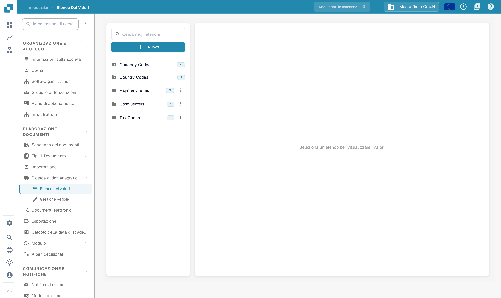
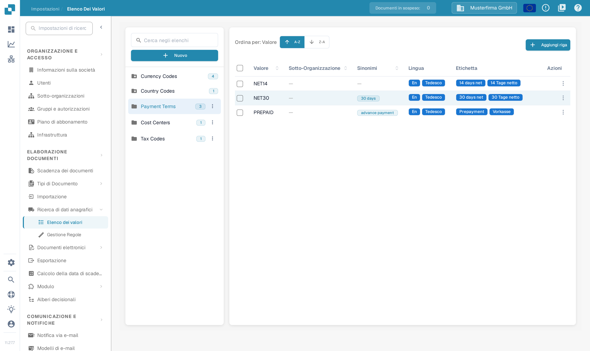
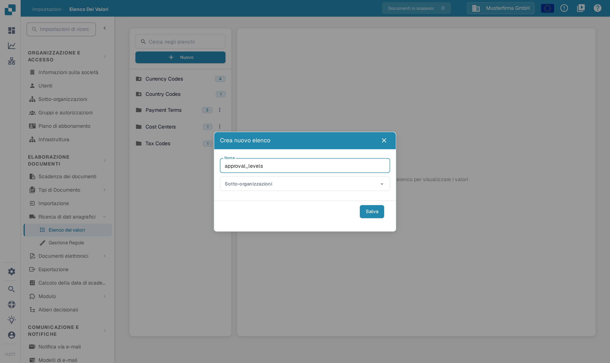
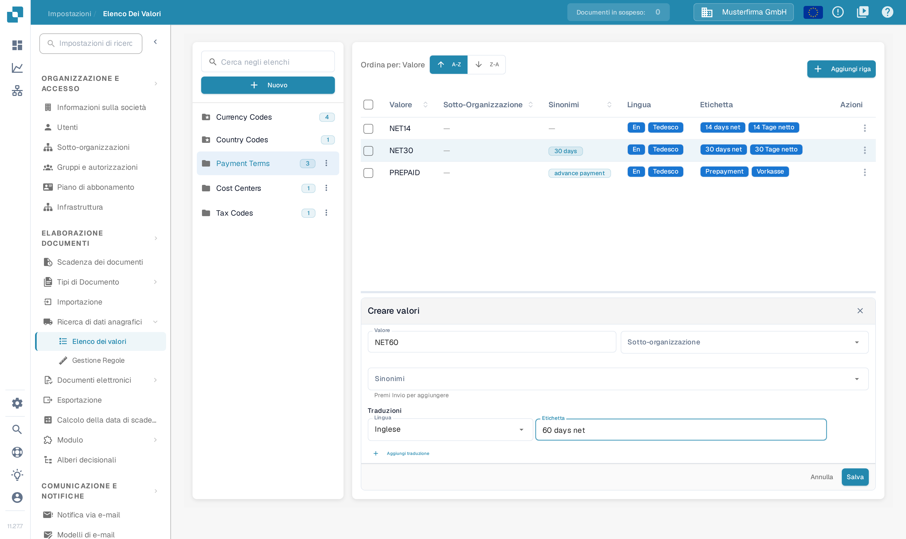

# Elenchi di valori

## Video tutorial: Dati anagrafici ed elenchi di valori


Fonti dei dati anagrafici, elenchi di valori e impostazioni dei dati master in DocBits


Il video mostra le fonti dei dati anagrafici, gli elenchi di valori e le impostazioni dei dati master di un tipo di documento.

## Panoramica

Un elenco di valori fornisce scelte predefinite per un campo, ad esempio tipi di fattura o valute. Ogni voce ha un **Valore** memorizzato e può avere **Sinonimi** ed etichette tradotte. Usare gli elenchi quando si configurano menu a discesa nei [Campi](../global-settings/document-types/fields/) e la convalida dei campi.

Elenchi e voci possono essere limitati a una sotto-organizzazione. Le traduzioni determinano l'etichetta mostrata per una lingua; il valore sottostante resta uguale. Se non è disponibile un'etichetta per la lingua dell'utente, viene mostrato il valore sottostante.

## Come accedere?

Aprire **Impostazioni**. In **ELABORAZIONE DOCUMENTI**, espandere **Ricerca di dati anagrafici** e selezionare **Elenco dei valori**.

Usare **Cerca negli elenchi** nel pannello a sinistra per trovare un elenco, poi selezionarne il nome. A destra compaiono le sue voci. Un numero accanto al nome dell'elenco indica quante voci sono state caricate. L'icona a forma di cartella con una stella identifica un elenco definito dal sistema.

<figure><figcaption>
Selezionare un elenco nel pannello a sinistra per aprire le sue voci. Nomi degli elenchi e conteggi in questa vista sono dati di esempio inventati.
</figcaption></figure>

<figure><figcaption>
La selezione di un elenco apre la tabella delle voci. A-Z e Z-A ordinano i valori; Aggiungi riga apre il modulo di una nuova voce. Voci, etichette e conteggi sono dati di esempio inventati.
</figcaption></figure>

## Come aggiungere o eliminare un elenco

### Creare un nuovo elenco di valori

1. Selezionare **Nuovo** sopra i nomi degli elenchi nel pannello a sinistra.
2. Inserire un **Nome**.
3. Se necessario, selezionare **Sotto-organizzazioni** per limitare l'elenco.
4. Selezionare **Salva** per crearlo. Con la **X** si chiude la finestra senza creare alcun elenco.

<figure><figcaption>
Nuovo apre questa finestra. Nome identifica l'elenco; Sotto-organizzazioni ne limita l'ambito. Salva crea l'elenco. Il nome approval_levels è un dato di esempio inventato.
</figcaption></figure>

### Come eliminare un elenco

Per un elenco creato dalla propria organizzazione, aprire il menu a tre punti accanto al nome e selezionare **Cancellare**. Una finestra di conferma chiede se rimuoverlo. Confermare solo l'elenco previsto. Gli elenchi definiti dal sistema non hanno il menu di eliminazione.

## Come aggiungere, modificare o rimuovere valori da un elenco esistente

### Aggiungere valori manualmente

1. Selezionare l'elenco nel pannello a sinistra.
2. Selezionare **Aggiungi riga** sopra la sua tabella. Il modulo **Creare valori** si apre sotto la tabella.
3. Inserire il **Valore** memorizzato e, se necessario, la sua **Sotto-organizzazione**.
4. Aggiungere facoltativamente dei **Sinonimi**. Premere **Invio** dopo ciascuno, così diventa un'etichetta.
5. In **Traduzioni**, selezionare una **Lingua** e inserire un'**Etichetta** non vuota. Una nuova voce richiede almeno una traduzione completata.
6. Selezionare **Salva** per memorizzare la voce, oppure **Annulla** per chiudere il modulo senza salvarla.

<figure><figcaption>
Aggiungi riga apre il modulo della voce sotto la tabella. Inserire il valore e almeno un'etichetta di lingua prima di salvare; Annulla chiude il modulo senza memorizzare alcuna voce. Valore ed etichetta sono dati di esempio inventati.
</figcaption></figure>

### Importare valori da un file CSV

Questa schermata non include più il precedente comando per caricare un file CSV dal menu **Azioni**. I vecchi passaggi per il caricamento di un CSV non si applicano a questa schermata. Qui i valori si inseriscono con **Aggiungi riga**.

### Modificare valori esistenti

Selezionare una riga per aprire il suo modulo di modifica sotto la tabella, oppure usare **Modifica** nel menu **Azioni** della riga. Aggiornare i campi modificabili e salvare il modulo. **Annulla** scarta la modifica non salvata. I campi protetti restano di sola lettura; anche il Valore memorizzato può essere bloccato quando esistono traduzioni.

Il menu della riga offre anche **Duplicato**. Per duplicare più voci, selezionare le relative caselle e usare il comando di copia sopra la tabella. La duplicazione crea voci aggiuntive.

### Eliminare valori

Per una voce creata dalla propria organizzazione, il menu **Azioni** della riga include **Cancellare**. Questa azione rimuove la voce, quindi sceglierla solo per una voce che si intende davvero eliminare. Le voci definite dal sistema non offrono questa azione.

## Aggiungere traduzioni ai valori

Nel modulo della voce, scegliere la **Lingua** e inserire la sua **Etichetta**. Selezionare **Aggiungi traduzione** per un'altra lingua e la relativa etichetta. Completare o rimuovere le ulteriori righe di traduzione vuote prima di salvare. Quando è presente una riga di traduzione rimovibile, il suo comando con il cestino rimuove quella traduzione dal modulo; salvare il modulo per memorizzare la modifica.

## Elenchi e voci definiti dal sistema

Gli elenchi di sistema sono contrassegnati da un'icona a forma di cartella con una stella e non possono essere eliminati. Possono contenere voci aggiuntive create dalla propria organizzazione.

Le voci definite dal sistema e le traduzioni ereditate hanno campi protetti. Usare i controlli modificabili per le voci e le traduzioni della propria organizzazione. L'assenza dell'azione Cancellare identifica una voce protetta; un elenco di sistema può contenere sia voci protette sia voci create dall'organizzazione.
