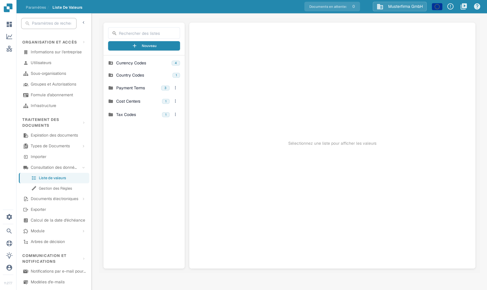
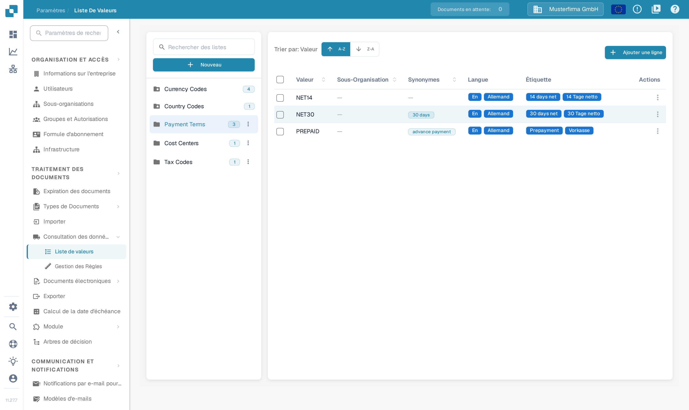
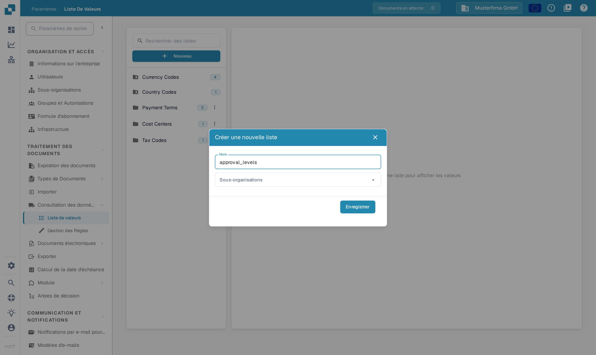
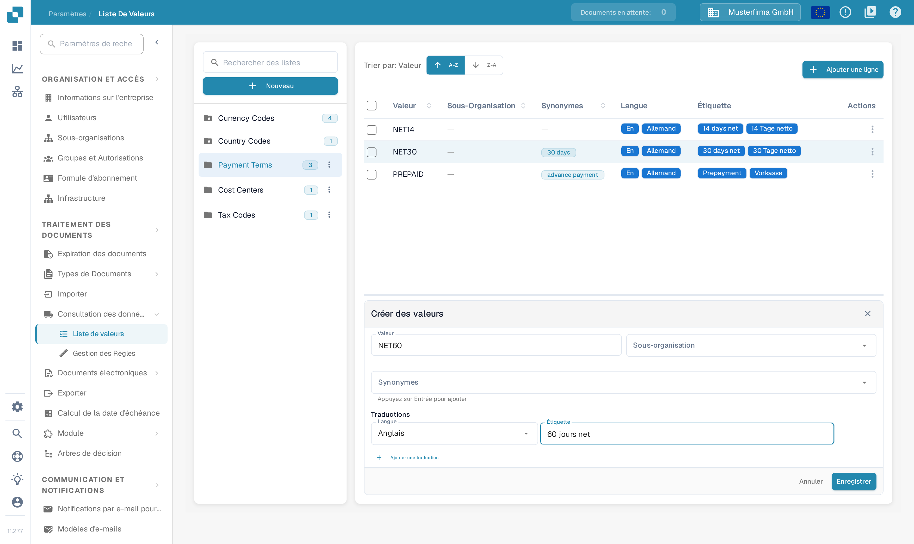

# Listes de valeurs

## Tutoriel vidéo : données de base et listes de valeurs


Sources de données de base, listes de valeurs et paramètres des données de base dans DocBits


La vidéo présente les sources de données de base, les listes de valeurs et les paramètres des données de base d'un type de document.

## Aperçu

Une liste de valeurs fournit des choix prédéfinis pour un champ, par exemple des types de facture ou des devises. Chaque entrée possède une **Valeur** enregistrée et peut avoir des **Synonymes** ainsi que des **Étiquettes** traduites. Utilisez les listes de valeurs lors de la configuration des listes déroulantes dans les [champs](../global-settings/document-types/fields/) et de la validation des champs.

Les listes et les entrées peuvent être limitées à une sous-organisation. Les traductions déterminent l'étiquette affichée pour une langue ; la valeur sous-jacente reste identique. Si aucune étiquette n'existe pour la langue de l'utilisateur, la valeur sous-jacente est affichée à la place.

## Comment ouvrir les listes de valeurs ?

Ouvrez les **Paramètres**. Sous **TRAITEMENT DES DOCUMENTS**, dépliez **Consultation des données de base** et sélectionnez **Liste de valeurs**.

Utilisez **Rechercher des listes** dans le panneau de gauche pour trouver une liste, puis sélectionnez son nom. Ses entrées apparaissent à droite. Le nombre à côté du nom de la liste indique le nombre d'entrées chargées. L'icône de dossier avec une étoile identifie une liste définie par le système.

<figure><figcaption>
Recherchez et sélectionnez une liste dans le panneau de gauche pour ouvrir ses entrées. Les noms de listes visibles dans cette capture proviennent de données d'exemple fictives.
</figcaption></figure>

<figure><figcaption>
La liste sélectionnée affiche ses entrées. A-Z et Z-A trient par valeur ; Ajouter une ligne ouvre le formulaire d'une nouvelle entrée. Les entrées visibles dans cette capture proviennent de données d'exemple fictives.
</figcaption></figure>

## Créer ou supprimer une liste

### Créer une nouvelle liste de valeurs

1. Sélectionnez **Nouveau** au-dessus des noms de listes dans le panneau de gauche.
2. Saisissez un **Nom**.
3. Sélectionnez éventuellement **Sous-organisations** pour limiter le périmètre de la liste.
4. Sélectionnez **Enregistrer** pour la créer. Fermez la boîte de dialogue avec **X** pour quitter sans créer de liste.

<figure><figcaption>
Nouveau ouvre cette boîte de dialogue. Le Nom identifie la liste ; Sous-organisations limite son périmètre ; Enregistrer crée la liste. Le nom saisi dans cette capture provient de données d'exemple fictives.
</figcaption></figure>

### Supprimer une liste

Pour une liste créée par votre organisation, ouvrez le menu à trois points à côté de son nom et sélectionnez **Supprimer**. Une boîte de dialogue de confirmation demande si la liste doit être retirée. Confirmez uniquement la liste prévue. Les listes définies par le système ne proposent pas de menu de suppression.

## Ajouter, modifier ou retirer des valeurs d'une liste existante

### Ajouter des valeurs manuellement

1. Sélectionnez la liste dans le panneau de gauche.
2. Sélectionnez **Ajouter une ligne** au-dessus de son tableau. Le formulaire **Créer des valeurs** s'ouvre sous le tableau.
3. Saisissez la **Valeur** enregistrée et, si nécessaire, sa **Sous-organisation**.
4. Ajoutez éventuellement des **Synonymes**. Appuyez sur **Entrée** après chacun pour qu'il devienne une puce.
5. Sous **Traductions**, sélectionnez une **Langue** et saisissez une **Étiquette** non vide. Une nouvelle entrée nécessite au moins une traduction complète.
6. Sélectionnez **Enregistrer** pour stocker l'entrée, ou **Annuler** pour fermer le formulaire sans l'enregistrer.

<figure><figcaption>
Ajouter une ligne ouvre le formulaire de l'entrée sous le tableau. Saisissez la valeur et au moins une étiquette avant d'enregistrer ; Annuler quitte le formulaire sans créer l'entrée. La valeur et l'étiquette saisies dans cette capture proviennent de données d'exemple fictives.
</figcaption></figure>

### Importer des valeurs depuis un fichier CSV

Cette interface ne propose pas l'ancien import CSV depuis le menu **Actions**. Les anciennes étapes de chargement CSV ne s'appliquent pas à cet écran ; utilisez **Ajouter une ligne** pour y saisir des valeurs.

### Modifier des valeurs existantes

Sélectionnez une ligne pour ouvrir son formulaire de modification sous le tableau, ou utilisez **Éditer** dans le menu **Actions** de la ligne. Mettez à jour les champs modifiables et enregistrez le formulaire. **Annuler** abandonne la modification non enregistrée. Les champs protégés restent en lecture seule ; la valeur enregistrée peut également être verrouillée dès que des traductions existent.

Le menu de la ligne propose aussi **Duplicata**. Pour dupliquer plusieurs entrées, cochez leurs cases et utilisez la commande de copie au-dessus du tableau. La duplication crée des entrées supplémentaires.

### Supprimer des valeurs

Pour une entrée créée par votre organisation, le menu **Actions** de la ligne contient **Supprimer**. Cette action retire l'entrée ; ne la choisissez que pour une entrée que vous voulez vraiment supprimer. Les entrées définies par le système ne proposent pas cette action.

## Ajouter des traductions à vos valeurs

Dans le formulaire de l'entrée, choisissez une **Langue** et saisissez son **Étiquette**. Sélectionnez **Ajouter une traduction** pour une autre langue et son étiquette. Complétez ou retirez les lignes de traduction supplémentaires laissées vides avant d'enregistrer. Lorsqu'une ligne de traduction peut être retirée, sa corbeille la retire d'abord du formulaire ; enregistrez le formulaire pour appliquer la modification.

Le texte affiché peut varier selon la langue, mais la valeur technique reste identique. Sans étiquette pour la langue active, la valeur technique est affichée.

## Listes et entrées définies par le système

Les listes système sont marquées par une icône de dossier avec une étoile et ne peuvent pas être supprimées. Elles peuvent contenir des entrées supplémentaires créées par votre organisation.

Les entrées définies par le système et les traductions héritées comportent des champs protégés. Utilisez les commandes modifiables pour les entrées et les traductions de votre propre organisation. L'absence d'action **Supprimer** identifie une entrée protégée ; une liste système peut contenir à la fois des entrées protégées et des entrées créées par l'organisation.
