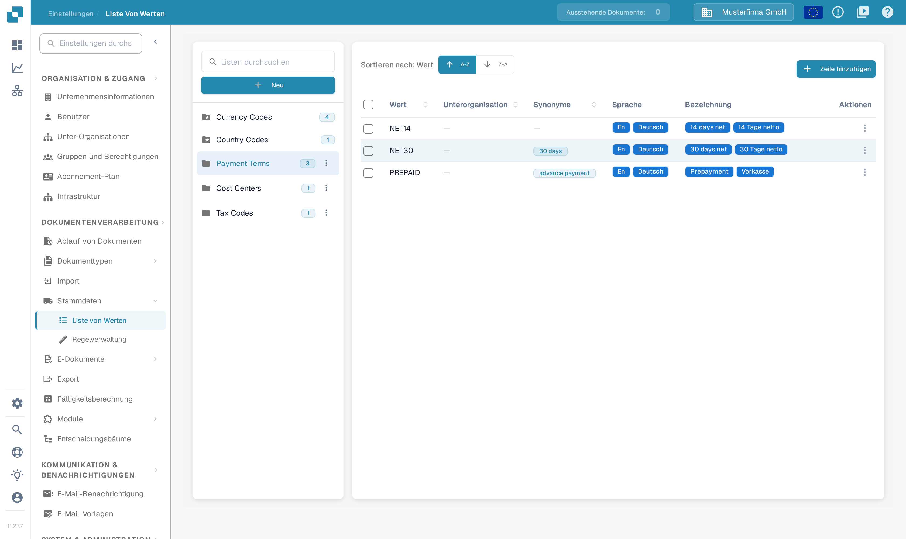
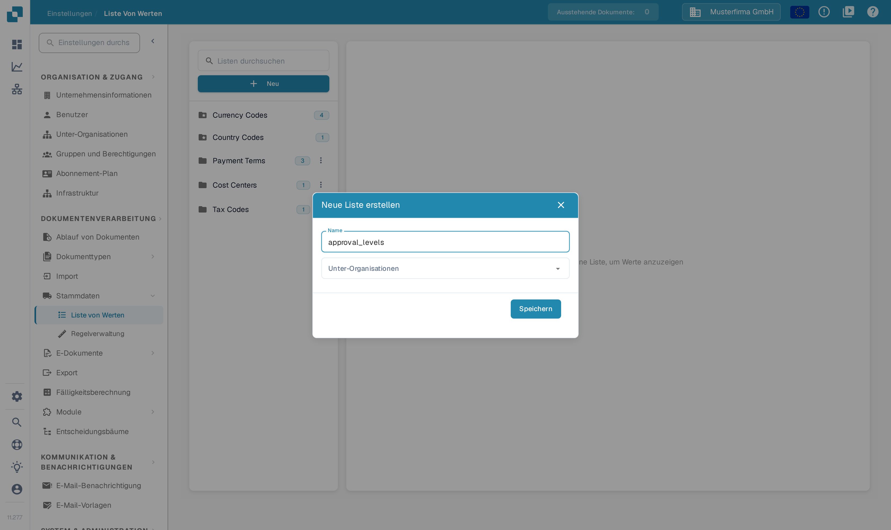
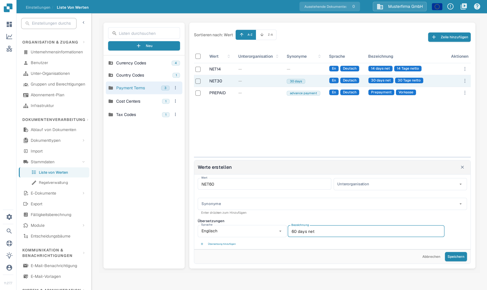

# Wertelisten

## Video-Tutorial: Stammdaten und Wertelisten


Stammdatenquellen, Wertelisten und Stammdaten-Einstellungen in DocBits


Das Video zeigt die Stammdatenquellen, die Wertelisten und die Stammdaten-Einstellungen eines Dokumenttyps.

## Überblick

Eine Werteliste stellt vordefinierte Auswahlmöglichkeiten für ein Feld bereit, zum Beispiel Rechnungsarten oder Währungen. Jeder Eintrag hat einen gespeicherten **Wert** und kann **Synonyme** sowie übersetzte **Bezeichnungen** haben. Verwenden Sie Wertelisten, wenn Sie Auswahllisten in den [Feldern](../global-settings/document-types/fields/) und in der Feldvalidierung einrichten.

Wertelisten und Einträge können auf eine Unterorganisation eingeschränkt werden. Übersetzungen bestimmen die Bezeichnung, die für eine Sprache angezeigt wird; der zugrunde liegende Wert bleibt gleich. Gibt es für die Sprache des Benutzers keine Bezeichnung, wird der zugrunde liegende Wert als Ersatz angezeigt.

## So öffnen Sie die Wertelisten

Öffnen Sie die **Einstellungen**. Klappen Sie unter **DOKUMENTENVERARBEITUNG** den Bereich **Stammdaten** auf und wählen Sie **Liste von Werten**.

Mit **Listen durchsuchen** im linken Bereich finden Sie eine Liste und wählen dann ihren Namen. Rechts erscheinen ihre Einträge. Eine Zahl neben dem Listennamen zeigt die geladene Anzahl ihrer Einträge. Das Ordnersymbol mit Stern kennzeichnet eine systemseitig angelegte Liste.

<figure><figcaption>
Suchen und wählen Sie eine Liste im linken Bereich, um ihre Einträge zu öffnen. Die Listennamen dieser Aufnahme stammen aus erfundenen Beispieldaten.
</figcaption></figure>

<figure><figcaption>
Eine ausgewählte Liste öffnet die Eintragstabelle. A-Z und Z-A sortieren nach Wert; Zeile hinzufügen öffnet das Formular für einen neuen Eintrag. Die Werte dieser Aufnahme stammen aus erfundenen Beispieldaten.
</figcaption></figure>

## Listen anlegen und löschen

### Eine neue Werteliste anlegen

1. Wählen Sie **Neu** über den Listennamen im linken Bereich.
2. Geben Sie einen **Name** ein.
3. Wählen Sie bei Bedarf **Unter-Organisationen**, um die Liste einzuschränken.
4. Wählen Sie **Speichern**, um die Liste anzulegen. Mit **X** schließen Sie den Dialog, ohne eine Liste anzulegen.

<figure><figcaption>
Neu öffnet diesen Dialog. Name benennt die Liste, Unter-Organisationen schränkt ihren Gültigkeitsbereich ein und Speichern legt die Liste an. Der eingetragene Name dieser Aufnahme stammt aus erfundenen Beispieldaten.
</figcaption></figure>

### Eine Liste löschen

Bei einer Liste, die Ihre Organisation angelegt hat, öffnen Sie das Drei-Punkte-Menü neben ihrem Namen und wählen **Löschen**. Ein Bestätigungsdialog fragt, ob die Liste entfernt werden soll. Bestätigen Sie nur die Liste, die Sie wirklich entfernen möchten. Systemseitig angelegte Listen haben kein Löschmenü.

## Einträge einer vorhandenen Liste hinzufügen, bearbeiten oder entfernen

### Einträge manuell hinzufügen

1. Wählen Sie die Liste im linken Bereich.
2. Wählen Sie **Zeile hinzufügen** über ihrer Tabelle. Das Formular **Werte erstellen** öffnet sich unterhalb der Tabelle.
3. Geben Sie den gespeicherten **Wert** und bei Bedarf die **Unterorganisation** ein.
4. Ergänzen Sie bei Bedarf **Synonyme**. Bestätigen Sie jedes Synonym mit **Enter**, damit es als eigenes Feld erscheint.
5. Wählen Sie unter **Übersetzungen** eine **Sprache** und geben Sie eine nicht leere **Bezeichnung** ein. Ein neuer Eintrag benötigt mindestens eine vollständige Übersetzung.
6. Wählen Sie **Speichern**, um den Eintrag zu sichern, oder **Abbrechen**, um das Formular ohne Speichern zu schließen.

<figure><figcaption>
Zeile hinzufügen öffnet das Formular für einen Eintrag unterhalb der Tabelle. Tragen Sie den Wert und mindestens eine Bezeichnung ein, bevor Sie speichern; Abbrechen verlässt das Formular, ohne einen Eintrag anzulegen. Die Eingaben dieser Aufnahme sind erfundene Beispieldaten.
</figcaption></figure>

### Werte aus einer CSV-Datei importieren

Diese Ansicht enthält den früheren Befehl **Aktionen → CSV hochladen** nicht. Die älteren Schritte zum CSV-Upload gelten für diesen Bildschirm nicht. Verwenden Sie **Zeile hinzufügen**, um Werte hier einzutragen.

### Vorhandene Einträge bearbeiten

Wählen Sie eine Zeile, um ihr Bearbeitungsformular unterhalb der Tabelle zu öffnen, oder verwenden Sie **Bearbeiten** im **Aktionen**-Menü der Zeile. Ändern Sie die bearbeitbaren Felder und speichern Sie das Formular. **Abbrechen** verwirft die ungespeicherte Änderung. Geschützte Felder bleiben schreibgeschützt; der gespeicherte Wert kann gesperrt sein, sobald Übersetzungen vorhanden sind.

Das Zeilenmenü bietet außerdem **Duplizieren**. Um mehrere Einträge zu duplizieren, wählen Sie deren Kontrollkästchen und verwenden das Kopiersymbol über der Tabelle. Beim Duplizieren entstehen weitere Einträge.

### Einträge löschen

Bei einem Eintrag, den Ihre Organisation angelegt hat, enthält das **Aktionen**-Menü der Zeile den Befehl **Löschen**. Er entfernt den Eintrag; wählen Sie ihn nur für einen Eintrag, den Sie wirklich entfernen möchten. Systemseitig angelegte Einträge bieten diesen Befehl nicht.

## Übersetzungen zu Ihren Einträgen hinzufügen

Wählen Sie im Eintragsformular eine **Sprache** und tragen Sie ihre **Bezeichnung** ein. Wählen Sie **Übersetzung hinzufügen** für eine weitere Sprache und Bezeichnung. Füllen Sie zusätzliche leere Übersetzungszeilen aus oder entfernen Sie sie vor dem Speichern. Ist eine entfernbare Übersetzungszeile vorhanden, nimmt ihr Papierkorbsymbol diese Übersetzung aus dem Formular; erst das Speichern übernimmt die Änderung.

## Systemseitig angelegte Listen und Einträge

Systemlisten sind mit einem Ordnersymbol mit Stern gekennzeichnet und können nicht gelöscht werden. Sie können zusätzliche Einträge enthalten, die Ihre Organisation angelegt hat.

Systemseitig angelegte Einträge und geerbte Übersetzungen haben geschützte Felder. Verwenden Sie die bearbeitbaren Bedienelemente für die eigenen Einträge und Übersetzungen Ihrer Organisation. Ein fehlender Löschbefehl kennzeichnet einen geschützten Eintrag; eine Systemliste kann sowohl geschützte als auch von Ihrer Organisation angelegte Einträge enthalten.
