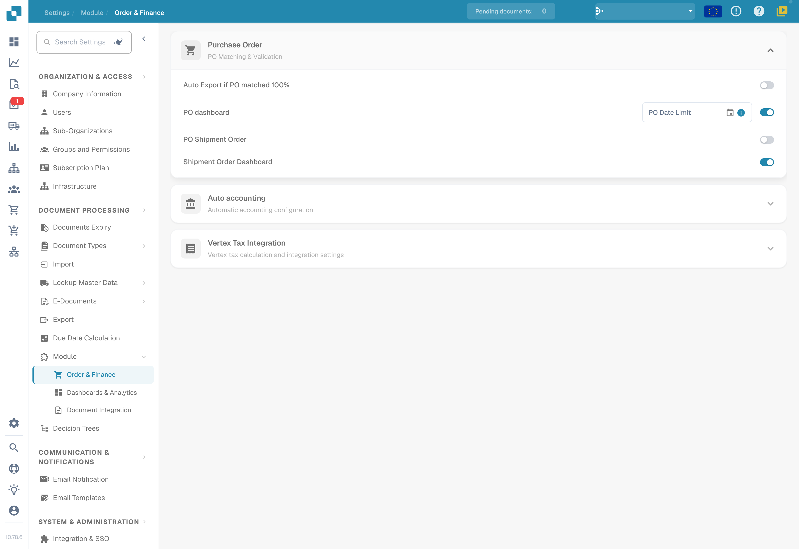
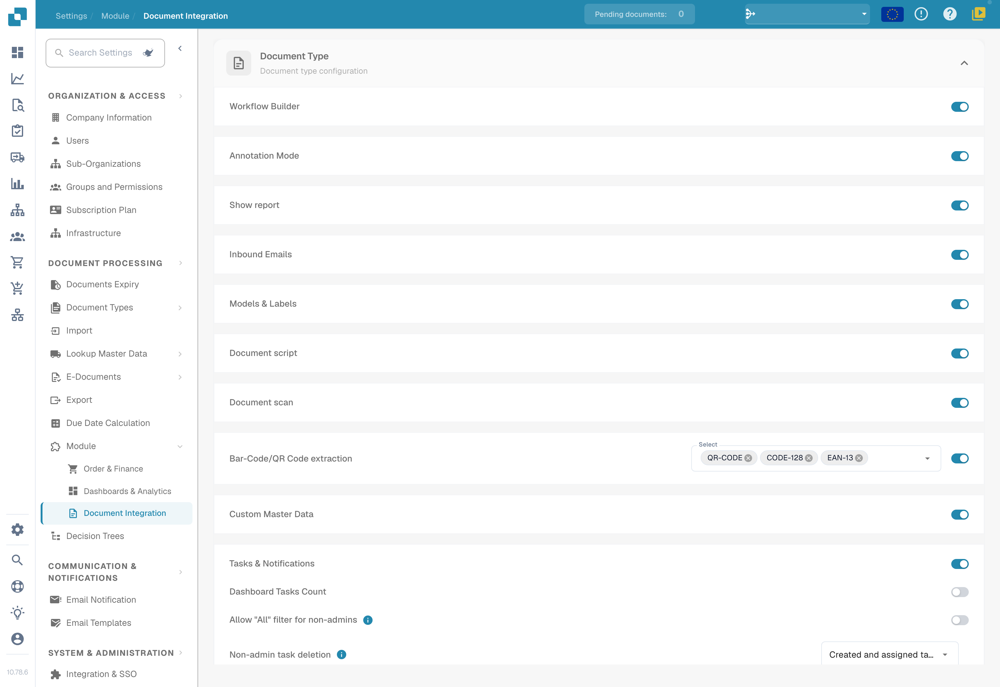
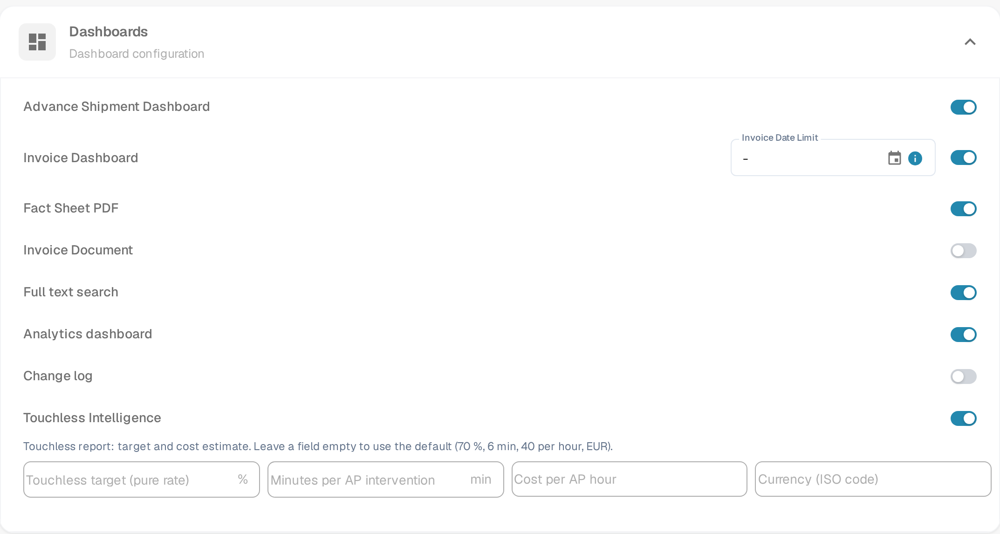
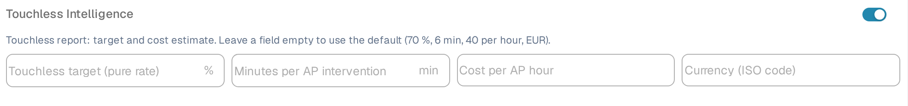

# Module

## Video tutorial: Settings hub and modules


Settings Overview and Modules in DocBits


The video shows the five groups of the Settings Overview, the search and Quick Links, and what the three Module pages control.

<figure><figcaption>
Order and finance modules in their existing configuration.
</figcaption></figure>

<figure><figcaption>
Document-integration modules: scripts, document scanning, barcode extraction and custom master data.
</figcaption></figure>

<figure><figcaption>
The Dashboards card with the switches and the Touchless report fields.
</figcaption></figure>

The Module page lets you enable or disable optional features in DocBits. Each section groups related modules that can be toggled on or off.

## Purchase Order

PO Matching & Validation settings.

| Setting | Description |
|---------|-------------|
| **Auto Export if PO matched 100%** | Automatically exports the document when PO matching reaches 100%. |
| **PO Dashboard** | Enables the Purchase Order dashboard. Includes a **PO Date Limit** field to restrict PO data by date. |
| **PO Shipment Order** | Enables shipment order processing linked to purchase orders. |
| **Shipment Order Dashboard** | Enables a dedicated dashboard for shipment orders. |

## Auto Accounting

| Setting | Description |
|---------|-------------|
| **Auto Accounting** | Enables automatic accounting for documents. Select the ERP type (e.g., LN, M3). |

## Dashboards

| Setting | Description |
|---------|-------------|
| **Advance Shipment Dashboard** | Dashboard for monitoring advanced shipment activities. |
| **Invoice Dashboard** | Dashboard for invoice monitoring and analytics. With the switch on, **Invoice Date Limit** limits the invoices the dashboard loads to those from that date onwards. |
| **Full Text Search** | Enables full-text search across documents. |
| **Analytics Dashboard** | Enables the analytics overview dashboard and its Touchless Intelligence report. |
| **Change log** | Enables the Change Log. |
| **Touchless Intelligence** | Enables the Touchless Intelligence report. The target and cost values of the report are set in the fields below the switch. |

### Touchless report settings

The Touchless report shows how many documents passed without a processing intervention and what an intervention costs. It needs two groups of values: the target it measures against and the cost view. Both are organisation settings.

The four fields below the **Touchless Intelligence** switch are shown while **Analytics dashboard** is on. Leave a field empty to use the default shown in its placeholder — 70 %, 6 min, 40 per hour, EUR. DocBits saves a field as soon as you leave it, and it does not save a value it cannot use.

<figure><figcaption>
The Touchless report fields appear below the Touchless Intelligence switch.
</figcaption></figure>

| Setting | Default | What it controls |
|---------|---------|------------------|
| **Touchless target (pure rate)** | 70 % | The share of documents that should pass without a processing intervention. The report uses it as the target mark in the rate chart. |
| **Minutes per AP intervention** | 6 min | The time an AP employee needs to correct and release one document. |
| **Cost per AP hour** | 40 | The cost of one hour of AP work, in the currency below. |
| **Currency (ISO code)** | EUR | The currency of the cost view, as a three-letter ISO 4217 code such as `EUR`, `CHF` or `USD`. DocBits stores the code in upper case and rejects a value that is not a currency code. |

The report and its calculation are described in the [Touchless Intelligence guide](../../../analytics-dashboard/touchless-intelligence/README.md).

## Database Access

| Setting | Description |
|---------|-------------|
| **DB Access** | Enables direct database access for the organization. |

## AI Dashboard

These toggles are grouped under the **AI Dashboard** section on the **Settings → Module → Dashboards & Analytics** page. **AI Document Warehouse** requires a Clickhouse subscription; **Clickhouse Direct Access** and **Supplier Statistics** only appear after **AI Document Warehouse** is turned on.

| Setting | Description |
|---------|-------------|
| **AI Document Warehouse** | AI-powered document warehouse analytics. |
| **Clickhouse Direct Access** | Enables direct Clickhouse database access. |
| **Supplier Statistics** | Enables supplier-level statistics and reporting. See the [Supplier Statistics](../../../../end-user-and-partner-section/end-user-section/supplier-statistics.md) user guide. |

## Shipping & Supplier

| Setting | Description |
|---------|-------------|
| **Supplier Portal** | Enables the supplier portal for supplier collaboration. |

## Document Type

| Setting | Description |
|---------|-------------|
| **Workflow Builder** | Build and customize document processing workflows. |
| **Annotation Mode** | Allows users to annotate documents in the validation view. |
| **Show Report** | Enables report generation for documents. |
| **Inbound Emails** | Enables inbound email handling per document type. |
| **Models & Labels** | Manage AI models and labels for document recognition. |
| **Document Script** | Enables custom scripting for document processing. |
| **Document Scan** | Enables document scanning functionality. |
| **Bar-Code/QR Code Extraction** | Extracts barcode/QR code data from documents. Select supported code types. |
| **Custom Master Data** | Enables custom master data fields. |
| **Tasks & Notifications** | Enables task management and notification features. Includes **Dashboard Tasks Count** toggle. |
| **DocBits Operator** | Enables the DocBits Operator browser automation feature. |
| **DocNet** | Enables DocNet document networking. |
| **IDM ACL Updater** | Updates Infor Document Management access control lists. Upload an ION-Mapping file and configure Infor-Doctype to ACL mappings. |
| **Barcode Assignment** | Enables barcode assignment to documents. |
| **Set Negative Sign For Credit Notes** | Automatically applies negative signs to credit note amounts. |

## BOD Connection Stream

| Setting | Description |
|---------|-------------|
| **BOD Connection Stream** | Enables BOD (Business Object Document) integration. Shows the **Stream Name** used for the connection. |

## Analytics

| Setting | Description |
|---------|-------------|
| **Use PostgreSQL for Quality Analytics** | Switch between Prometheus (real-time, resets on deploy) and PostgreSQL (persistent 90 days, trend analysis, worst-performing fields). |

## Vertex Tax Integration

| Setting | Description |
|---------|-------------|
| **Vertex Tax Integration** | Enables Vertex tax calculation. Configure **Base URL**, **Client ID**, and **Client Secret**. Use **Test Connection** to verify. |
