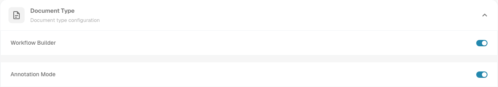
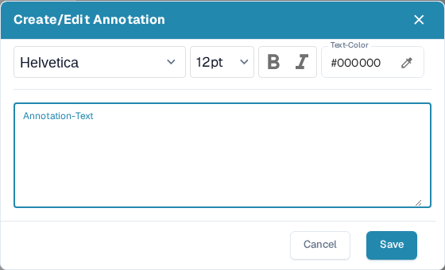
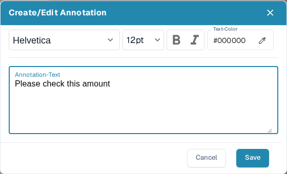
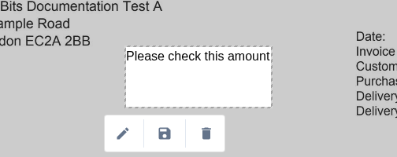
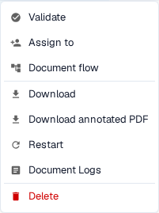

# Tryb adnotacji

Tryb adnotacji pozwala umieszczać notatki bezpośrednio na dokumencie podczas walidacji. Notatkę można edytować, przenieść lub usunąć przed pobraniem pliku PDF z adnotacjami. Administrator musi najpierw włączyć tę funkcję dla organizacji. Jeśli dokument zawiera adnotacje, są one uwzględniane przy eksporcie do IDM.

## Włączanie trybu adnotacji

Administrator otwiera **Settings → Module → Document Integration → Document Type** i włącza **Annotation Mode**. Jeśli podczas walidacji nie widać przycisku adnotacji, poproś administratora o sprawdzenie tego ustawienia i swoich uprawnień.

<figure><figcaption>
Sekcja Document Type w Settings → Module → Document Integration. W tym przykładzie Annotation Mode jest włączony.
</figcaption></figure>


DocBits Annotation Mode Tutorial: Add Notes in Validation & Download With/Without Annotations


## Dodawanie notatki podczas walidacji

1. Otwórz dokument na [Validation Screen](../../../../end-user-and-partner-section/end-user-section/validation-screen/README.md).
2. Wybierz **speech bubble** na pasku narzędzi po prawej stronie. Jej podpowiedź brzmi **Activate annotation-mode**. Wybierz ją ponownie, aby opuścić tryb adnotacji.
3. Przeciągnij wskaźnik po fragmencie pliku PDF, w którym ma pojawić się notatka. Obok zaznaczonego obszaru pojawi się mały pasek narzędzi.
4. Wybierz **pen**, aby otworzyć **Create/Edit Annotation**. Wpisz notatkę w polu **Annotation-Text**. Możesz wybrać czcionkę i rozmiar, użyć **Bold** lub *Italic* oraz ustawić **Text-Color**. **Cancel** zamyka okno bez zastosowania tekstu; **Save** stosuje go do wybranej adnotacji.
5. Użyj przycisku **disk** na pasku narzędzi adnotacji, aby zapisać zmianę. Użyj przycisku **trash**, aby usunąć adnotację, jeśli nie jest już potrzebna.

<figure><figcaption>
Otwórz tryb adnotacji z paska narzędzi walidacji.
</figcaption></figure>

<figure><figcaption>
Pasek narzędzi pojawia się po zaznaczeniu obszaru na pliku PDF.
</figcaption></figure>

<figure><figcaption>
Wpisz i sformatuj notatkę w oknie adnotacji.
</figcaption></figure>

<figure><figcaption>
Sprawdź notatkę przed wybraniem Save.
</figcaption></figure>

## Zarządzanie istniejącą notatką

Wybierz notatkę w trybie adnotacji, aby wyświetlić jej pasek narzędzi. Użyj **pen**, aby zmienić tekst lub formatowanie, przeciągnij zaznaczoną notatkę, aby ją przenieść, albo użyj **trash**, aby ją usunąć. W tym samym dokumencie można utworzyć wiele adnotacji. Adnotacje są widoczne tylko przy włączonym trybie adnotacji i pojawiają się na pliku PDF po zapisaniu. Przycisk **speech bubble** nie pokazuje, czy dokument ma już notatki; włącz tryb adnotacji, aby je zobaczyć.

<figure><figcaption>
Zapisana notatka pozostaje widoczna na dokumencie w trybie adnotacji.
</figcaption></figure>

Adnotacje są dostępne również podczas [zatwierdzania dokumentu](../../global-settings/document-types/more-settings/approval/README.md), gdzie można je wyświetlać, dodawać i zmieniać. Informacje o eksporcie przez Infor IDM znajdziesz w sekcji [Exporting to IDM](../../../../infor-integration-and-configuration/exporting-to-infor/exporting-to-idm.md).

## Pobieranie oryginalnego lub opatrzonego adnotacjami pliku PDF

Na stronie **Dashboard** otwórz menu akcji dokumentu z trzema kropkami. Wybierz **Download**, aby pobrać oryginalny plik PDF, lub **Download annotated PDF**, aby pobrać wersję z zapisanymi notatkami. Opcja z adnotacjami pojawia się po zapisaniu adnotacji. Menu oferuje także **Validate** (otwarcie ekranu walidacji), **Assign to** (wybór osoby), **Document flow** (podgląd [document flow](../../../../end-user-and-partner-section/end-user-section/dashboard/document-flow.md)), **Restart** (ponowne przetworzenie dokumentu), **Document Logs** (podgląd aktywności) oraz **Delete** (usunięcie dokumentu). Używaj tych akcji tylko wtedy, gdy zamierzasz zmienić dokument lub go sprawdzić.

<figure><figcaption>
Wybierz potrzebną wersję pliku PDF w menu akcji dokumentu.
</figcaption></figure>
