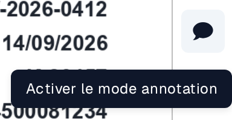
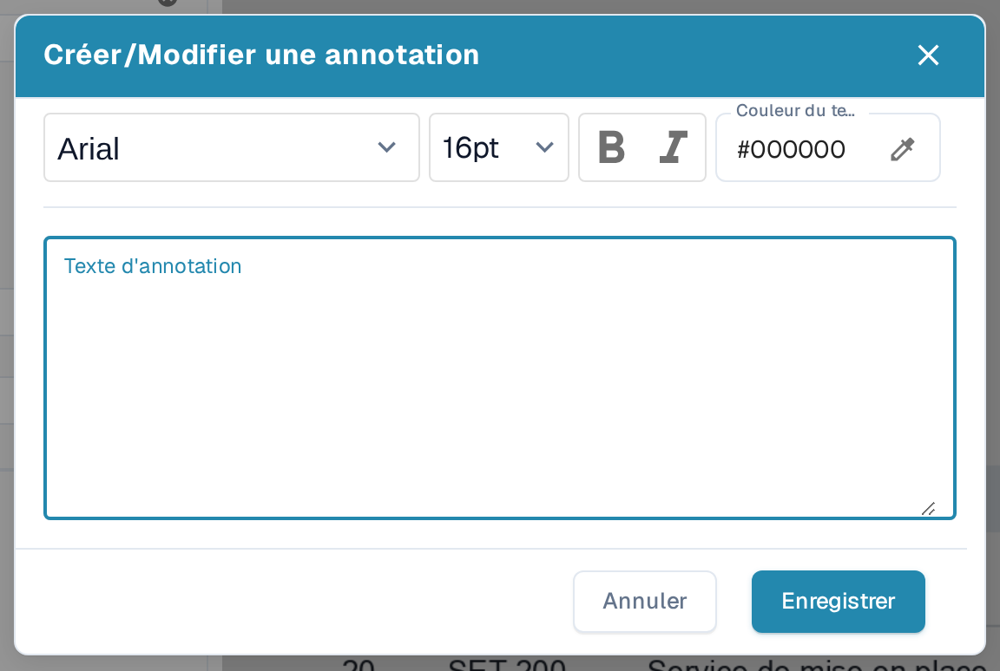
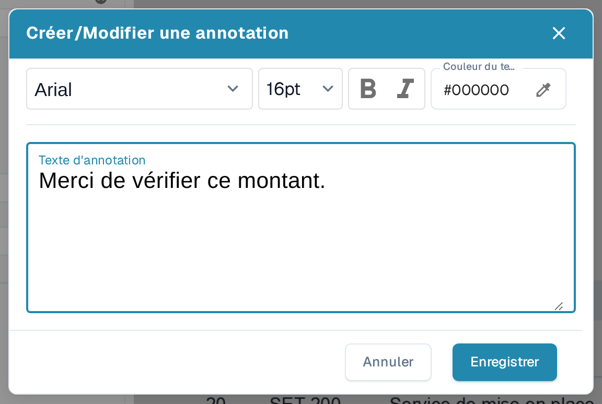
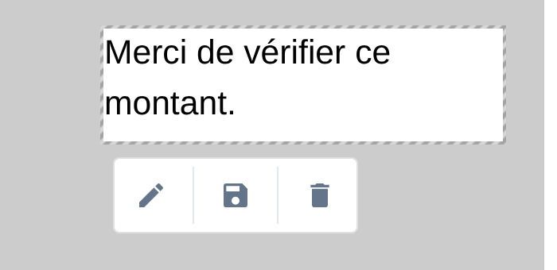
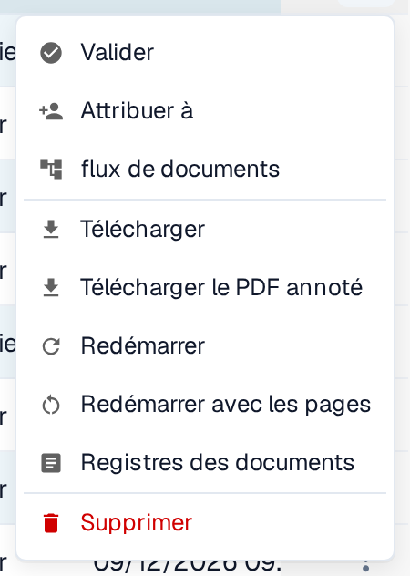

# Mode annotation

Le mode annotation vous permet de placer des notes directement sur un document pendant la validation. Vous pouvez modifier, déplacer ou supprimer une note avant de télécharger un PDF annoté. Votre administrateur doit d'abord activer la fonction pour l'organisation. Si un document contient des annotations, elles sont incluses lors de l'**exportation vers IDM**.

## Activer le mode annotation

Un administrateur ouvre **Paramètres → Module → Intégration de documents → Type de document** et active **Mode d'annotation**. Si vous ne voyez pas le bouton d'annotation pendant la validation, demandez à un administrateur de vérifier ce paramètre et votre accès.

<figure><figcaption>
La section Type de document sous Paramètres → Module → Intégration de documents. Le mode d'annotation est activé dans cet exemple.
</figcaption></figure>


Tutoriel DocBits sur le mode annotation : ajouter des notes dans la validation et télécharger avec ou sans annotations


## Ajouter une note pendant la validation

1. Ouvrez le document sur l'[écran de validation](../../../../end-user-and-partner-section/end-user-section/validation-screen/README.md).
2. Sélectionnez la **bulle de discussion** dans la barre d'outils à droite. Son info-bulle indique **Activer le mode annotation**. Sélectionnez-la à nouveau pour quitter le mode annotation.
3. Faites glisser le pointeur sur la partie du PDF où la note doit apparaître. Une petite barre d'outils apparaît à côté de la zone sélectionnée.
4. Sélectionnez le **stylo** pour ouvrir **Créer/Modifier une annotation**. Saisissez la note dans **Texte d'annotation**. Vous pouvez choisir la police et la taille, utiliser le **gras** ou l'*italique* et définir la **Couleur du texte**. **Annuler** ferme la boîte de dialogue sans appliquer le texte ; **Enregistrer** l'applique à l'annotation sélectionnée.
5. Utilisez le bouton **disquette** de la barre d'outils de l'annotation pour enregistrer votre modification. Utilisez le bouton **corbeille** pour supprimer l'annotation si elle n'est plus nécessaire.

<figure><figcaption>
Ouvrez le mode annotation depuis la barre d'outils de validation.
</figcaption></figure>

<figure><figcaption>
La barre d'outils apparaît après avoir sélectionné une zone sur le PDF.
</figcaption></figure>

<figure><figcaption>
Rédigez et mettez en forme la note dans la boîte de dialogue d'annotation.
</figcaption></figure>

<figure><figcaption>
Vérifiez la note avant de sélectionner Enregistrer. Le texte affiché est un exemple fictif.
</figcaption></figure>

## Gérer une note existante

Sélectionnez une note en mode annotation pour afficher sa barre d'outils. Utilisez le **stylo** pour modifier le texte ou la mise en forme, faites glisser la note sélectionnée pour la déplacer, ou utilisez la **corbeille** pour la supprimer. Vous pouvez créer plusieurs annotations dans le même document. Les annotations ne sont visibles que lorsque le mode annotation est activé, et elles apparaissent sur le PDF après leur enregistrement. Le bouton en forme de bulle n'indique pas si un document contient déjà des notes ; activez le mode annotation pour les voir.

<figure><figcaption>
Une note enregistrée reste visible sur le document en mode annotation.
</figcaption></figure>

Les annotations sont également disponibles pendant l'[approbation de document](../../global-settings/document-types/more-settings/approval/README.md), où vous pouvez les consulter, les ajouter et les modifier. Pour la sortie via Infor IDM, voir [Exportation vers IDM](../../../../infor-integration-and-configuration/exporting-to-infor/exporting-to-idm.md).

## Télécharger le PDF original ou annoté

Sur le **Tableau de bord**, ouvrez le menu d'actions à trois points du document. Choisissez **Télécharger** pour le PDF original ou **Télécharger le PDF annoté** pour la version avec les notes enregistrées. L'option annotée apparaît après l'enregistrement d'une annotation. Le menu propose aussi **Valider** (ouvrir l'écran de validation), **Attribuer à** (choisir une personne), **flux de documents** (afficher le [flux du document](../../../../end-user-and-partner-section/end-user-section/dashboard/document-flow.md)), **Redémarrer** (traiter le document à nouveau), **Registres des documents** (voir l'activité) et **Supprimer** (supprimer le document). N'utilisez ces actions que lorsque vous avez l'intention de modifier ou d'inspecter le document.

<figure><figcaption>
Choisissez la version du PDF dont vous avez besoin dans le menu d'actions du document.
</figcaption></figure>
