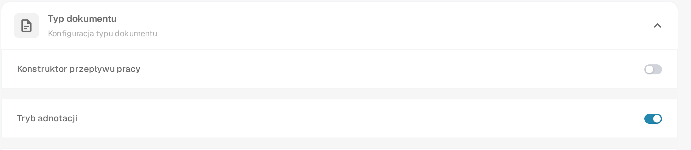
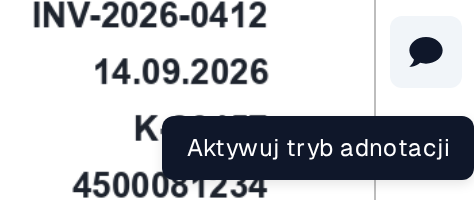
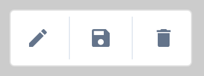
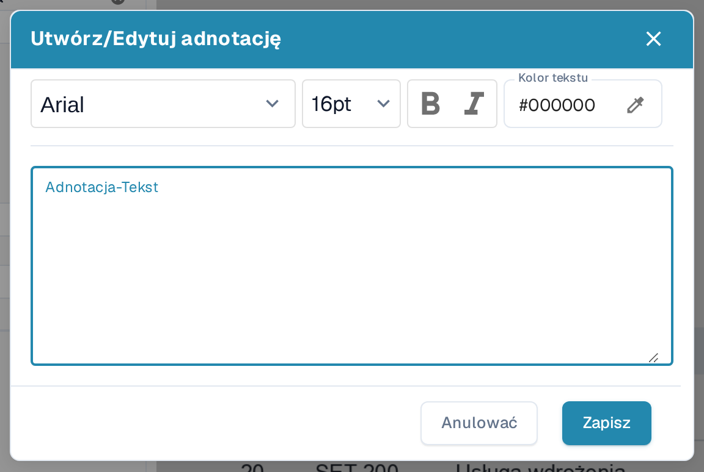
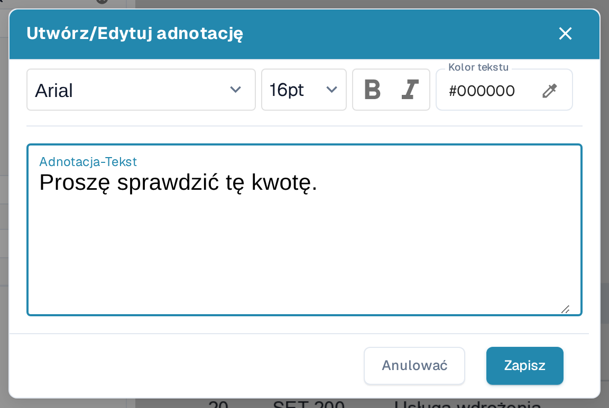
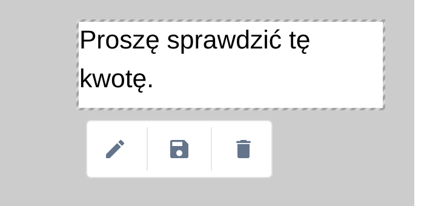
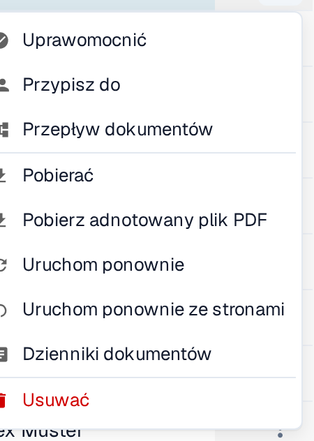

# Tryb adnotacji

Tryb adnotacji pozwala umieszczać notatki bezpośrednio na dokumencie podczas walidacji. Notatkę możesz edytować, przesuwać i usuwać przed pobraniem pliku PDF z adnotacjami. Administrator musi najpierw włączyć tę funkcję dla organizacji. Jeśli dokument zawiera adnotacje, są one uwzględniane przy **eksporcie do IDM**.

## Włączanie trybu adnotacji

Administrator otwiera **Ustawienia → Moduł → Integracja Dokumentów → Typ dokumentu** i włącza **Tryb adnotacji**. Jeśli przycisk adnotacji nie jest widoczny podczas walidacji, poproś administratora o sprawdzenie tego ustawienia i swoich uprawnień.

<figure><figcaption>
Sekcja Typ dokumentu w sekcji Ustawienia → Moduł → Integracja Dokumentów. W tym przykładzie tryb adnotacji jest włączony.
</figcaption></figure>


Samouczek DocBits dotyczący trybu adnotacji: dodawanie notatek podczas walidacji i pobieranie plików z adnotacjami lub bez nich


## Dodawanie notatki podczas walidacji

1. Otwórz dokument na [ekranie walidacji](../../../../end-user-and-partner-section/end-user-section/validation-screen/README.md).
2. Wybierz **dymek** na pasku narzędzi po prawej stronie. Podpowiedź przycisku brzmi **Aktywuj tryb adnotacji**. Wybierz go ponownie, aby opuścić tryb adnotacji; wtedy podpowiedź brzmi **Dezaktywuj tryb adnotacji**.
3. Przeciągnij wskaźnikiem po części pliku PDF, w której ma pojawić się notatka. Obok zaznaczonego obszaru pojawi się mały pasek narzędzi.
4. Wybierz **pióro**, aby otworzyć okno **Utwórz/Edytuj adnotację**. Wpisz notatkę w polu **Adnotacja-Tekst**. Możesz wybrać czcionkę i rozmiar, użyć pogrubienia **B** lub kursywy *I* i ustawić **Kolor tekstu**. **Anulować** zamyka okno bez zastosowania tekstu; **Zapisz** stosuje go do zaznaczonej adnotacji.
5. Użyj przycisku **dyskietki** na pasku narzędzi adnotacji, aby zapisać zmianę. Użyj przycisku **kosza**, aby usunąć adnotację, jeśli nie jest już potrzebna.

<figure><figcaption>
Tryb adnotacji włączasz na pasku narzędzi ekranu walidacji.
</figcaption></figure>

<figure><figcaption>
Pasek narzędzi pojawia się po zaznaczeniu obszaru na pliku PDF.
</figcaption></figure>

<figure><figcaption>
Notatkę piszesz i formatujesz w oknie adnotacji.
</figcaption></figure>

<figure><figcaption>
Przykładowa notatka „Proszę sprawdzić tę kwotę.” przed wybraniem przycisku Zapisz. Wpisany tekst jest danymi przykładowymi.
</figcaption></figure>

## Zarządzanie istniejącą notatką

Wybierz notatkę w trybie adnotacji, aby wyświetlić jej pasek narzędzi. Użyj **pióra**, aby zmienić tekst lub formatowanie, przeciągnij zaznaczoną notatkę, aby ją przesunąć, albo użyj **kosza**, aby ją usunąć. W tym samym dokumencie możesz utworzyć wiele adnotacji. Adnotacje są widoczne tylko przy włączonym trybie adnotacji i pojawiają się w pliku PDF po zapisaniu. Przycisk dymka nie pokazuje, czy dokument ma już notatki; włącz tryb adnotacji, aby je zobaczyć.

<figure><figcaption>
Zapisana notatka pozostaje widoczna na dokumencie w trybie adnotacji.
</figcaption></figure>

Adnotacje są dostępne również podczas [zatwierdzania dokumentu](../../global-settings/document-types/more-settings/approval/README.md), gdzie można je przeglądać, dodawać i zmieniać. Informacje o wyprowadzaniu danych przez Infor IDM znajdziesz w sekcji [Eksport do IDM](../../../../infor-integration-and-configuration/exporting-to-infor/exporting-to-idm.md).

## Pobieranie oryginalnego lub oznaczonego adnotacjami pliku PDF

W **panelu** otwórz menu akcji dokumentu z trzema kropkami. Wybierz **Pobierać**, aby pobrać oryginalny plik PDF, albo **Pobierz adnotowany plik PDF**, aby pobrać wersję z zapisanymi notatkami. Opcja pobierania z adnotacjami pojawia się po zapisaniu adnotacji. Menu oferuje również **Uprawomocnić** (otwiera ekran walidacji), **Przypisz do** (wybór osoby), **Przepływ dokumentów** (podgląd [przepływu dokumentów](../../../../end-user-and-partner-section/end-user-section/dashboard/document-flow.md)), **Uruchom ponownie** (ponowne przetworzenie dokumentu), **Dzienniki dokumentów** (podgląd aktywności) i **Usuwać** (usunięcie dokumentu). Korzystaj z tych akcji tylko wtedy, gdy chcesz zmienić lub sprawdzić dokument.

<figure><figcaption>
Potrzebną wersję pliku PDF wybierasz w menu akcji dokumentu.
</figcaption></figure>
