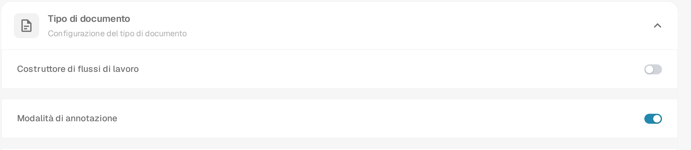
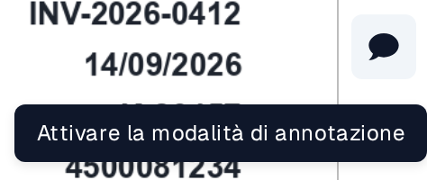
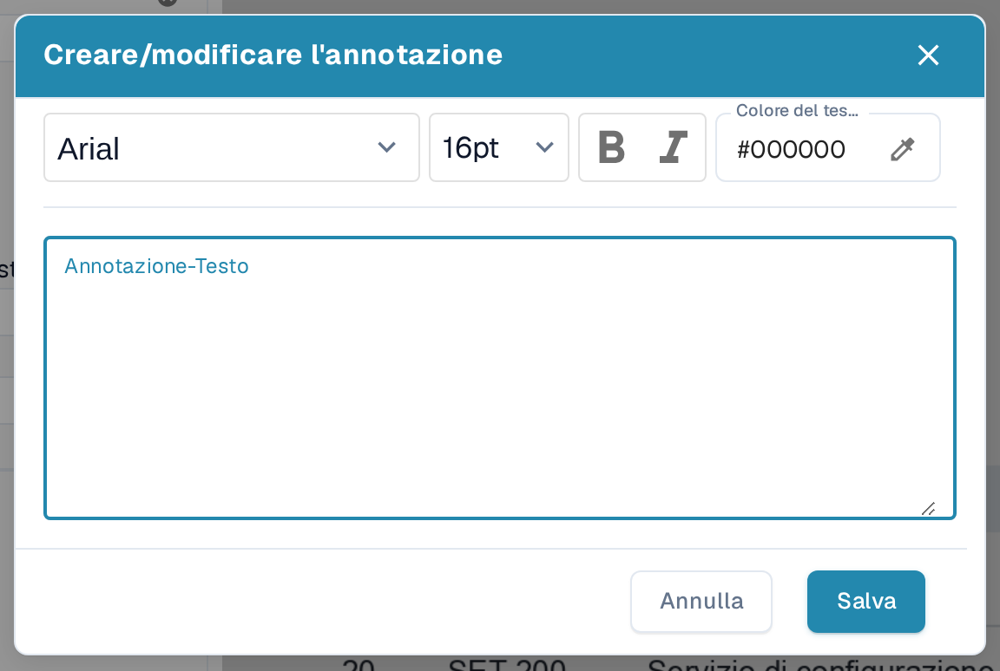
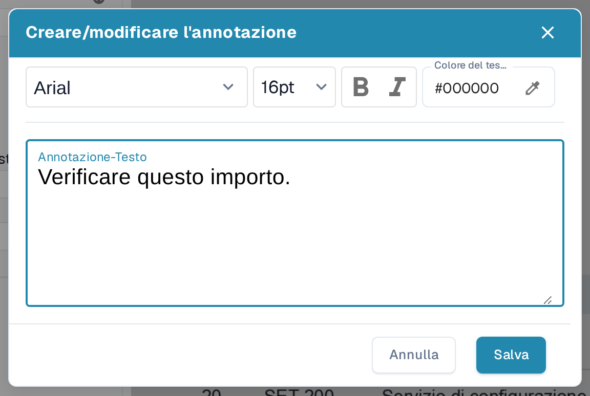
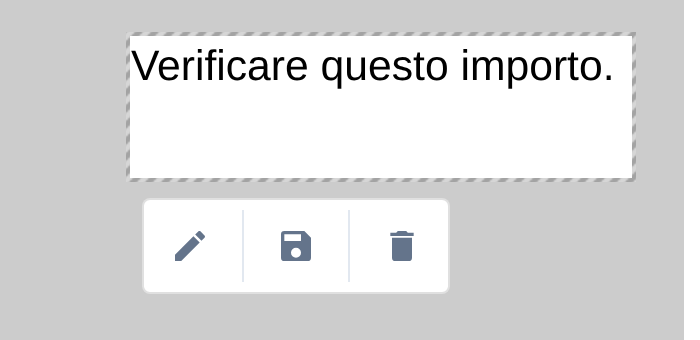
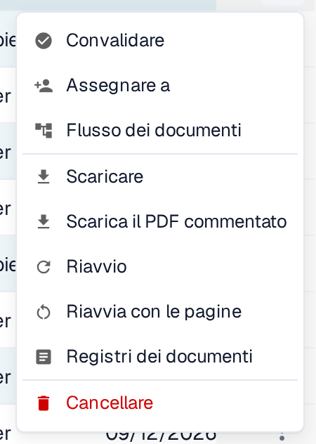

# Modalità annotazione

La modalità annotazione consente di inserire note direttamente su un documento durante la convalida. Puoi modificare, spostare o eliminare una nota prima di scaricare un PDF annotato. L'amministratore deve prima attivare la funzione per l'organizzazione. Se un documento contiene annotazioni, queste vengono incluse quando si **esporta in IDM**.

## Attivare la modalità annotazione

Un amministratore apre **Impostazioni → Modulo → Integrazione dei documenti → Tipo di documento** e attiva **Modalità di annotazione**. Se durante la convalida non vedi il pulsante per le annotazioni, chiedi a un amministratore di verificare questa impostazione e il tuo accesso.

<figure><figcaption>
La sezione Tipo di documento in Impostazioni → Modulo → Integrazione dei documenti. In questo esempio la modalità di annotazione è attivata.
</figcaption></figure>


DocBits Tutorial sulla modalità annotazione: aggiunta di note nella convalida e download con/senza annotazioni


## Aggiungere una nota durante la convalida

1. Apri il documento nella [Schermata di convalida](../../../../end-user-and-partner-section/end-user-section/validation-screen/README.md).
2. Seleziona il **fumetto** nella barra degli strumenti a destra. La descrizione comando indica **Attivare la modalità di annotazione**. Selezionalo di nuovo per uscire dalla modalità annotazione.
3. Trascina il puntatore sulla parte del PDF in cui deve apparire la nota. Accanto all'area selezionata compare una piccola barra degli strumenti.
4. Seleziona la **penna** per aprire **Creare/modificare l'annotazione**. Inserisci la nota in **Annotazione-Testo**. Puoi scegliere il carattere e la dimensione, usare il **grassetto** o il *corsivo* e impostare il **Colore del testo**. **Annulla** chiude la finestra senza applicare il testo; **Salva** lo applica all'annotazione selezionata.
5. Usa il pulsante **dischetto** nella barra degli strumenti dell'annotazione per salvare la modifica. Usa il pulsante **cestino** per eliminare l'annotazione se non serve più.

<figure><figcaption>
Apri la modalità annotazione dalla barra degli strumenti di convalida.
</figcaption></figure>

<figure><figcaption>
La barra degli strumenti compare dopo aver selezionato un'area sul PDF.
</figcaption></figure>

<figure><figcaption>
Scrivi e formatta la nota nella finestra dell'annotazione.
</figcaption></figure>

<figure><figcaption>
Controlla la nota prima di selezionare Salva. Il testo mostrato è un esempio inventato.
</figcaption></figure>

## Gestire una nota esistente

Seleziona una nota in modalità annotazione per visualizzarne la barra degli strumenti. Usa la **penna** per cambiare il testo o la formattazione, trascina la nota selezionata per spostarla oppure usa il **cestino** per eliminarla. Puoi creare più annotazioni nello stesso documento. Le annotazioni sono visibili solo con la modalità annotazione attivata e compaiono sul PDF dopo il salvataggio. Il pulsante a forma di fumetto non indica se un documento contiene già delle note: attiva la modalità annotazione per vederle.

<figure><figcaption>
Una nota salvata resta visibile sul documento in modalità annotazione.
</figcaption></figure>

Le annotazioni sono disponibili anche durante l'[approvazione dei documenti](../../global-settings/document-types/more-settings/approval/README.md), dove puoi visualizzarle, aggiungerle e modificarle. Per l'output tramite Infor IDM vedi [Esportare in IDM](../../../../infor-integration-and-configuration/exporting-to-infor/exporting-to-idm.md).

## Scaricare il PDF originale o annotato

Nel **Cruscotto** apri il menu delle azioni a tre punti del documento. Scegli **Scaricare** per il PDF originale o **Scarica il PDF commentato** per la versione con le note salvate. L'opzione con le annotazioni compare dopo che un'annotazione è stata salvata. Il menu offre anche **Convalidare** (aprire la schermata di convalida), **Assegnare a** (scegliere una persona), **Flusso dei documenti** (vedi il [flusso del documento](../../../../end-user-and-partner-section/end-user-section/dashboard/document-flow.md)), **Riavvio** (elaborare di nuovo il documento), **Registri dei documenti** (vedere l'attività) e **Cancellare** (rimuovere il documento). Usa queste azioni solo quando hai intenzione di modificare o controllare il documento.

<figure><figcaption>
Scegli la versione del PDF che ti serve nel menu delle azioni del documento.
</figcaption></figure>
