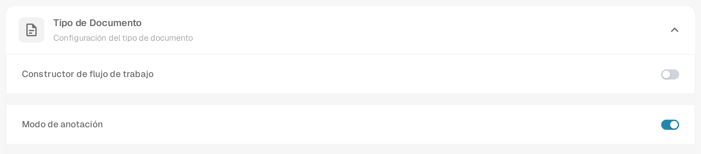
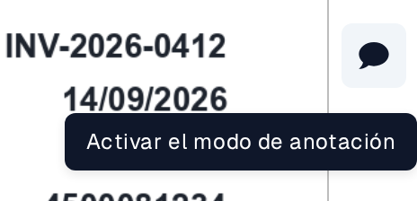
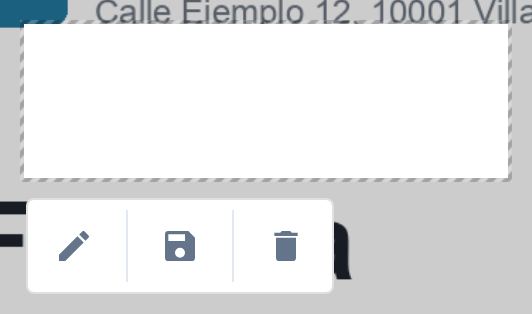
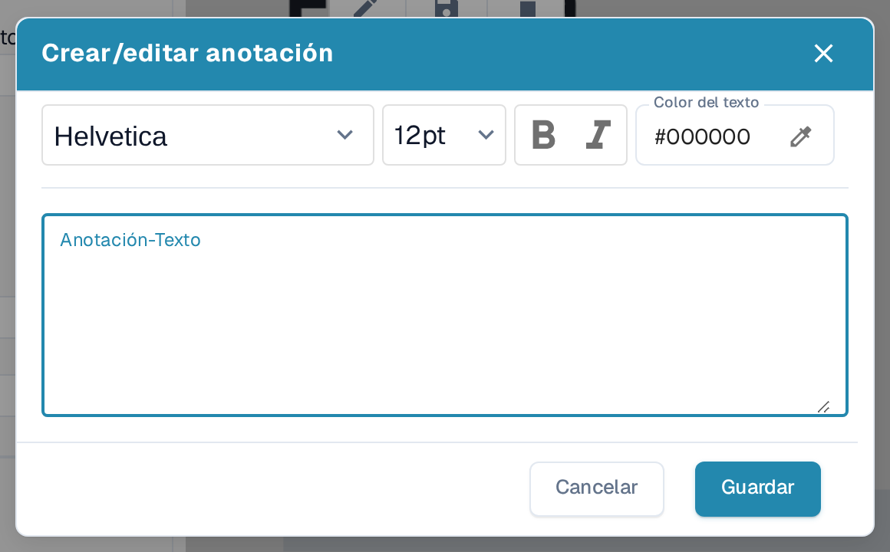
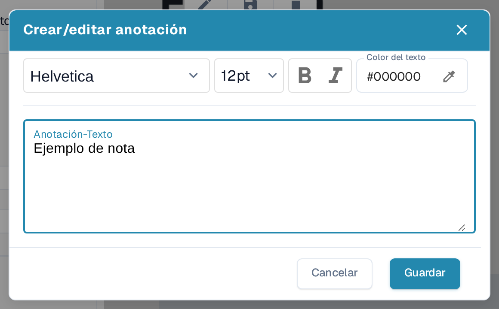
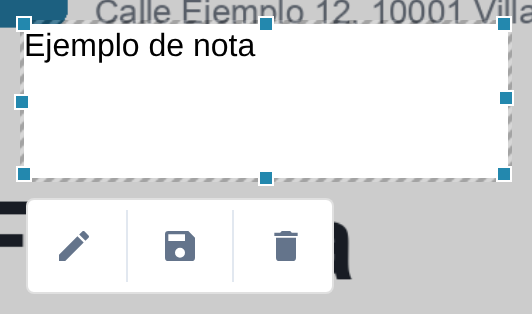

# Modo de anotación

El modo de anotación permite colocar notas directamente en un documento durante la validación. Puede editar, mover o eliminar una nota antes de descargar un PDF anotado. Su administrador debe activar antes la función para la organización. Si un documento contiene anotaciones, se incluyen al **exportar a IDM**.

## Activar el modo de anotación

Un administrador abre **Ajustes → Módulo → Integración De Documentos → Tipo de Documento** y activa **Modo de anotación**. Si no ve el botón de anotación durante la validación, pida a un administrador que revise esta configuración y su acceso.

<figure><figcaption>
La sección Tipo de Documento en Ajustes → Módulo → Integración De Documentos. En este ejemplo el modo de anotación está activado.
</figcaption></figure>


DocBits Tutorial del modo de anotación: agregar notas en validación y descargar con o sin anotaciones


## Añadir una nota durante la validación

1. Abra el documento en la [Pantalla de Validación](../../../../end-user-and-partner-section/end-user-section/validation-screen/README.md).
2. Seleccione la **burbuja de diálogo** de la barra de herramientas de la derecha. Su información emergente dice **Activar el modo de anotación**. Selecciónela de nuevo para salir del modo de anotación.
3. Arrastre sobre la parte del PDF donde debe aparecer la nota. Junto al área seleccionada aparece una barra de herramientas pequeña.
4. Seleccione el **lápiz** para abrir **Crear/editar anotación**. Escriba la nota en **Anotación-Texto**. Puede elegir la fuente y el tamaño, usar **B** (negrita) o *I* (cursiva) y definir el **Color del texto**. **Cancelar** cierra el diálogo sin aplicar el texto; **Guardar** lo aplica a la anotación seleccionada.
5. Use el botón de **disquete** de la barra de herramientas de la anotación para guardar el cambio. Use el botón de **papelera** para eliminar la anotación si ya no la necesita.

<figure><figcaption>
Abra el modo de anotación desde la barra de herramientas de la derecha.
</figcaption></figure>

<figure><figcaption>
La barra de herramientas aparece después de seleccionar un área en el PDF.
</figcaption></figure>

<figure><figcaption>
Escriba y formatee la nota en el diálogo de anotación.
</figcaption></figure>

<figure><figcaption>
Revise la nota antes de seleccionar Guardar. El texto «Ejemplo de nota» es un dato de ejemplo inventado.
</figcaption></figure>

## Gestionar una nota existente

Seleccione una nota en el modo de anotación para mostrar su barra de herramientas. Use el **lápiz** para cambiar el texto o el formato, arrastre la nota seleccionada para moverla o use la **papelera** para eliminarla. Puede crear varias anotaciones en el mismo documento. Las anotaciones solo son visibles mientras el modo de anotación está activado y aparecen en el PDF una vez guardadas. El botón de burbuja de diálogo no indica si un documento ya tiene notas; active el modo de anotación para verlas.

<figure><figcaption>
Una nota guardada permanece visible en el documento mientras el modo de anotación está activado.
</figcaption></figure>

Las anotaciones también están disponibles durante la [Aprobación](../../global-settings/document-types/more-settings/approval/README.md), donde puede verlas, añadirlas y modificarlas. Para la salida a través de Infor IDM, consulte [Exportación a IDM](../../../../infor-integration-and-configuration/exporting-to-infor/exporting-to-idm.md).

## Descargar el PDF original o el anotado

En el **Panel**, abra el menú de acciones de tres puntos del documento. Elija **Descargar** para el PDF original o **Descargar PDF comentado** para la versión con las notas guardadas. La opción con las anotaciones aparece después de guardar una anotación. El menú también ofrece **Validar** (abrir la pantalla de validación), **Asignar a** (elegir una persona), **Flujo del documento** (ver el [flujo de documentos](../../../../end-user-and-partner-section/end-user-section/dashboard/document-flow.md)), **Reiniciar** (procesar el documento de nuevo), **Registros de documentos** (ver la actividad) y **Borrar** (quitar el documento). Use estas acciones solo cuando quiera cambiar o revisar el documento.
