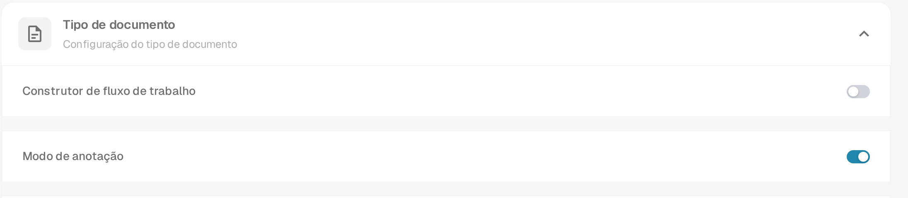
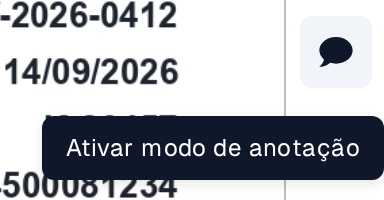
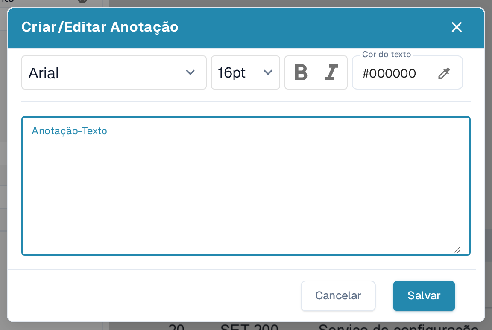
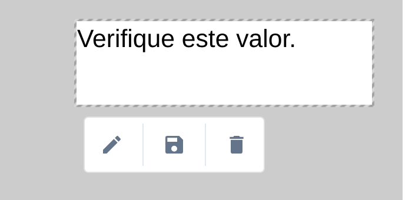
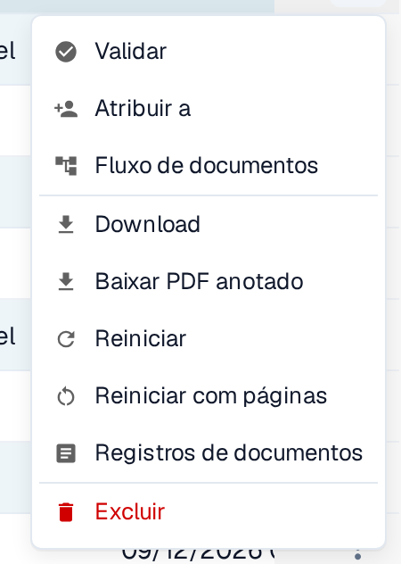

# Modo de anotação

O Modo de anotação permite colocar notas diretamente num documento durante a validação. Pode editar, mover ou eliminar uma nota antes de descarregar um PDF anotado. O administrador tem de ativar primeiro a funcionalidade para a organização. Se um documento tiver anotações, estas são incluídas na **exportação para o IDM**.

## Ativar o modo de anotação

Um administrador abre **Configurações → Módulo → Integração De Documentos → Tipo de documento** e ativa **Modo de anotação**. Se não vir o botão de anotação durante a validação, peça a um administrador para verificar esta definição e o seu acesso.

<figure><figcaption>
A secção Tipo de documento em Configurações → Módulo → Integração De Documentos. Neste exemplo, o Modo de anotação está ativado.
</figcaption></figure>


Tutorial do modo de anotação do DocBits: adicionar notas na validação e descarregar com ou sem anotações


## Adicionar uma anotação durante a validação

1. Abra o documento no [ecrã de validação](../../../../end-user-and-partner-section/end-user-section/validation-screen/README.md).
2. Selecione o **balão de fala** na barra de ferramentas à direita. A dica apresenta **Ativar modo de anotação**. Selecione-o novamente para sair do Modo de anotação.
3. Arraste sobre a parte do PDF onde a nota deve aparecer. Surge uma pequena barra de ferramentas junto à área selecionada.
4. Selecione a **caneta** para abrir **Criar/Editar Anotação**. Introduza a nota em **Anotação-Texto**. Pode escolher o tipo de letra e o tamanho, usar **Negrito** ou *Itálico* e definir a **Cor do texto**. **Cancelar** fecha a caixa de diálogo sem aplicar o texto; **Salvar** aplica-o à anotação selecionada.
5. Utilize o botão **disquete** na barra de ferramentas da anotação para guardar a alteração. Utilize o botão **caixote do lixo** para eliminar a anotação, se já não for necessária.

<figure><figcaption>
Abra o Modo de anotação a partir da barra de ferramentas de validação.
</figcaption></figure>

<figure><figcaption>
A barra de ferramentas aparece depois de selecionar uma área no PDF.
</figcaption></figure>

<figure><figcaption>
Escreva e formate a nota na caixa de diálogo da anotação. Nesta imagem o campo de texto está vazio.
</figcaption></figure>

<figure><figcaption>
Reveja a nota antes de selecionar Salvar. O texto «Verifique este valor.» é um exemplo inventado e não dados reais.
</figcaption></figure>

## Gerir uma anotação existente

Selecione uma nota no Modo de anotação para mostrar a sua barra de ferramentas. Utilize a **caneta** para alterar o texto ou a formatação, arraste a nota selecionada para a mover ou utilize o **caixote do lixo** para a eliminar. Pode criar várias anotações no mesmo documento. As anotações só estão visíveis enquanto o Modo de anotação está ativo e aparecem no PDF depois de guardadas. O botão de balão de fala não mostra se um documento já tem notas; ative o Modo de anotação para as ver.

<figure><figcaption>
Uma nota guardada continua visível no documento enquanto o Modo de anotação está ativo.
</figcaption></figure>

As anotações também estão disponíveis durante a [aprovação de documentos](../../global-settings/document-types/more-settings/approval/README.md), onde pode vê-las, adicioná-las e alterá-las. Para a saída através do Infor IDM, consulte [Exportar para o IDM](../../../../infor-integration-and-configuration/exporting-to-infor/exporting-to-idm.md).

## Descarregar o PDF original ou o PDF anotado

No **Painel**, abra o menu de ações de três pontos do documento. Escolha **Download** para o PDF original ou **Baixar PDF anotado** para a versão com as notas guardadas. A opção anotada aparece depois de uma anotação ter sido guardada. O menu oferece também **Validar** (abrir o ecrã de validação), **Atribuir a** (escolher uma pessoa), **Fluxo de documentos** (ver o [fluxo de documentos](../../../../end-user-and-partner-section/end-user-section/dashboard/document-flow.md)), **Reiniciar** (processar o documento novamente), **Registos de documentos** (ver a atividade) e **Excluir** (remover o documento). Utilize estas ações apenas quando pretender alterar ou inspecionar o documento.

<figure><figcaption>
Escolha a versão do PDF de que precisa no menu de ações do documento.
</figcaption></figure>
