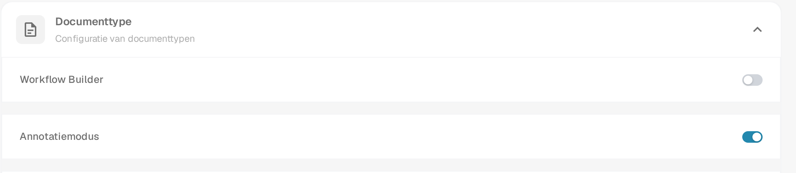
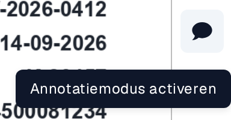
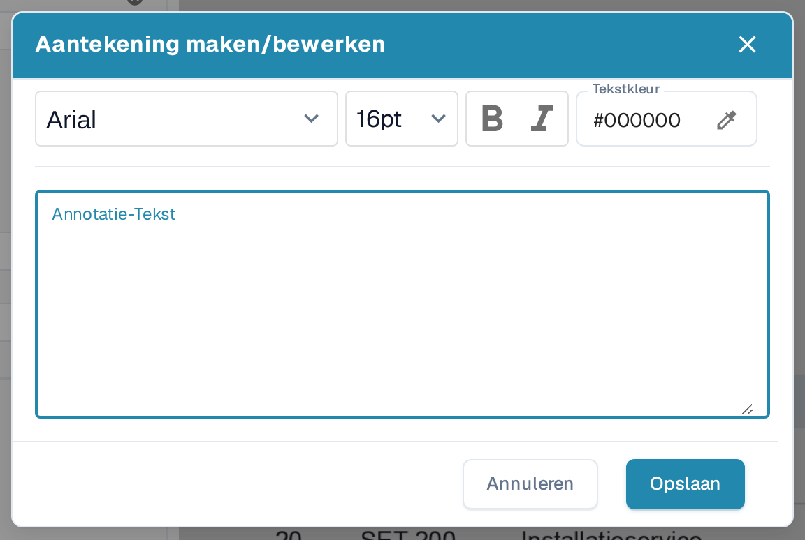
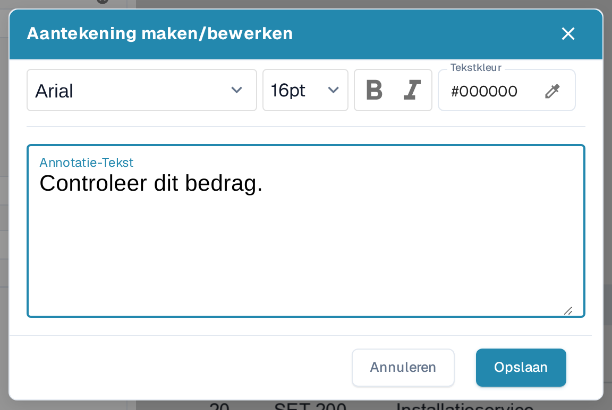
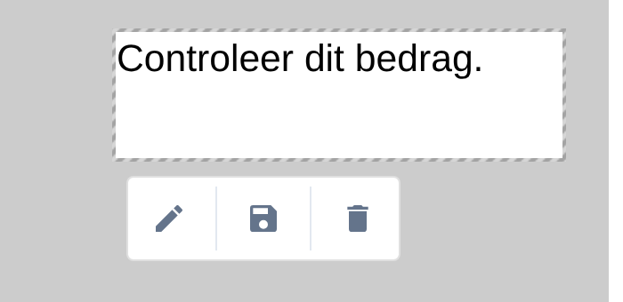
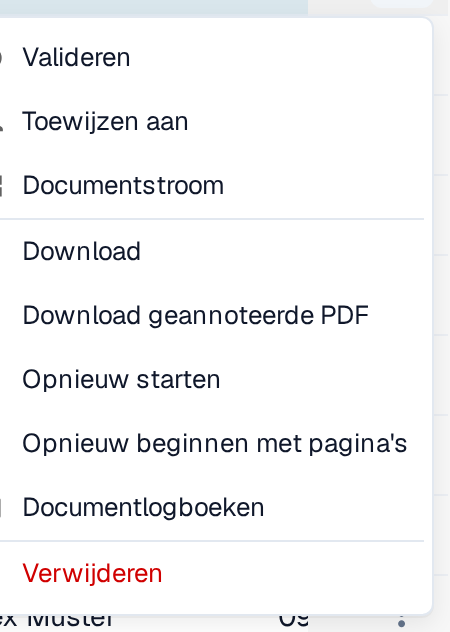

# Annotatiemodus

Met de Annotatiemodus kun je tijdens de validatie notities rechtstreeks op een document plaatsen. Je kunt een notitie bewerken, verplaatsen of verwijderen voordat je een geannoteerde PDF downloadt. Je beheerder moet de functie eerst voor de organisatie inschakelen. Bevat een document annotaties, dan worden deze opgenomen bij het **exporteren naar IDM**.

## Annotatiemodus inschakelen

Een beheerder opent **Instellingen → Module → Documentintegratie → Documenttype** en schakelt **Annotatiemodus** in. Zie je tijdens de validatie geen annotatieknop, vraag een beheerder dan deze instelling en je toegang te controleren.

<figure><figcaption>
Het gedeelte Documenttype onder Instellingen → Module → Documentintegratie. In dit voorbeeld staat Annotatiemodus aan.
</figcaption></figure>


DocBits Annotatiemodus-tutorial: notities toevoegen tijdens de validatie en downloaden met of zonder annotaties


## Een notitie toevoegen tijdens de validatie

1. Open het document op het [Validatiescherm](../../../../end-user-and-partner-section/end-user-section/validation-screen/README.md).
2. Selecteer de **spraakballon** in de werkbalk rechts. De tooltip ervan luidt **Annotatiemodus activeren**. Selecteer de knop opnieuw om de Annotatiemodus te verlaten.
3. Sleep over het deel van de PDF waar de notitie moet komen. Naast het geselecteerde gebied verschijnt een kleine werkbalk.
4. Selecteer de **pen** om **Aantekening maken/bewerken** te openen. Voer de notitie in bij **Annotatie-Tekst**. Je kunt het lettertype en de grootte kiezen, **Vet** of *Cursief* gebruiken en de **Tekstkleur** instellen. Met **Annuleren** sluit je het venster zonder de tekst toe te passen; met **Opslaan** wordt de tekst op de geselecteerde annotatie toegepast.
5. Gebruik de **diskette**-knop in de annotatiewerkbalk om je wijziging op te slaan. Gebruik de **prullenbak**-knop om de annotatie te verwijderen als je die niet meer nodig hebt.

<figure><figcaption>
Open de Annotatiemodus vanuit de validatiewerkbalk.
</figcaption></figure>

<figure><figcaption>
De werkbalk verschijnt nadat je een gebied op de PDF hebt geselecteerd.
</figcaption></figure>

<figure><figcaption>
Schrijf en formatteer de notitie in het annotatievenster.
</figcaption></figure>

<figure><figcaption>
Controleer de notitie voordat je Opslaan selecteert. De getoonde tekst is een verzonnen voorbeeld.
</figcaption></figure>

## Een bestaande notitie beheren

Selecteer een notitie in de Annotatiemodus om de werkbalk ervan te tonen. Gebruik de **pen** om de tekst of de opmaak te wijzigen, sleep de geselecteerde notitie om die te verplaatsen, of gebruik de **prullenbak** om die te verwijderen. Je kunt meerdere annotaties in hetzelfde document maken. Annotaties zijn alleen zichtbaar zolang de Annotatiemodus is ingeschakeld en verschijnen op de PDF nadat ze zijn opgeslagen. De spraakballon-knop laat niet zien of een document al notities bevat; schakel de Annotatiemodus in om ze te zien.

<figure><figcaption>
Een opgeslagen notitie blijft zichtbaar op het document in de Annotatiemodus.
</figcaption></figure>

Annotaties zijn ook beschikbaar tijdens de [goedkeuring van documenten](../../global-settings/document-types/more-settings/approval/README.md); daar kun je ze bekijken, toevoegen en wijzigen. Zie voor uitvoer via Infor IDM [Exporteren naar IDM](../../../../infor-integration-and-configuration/exporting-to-infor/exporting-to-idm.md).

## De originele of geannoteerde PDF downloaden

Open op het **Dashboard** het actiemenu met de drie stippen van het document. Kies **Download** voor de originele PDF of **Download geannoteerde PDF** voor de versie met opgeslagen notities. De geannoteerde optie verschijnt nadat een annotatie is opgeslagen. Het menu biedt ook **Valideren** (het validatiescherm openen), **Toewijzen aan** (een persoon kiezen), **Documentstroom** (de [documentstroom](../../../../end-user-and-partner-section/end-user-section/dashboard/document-flow.md) bekijken), **Opnieuw starten** (het document opnieuw verwerken), **Documentlogboeken** (activiteit bekijken) en **Verwijderen** (het document verwijderen). Gebruik die acties alleen als je het document wilt wijzigen of controleren.

<figure><figcaption>
Kies de PDF-versie die je nodig hebt in het actiemenu van het document.
</figcaption></figure>
