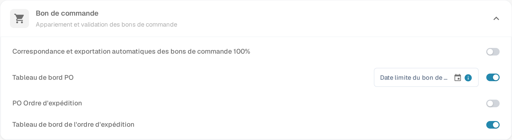

# Paramètres de commande d'expédition PO

## **Aperçu**

La section **Commande d'expédition PO** fournit un aperçu de l'état de livraison et de facturation des articles de commande d'achat correspondants. Cette section apparaît dans l'écran de **Correspondance de commande d'achat** lorsque la fonctionnalité est activée.

## **Comment activer**

Pour activer cette fonctionnalité :

1. Allez dans **Paramètres** → **Module**.
2. Ouvrez la section **Bon de commande** (*Appariement et validation des bons de commande*).
3.  Activez l'option **PO Ordre d'expédition**.

    
<figure><figcaption>
Paramètres → Module → Bon de commande
</figcaption></figure>

Cette même section contient deux autres interrupteurs : **Tableau de bord PO** ajoute un tableau de bord des bons de commande à la navigation, et **Tableau de bord de l'ordre d'expédition** ajoute un tableau de bord des ordres d'expédition qui liste les livraisons entrantes par ligne de commande.

## **Où cela apparaît**

Une fois activée, la section PO Ordre d'expédition devient visible dans l'interface de Correspondance de commande d'achat.

### **PO Ordre d'expédition - Descriptions des champs**

* **ID de l'article** Identifie l'article spécifique dans la commande d'achat.
* **Numéro de livraison** Numéro de référence pour l'expédition ou la livraison.
* **Quantité expédiée** Quantité qui a été livrée ou reçue.
* **Quantité facturée** Quantité qui a déjà été facturée.
* **Quantité ouverte à la facturation** Quantité encore ouverte à la facturation (calculée comme _Quantité expédiée - Quantité facturée_).
* **Barre de progression et pourcentage**
  * Montre combien de la quantité expédiée a été concordée avec les factures.
  * Commence à 0% pour les nouvelles commandes d'achat.
  * Se met à jour de manière cumulative à travers plusieurs factures.
  * Reflète le progrès total des articles facturés par rapport aux articles expédiés.
* **Date de livraison promise** La date de livraison prévue pour l'article de la commande d'achat.
*   **Indicateur de retard**

    Affiche le nombre de jours de retard de livraison basé sur la **Date de livraison promise**.
