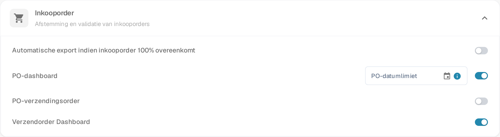
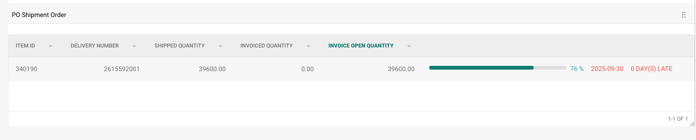

# PO Verzendingsorder Instelling

## **Overzicht**

De sectie **PO Verzendingsorder** geeft een overzicht van de leverings- en factureringsstatus voor overeenkomende items van de inkooporder. Deze sectie verschijnt binnen het scherm **Inkooporder Matching** wanneer de functie is ingeschakeld.

## **Hoe in te schakelen**

Om deze functie te activeren:

1. Ga naar **Instellingen** → **Module**.
2. Open de sectie **Inkooporder** (*Afstemming en validatie van inkooporders*).
3.  Schakel de optie **PO-verzendingsorder** in.

    
<figure><figcaption>
Instellingen → Module → Inkooporder
</figcaption></figure>

Dezelfde sectie bevat nog twee schakelaars: **PO-dashboard** voegt een dashboard voor inkooporders toe aan de navigatie, en **Verzendorder Dashboard** voegt een dashboard voor verzendorders toe dat inkomende leveringen per inkooporderregel toont.

## **Waar het verschijnt**

Eenmaal ingeschakeld, wordt de sectie PO-verzendingsorder zichtbaar in de interface Inkooporder Matching.\

<figure><figcaption></figcaption></figure>

### **PO-verzendingsorder – Veldbeschrijvingen**

* **Item ID** Identificeert het specifieke item in de inkooporder.
* **Leveringsnummer** Referentienummer voor de zending of levering.
* **Verzonden Hoeveelheid** Hoeveelheid die is geleverd of ontvangen.
* **Gefactureerde Hoeveelheid** Hoeveelheid die al is gefactureerd.
* **Openstaande Factuurhoeveelheid** Hoeveelheid die nog openstaat voor facturering (berekend als _Verzonden Hoeveelheid - Gefactureerde Hoeveelheid_).
* **Voortgangsbalk en Percentage**
  * Toont hoeveel van de verzonden hoeveelheid is gematcht met facturen.
  * Begint bij 0% voor nieuwe inkooporders.
  * Wordt cumulatief bijgewerkt over meerdere facturen.
  * Weerspiegelt de totale voortgang van gefactureerde versus verzonden items.
* **Verwachte Leveringsdatum** De verwachte leveringsdatum voor het PO-item.
*   **Late Indicator**

    Geeft het aantal dagen weer dat de levering te laat is op basis van de **Verwachte Leveringsdatum**.
