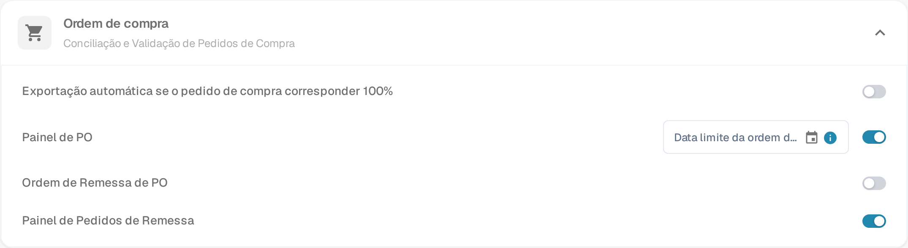

# Configuração do Pedido de Envio de PO

## **Visão Geral**

A seção **Pedido de Envio de PO** fornece uma análise do status de entrega e faturamento dos itens do Pedido de Compra correspondentes. Esta seção aparece dentro da tela de **Correspondência de Pedido de Compra** quando o recurso está habilitado.

## **Como Habilitar**

Para ativar este recurso:

1. Vá para **Configurações** → **Módulo**.
2. Abra a seção **Ordem de compra** (*Conciliação e Validação de Pedidos de Compra*).
3.  Ative a opção **Ordem de Remessa de PO**.

    
<figure><figcaption>
Configurações → Módulo → Ordem de compra
</figcaption></figure>

A mesma seção contém mais dois interruptores: **Painel de PO** adiciona à navegação um painel de pedidos de compra, e **Painel de Pedidos de Remessa** adiciona um painel de pedidos de remessa que lista as entregas recebidas por item do pedido de compra.

## **Onde Aparece**

Uma vez habilitada, a seção Ordem de Remessa de PO se torna visível na interface de Correspondência de Pedido de Compra.

### **Ordem de Remessa de PO – Descrições dos Campos**

* **ID do Item** Identifica o item específico no pedido de compra.
* **Número de Entrega** Número de referência para o envio ou entrega.
* **Quantidade Enviada** Quantidade que foi entregue ou recebida.
* **Quantidade Faturada** Quantidade que já foi faturada.
* **Quantidade em Aberto para Faturamento** Quantidade ainda em aberto para faturamento (calculada como _Quantidade Enviada - Quantidade Faturada_).
* **Barra de Progresso e Porcentagem**
  * Mostra quanto da quantidade enviada foi correspondida com faturas.
  * Começa em 0% para novos POs.
  * Atualiza cumulativamente em várias faturas.
  * Reflete o progresso total de itens faturados versus enviados.
* **Data de Entrega Prometida** A data de entrega esperada para o item do PO.
*   **Indicador de Atraso**

    Mostra o número de dias de atraso na entrega com base na **Data de Entrega Prometida**.
