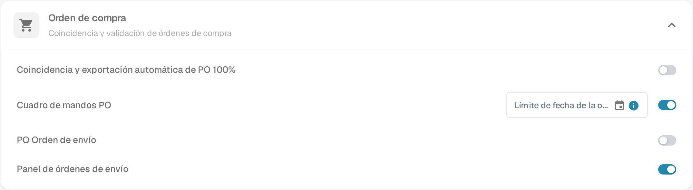

# Configuración de Orden de Envío de PO

## **Resumen**

La sección de **Orden de Envío de PO** proporciona un desglose del estado de entrega y facturación de los elementos de la Orden de Compra coincidentes. Esta sección aparece dentro de la pantalla de **Coincidencia de Orden de Compra** cuando la función está habilitada.

## **Cómo Habilitar**

Para activar esta función:

1. Ve a **Ajustes** → **Módulo**.
2. Abre la sección **Orden de compra** (*Coincidencia y validación de órdenes de compra*).
3.  Activa la opción **PO Orden de envío**.

    
<figure><figcaption>
Ajustes → Módulo → Orden de compra
</figcaption></figure>

Esta misma sección incluye otros dos interruptores: **Cuadro de mandos PO** añade a la navegación un cuadro de mandos de órdenes de compra, y **Panel de órdenes de envío** añade un panel que lista las entregas entrantes por posición de la orden de compra.

## **Dónde Aparece**

Una vez habilitada, la sección de PO Orden de envío se hace visible en la interfaz de Coincidencia de Orden de Compra.

### **PO Orden de envío – Descripción de Campos**

* **ID de Artículo** Identifica el artículo específico en la orden de compra.
* **Número de Entrega** Número de referencia para el envío o entrega.
* **Cantidad Enviada** Cantidad que ha sido entregada o recibida.
* **Cantidad Facturada** Cantidad que ya ha sido facturada.
* **Cantidad Abierta en Factura** Cantidad aún pendiente de facturación (calculada como _Cantidad Enviada - Cantidad Facturada_).
* **Barra de Progreso y Porcentaje**
  * Muestra cuánto de la cantidad enviada ha sido coincidente con facturas.
  * Comienza en 0% para nuevas POs.
  * Se actualiza acumulativamente a través de múltiples facturas.
  * Refleja el progreso total de artículos facturados vs. enviados.
* **Fecha de Entrega Prometida** La fecha de entrega esperada para el artículo de la PO.
*   **Indicador de Retraso**

    Muestra el número de días que la entrega se retrasa según la **Fecha de Entrega Prometida**.
