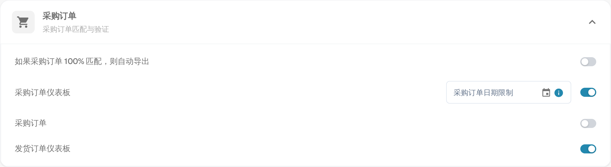
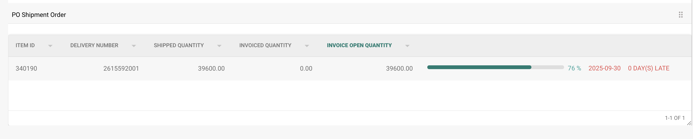

# PO 发运订单设置

## **概述**

**PO Shipment Order（采购订单发运订单）**部分会显示已匹配采购订单行项目的交付和开票状态明细。启用此功能后，该部分会显示在**采购订单匹配**界面中。

## **如何启用**

启用此功能：

1. 前往**设置** → **模块**。
2. 打开**采购订单**部分（*采购订单匹配与验证*）。
3. 启用**采购订单**选项。

    
<figure><figcaption>
设置 → 模块 → 采购订单
</figcaption></figure>

该部分还包含两个相关开关：**采购订单仪表板**会在导航中添加采购订单仪表板，**发货订单仪表板**则添加一个按采购订单行项目列出收货情况的发货订单仪表板。

## **显示位置**

启用后，**PO Shipment Order**部分会显示在采购订单匹配界面中。

<figure><figcaption></figcaption></figure>

### **PO Shipment Order – 字段说明**

* **Item ID**\
  标识采购订单中的特定行项目。
* **Delivery Number**\
  发运或交付的参考编号。
* **Shipped Quantity**\
  已交付或接收的数量。
* **Invoiced Quantity**\
  已开票的数量。
* **Invoice Open Quantity**（发票未结数量）\
  仍待开票的数量（计算方式为 _Shipped Quantity – Invoiced Quantity_）。
* **Progress Bar and Percentage**（进度条和百分比）
  * 显示已与发票匹配的发运数量。
  * 新建采购订单的进度从 0% 开始。
  * 随着多张发票的处理，进度会累计更新。
  * 反映已开票数量相对于发运数量的总体进度。
* **Promised Delivery Date**（承诺交货日期）\
  该采购订单行项目的预计交付日期。
*   **Late Indicator**

    根据**Promised Delivery Date**（承诺交货日期）显示交付逾期的天数。
