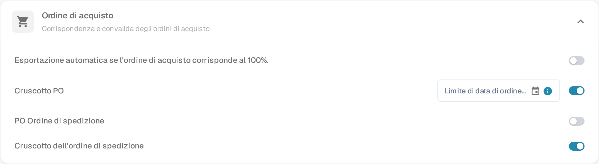

# Impostazione dell'Ordine di Spedizione PO

## **Panoramica**

La sezione **Ordine di Spedizione PO** fornisce una panoramica dello stato di consegna e fatturazione degli elementi dell'Ordine di Acquisto corrispondenti. Questa sezione appare all'interno dello schermo di **Corrispondenza dell'Ordine di Acquisto** quando la funzionalità è abilitata.

## **Come Abilitare**

Per attivare questa funzionalità:

1. Vai su **Impostazioni** → **Modulo**.
2. Apri la sezione **Ordine di acquisto** (*Corrispondenza e convalida degli ordini di acquisto*).
3.  Abilita l'opzione **PO Ordine di spedizione**.

    
<figure><figcaption>
Impostazioni → Modulo → Ordine di acquisto
</figcaption></figure>

La stessa sezione contiene altri due interruttori: **Cruscotto PO** aggiunge alla navigazione un cruscotto degli ordini di acquisto, mentre **Cruscotto dell'ordine di spedizione** aggiunge un cruscotto che elenca le consegne in arrivo per singola riga dell'ordine di acquisto.

## **Dove Appare**

Una volta abilitata, la sezione PO Ordine di spedizione diventa visibile nell'interfaccia di Corrispondenza dell'Ordine di Acquisto.

### **PO Ordine di spedizione – Descrizioni dei Campi**

* **ID Articolo** Identifica l'articolo specifico nell'ordine di acquisto.
* **Numero di Consegna** Numero di riferimento per la spedizione o consegna.
* **Quantità Spedita** Quantità che è stata consegnata o ricevuta.
* **Quantità Fatturata** Quantità che è già stata fatturata.
* **Quantità Aperta in Fattura** Quantità ancora aperta per la fatturazione (calcolata come _Quantità Spedita - Quantità Fatturata_).
* **Barra di Avanzamento e Percentuale**
  * Mostra quanto della quantità spedita è stata abbinata alle fatture.
  * Parte dal 0% per i nuovi PO.
  * Si aggiorna cumulativamente attraverso più fatture.
  * Riflette il progresso totale degli articoli fatturati rispetto a quelli spediti.
* **Data di Consegna Promessa** La data di consegna prevista per l'articolo dell'ordine di acquisto.
*   **Indicatore di Ritardo**

    Mostra il numero di giorni di ritardo della consegna in base alla **Data di Consegna Promessa**.
