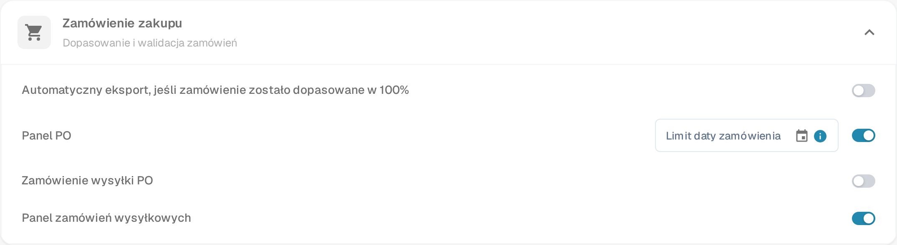

# Ustawienia zamówienia wysyłki PO

## **Przegląd**

Sekcja **Zamówienie wysyłki PO** zawiera szczegółowe informacje dotyczące statusu dostawy i faktur dla dopasowanych pozycji zamówienia zakupu. Ta sekcja pojawia się w ramach ekranu **Dopasowanie zamówienia zakupu**, gdy funkcja jest włączona.

## **Jak włączyć**

Aby aktywować tę funkcję:

1. Przejdź do **Ustawienia** → **Moduł**.
2. Otwórz sekcję **Zamówienie zakupu** (*Dopasowanie i walidacja zamówień*).
3.  Włącz opcję **Zamówienie wysyłki PO**.

    
<figure><figcaption>
Ustawienia → Moduł → Zamówienie zakupu
</figcaption></figure>

Ta sama sekcja zawiera jeszcze dwa przełączniki: **Panel PO** dodaje do nawigacji panel zamówień zakupu, a **Panel zamówień wysyłkowych** dodaje panel zamówień wysyłkowych, który wyświetla przychodzące dostawy dla każdej pozycji zamówienia zakupu.

## **Gdzie się pojawia**

Po włączeniu sekcja Zamówienie wysyłki PO staje się widoczna w interfejsie Dopasowanie zamówienia zakupu.

### **Zamówienie wysyłki PO – Opisy pól**

* **ID pozycji** Identyfikuje konkretną pozycję w zamówieniu zakupu.
* **Numer dostawy** Numer referencyjny dla przesyłki lub dostawy.
* **Ilość wysłana** Ilość dostarczona lub odebrana.
* **Ilość zafakturowana** Ilość, która została już zafakturowana.
* **Ilość otwarta na fakturę** Ilość nadal otwarta do faktury (obliczana jako _Ilość wysłana - Ilość zafakturowana_).
* **Pasek postępu i procent**
  * Pokazuje, ile z wysłanej ilości zostało dopasowane do faktur.
  * Rozpoczyna się od 0% dla nowych zamówień zakupu.
  * Aktualizuje się kumulatywnie w przypadku wielu faktur.
  * Odzwierciedla ogólny postęp zafakturowanych w porównaniu z wysłanymi pozycjami.
* **Obiecana data dostawy** Przewidywana data dostawy dla pozycji zamówienia.
*   **Wskaźnik opóźnienia**

    Wyświetla liczbę dni opóźnienia dostawy na podstawie **Obiecanej daty dostawy**.
