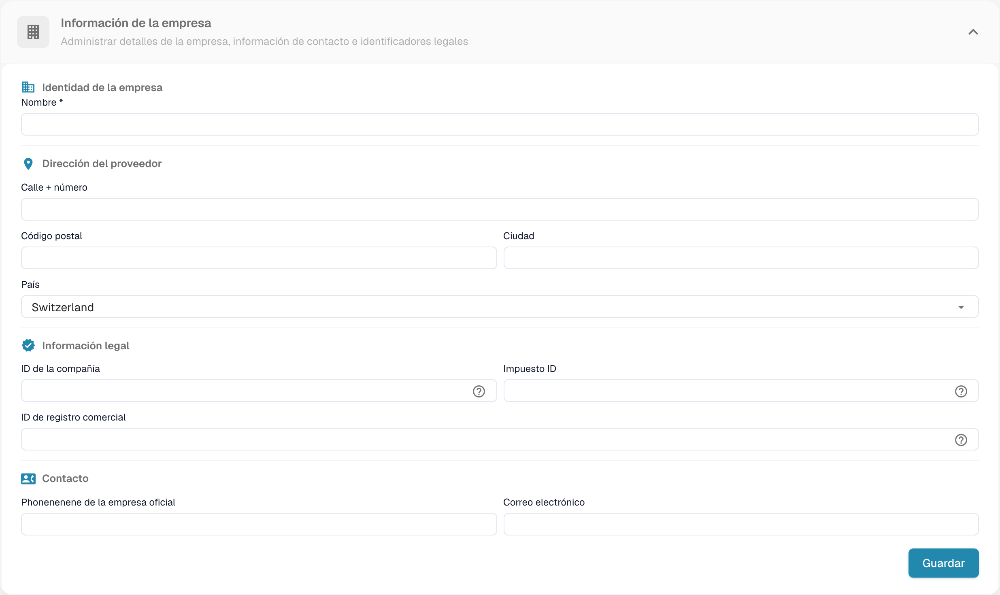
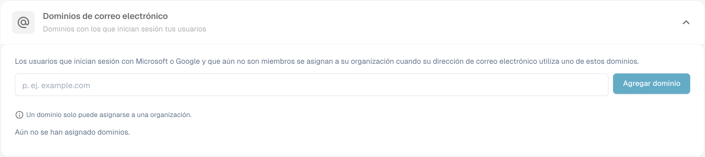
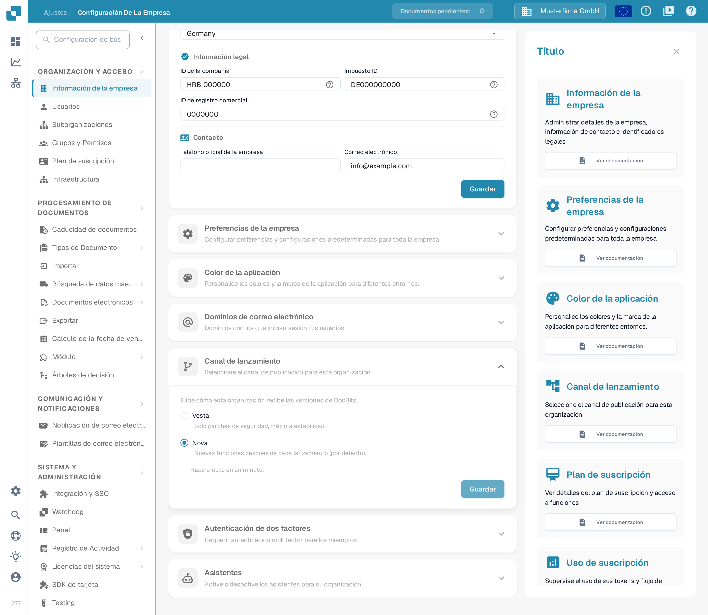
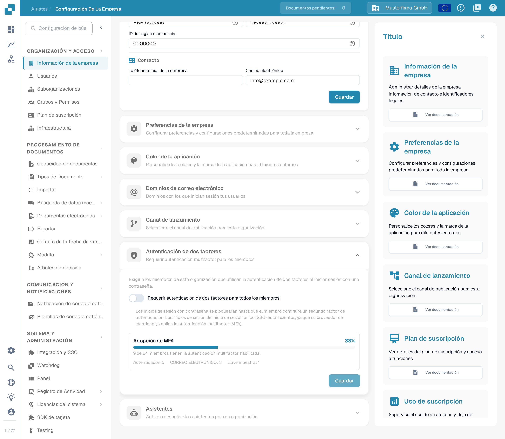
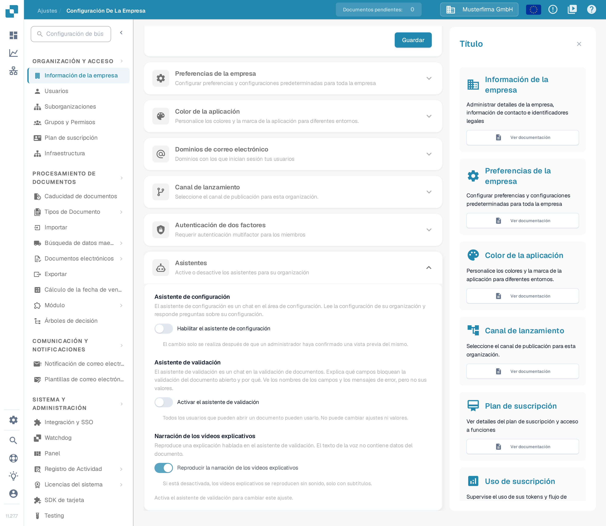

# Información de la empresa

## Tutorial en vídeo: Empresa, suscripción y auditoría


Información de la empresa, plan de suscripción y registros de auditoría en DocBits


El vídeo muestra la información y las preferencias de la empresa, el plan de suscripción, la actividad de inicio de sesión y los registros de auditoría.

<figure><figcaption>
Información de la empresa con los valores de la organización ocultos.
</figcaption></figure>

La página Company Information le permite gestionar el perfil de su empresa, las preferencias y los detalles de la suscripción. Está organizada en las siguientes secciones:

## Información de la empresa

Esta sección contiene los datos principales de su empresa, agrupados en cuatro áreas:

### Identificación de la empresa

* **Nombre** *(obligatorio)*: el nombre legal de su empresa.

### Dirección

* **Calle + número**: la dirección postal de su empresa.
* **Código postal**: código postal.
* **Ciudad**: nombre de la ciudad.
* **País**: seleccione su país en la lista desplegable.

### Información legal

* **ID de la compañía**: un identificador único de su empresa, utilizado para integraciones y como referencia interna.
* **Impuesto ID**: su número de identificación fiscal para la elaboración de informes financieros.
* **ID de registro comercial**: su número de registro mercantil para la documentación legal.

### Contacto

* **Teléfono oficial de la empresa**: el número de teléfono principal de su empresa.
* **Correo electrónico**: la dirección de correo electrónico principal utilizada para las comunicaciones oficiales.

Después de introducir o actualizar cualquier campo, haga clic en **Guardar** para aplicar los cambios. Los iconos **?** junto a los identificadores legales muestran orientación adicional sobre el campo. Seleccione el encabezado de la sección para expandir o contraer el formulario.

## Dominios de correo electrónico

Los administradores de la organización pueden abrir **Ajustes → Información de la empresa → Dominios de correo electrónico** para gestionar los dominios utilizados para la asignación automática de organización. Cuando una persona inicia sesión con Microsoft o Google y todavía no es miembro de una organización, DocBits puede asignarla a esta organización si su dirección de correo electrónico utiliza uno de los dominios indicados. Un dominio solo puede pertenecer a una organización.

<figure><figcaption>
Configuración de dominios de correo de la empresa.
</figcaption></figure>

Introduzca únicamente el dominio, por ejemplo `example.com`, en el campo de entrada y seleccione **Agregar dominio** o pulse Intro. El primer dominio se convierte en el dominio principal. Si hay más dominios en la lista, utilice **Hacer primario** en otra fila para cambiarlo, o el icono de la papelera para eliminar un dominio. Los errores, como un dominio no válido, un proveedor de correo electrónico personal o un dominio ya asignado a otra organización, aparecen debajo del campo de entrada. **Todavía no hay dominios asignados** significa que esta organización no tiene ninguna regla de dominio.

Antes de añadir un dominio, compruebe qué organización debe recibir los nuevos inicios de sesión. Para gestionar las pertenencias existentes, continúe con [Usuarios](../groups-users-and-permissions/users/README.md).

## Canal de lanzamiento

La sección **Canal de lanzamiento** controla cómo recibe esta organización las actualizaciones de DocBits. Seleccione el encabezado de la sección para expandirla.

<figure><figcaption>
La sección Canal de lanzamiento. Vesta solo entrega parches de seguridad, Nova entrega las nuevas funciones después de cada versión (opción predeterminada).
</figcaption></figure>

* **Vesta**: solo parches de seguridad, máxima estabilidad.
* **Nova**: nuevas funciones después de cada lanzamiento (por defecto).

Solo hay un canal activo a la vez. Elija **Vesta** cuando la organización deba mantenerse en una versión probada y solo recibir correcciones; elija **Nova** para obtener las nuevas funciones con cada versión. El cambio se aplica en un minuto. Seleccione **Guardar** para aplicarlo.

## Autenticación de dos factores

La sección **Autenticación de dos factores** controla si los miembros de esta organización deben usar la autenticación multifactor (MFA) al iniciar sesión con una contraseña. Seleccione el encabezado de la sección para expandirla o contraerla.

<figure><figcaption>
La sección Autenticación de dos factores. El requisito está desactivado; el panel Adopción de MFA muestra cuántos miembros ya usan un segundo factor.
</figcaption></figure>

Active **Requerir autenticación de dos factores para todos los miembros** para exigir que cada miembro de la organización confirme su inicio de sesión con contraseña mediante un segundo factor. A partir de ese momento, los inicios de sesión con contraseña se bloquean hasta que el miembro configure un segundo factor. Los inicios de sesión mediante inicio de sesión único (SSO) están exentos: su proveedor de identidad ya aplica la MFA.

El panel **Adopción de MFA** muestra en qué medida se usa ya un segundo factor en la organización: el porcentaje y el número de miembros con la autenticación multifactor habilitada, desglosados por aplicación de autenticación, correo electrónico y llave maestra (passkey). Seleccione **Guardar** para aplicar un requisito modificado.

La guía paso a paso para exigir la MFA, incluido lo que ven los miembros al iniciar sesión, se describe en [Autenticación de Dos Factores (Admin)](two-factor-authentication.md).

## Asistentes

La sección **Asistentes** permite activar o desactivar los asistentes para su organización. Seleccione el encabezado de la sección para expandirla.

<figure><figcaption>
La sección Asistentes con sus tres ajustes. El asistente de configuración y el asistente de validación están desactivados; la narración solo puede cambiarse cuando el asistente de validación está activado.
</figcaption></figure>

* **Asistente de configuración**: es un chat en el área de configuración. Lee la configuración de su organización y responde preguntas sobre ella. Active **Habilitar el asistente de configuración**. El cambio solo se realiza después de que un administrador haya confirmado una vista previa del mismo.
* **Asistente de validación**: es un chat en la validación de documentos. Explica qué campos bloquean la validación del documento abierto y por qué; ve los nombres de los campos y los mensajes de error, pero no sus valores. Active **Activar el asistente de validación**; todos los usuarios que pueden abrir un documento pueden usarlo, pero no puede cambiar ajustes ni valores.
* **Narración de los vídeos explicativos**: reproduce una explicación hablada en el asistente de validación. El texto de la voz no contiene datos del documento. Active **Reproducir la narración de los vídeos explicativos** para oírla; si está desactivada, los vídeos se reproducen sin sonido, solo con subtítulos. Este ajuste solo puede cambiarse cuando el asistente de validación está activado.

Para saber cómo abrir el asistente de configuración y qué puede preguntarle, continúe con [Asistente de configuración](settings-assistant.md).

## Preferencias de la empresa

Configure los ajustes predeterminados de toda la empresa:

* **Patrón de fecha**: elija cómo se muestran las fechas en todo DocBits (por ejemplo, `%m/%d/%Y`, `%d.%m.%Y`).
* **Formato de cantidad**: seleccione el formato numérico de los importes (por ejemplo, Deutsch para `1.000,00`, English para `1,000.00`).
* **Nuevo cuadro de diálogo de información sobre la versión**: active o desactive si los usuarios ven una notificación cuando se publica una nueva versión de DocBits.

Haga clic en **Guardar** después de realizar los cambios.

## Color de la aplicación

Personalice el color principal de la interfaz de DocBits. Resulta útil para distinguir visualmente entornos diferentes (por ejemplo, dev frente a producción).

* **Color**: introduzca un código de color hexadecimal (por ejemplo, `#2388AE`) o utilice el selector de color.
* Haga clic en **Guardar** para aplicarlo o en **Restablecer** para restaurar el color predeterminado.

## Plan de suscripción

Consulte sus planes de suscripción activos y sus detalles:

* **Nombre del plan**: el nombre de cada plan activo (por ejemplo, DocBits, DocFlow Users, DocSearch).
* **días restantes**: cuántos días quedan hasta que caduque el plan.
* **Start Date / End Date**: el período de la suscripción.
* **Número de usuarios**: número total de usuarios de su organización.
* **Número de suborganizaciones**: número de suborganizaciones configuradas.
* **Número de proveedores**: número de proveedores registrados.

## Uso de la suscripción

Supervise su consumo mensual de tokens y de flujos de trabajo:

| Columna | Descripción |
|--------|-------------|
| **Tipo** | El tipo de uso (Document o Workflow). |
| **From / To** | Las fechas del período de facturación. |
| **Tokens utilizados** | Número de tokens consumidos en el período actual. |
| **Tokens restantes** | Tokens que aún están disponibles en el período actual. |

Utilice el botón **Seleccionar** para filtrar por intervalos de fechas específicos.
