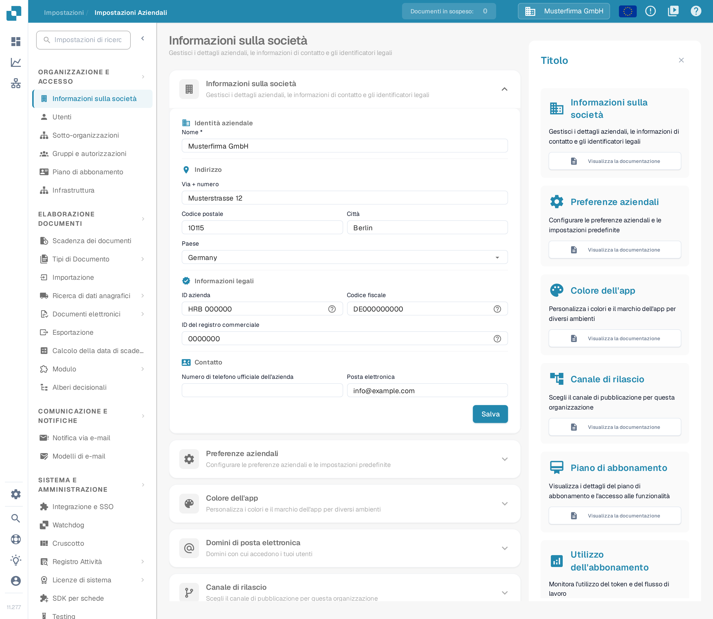
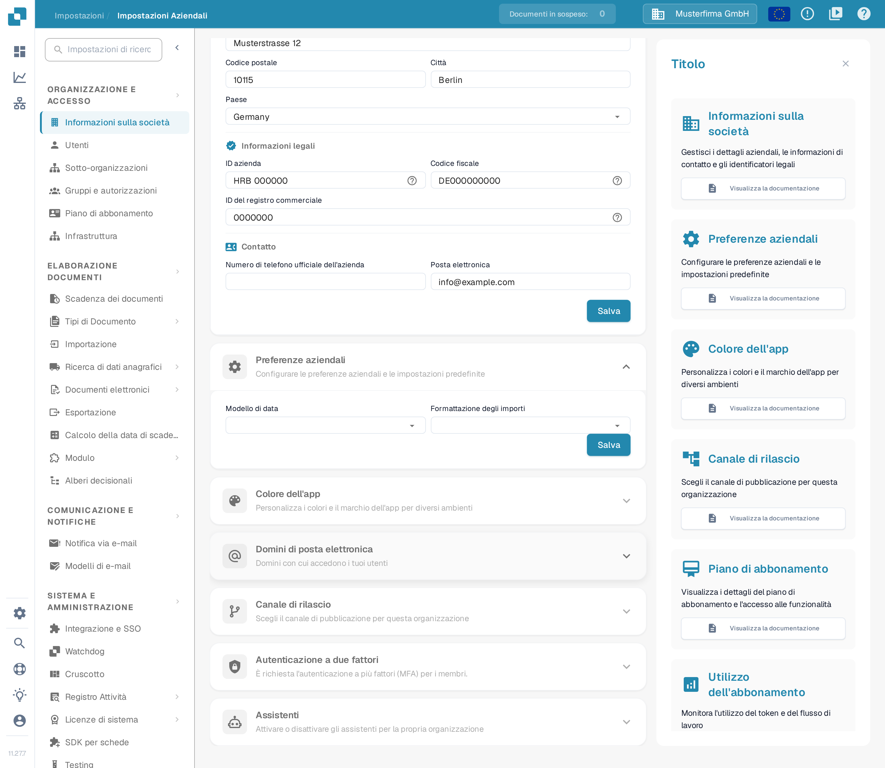
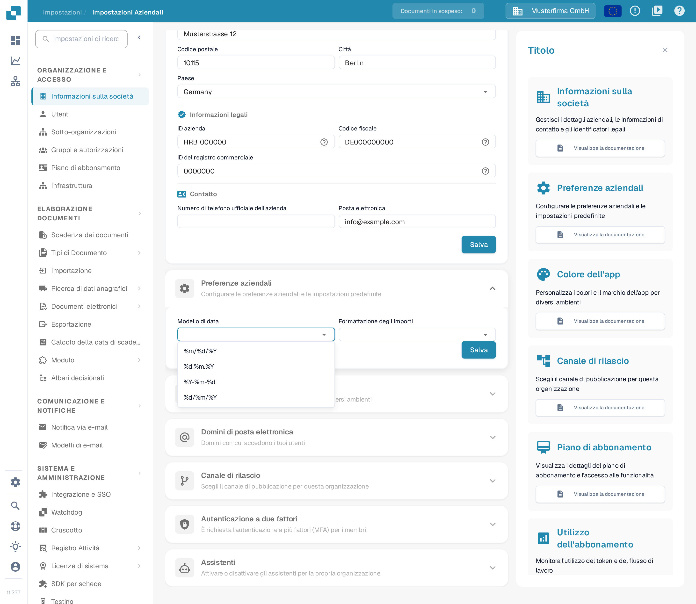
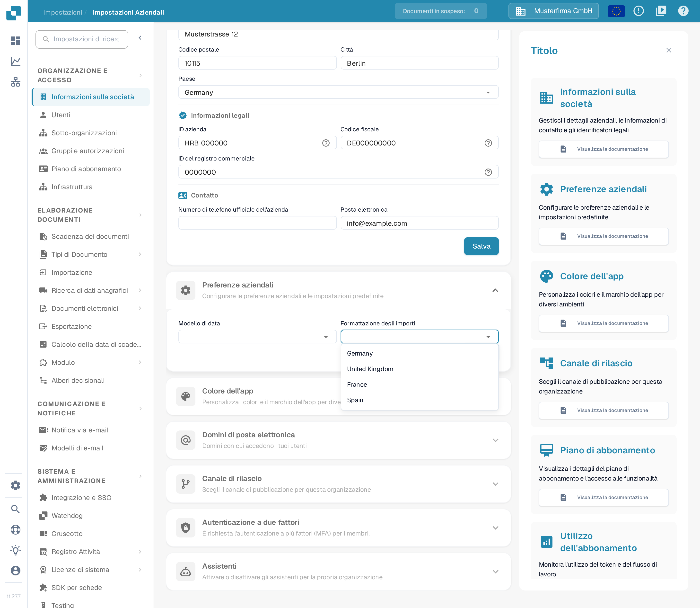
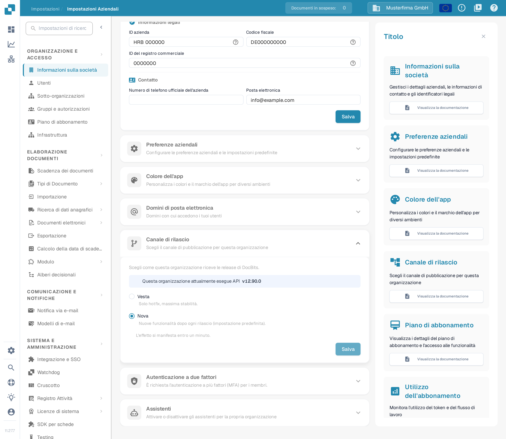

# Preferenze aziendali

## Video tutorial: Società, abbonamento e controllo


Informazioni e preferenze dell'azienda, piano di abbonamento e registri di controllo in DocBits


Il video mostra le informazioni e le preferenze dell'azienda, il piano di abbonamento, le attività di accesso e i registri di controllo.

Le **Preferenze aziendali** stabiliscono come vengono visualizzate le date e gli importi per la tua organizzazione. Si trovano in **Impostazioni → Informazioni sulla società**. Espandi **Preferenze aziendali** per vedere le due impostazioni.

<figure><figcaption>
La pagina Informazioni sulla società. Le Preferenze aziendali sono una sezione più in basso.
</figcaption></figure>

<figure><figcaption>
Le due preferenze aziendali con il proprio pulsante Salva. I dati dell'organizzazione mostrati nelle immagini sono dati di esempio inventati.
</figcaption></figure>

## Scegliere un modello di data

Apri **Modello di data** e scegli l'ordine e il separatore con cui devono essere visualizzate le date. Per esempio, `%d.%m.%Y` mostra giorno, mese e anno a quattro cifre separati da punti; `%m/%d/%Y` mette il mese all'inizio e usa le barre. La lista in DocBits mostra tutti i modelli disponibili.

<figure><figcaption>
Scegli il modello di data adatto alla tua organizzazione.
</figcaption></figure>

## Scegliere la formattazione degli importi

Apri **Formattazione degli importi** e scegli il formato regionale usato dalla tua organizzazione. Nella cattura di esempio la lista contiene Germany, United Kingdom, France e Spain; questi nomi sono dati di esempio inventati e non l'elenco completo dei formati.

<figure><figcaption>
Scegli un formato regionale per gli importi. Le voci mostrate sono dati di esempio inventati.
</figcaption></figure>

Fai clic su **Salva** all'interno di **Preferenze aziendali** dopo aver modificato un'impostazione. È un pulsante diverso da quello della sezione **Informazioni sulla società** sopra.

## Canale di rilascio

L'interruttore che mostrava un avviso per le nuove versioni non esiste più. DocBits rileva ormai automaticamente le nuove versioni, quindi non serve alcuna finestra popup per restare aggiornati.

La distribuzione delle versioni è gestita dalla sezione **Canale di rilascio** nella stessa pagina **Informazioni sulla società**. In alto la sezione mostra la versione API che la tua organizzazione sta usando in quel momento, con il testo «Questa organizzazione attualmente esegue API», e sotto scegli come la tua organizzazione riceve le release di DocBits: **Vesta** (solo hotfix, massima stabilità) o **Nova** (nuove funzionalità dopo ogni rilascio, l'impostazione predefinita). La modifica si salva con il pulsante **Salva** della sezione e ha effetto entro un minuto, come indica il testo «L'effetto si manifesta entro un minuto.»

<figure><figcaption>
Scegli Vesta o Nova e salva la modifica nella sezione stessa. Il numero di versione mostrato è un dato di esempio inventato.
</figcaption></figure>
