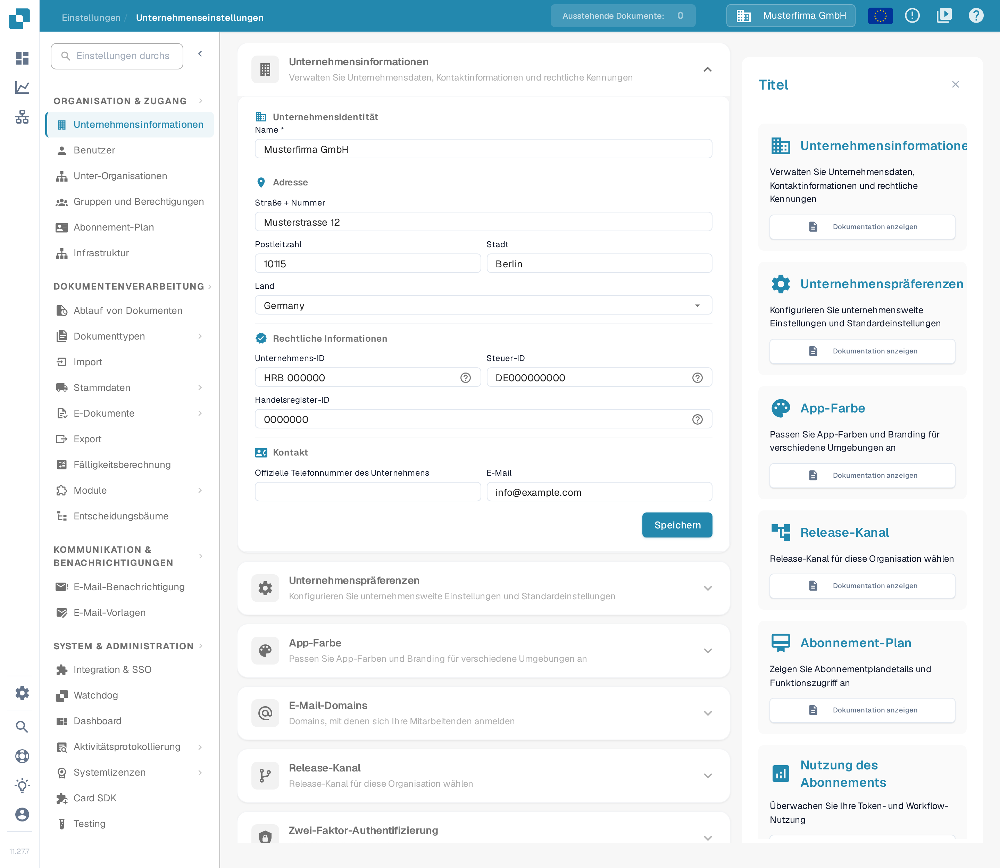
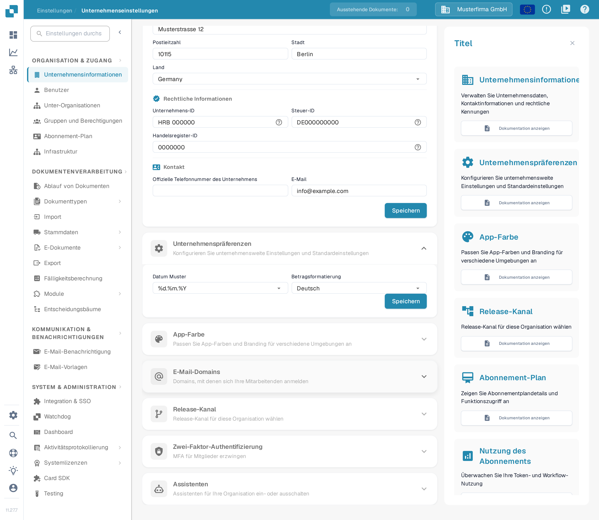
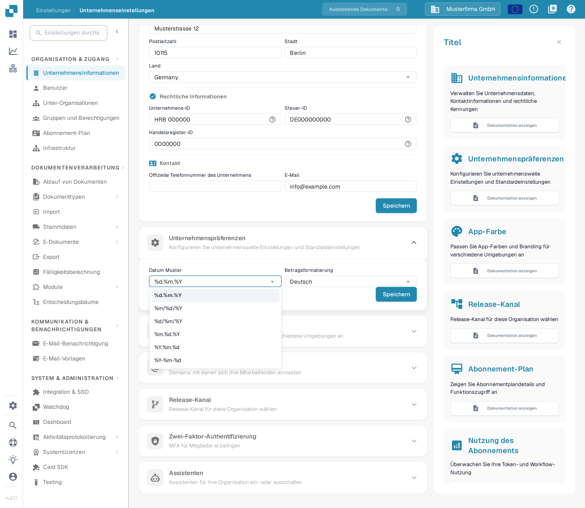
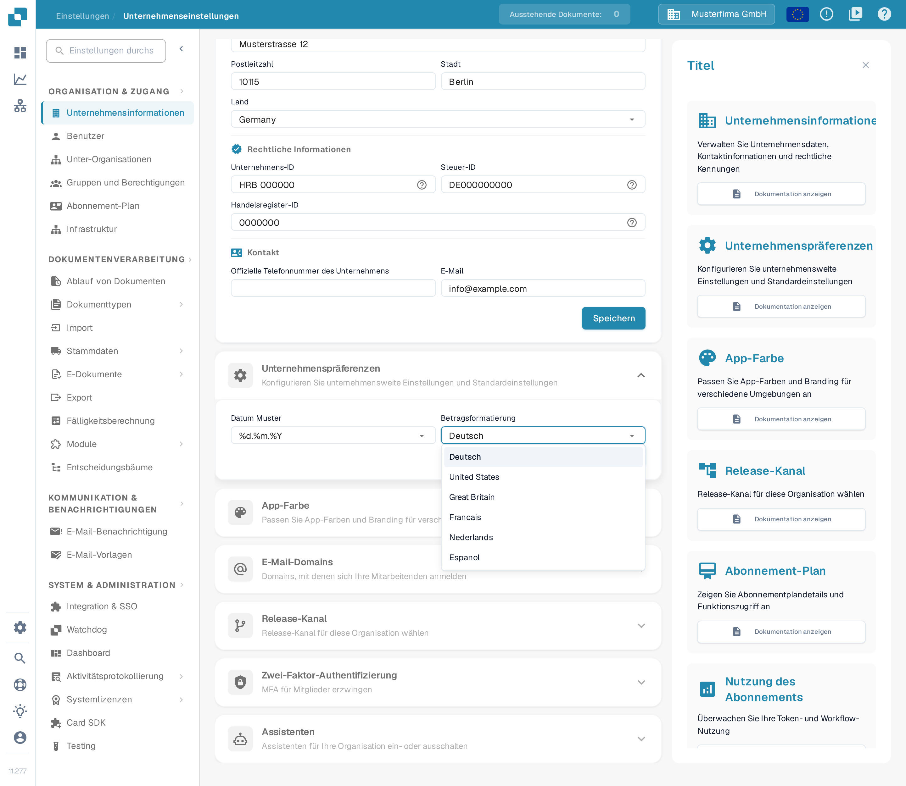

# Unternehmenspräferenzen

## Video-Tutorial: Unternehmen, Abonnement und Audit


Unternehmensinformationen, Abonnement-Plan und Audit-Protokoll in DocBits


Das Video zeigt die Unternehmensinformationen und -präferenzen, den Abonnement-Plan, die Anmeldeaktivität und das Audit-Protokoll.

Die **Unternehmenspräferenzen** steuern, wie Datumsangaben und Beträge für Ihre Organisation angezeigt werden. Sie finden den Abschnitt unter **Einstellungen → Unternehmensinformationen**. Klappen Sie **Unternehmenspräferenzen** auf, um die beiden Einstellungen zu sehen.

<figure><figcaption>
Die Seite Unternehmensinformationen. Die Unternehmenspräferenzen liegen weiter unten.
</figcaption></figure>

<figure><figcaption>
Die beiden Unternehmenspräferenzen mit ihrem eigenen Knopf Speichern. Die eingestellten Werte sind Beispieldaten einer Testorganisation.
</figcaption></figure>

## Datumsmuster wählen

Öffnen Sie **Datum Muster** und wählen Sie die Reihenfolge und das Trennzeichen für angezeigte Datumsangaben. `%d.%m.%Y` zeigt zum Beispiel Tag, Monat und das vierstellige Jahr mit Punkten; `%m/%d/%Y` stellt den Monat voran und verwendet Schrägstriche. Die Liste in DocBits zeigt alle verfügbaren Muster.

<figure><figcaption>
Wählen Sie das Datumsmuster, das zu Ihrer Organisation passt.
</figcaption></figure>

## Betragsformatierung wählen

Öffnen Sie **Betragsformatierung** und wählen Sie das regionale Format, das Ihre Organisation verwendet. Die Liste enthält unter anderem **Deutsch**, **United States**, **Great Britain** und **Francais**.

<figure><figcaption>
Wählen Sie ein regionales Betragsformat.
</figcaption></figure>

Klicken Sie nach einer Änderung im Abschnitt **Unternehmenspräferenzen** auf **Speichern**. Dieser Knopf ist nicht derselbe wie der Knopf **Speichern** im Abschnitt **Unternehmensinformationen** darüber.

## Release-Kanal

Den früheren Schalter **Neuer Versionsinfo-Dialog** gibt es nicht mehr. DocBits erkennt neue Versionen heute automatisch; ein Popup ist nicht mehr nötig, um auf dem aktuellen Stand zu bleiben.

Die Auslieferung von Versionen steuert der Abschnitt **Release-Kanal** auf derselben Seite **Unternehmensinformationen**. Er zeigt oben die aktuell genutzte API-Version, sofern die API sie meldet, und die geltende Release-Spur: **Vesta** (nur Hotfixes, maximale Stabilität) oder **Nova** (neue Features nach jedem Release).

<figure><figcaption>
Der Abschnitt Release-Kanal mit den beiden Release-Spuren. Ausgewählt ist Nova, die Standard-Spur.
</figcaption></figure>
