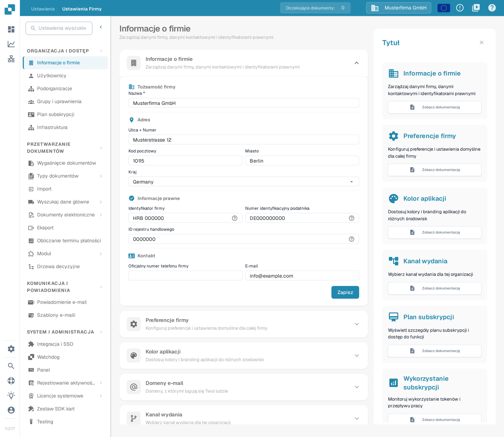
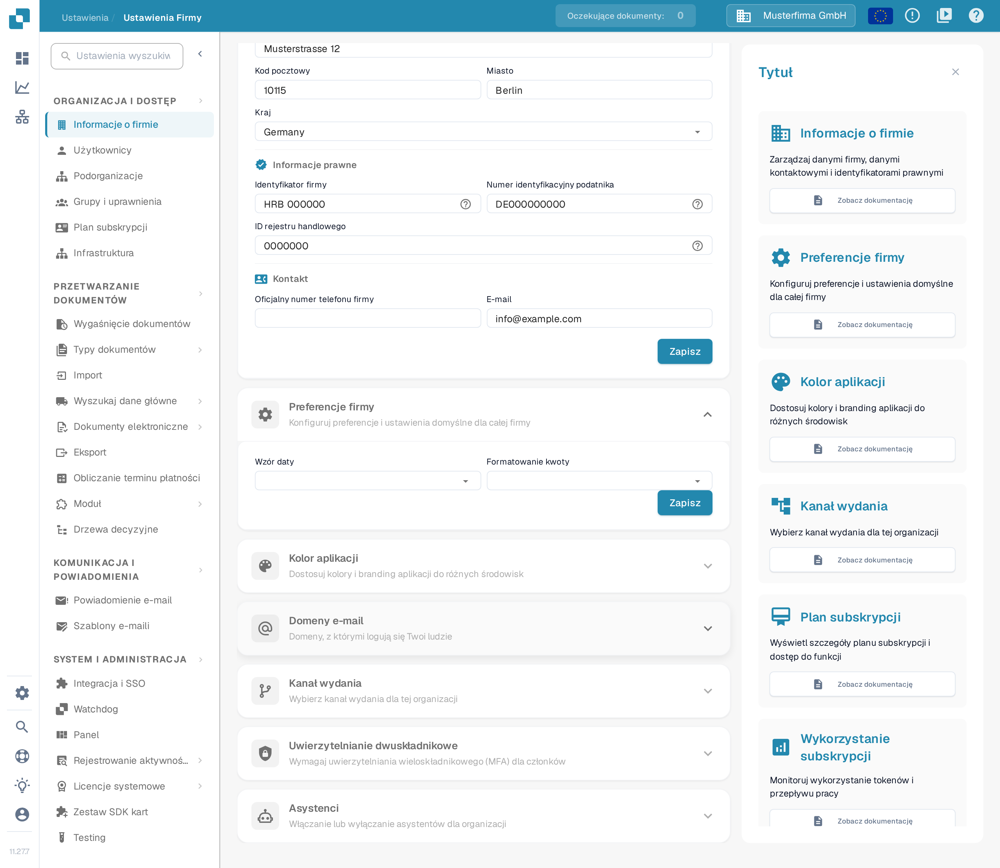
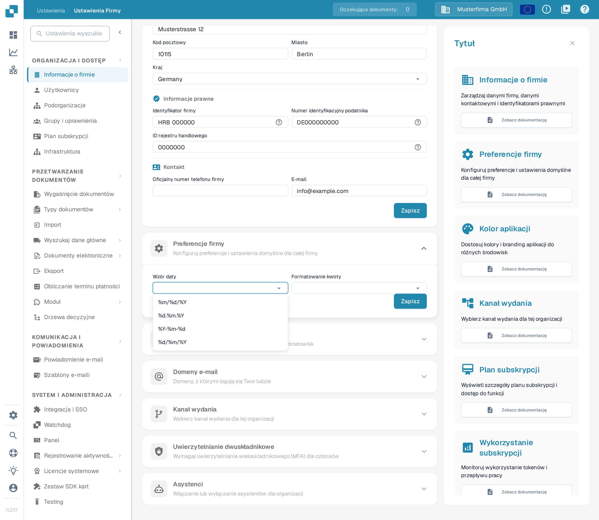
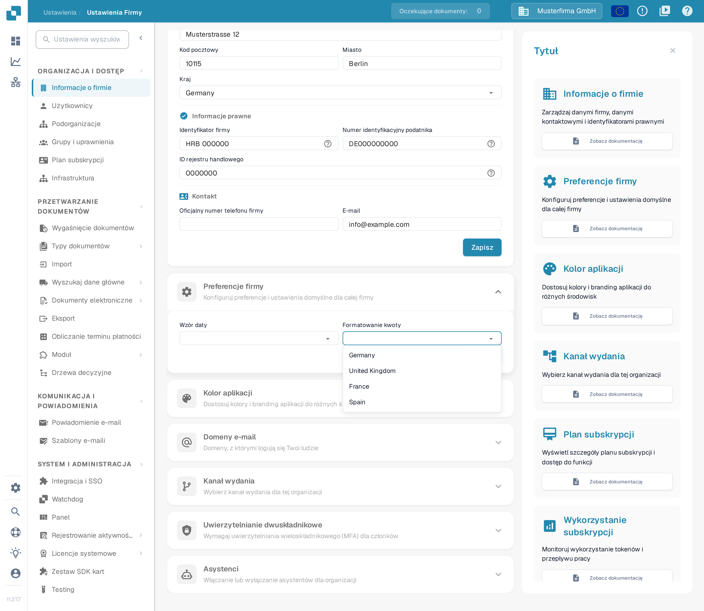
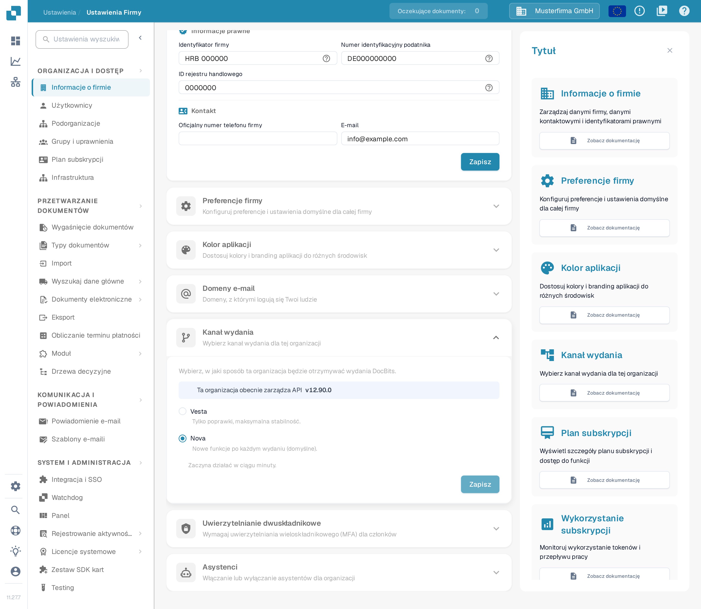

# Preferencje firmy

## Samouczek wideo: Firma, subskrypcja i audyt


Informacje o firmie, plan subskrypcji i dzienniki audytu w DocBits


Film pokazuje informacje i preferencje firmy, plan subskrypcji, aktywność logowania oraz dzienniki audytu.

Sekcja **Preferencje firmy** określa, jak daty i kwoty są wyświetlane w Twojej organizacji. Znajdziesz ją w **Ustawienia → Informacje o firmie**. Rozwiń **Preferencje firmy**, aby zobaczyć dwa ustawienia.

<figure><figcaption>
Strona Informacje o firmie. Preferencje firmy to sekcja niżej na stronie.
</figcaption></figure>

<figure><figcaption>
Dwie preferencje firmy z własnym przyciskiem Zapisz. Dane organizacji widoczne na zrzutach to wymyślone dane przykładowe.
</figcaption></figure>

## Wybór wzoru daty

Otwórz **Wzór daty** i wybierz kolejność oraz separator wyświetlanych dat. Na przykład `%d.%m.%Y` pokazuje dzień, miesiąc i czterocyfrowy rok oddzielone kropkami, a `%m/%d/%Y` stawia miesiąc na początku i używa ukośników. Lista w DocBits pokazuje wszystkie dostępne wzory.

<figure><figcaption>
Wybierz wzór daty odpowiedni dla Twojej organizacji.
</figcaption></figure>

## Wybór formatowania kwot

Otwórz **Formatowanie kwoty** i wybierz format regionalny używany w Twojej organizacji. Na zrzucie przykładu lista zawiera Germany, United Kingdom, France i Spain; te nazwy są wymyślonymi danymi przykładowymi, a nie pełną listą formatów.

<figure><figcaption>
Wybierz regionalny format kwot. Widoczne pozycje to wymyślone dane przykładowe.
</figcaption></figure>

Po zmianie kliknij **Zapisz** wewnątrz **Preferencje firmy**. To inny przycisk niż **Zapisz** w sekcji **Informacje o firmie** powyżej.

## Kanał wydania

Przełącznik, który wyświetlał powiadomienie o nowej wersji, już nie istnieje. DocBits wykrywa nowe wersje automatycznie, więc nie potrzebujesz okna popup, aby być na bieżąco.

O sposobie dostarczania wydań decyduje sekcja **Kanał wydania** na tej samej stronie **Informacje o firmie**. U góry sekcja pokazuje wersję API, z której obecnie korzysta Twoja organizacja, a poniżej wybierasz kanał wydań DocBits: **Vesta** (tylko poprawki, maksymalna stabilność) albo **Nova** (nowe funkcje po każdym wydaniu, ustawienie domyślne). Zmianę zapiszesz przyciskiem **Zapisz** w samej sekcji; zgodnie z tekstem «Zaczyna działać w ciągu minuty.» nowy kanał działa w ciągu minuty.

<figure><figcaption>
Wybierz Vesta albo Nova i zapisz zmianę w samej sekcji. Numer wersji na zrzucie jest przykładowy i wymyślony.
</figcaption></figure>
